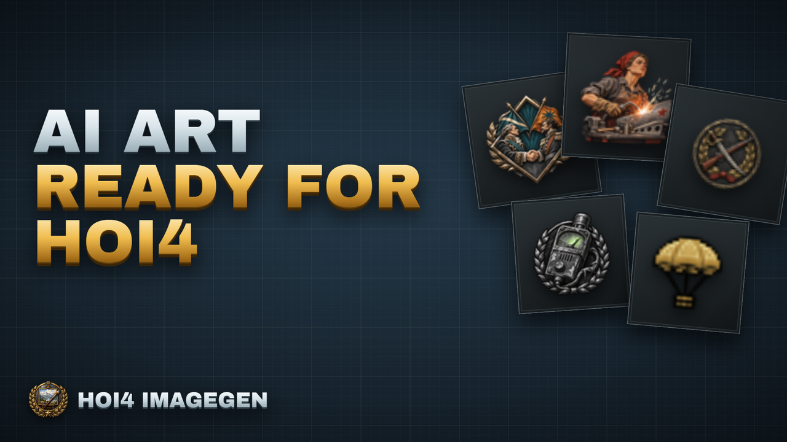
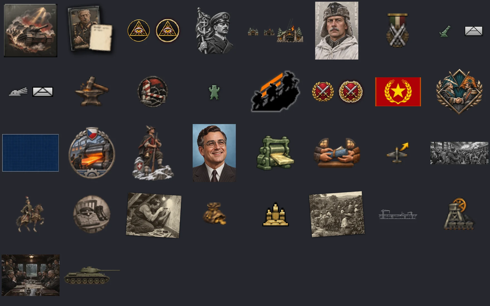
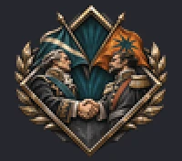
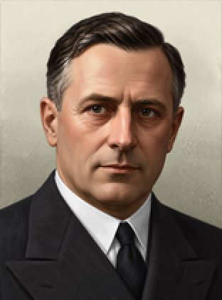
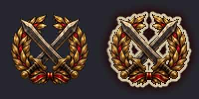
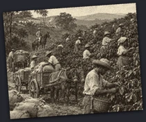
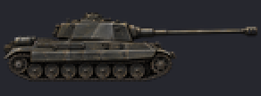

<p align="center">
  
</p>

<h1 align="center">HOI4 Imagegen</h1>

<p align="center">
  An <a href="https://modelcontextprotocol.io/">MCP</a> server and command-line tool that make <em>Hearts of Iron IV</em> image assets at the exact size, naming and format the game expects.
</p>

<p align="center">
  <a href="https://github.com/klimPaskov/hoi4-imagegen-mcp/releases/latest"></a>
  <a href="LICENSE"></a>
  <a href="https://discord.gg/rAXesGcT2t"></a>
  <a href="https://www.youtube.com/@ChaosRedux"></a>
  <a href="https://ko-fi.com/klimpaskov"></a>
  <a href="https://github.com/klimPaskov/hoi4-imagegen-mcp/issues"></a>
</p>

<p align="center">
  <a href="#quick-start">Quick start</a> ·
  <a href="docs/gallery/big/README.md">Gallery</a> ·
  <a href="#tools">Tools</a> ·
  <a href="#providers-and-the-chatgpt-login">Providers</a> ·
  <a href="docs/how-to.md">How-to</a> ·
  <a href="docs/reference.md">Reference</a> ·
  <a href="docs/rules-and-terms.md">Rules and terms</a>
</p>

<p align="center">
  <a href="https://www.youtube.com/watch?v=4ko6f-icwDc"></a>
</p>

Focus icons, idea pictures, decision icons, technology pictures, event pictures, portraits, flags, counters, logos, animated sprites and more: 44 asset families, each with the canvas, frames, naming, processing and checks measured from the game itself.

> ### Part of the Agentic HOI4 Modding workflow
>
> HOI4 Imagegen is one piece of **[Agentic HOI4 Modding](https://github.com/klimPaskov/Agentic-HOI4-Modding)**, the full workflow for building HOI4 mods with a coding agent.
>
> * **[HOI4 Mod Setup](https://github.com/klimPaskov/HOI4-Mod-Setup/releases/latest)** installs HOI4 Imagegen into each mod project, writes the MCP entries for your coding tools and offers the ChatGPT sign-in.
> * **[Agentic HOI4 Modding](https://github.com/klimPaskov/Agentic-HOI4-Modding)**, the kit of skills, agents and an offline wiki, drives it: its art skills and agents plan the assets and call the `hoi4.image_*` tools.
> * **[HOI4 Agent Tools](https://github.com/klimPaskov/hoi4-agent-tools)** works beside it: the same agent writes focus trees, events and maps there, and HOI4 Imagegen's audit uses its engine to trace every sprite.

## What it does

You ask your agent for an asset. HOI4 Imagegen plans the job, shows the cost, calls an image provider, fits the result to the exact HOI4 canvas, runs the family's own processing, checks the file, lets a reviewer approve it and installs a real DDS or TGA file with a sprite snippet and a provenance record.

* **Every asset has a family.** The family alone selects the canvas, frames, naming, style references, processing and checks.
* **Measured from the game.** Sizes come from the installed HOI4 1.19.4.1, not from guesses. A focus icon is 100x88, a news picture 397x153, a flag 82x52.
* **Processing cannot be skipped.** Each family has a fixed chain that the tool appends itself.
* **Install is gated.** Validation passed, a review approved this exact file, and nothing changed since. Nothing is overwritten and nothing leaves the mod project.
* **Style from your mod first.** A plan picks style references from your own pinned styles and assets, then the kit's shelf, then vanilla art.

## Examples

Every image below was made by the tool on the ChatGPT login with version 0.3 or later, then processed and validated by it and passed by its check against the game's own art. They are shown on a dark tile, enlarged by whole numbers when small, and are not retouched.

[](docs/gallery/big/README.md)

| Focus icon (100x88) | Leader portrait (156x210) | Faction logo (two frames) |
|:---:|:---:|:---:|
|  |  |  |

| News event picture (397x153) | Report event card (210x176) | Technology picture (146x54) |
|:---:|:---:|:---:|
|  |  |  |

See many more in the [gallery](docs/gallery/big/README.md): every family beside vanilla references from the game, plus a section in the style of *The New Order*. It grows as more runs finish. The [documentation](docs/families.md) covers all 40 families, each with its canvas, the names the game looks up, the processing chain, the checks, an example call and a current example.

## Quick start

1. **Install it.** The easy way is [HOI4 Mod Setup](https://github.com/klimPaskov/HOI4-Mod-Setup/releases/latest) 0.9.2 or later: tick **Install hoi4-imagegen** on the image step. Setup downloads the [latest release](https://github.com/klimPaskov/hoi4-imagegen-mcp/releases/latest) (v0.3.3) for your computer, checks its SHA-256, installs it in your mod and then opens the ChatGPT sign-in in your browser by itself. Other backends are under **Use another backend**. To install by hand, download the archive for your platform from the [releases](https://github.com/klimPaskov/hoi4-imagegen-mcp/releases) (Windows, macOS and Linux, `SHA256SUMS` included) and unpack it somewhere on your `PATH`.
2. **Sign in once** with your ChatGPT account, and no API key is needed. Setup does this step for you. By hand it is one command, which opens the browser, with nothing to type or confirm:

   ```sh
   hoi4-imagegen login
   ```

3. **Check the setup** from your mod folder:

   ```sh
   hoi4-imagegen --project-root . doctor
   ```

4. **Connect your agent.** Setup writes this for you. By hand, put it in `.mcp.json` for Claude Code (Codex uses `.codex/config.toml`, see [the reference](docs/reference.md#by-hand)):

   ```json
   {
     "mcpServers": {
       "hoi4_imagegen": {
         "command": "hoi4-imagegen-mcp",
         "args": ["--project-root", "."]
       }
     }
   }
   ```

5. **Ask for an image**, for example "make a 156x210 portrait for the Atlantis focus". The tools are named `hoi4.image_*`. The [how-to](docs/how-to.md) walks through one asset from the plan to the install, and the [recipes](examples/recipes.md) cover sets, flags, report pictures and buildings with a ruined frame.

The binaries are unsigned, so Windows SmartScreen and macOS Gatekeeper may warn. Check a download with `SHA256SUMS` and `gh attestation verify`, as the [reference](docs/reference.md#install) describes.

## Tools

There are 21 tools. Seven plan families by group, and each takes a required `family` whose schema lists only that group's families.

| Tool | What it does |
|---|---|
| `hoi4.image_icon` | 19 icon families: focus, idea spirits, decisions, traits, medals, doctrines and more |
| `hoi4.image_picture` | 6 picture families: report and news events, category and operation pictures, technology, achievements |
| `hoi4.image_portrait` | 5 portrait families: leaders, commanders, operatives, scientists, advisor cards |
| `hoi4.image_flag` | The country flag in its three sizes |
| `hoi4.image_unit` | Counters, division emblems, buildings, faction and agency logos |
| `hoi4.image_interface` | Modifier icons, GUI textures, super events |
| `hoi4.image_animation` | 4 animated sprite families (`frameAnimatedSpriteType`): a pulsing blend glow, blended key frames, a scrolling strip and a turning icon. One base frame is generated and the other frames are derived from it, so they stay consistent |
| `hoi4.image_status`, `hoi4.image_families`, `hoi4.image_references` | Providers and setup, the family catalogue, reference images and style profiles |
| `hoi4.image_generate`, `hoi4.image_edit` | Run a stored plan, refine a candidate |
| `hoi4.image_process`, `hoi4.image_validate`, `hoi4.image_preview`, `hoi4.image_review` | Processing chain, checks, contact sheet, visual review |
| `hoi4.image_install`, `hoi4.image_ledger`, `hoi4.image_cancel` | The gated install, provenance, cancel and recover |
| `hoi4.image_login` | Opens the ChatGPT sign-in in the browser, for an agent or a setup tool |
| `hoi4.image_audit` | A read-only audit of the whole mod: sprite reuse across families, missing textures, undefined sprites, wrong canvas sizes |

Every tool is also on the command line: `hoi4-imagegen call <tool> '<json>'`. The [reference](docs/reference.md#tools) has the full table.

## Providers and the ChatGPT login

| Provider | Needs |
|---|---|
| **ChatGPT login (the default)** | `hoi4-imagegen login` once. Uses your own ChatGPT plan, no API key |
| OpenAI API | `OPENAI_API_KEY` |
| Google Gemini API | `GEMINI_API_KEY` or `GOOGLE_API_KEY` |
| fal | `FAL_KEY` |
| ComfyUI | an endpoint in the project config |

Once you have signed in, the ChatGPT login is the default provider on your machine. A provider named in a plan, a style profile or the project config wins. Keys come from the environment, or from the credential store where HOI4 Mod Setup saved them, and are never written into a project file.

Before you use the login, know that it calls a ChatGPT backend that OpenAI does not document for other tools, so it can change or be blocked without notice. Heavy use counts against your plan, and the consequences are yours. The risk note is shown as information at sign-in, and signing in accepts it. Every image runs on `gpt-6-luna`. The route asks for the highest reasoning effort the backend accepts, falls back to the backend's default when it refuses the named efforts, and records the effort each image ran at. Since 0.3.3 it sends up to three requests at once across your machine, and it drops to one at a time for six hours by itself after a sign-out by the server, a rate limit or a usage-limit answer. The route cannot force image quality or size, so check the pixels in the preview. Details and recorded evidence are in [docs/chatgpt-login.md](docs/chatgpt-login.md).

## More

* [How-to](docs/how-to.md): sign in, make a first image, fix problems
* [Asset gallery](docs/families.md): the 40 still families with real examples, and the [animated sprites](docs/families.md#animated-sprites)
* [Reference](docs/reference.md): families, processing chains, names the game looks up, style references, validation, install and project config
* [ChatGPT login](docs/chatgpt-login.md), [rules and terms](docs/rules-and-terms.md), [kit integration](docs/kit-integration.md), [test layers](docs/testing.md), [recipes](examples/recipes.md)

AI-generated art in a mod: disclosing it is recommended, the ledger records provider, model, date and prompt for every asset, and portraits of real people raise personal-rights questions. Read [rules and terms](docs/rules-and-terms.md).

## Upstream and license

`hoi4-imagegen-mcp` is a Rust rewrite of [Connected-Mate/gptimage](https://github.com/Connected-Mate/gptimage) (MIT). See [UPSTREAM.md](UPSTREAM.md) and [NOTICE](NOTICE). The sprite audit and `.gfx` registration link the shared HOI4 engine of [hoi4-agent-tools](https://github.com/klimPaskov/hoi4-agent-tools) (Apache License 2.0).

MIT. See [LICENSE](LICENSE), [NOTICE](NOTICE) and [UPSTREAM.md](UPSTREAM.md).
