# Asset gallery: all 40 families

Every example below was made by the tool itself on the [ChatGPT login](chatgpt-login.md) with version 0.3 or later: planned, generated, processed and validated by `hoi4-imagegen`, and passed by its check against the game's own art. Each is shown at its native size on a dark tile, enlarged by a whole number when small so the pixels stay crisp. Nothing is retouched. They are files the tool made, not in-game captures. The [big gallery](gallery/big/README.md) has many more per family beside vanilla references, and [`gallery/examples.json`](gallery/examples.json) lists the brief and build of each example here.

<p align="center"><a href="gallery/contact-sheet.webp">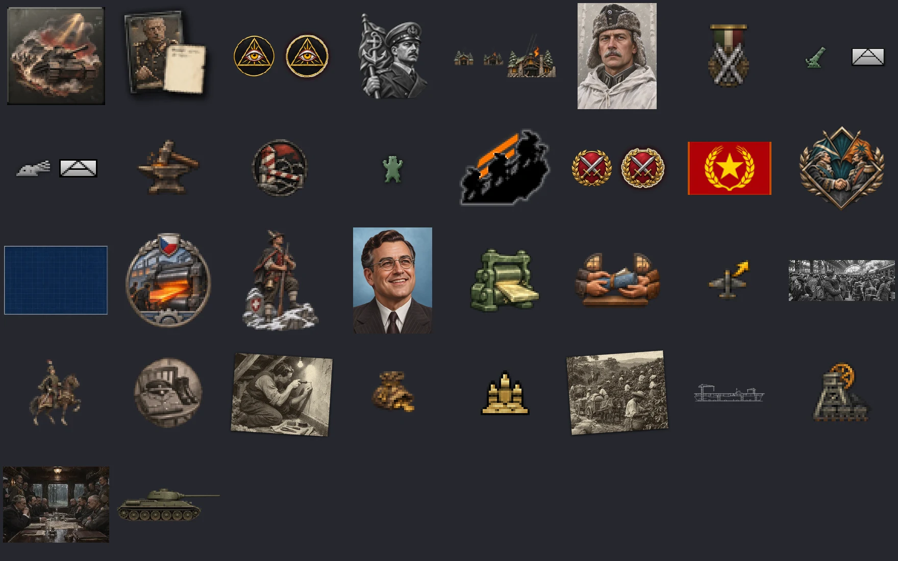</a></p>

## How to read an entry

* **Canvas and frames** are measured from the installed game, HOI4 1.19.4.1.
* **Names the game looks up** follow the vanilla evidence in `crates/imagegen-core/src/lookup.rs`, as fixed in v0.2.2. Where a script names the sprite in full the name is free. Where the game builds the name, the tool builds the same one and the install result's `script` field says what to write.
* **Processing** is the family's fixed chain. The tool appends it and you cannot skip it. The steps listed are the ones that ran on the example. The examples were made with version 0.2.0. Since 0.3.2 more families have their own chain: raid icons get vanilla's gold gradient, doctrine icons black units with a pale outline and glow, special project icons are redrawn as line art, counters and division emblems always end in the unit recipe, and a landmark's small strip is a flat orange pictogram. Since 0.3.4 agency upgrades are cut to vanilla's round, muted vignette with its darkened edge. The [reference](reference.md#processing-chains) lists every chain.
* **Checks** are the deterministic set that `hoi4.image_validate` always runs for the family. Composition and readability at game size go to the visual review.
* **Example call** is the one-call form (`approve: true` plans and generates together) as it was run for the image. `hoi4-imagegen call <tool> '<json>'` runs the same operation on the command line. The rest of the loop (process, validate, preview, review, install) is in the [how-to](how-to.md).
* The example mod's feature slug is `gallery`. Replace it and the asset name with your own.

## Contents

* [Icons](#icons) (`hoi4.image_icon`): [`agency_upgrade`](#agency_upgrade), [`bop_side`](#bop_side), [`commander_trait`](#commander_trait), [`decision`](#decision), [`decision_category_icon`](#decision_category_icon), [`doctrine`](#doctrine), [`focus`](#focus), [`idea_concern`](#idea_concern), [`idea_spirit`](#idea_spirit), [`medal`](#medal), [`mio_department`](#mio_department), [`mio_policy`](#mio_policy), [`mio_trait`](#mio_trait), [`officer_corps_spirit`](#officer_corps_spirit), [`operation_icon`](#operation_icon), [`personal_trait`](#personal_trait), [`raid`](#raid), [`special_project_icon`](#special_project_icon), [`state_modifier`](#state_modifier)
* [Pictures](#pictures) (`hoi4.image_picture`): [`achievement`](#achievement), [`decision_category_picture`](#decision_category_picture), [`news_event`](#news_event), [`operation_picture`](#operation_picture), [`report_event`](#report_event), [`technology`](#technology)
* [Portraits](#portraits) (`hoi4.image_portrait`): [`advisor_card`](#advisor_card), [`commander_portrait`](#commander_portrait), [`leader_portrait`](#leader_portrait), [`operative_portrait`](#operative_portrait), [`scientist_portrait`](#scientist_portrait)
* [Flags](#flags) (`hoi4.image_flag`): [`flag`](#flag)
* [Units, logos and buildings](#units-logos-and-buildings) (`hoi4.image_unit`): [`agency_logo`](#agency_logo), [`building`](#building), [`counter_large`](#counter_large), [`counter_small`](#counter_small), [`division_emblem`](#division_emblem), [`faction_logo`](#faction_logo)
* [Interface](#interface) (`hoi4.image_interface`): [`gui_texture`](#gui_texture), [`modifier_stat_icon`](#modifier_stat_icon), [`super_event`](#super_event)
* [Animated sprites](#animated-sprites) (`hoi4.image_animation`): [`anim_blend_glow`](#anim_blend_glow), [`anim_blend_keyframes`](#anim_blend_keyframes), [`anim_scroll`](#anim_scroll), [`anim_spin`](#anim_spin)

## Icons

Planned with `hoi4.image_icon`.

### agency_upgrade

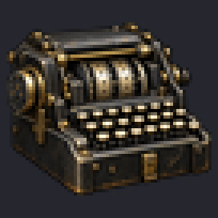

**Vanilla form (since 0.3.2, palette since 0.3.4).** Measured on the 15 vanilla upgrades (`agency_cryptology_1`, `agency_invisible_ink`, `agency_portable_radios`): a round disc whose whole face is one simple painted close-up, a semi-realistic 1930s or 1940s illustration. The disc is 52 px across on the 68 px canvas with a one-pixel soft edge, and its edge is darkened to about half the inner value. There is no ring or frame around it. The palette is pale and muted: mean saturation 0.249 and mean value 0.423 in the median file, gold and bronze tones on 11 percent of the disc. The 0.3.2 gallery's upgrades were darker, more saturated and warmer, busy rooms full of small objects. Since 0.3.4 the `vignette` recipe cuts any subject to vanilla's disc, brings its saturation, value and gold tones into vanilla's range and darkens its edge, the rule asks for a light, simple close-up, and the vanilla-match check refuses a saturated, warm medallion. The example above predates these rules and shows a loose object instead.

| | |
|---|---|
| Group and tool | icon, `hoi4.image_icon` |
| Canvas and frames | 68x68, 1 frame; DDS |
| Names the game looks up | the script names the sprite in full, so the name is free. The example installs `GFX_agency_cipher_bureau`. |
| Script | intelligence agency upgrade: picture = GFX_agency_cipher_bureau |
| Installed files (example) | `gfx/interface/operatives/icons/gallery/agency_cipher_bureau.dds` |
| Processing | recipe `icon` v1: trim, fit to the canvas with the profile margin, grayscale where the family needs it. Ran: `defringe` (erosion 1) → `trim_to_subject` → `fit_subject` (height 68, margin 2, width 68) |
| Checks | `size`, `alpha`, `opaque_canvas`, `fringe`, `margin`, `fill`, `checker`, `style`, `dds` |
| Made | 2026-11-02 on `gpt-6-luna` (high reasoning effort), image tool `gpt-image-2-codex`, quality medium, source 1254x1254 |
| Image SHA-256 | `a97b981f58597238d63aa5ebaf8406f59ebf6532c4877baa13ec3dafd528fe7d` |

```sh
hoi4-imagegen call hoi4.image_icon '{"family": "agency_upgrade", "feature_slug": "gallery", "asset": "cipher_bureau", "brief": "A mechanical rotor cipher machine with keys, painted in the dark, muted Hearts of Iron IV style", "approve": true, "idempotency_key": "gallery-agency_upgrade-1"}'
```

<details><summary>Vanilla evidence for the name</summary>

common/intelligence_agency_upgrades/intelligence_agency_upgrades.txt:73 picture = GFX_agency_airforce_department

</details>

### bop_side

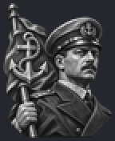

**Vanilla form (since 0.3.2).** Measured on the 86 vanilla 72x88 sides (`bop_FIN_mannerheim_good_side`, `bop_ITA_king_side`, `PRC_bop_left_side`): a greyscale head-and-shoulders portrait cut out with no backdrop, a silver bust on a small plinth, or for a side that is not a person a silver symbol in a laurel wreath. 61 of the 86 files are fully grey. The coloured ones are the `_improved` and `_max` state variants, which are left out of the references. Banners and loose objects are not the vanilla form.

| | |
|---|---|
| Group and tool | icon, `hoi4.image_icon` |
| Canvas and frames | 72x88, 1 frame; DDS |
| Names the game looks up | the script names the sprite in full, so the name is free. The example installs `GFX_bop_defenders_of_order`. |
| Script | balance of power side: icon = GFX_bop_defenders_of_order |
| Installed files (example) | `gfx/interface/bop/gallery/bop_defenders_of_order.dds` |
| Processing | recipe `icon` v1: trim, fit to the canvas with the profile margin, grayscale where the family needs it. Ran: `defringe` (erosion 1) → `trim_to_subject` → `fit_subject` (height 88, margin 2, width 72) |
| Checks | `size`, `alpha`, `opaque_canvas`, `fringe`, `margin`, `fill`, `checker`, `style`, `dds` |
| Made | 2026-11-02 on `gpt-6-luna` (high reasoning effort), image tool `gpt-image-2-codex`, quality medium, source 1254x1254 |
| Image SHA-256 | `01e54213b1beb429ad433c4c1528a65df160bbd8f373720e940c5878a593d741` |

```sh
hoi4-imagegen call hoi4.image_icon '{"family": "bop_side", "feature_slug": "gallery", "asset": "defenders_of_order", "brief": "A tall heater shield bearing a laurel wreath, upright, painted in the dark, muted Hearts of Iron IV style", "approve": true, "idempotency_key": "gallery-bop_side-1"}'
```

<details><summary>Vanilla evidence for the name</summary>

common/bop/PRC.txt:10 icon = GFX_PRC_bop_left_side

</details>

### commander_trait

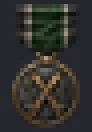

**Vanilla form (since 0.3.2).** Measured on the 81 vanilla army and navy leader traits at 23x33 (`trait_panzer_leader`, `trait_desert_fox`, `trait_admiral_marksman`): a small medal seen straight on. A short striped ribbon under a thin gold bar sits on top, and below it the symbol hangs as grey steel or silver metal, often on a bronze wreath. The symbol is never painted in its own colours (median saturation 0.02). The operative traits, shield plaques without a ribbon, are left out of the references. The tank above predates this rule and is not the vanilla form.

| | |
|---|---|
| Group and tool | icon, `hoi4.image_icon` |
| Canvas and frames | 23x33, 1 frame; DDS |
| Names the game looks up | the game builds the sprite name from the key of the object it belongs to. The example installs `GFX_trait_armour_expert`. |
| Script | name the unit leader trait armour_expert in common/unit_leader (its icon is GFX_trait_<trait key>) |
| Installed files (example) | `gfx/interface/traits/gallery/trait_armour_expert.dds` |
| Processing | recipe `icon` v1: trim, fit to the canvas with the profile margin, grayscale where the family needs it. Ran: `defringe` (erosion 1) → `trim_to_subject` → `fit_subject` (height 33, margin 1, width 23) |
| Checks | `size`, `alpha`, `opaque_canvas`, `fringe`, `margin`, `fill`, `checker`, `style`, `dds` |
| Made | 2026-11-02 on `gpt-6-luna` (high reasoning effort), image tool `gpt-image-2-codex`, quality medium, source 1047x1502 |
| Image SHA-256 | `0c11a7aebad3f8f38d7d13922d63e9ec799a7c65b8bbfe60005445e86d492dff` |

```sh
hoi4-imagegen call hoi4.image_icon '{"family": "commander_trait", "feature_slug": "gallery", "asset": "armour_expert", "brief": "A side view of a tank, bold silhouette, painted in the dark, muted Hearts of Iron IV style", "approve": true, "idempotency_key": "gallery-commander_trait-1"}'
```

<details><summary>Vanilla evidence for the name</summary>

common/unit_leader/*.txt: 189 of 196 leader traits have GFX_trait_<key>; traits have no icon field; hoi4.exe has GFX_trait_; interface/aat_traits.gfx:10 GFX_trait_jaeger

</details>

### decision

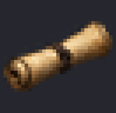

| | |
|---|---|
| Group and tool | icon, `hoi4.image_icon` |
| Canvas and frames | 33x32, 1 frame; DDS |
| Also accepted | 38x35, 38x37, 38x38, 33x31 |
| Names the game looks up | the game builds the sprite name from a short key in script. The example installs `GFX_decision_mobilise_reserves`. |
| Script | decision: icon = mobilise_reserves |
| Installed files (example) | `gfx/interface/decisions/gallery/decision_mobilise_reserves.dds` |
| Processing | recipe `icon` v1: trim, fit to the canvas with the profile margin, grayscale where the family needs it. Ran: `defringe` (erosion 1) → `trim_to_subject` → `fit_subject` (height 32, margin 1, width 33) |
| Checks | `size`, `alpha`, `opaque_canvas`, `fringe`, `margin`, `fill`, `checker`, `style`, `dds` |
| Made | 2026-11-02 on `gpt-6-luna` (high reasoning effort), image tool `gpt-image-2-codex`, quality medium, source 1254x1254 |
| Image SHA-256 | `35202affd784404d0cd652b722dea356747b304328d847cf8cd1073c88c8decc` |

```sh
hoi4-imagegen call hoi4.image_icon '{"family": "decision", "feature_slug": "gallery", "asset": "mobilise_reserves", "brief": "A rolled call-up poster tied with a cord, one bold simple object, painted in the dark, muted Hearts of Iron IV style", "approve": true, "idempotency_key": "gallery-decision-1"}'
```

<details><summary>Vanilla evidence for the name</summary>

common/decisions/ARG.txt:764 icon = oil -> interface/decisions.gfx:723 GFX_decision_oil; 91 of 104 short keys resolve; hoi4.exe has GFX_decision_

</details>

### decision_category_icon

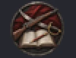

| | |
|---|---|
| Group and tool | icon, `hoi4.image_icon` |
| Canvas and frames | 52x40, 1 frame; DDS |
| Names the game looks up | the game builds the sprite name from a short key in script. The example installs `GFX_decision_category_military_reforms`. |
| Script | decision category: icon = military_reforms |
| Installed files (example) | `gfx/interface/decisions/gallery/category_icons/decision_category_military_reforms.dds` |
| Processing | recipe `icon` v1: trim, fit to the canvas with the profile margin, grayscale where the family needs it. Ran: `defringe` (erosion 1) → `trim_to_subject` → `fit_subject` (height 40, margin 3, width 52) |
| Checks | `size`, `alpha`, `opaque_canvas`, `fringe`, `margin`, `fill`, `checker`, `style`, `dds` |
| Made | 2026-11-02 on `gpt-6-luna` (high reasoning effort), image tool `gpt-image-2-codex`, quality medium, source 1254x1254 |
| Image SHA-256 | `66b25d76ad95ab811dca0c26caa4dce0c1a2d28a49585031b41d1e373b75f108` |

```sh
hoi4-imagegen call hoi4.image_icon '{"family": "decision_category_icon", "feature_slug": "gallery", "asset": "military_reforms", "brief": "A crossed sabre and rifle inside a laurel wreath, bold emblem, painted in the dark, muted Hearts of Iron IV style", "approve": true, "idempotency_key": "gallery-decision_category_icon-1"}'
```

<details><summary>Vanilla evidence for the name</summary>

common/decisions/categories/00_decision_categories.txt:16 icon = generic_propaganda -> interface/decisions.gfx:22 GFX_decision_category_generic_propaganda; hoi4.exe has GFX_decision_category_

</details>

### doctrine

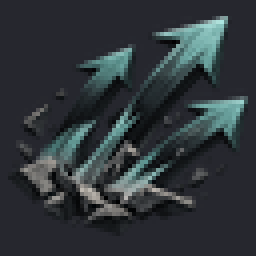

| | |
|---|---|
| Group and tool | icon, `hoi4.image_icon` |
| Canvas and frames | 64x64, 1 frame; DDS |
| Names the game looks up | the script names the sprite in full, so the name is free. The example installs `GFX_doctrine_mobile_warfare`. |
| Script | doctrine: icon = GFX_doctrine_mobile_warfare |
| Installed files (example) | `gfx/interface/doctrines/gallery/doctrine_mobile_warfare.dds` |
| Processing | recipe `icon` v1: trim, fit to the canvas with the profile margin, grayscale where the family needs it. Ran: `defringe` (erosion 1) → `trim_to_subject` → `fit_subject` (height 64, margin 2, width 64) |
| Checks | `size`, `alpha`, `opaque_canvas`, `fringe`, `margin`, `fill`, `checker`, `style`, `dds` |
| Made | 2026-11-02 on `gpt-6-luna` (high reasoning effort), image tool `gpt-image-2-codex`, quality medium, source 1254x1254 |
| Image SHA-256 | `a84508c636bc1b02582729cd50bf2a1d0be60c30b620eff7028f9433910bcdbf` |

```sh
hoi4-imagegen call hoi4.image_icon '{"family": "doctrine", "feature_slug": "gallery", "asset": "mobile_warfare", "brief": "Three bold arrows driving forward over broken ground, painted in the dark, muted Hearts of Iron IV style", "approve": true, "idempotency_key": "gallery-doctrine-1"}'
```

<details><summary>Vanilla evidence for the name</summary>

common/doctrines/subdoctrines/land/combat_support_subdoctrines.txt:282 icon = GFX_doctrine_air_cavalry_medium

</details>

### focus

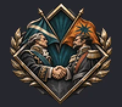

| | |
|---|---|
| Group and tool | icon, `hoi4.image_icon` |
| Canvas and frames | 100x88, 1 frame; DDS |
| Also accepted | 102x90, 99x88, 98x88 |
| Names the game looks up | the script names the sprite in full, so the name is free. The example installs `GFX_focus_steel_gate`, `GFX_focus_steel_gate_shine`. |
| Script | national focus: icon = GFX_focus_steel_gate |
| Installed files (example) | `gfx/interface/goals/gallery/focus_steel_gate.dds` |
| Processing | recipe `icon` v1: trim, fit to the canvas with the profile margin, grayscale where the family needs it. Ran: `defringe` (erosion 1) → `trim_to_subject` → `fit_subject` (height 88, margin 2, width 100) |
| Checks | `size`, `alpha`, `opaque_canvas`, `fringe`, `margin`, `fill`, `checker`, `ghost`, `style`, `dds` |
| Made | 2026-11-02 on `gpt-6-luna` (high reasoning effort), image tool `gpt-image-2-codex`, quality medium, source 1337x1176 |
| Image SHA-256 | `42cd960afb33b1ebc8eb20ebc2b3830b94aa0c78e6eea211485e5a45a1ae8580` |

```sh
hoi4-imagegen call hoi4.image_icon '{"family": "focus", "feature_slug": "gallery", "asset": "steel_gate", "brief": "A heavy riveted steel gate set in a stone fortress wall in a mountain pass, dramatic side light, painted style, 1940s", "approve": true, "idempotency_key": "gallery-focus-1"}'
```

<details><summary>Vanilla evidence for the name</summary>

common/national_focus/*.txt: all 3,007 icon values are full GFX_ names (interface/goals.gfx:755 GFX_focus_generic_industry_1)

</details>

### idea_concern

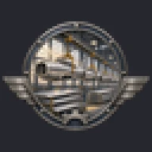

| | |
|---|---|
| Group and tool | icon, `hoi4.image_icon` |
| Canvas and frames | 64x64, 1 frame; DDS |
| Names the game looks up | the game builds the sprite name from a short key in script. The example installs `GFX_idea_ration_crisis`. |
| Script | idea: picture = ration_crisis |
| Installed files (example) | `gfx/interface/ideas/gallery/concerns/idea_ration_crisis.dds` |
| Processing | recipe `icon` v1: trim, fit to the canvas with the profile margin, grayscale where the family needs it. Ran: `defringe` (erosion 1) → `trim_to_subject` → `fit_subject` (height 64, margin 1, width 64) |
| Checks | `size`, `alpha`, `opaque_canvas`, `fringe`, `margin`, `fill`, `checker`, `style`, `dds` |
| Made | 2026-11-02 on `gpt-6-luna` (high reasoning effort), image tool `gpt-image-2-codex`, quality medium, source 1254x1254 |
| Image SHA-256 | `4b7e5819f5e67a4fac8b55c8682f4ea0ac98d3704c0deaa4bcef58c940f59391` |

```sh
hoi4-imagegen call hoi4.image_icon '{"family": "idea_concern", "feature_slug": "gallery", "asset": "ration_crisis", "brief": "An empty bread basket with a single cracked loaf and a ration card, a national hardship, painted in the dark, muted Hearts of Iron IV style", "approve": true, "idempotency_key": "gallery-idea_concern-1"}'
```

<details><summary>Vanilla evidence for the name</summary>

common/ideas/CSA.txt:8 picture = generic_air_manufacturer_2 -> interface/ideas.gfx:1069 GFX_idea_generic_air_manufacturer_2; 1,400 of 1,455 short picture keys resolve to GFX_idea_<key>; hoi4.exe has the string GFX_idea_

</details>

### idea_spirit

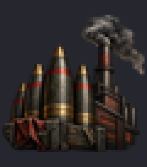

| | |
|---|---|
| Group and tool | icon, `hoi4.image_icon` |
| Canvas and frames | 60x68, 1 frame; DDS |
| Also accepted | 62x70 |
| Names the game looks up | the game builds the sprite name from a short key in script. The example installs `GFX_idea_war_economy`. |
| Script | idea: picture = war_economy |
| Installed files (example) | `gfx/interface/ideas/gallery/idea_war_economy.dds` |
| Processing | recipe `icon` v1: trim, fit to the canvas with the profile margin, grayscale where the family needs it. Ran: `defringe` (erosion 1) → `trim_to_subject` → `fit_subject` (height 68, margin 1, width 60) |
| Checks | `size`, `alpha`, `opaque_canvas`, `fringe`, `margin`, `fill`, `checker`, `style`, `dds` |
| Made | 2026-11-02 on `gpt-6-luna` (high reasoning effort), image tool `gpt-image-2-codex`, quality medium, source 1254x1254 |
| Image SHA-256 | `91553bc9284c86cc04bd1ad6e738904827f3a88559efcf63afe558b6d4e73499` |

```sh
hoi4-imagegen call hoi4.image_icon '{"family": "idea_spirit", "feature_slug": "gallery", "asset": "war_economy", "brief": "Artillery shells beside a smoking factory chimney, a war economy national spirit, painted in the dark, muted Hearts of Iron IV style", "approve": true, "idempotency_key": "gallery-idea_spirit-1"}'
```

<details><summary>Vanilla evidence for the name</summary>

common/ideas/CSA.txt:8 picture = generic_air_manufacturer_2 -> interface/ideas.gfx:1069 GFX_idea_generic_air_manufacturer_2; 1,400 of 1,455 short picture keys resolve to GFX_idea_<key>; hoi4.exe has the string GFX_idea_

</details>

### medal

*No current image of this family passes the vanilla-match check yet, so the 0.2.x example was removed. One follows as the runs go on.*

| | |
|---|---|
| Group and tool | icon, `hoi4.image_icon` |
| Canvas and frames | 56x84, 1 frame; DDS |
| Names the game looks up | the script names the sprite in full, so the name is free. The example installs `GFX_medal_icon_star_of_valor_large`, `GFX_medal_icon_star_of_valor`. |
| Script | unit medal: icon = GFX_medal_icon_star_of_valor with frame = 1 (the game also loads GFX_medal_icon_star_of_valor_large) |
| Installed files (example) | `gfx/interface/medals/gallery/medal_icon_star_of_valor.dds`<br>`gfx/interface/medals/gallery/medal_icon_star_of_valor_small.dds` |
| Processing | recipe `icon` v1: trim, fit to the canvas with the profile margin, grayscale where the family needs it. Ran: `trim_to_subject` → `fit_subject` (height 84, margin 2, width 56), then finishing `derived_companions` |
| Checks | `size`, `alpha`, `opaque_canvas`, `fringe`, `margin`, `fill`, `checker`, `style`, `dds` |
| Made | 2026-11-02 on `gpt-6-luna` (high reasoning effort), image tool `gpt-image-2-codex`, quality medium, source 1024x1536 |
| Image SHA-256 | `c52bd6e0f99b79d2154836626e55558877751a4b8123e6a50b1e3c7c22a03b73` |

```sh
hoi4-imagegen call hoi4.image_icon '{"family": "medal", "feature_slug": "gallery", "asset": "star_of_valor", "brief": "A bronze star medal hanging from a red and white ribbon, painted in the dark, muted Hearts of Iron IV style", "approve": true, "idempotency_key": "gallery-medal-1"}'
```

<details><summary>Vanilla evidence for the name</summary>

common/unit_medals/00_default.txt:41 icon = "GFX_medal_icon_nor" with frame = 1; interface/medals.gfx:247 GFX_medal_icon_eng and :253 GFX_medal_icon_eng_large: each of the 21 GFX_medal_icon_* sprites has a _large twin, and no .gui names one

</details>

### mio_department

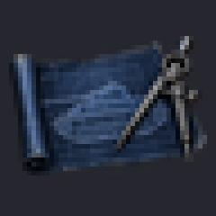

**Vanilla form (since 0.3.2).** Measured on the 337 vanilla department icons (`generic_mio_department_icon_air_transport`, `generic_mio_department_icon_armored_car_conversion`): one piece of equipment as a bold, flat icon, tinted one saturated colour by its type (aircraft red or blue, land equipment olive green, ships steel blue), with a thin dark outline and often one small accent symbol such as circular arrows, a rising zigzag arrow, a wrench or gears. It covers 57 percent of the canvas, and 31 percent of its pixels are strongly coloured. Grey or metallic shading, scenes and blueprints are never part of it.

| | |
|---|---|
| Group and tool | icon, `hoi4.image_icon` |
| Canvas and frames | 48x48, 1 frame; DDS |
| Names the game looks up | the script names the sprite in full, so the name is free. The example installs `GFX_mio_department_tank_design_bureau`. |
| Script | military industrial organization: icon = GFX_mio_department_tank_design_bureau |
| Installed files (example) | `gfx/interface/military_industrial_organization/department_icons/gallery/mio_department_tank_design_bureau.dds` |
| Processing | recipe `icon` v1: trim, fit to the canvas with the profile margin, grayscale where the family needs it. Ran: `defringe` (erosion 1) → `trim_to_subject` → `fit_subject` (height 48, margin 2, width 48) |
| Checks | `size`, `alpha`, `opaque_canvas`, `fringe`, `margin`, `fill`, `checker`, `style`, `dds` |
| Made | 2026-11-02 on `gpt-6-luna` (high reasoning effort), image tool `gpt-image-2-codex`, quality medium, source 1254x1254 |
| Image SHA-256 | `5230e3bf8a5ec3bf8810dbe3403ac86688469ce6d59fd4d96f1159b4d7596ae3` |

```sh
hoi4-imagegen call hoi4.image_icon '{"family": "mio_department", "feature_slug": "gallery", "asset": "tank_design_bureau", "brief": "A blueprint of a tank with a drafting compass lying on it, painted in the dark, muted Hearts of Iron IV style", "approve": true, "idempotency_key": "gallery-mio_department-1"}'
```

<details><summary>Vanilla evidence for the name</summary>

common/military_industrial_organization/organizations/00_generic_organization.txt:5128 icon = GFX_generic_mio_department_icon_air_transport_production

</details>

### mio_policy

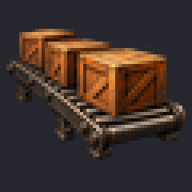

**Vanilla form (since 0.3.2).** Measured on the 20 vanilla policy icons (`mio_policy_welding`, `mio_policy_ruthless_contracts`, `mio_policy_modular_assembly`): one object, or two that belong together, as a painted icon with a dark outline and a soft shadow on transparency. There is no room, no factory hall and no view into the distance.

| | |
|---|---|
| Group and tool | icon, `hoi4.image_icon` |
| Canvas and frames | 60x60, 1 frame; DDS |
| Names the game looks up | the script names the sprite in full, so the name is free. The example installs `GFX_mio_policy_mass_production`. |
| Script | organization policy: icon = GFX_mio_policy_mass_production |
| Installed files (example) | `gfx/interface/military_industrial_organization/policy_icons/gallery/mio_policy_mass_production.dds` |
| Processing | recipe `icon` v1: trim, fit to the canvas with the profile margin, grayscale where the family needs it. Ran: `defringe` (erosion 1) → `trim_to_subject` → `fit_subject` (height 60, margin 2, width 60) |
| Checks | `size`, `alpha`, `opaque_canvas`, `fringe`, `margin`, `fill`, `checker`, `style`, `dds` |
| Made | 2026-11-02 on `gpt-6-luna` (high reasoning effort), image tool `gpt-image-2-codex`, quality medium, source 1254x1254 |
| Image SHA-256 | `20fe3e36c09a762ae217c907b42f50b4986124c68abf7c03533854b37b34a863` |

```sh
hoi4-imagegen call hoi4.image_icon '{"family": "mio_policy", "feature_slug": "gallery", "asset": "mass_production", "brief": "Wooden crates riding a factory conveyor belt, painted in the dark, muted Hearts of Iron IV style", "approve": true, "idempotency_key": "gallery-mio_policy-1"}'
```

<details><summary>Vanilla evidence for the name</summary>

common/military_industrial_organization/policies/_general_policies.txt:77 icon = GFX_idea_eng_spirit_of_the_industrial_revolution

</details>

### mio_trait

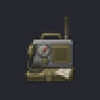

**Vanilla form (since 0.3.2, flat glyph since 0.3.4).** Measured on the 44 vanilla trait icons (`generic_mio_trait_icon_armor_value`, `generic_mio_trait_icon_detection`, `generic_mio_trait_icon_build_cost_ic`): one small, simple glyph of one object or symbol, often with a small accent sign such as a green plus or a red target ring. Inside the glyph the tones are light and flat: mean value 0.50 in the median file, 6 percent dark and 15 percent light pixels, about 14 colours for most of the glyph. Every file has a dark outline and a soft dark shadow, which is about half of the visible pixels, and about 29 percent of the canvas is covered. There is no badge or disc behind the object. The 0.3.2 gallery's traits had as few colours but were dark painted objects with little light area, so since 0.3.4 the rule asks for a flat, light glyph without texture or small parts. The colour count already matches vanilla, so no posterising step is added. The rule before 0.3.2 asked for a round badge, which vanilla does not use.

| | |
|---|---|
| Group and tool | icon, `hoi4.image_icon` |
| Canvas and frames | 48x48, 1 frame; DDS |
| Names the game looks up | the script names the sprite in full, so the name is free. The example installs `GFX_mio_trait_improved_armour`. |
| Script | organization trait: icon = GFX_mio_trait_improved_armour |
| Installed files (example) | `gfx/interface/military_industrial_organization/trait_icons/gallery/mio_trait_improved_armour.dds` |
| Processing | recipe `icon` v1: trim, fit to the canvas with the profile margin, grayscale where the family needs it. Ran: `defringe` (erosion 1) → `trim_to_subject` → `fit_subject` (height 48, margin 2, width 48) |
| Checks | `size`, `alpha`, `opaque_canvas`, `fringe`, `margin`, `fill`, `checker`, `style`, `dds` |
| Made | 2026-11-02 on `gpt-6-luna` (high reasoning effort), image tool `gpt-image-2-codex`, quality medium, source 1254x1254 |
| Image SHA-256 | `1e7571824ff43e2e3fb124734a10d398b0293eceea35d921cf8fce99abe76214` |

```sh
hoi4-imagegen call hoi4.image_icon '{"family": "mio_trait", "feature_slug": "gallery", "asset": "improved_armour", "brief": "A thick steel armour plate with welding sparks, painted in the dark, muted Hearts of Iron IV style", "approve": true, "idempotency_key": "gallery-mio_trait-1"}'
```

<details><summary>Vanilla evidence for the name</summary>

interface/military_industrial_organization/industrial_organization_policies_and_traits_icons.gfx:126 GFX_generic_mio_trait_icon_ap_attack, named in full by trait icon values

</details>

### officer_corps_spirit

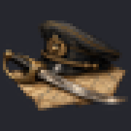

| | |
|---|---|
| Group and tool | icon, `hoi4.image_icon` |
| Canvas and frames | 45x45, 1 frame; DDS |
| Names the game looks up | the game builds the sprite name from the key of the object it belongs to. The example installs `GFX_idea_professional_officers`. |
| Script | name the officer corps spirit idea professional_officers (an idea without picture is drawn with GFX_idea_<idea key>), or write picture = professional_officers |
| Installed files (example) | `gfx/interface/officer_corp/spirits/gallery/spirit_professional_officers.dds` |
| Processing | recipe `icon` v1: trim, fit to the canvas with the profile margin, grayscale where the family needs it. Ran: `defringe` (erosion 1) → `trim_to_subject` → `fit_subject` (height 45, margin 1, width 45) |
| Checks | `size`, `alpha`, `opaque_canvas`, `fringe`, `margin`, `fill`, `checker`, `style`, `dds` |
| Made | 2026-11-02 on `gpt-6-luna` (high reasoning effort), image tool `gpt-image-2-codex`, quality medium, source 1254x1254 |
| Image SHA-256 | `1282237d73c7a0d9849ce75282efb7021b5d806f6c51178ed712ed2fb6860018` |

```sh
hoi4-imagegen call hoi4.image_icon '{"family": "officer_corps_spirit", "feature_slug": "gallery", "asset": "professional_officers", "brief": "A peaked officer's cap and a sabre resting on a staff map table, painted in the dark, muted Hearts of Iron IV style", "approve": true, "idempotency_key": "gallery-officer_corps_spirit-1"}'
```

<details><summary>Vanilla evidence for the name</summary>

common/ideas/army_spirits.txt:4 bold_attack_spirit has no picture -> interface/officer_corp_spirits.gfx:15 GFX_idea_bold_attack_spirit

</details>

### operation_icon

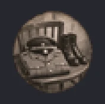

**Vanilla form (since 0.3.2).** This family is the 59x58 operation phase icon, and only that. All 71 vanilla ones (`operations/phases_small/phase_bruneval_attack_small`, `phase_capture_tito_infiltration_small`) are a round sepia photograph whose edge is worn and slightly darkened, with no ring and no colour (median saturation 0.15, under 0.1 percent of the pixels coloured). The 85x85 square colour illustrations and the 48x48 ringed colour paintings in the same folder are a different form: they are no longer accepted sizes and never references. The example above predates this rule and shows a loose object, which is not the vanilla form.

| | |
|---|---|
| Group and tool | icon, `hoi4.image_icon` |
| Canvas and frames | 59x58, 1 frame; DDS |
| Also accepted | 48x48, 85x85 |
| Names the game looks up | the script names the sprite in full, so the name is free. The example installs `GFX_phase_infiltrate_ministry_small`. |
| Script | operation phase: icon = GFX_phase_infiltrate_ministry_small |
| Installed files (example) | `gfx/interface/operations/gallery/icons/phase_infiltrate_ministry.dds` |
| Processing | recipe `icon` v1: trim, fit to the canvas with the profile margin, grayscale where the family needs it. Ran: `defringe` (erosion 1) → `trim_to_subject` → `fit_subject` (height 58, margin 2, width 59) |
| Checks | `size`, `alpha`, `opaque_canvas`, `fringe`, `margin`, `fill`, `checker`, `style`, `dds` |
| Made | 2026-11-02 on `gpt-6-luna` (high reasoning effort), image tool `gpt-image-2-codex`, quality medium, source 1254x1254 |
| Image SHA-256 | `3ae1e940ed673968c6c71a1858050cf20abc69cd43ce70b05992a86fbf57e165` |

```sh
hoi4-imagegen call hoi4.image_icon '{"family": "operation_icon", "feature_slug": "gallery", "asset": "infiltrate_ministry", "brief": "A leather briefcase with sealed documents and a red wax stamp, painted in the dark, muted Hearts of Iron IV style", "approve": true, "idempotency_key": "gallery-operation_icon-1"}'
```

<details><summary>Vanilla evidence for the name</summary>

common/operation_phases/00_operation_phases.txt icon values (73, full names) -> interface/lar_operations.gfx:546 GFX_phase_infiltrate_military_bribe_small (59x58)

</details>

### personal_trait

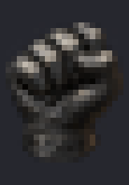

| | |
|---|---|
| Group and tool | icon, `hoi4.image_icon` |
| Canvas and frames | 23x33, 1 frame; DDS |
| Names the game looks up | the game builds the sprite name from the key of the object it belongs to. The example installs `GFX_trait_iron_will`. |
| Script | name the unit leader trait iron_will in common/unit_leader (its icon is GFX_trait_<trait key>) |
| Installed files (example) | `gfx/interface/traits/gallery/personal/trait_iron_will.dds` |
| Processing | recipe `icon` v1: trim, fit to the canvas with the profile margin, grayscale where the family needs it. Ran: `defringe` (erosion 1) → `trim_to_subject` → `fit_subject` (height 33, margin 1, width 23) |
| Checks | `size`, `alpha`, `opaque_canvas`, `fringe`, `margin`, `fill`, `checker`, `style`, `dds` |
| Made | 2026-11-02 on `gpt-6-luna` (high reasoning effort), image tool `gpt-image-2-codex`, quality medium, source 1254x1254 |
| Image SHA-256 | `d8536ed0eee78d0e8c64d3a2dbde6d0b716e73e7c9fbad3fb45bef7859f9ebee` |

```sh
hoi4-imagegen call hoi4.image_icon '{"family": "personal_trait", "feature_slug": "gallery", "asset": "iron_will", "brief": "A clenched gloved fist, bold silhouette, painted in the dark, muted Hearts of Iron IV style", "approve": true, "idempotency_key": "gallery-personal_trait-1"}'
```

<details><summary>Vanilla evidence for the name</summary>

common/unit_leader/*.txt: 189 of 196 leader traits have GFX_trait_<key>; traits have no icon field; hoi4.exe has GFX_trait_; interface/aat_traits.gfx:10 GFX_trait_jaeger

</details>

### raid

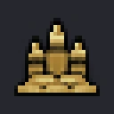

**Readable at 32x32 (since 0.3.4).** Like every icon family with a side of 40 px or less, raid icons ask for one bold object of a few large, solid shapes, with no thin parallel lines, lattices, groups of small figures or scene. On the 0.3.2 gallery a dinghy with figures, a broken arch bridge and twisted rails did not read at 32x32. The `small_detail` check warns (`GFX-SMALL-DETAIL`) when more of the subject's pixels lie on its edge than in all but one in twenty of vanilla's raid icons, which catches the bridge and the rails, but not the dinghy, whose problem is its small figures.

| | |
|---|---|
| Group and tool | icon, `hoi4.image_icon` |
| Canvas and frames | 32x32, 1 frame; DDS |
| Names the game looks up | the game builds the sprite name from the key of the object it belongs to. The example installs `GFX_raid_type_icon_sabotage`. |
| Script | name the raid type sabotage (the map icon is looked up as GFX_raid_type_icon_<raid type>), or write custom_map_icon = GFX_raid_type_icon_sabotage |
| Installed files (example) | `gfx/interface/military_raids/gallery/raid_type_icon_sabotage.dds` |
| Processing | recipe `icon` v1: trim, fit to the canvas with the profile margin, grayscale where the family needs it. Ran: `defringe` (erosion 1) → `trim_to_subject` → `fit_subject` (height 32, margin 1, width 32) |
| Checks | `size`, `alpha`, `opaque_canvas`, `fringe`, `margin`, `fill`, `checker`, `style`, `dds` |
| Made | 2026-11-02 on `gpt-6-luna` (high reasoning effort), image tool `gpt-image-2-codex`, quality medium, source 1254x1254 |
| Image SHA-256 | `e894087cc0cb9a6a69ae7590678a63102b3252caed27ec910a725d1a58cd76da` |

```sh
hoi4-imagegen call hoi4.image_icon '{"family": "raid", "feature_slug": "gallery", "asset": "sabotage", "brief": "A single lit stick of dynamite with a short fuse and a spark, painted in the dark, muted Hearts of Iron IV style", "approve": true, "idempotency_key": "gallery-raid-1"}'
```

<details><summary>Vanilla evidence for the name</summary>

common/raids/_documentation.md:22 and :232 (automatic lookup GFX_raid_type_icon_ + raid type) -> interface/military_raids/military_raids.gfx:281 GFX_raid_type_icon_airfield_raid

</details>

### special_project_icon

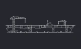

| | |
|---|---|
| Group and tool | icon, `hoi4.image_icon` |
| Canvas and frames | 161x98, 1 frame; DDS |
| Names the game looks up | the script names the sprite in full, so the name is free. The example installs `GFX_sp_rocket_programme`. |
| Script | special project: icon = GFX_sp_rocket_programme |
| Installed files (example) | `gfx/interface/special_project/project_icons/gallery/sp_rocket_programme.dds` |
| Processing | recipe `icon` v1: trim, fit to the canvas with the profile margin, grayscale where the family needs it. Ran: `defringe` (erosion 1) → `trim_to_subject` → `fit_subject` (height 98, margin 3, width 161) → `grayscale` |
| Checks | `size`, `alpha`, `opaque_canvas`, `fringe`, `margin`, `fill`, `checker`, `style`, `dds` |
| Made | 2026-11-02 on `gpt-6-luna` (high reasoning effort), image tool `gpt-image-2-codex`, quality medium, source 1608x978 |
| Image SHA-256 | `9cab582a691a83190615a0dc50405453a1f3a52b1c9553eae4eb7a6ab4fb33c6` |

```sh
hoi4-imagegen call hoi4.image_icon '{"family": "special_project_icon", "feature_slug": "gallery", "asset": "rocket_programme", "brief": "A tall liquid-fuel rocket on a steel launch gantry at dusk, painted in the dark, muted Hearts of Iron IV style", "approve": true, "idempotency_key": "gallery-special_project_icon-1"}'
```

<details><summary>Vanilla evidence for the name</summary>

common/special_projects/projects/air_projects.txt:1071 icon = GFX_sp_air_axial_jet_engine

</details>

### state_modifier

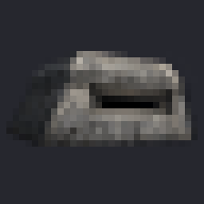

**Vanilla form (since 0.3.2).** Measured on the 100 vanilla 32x32 state modifiers (`modifier_generic_sabotage`, `modifiers_ETH_state_development`): one bold, simple object or symbol, at most two elements, with chunky shapes, a strong dark outline and one or two saturated accents, covering 62 percent of the canvas. There is no scene or landscape, because small details do not read at 32 px.

| | |
|---|---|
| Group and tool | icon, `hoi4.image_icon` |
| Canvas and frames | 32x32, 1 frame; DDS |
| Names the game looks up | the script names the sprite in full, so the name is free. The example installs `GFX_modifiers_fortified_region`. |
| Script | dynamic modifier: icon = GFX_modifiers_fortified_region |
| Installed files (example) | `gfx/interface/state_modifiers/gallery/modifiers_fortified_region.dds` |
| Processing | recipe `icon` v1: trim, fit to the canvas with the profile margin, grayscale where the family needs it. Ran: `defringe` (erosion 1) → `trim_to_subject` → `fit_subject` (height 32, margin 1, width 32) |
| Checks | `size`, `alpha`, `opaque_canvas`, `fringe`, `margin`, `fill`, `checker`, `style`, `dds` |
| Made | 2026-11-02 on `gpt-6-luna` (high reasoning effort), image tool `gpt-image-2-codex`, quality medium, source 1254x1254 |
| Image SHA-256 | `426a8f55572e29b993d513365eacdb32c1be158c478e6517e78f9b98f4b0e87b` |

```sh
hoi4-imagegen call hoi4.image_icon '{"family": "state_modifier", "feature_slug": "gallery", "asset": "fortified_region", "brief": "A low concrete bunker with a gun slit, bold simple silhouette, painted in the dark, muted Hearts of Iron IV style", "approve": true, "idempotency_key": "gallery-state_modifier-1"}'
```

<details><summary>Vanilla evidence for the name</summary>

common/dynamic_modifiers/*.txt: 375 of 377 icon values are full GFX_ names (interface/countrystateview.gfx:750 GFX_modifiers_tur_kemalist_loyalties)

</details>

## Pictures

Planned with `hoi4.image_picture`.

### achievement

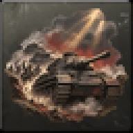

| | |
|---|---|
| Group and tool | picture, `hoi4.image_picture` |
| Canvas and frames | 64x64, 1 frame; DDS |
| Names the game looks up | the game loads the file by name, no sprite. |
| Script | name the achievement hold_the_line in common/achievements.txt (the game loads gfx/achievements/<key>.dds, _grey.dds and _not_eligible.dds) |
| Installed files (example) | `gfx/achievements/hold_the_line.dds`<br>`gfx/achievements/hold_the_line_grey.dds`<br>`gfx/achievements/hold_the_line_not_eligible.dds` |
| Processing | recipe `achievement` v1: fit the subject, then the grey and not-eligible states on the mod's template backgrounds (three DDS). Ran: `defringe` (erosion 1) → `trim_to_subject` → `fit_subject` (height 64, margin 2, width 64), then finishing `achievement_triplet` |
| Checks | `size`, `checker`, `near_opaque`, `style`, `dds` |
| Made | 2026-11-02 on `gpt-6-luna` (high reasoning effort), image tool `gpt-image-2-codex`, quality medium, source 1254x1254 |
| Image SHA-256 | `bf60a8e2ca10ee2d797fc051df0707934d72f02ff7ef73399ca6ba5f979f2d96` |

```sh
hoi4-imagegen call hoi4.image_picture '{"family": "achievement", "feature_slug": "gallery", "asset": "hold_the_line", "brief": "A tattered battle flag planted on a pile of sandbags, painted in the dark, muted Hearts of Iron IV style", "approve": true, "idempotency_key": "gallery-achievement-1"}'
```

<details><summary>Vanilla evidence for the name</summary>

gfx/achievements: 292 achievement keys have <key>.dds, <key>_grey.dds and (291) <key>_not_eligible.dds; no .gfx registers them

</details>

### decision_category_picture

*No current image of this family passes the vanilla-match check yet, so the 0.2.x example was removed. One follows as the runs go on.*

| | |
|---|---|
| Group and tool | picture, `hoi4.image_picture` |
| Canvas and frames | 114x101, 1 frame; DDS |
| Names the game looks up | the game builds the sprite name from a short key in script. The example installs `GFX_decision_cat_picture_war_industry`. |
| Script | decision category: picture = war_industry |
| Installed files (example) | `gfx/interface/decisions/gallery/category_pictures/decision_cat_picture_war_industry.dds` |
| Processing | recipe `picture` v1: flatten on black, cover-resize, grayscale for news. Ran: `flatten_on` (background [0, 0, 0]) → `cover_resize` (height 101, width 114) |
| Checks | `size`, `checker`, `opaque`, `style`, `dds` |
| Made | 2026-11-02 on `gpt-6-luna` (high reasoning effort), image tool `gpt-image-2-codex`, quality medium, source 1333x1180 |
| Image SHA-256 | `c62c1a437ca3bb801a77793539171e9b4beca1ac55f35befe72330faa0d2e169` |

```sh
hoi4-imagegen call hoi4.image_picture '{"family": "decision_category_picture", "feature_slug": "gallery", "asset": "war_industry", "brief": "Workers assembling military trucks on a busy factory floor, warm light through high windows, a painted illustration", "approve": true, "idempotency_key": "gallery-decision_category_picture-1"}'
```

<details><summary>Vanilla evidence for the name</summary>

common/decisions/categories/CHI_decision_categories.txt:166 picture = generic_border_conflicts -> interface/decisions.gfx:352 GFX_decision_cat_picture_generic_border_conflicts; hoi4.exe has GFX_decision_cat_picture_

</details>

### news_event

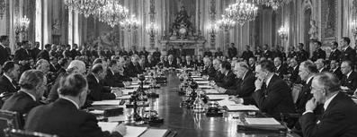

| | |
|---|---|
| Group and tool | picture, `hoi4.image_picture` |
| Canvas and frames | 397x153, 1 frame; DDS |
| Also accepted | 396x153 |
| Names the game looks up | the script names the sprite in full, so the name is free. The example installs `GFX_news_event_peace_conference`. |
| Script | event: picture = GFX_news_event_peace_conference |
| Installed files (example) | `gfx/event_pictures/gallery/news_event_peace_conference.dds` |
| Processing | recipe `picture` v1: flatten on black, cover-resize, grayscale for news. Ran: `flatten_on` (background [0, 0, 0]) → `cover_resize` (height 153, width 397) → `grayscale` |
| Checks | `size`, `checker`, `opaque`, `style`, `dds` |
| Made | 2026-11-02 on `gpt-6-luna` (high reasoning effort), image tool `gpt-image-2-codex`, quality medium, source 2020x779 |
| Image SHA-256 | `7e8133683872362d424ee3f40eb7270b768c50470436d3643ec4d218bb48bfd4` |

```sh
hoi4-imagegen call hoi4.image_picture '{"family": "news_event", "feature_slug": "gallery", "asset": "peace_conference", "brief": "Delegates seated around a long conference table in an ornate hall with chandeliers, a wide 1930s press photograph", "approve": true, "idempotency_key": "gallery-news_event-1"}'
```

<details><summary>Vanilla evidence for the name</summary>

events/*.txt: 830 of 833 picture values are full GFX_ names (interface/eventpictures.gfx:14 GFX_news_event_polish_army)

</details>

### operation_picture

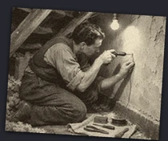

**Vanilla form (since 0.3.2).** This family is the 210x176 operation phase picture, and only that. All 71 vanilla ones (`operations/images/phase_bruneval_attack`, `phase_capture_cyphers_raid`) are period photographs in sepia or warm black and white, never paintings and never colour. In vanilla they sit on the same tilted, worn photo card as the report event pictures, with transparent corners (86 percent of the canvas covered). The prompt asks for the photograph and says it is not the round phase icon. The example above is a painted illustration and predates this rule.

| | |
|---|---|
| Group and tool | picture, `hoi4.image_picture` |
| Canvas and frames | 210x176, 1 frame; DDS |
| Names the game looks up | the script names the sprite in full, so the name is free. The example installs `GFX_phase_night_infiltration`. |
| Script | operation phase: picture = GFX_phase_night_infiltration |
| Installed files (example) | `gfx/interface/operations/gallery/pictures/phase_night_infiltration.dds` |
| Processing | recipe `picture` v1: flatten on black, cover-resize, grayscale for news. Ran: `flatten_on` (background [0, 0, 0]) → `cover_resize` (height 176, width 210) |
| Checks | `size`, `checker`, `opaque`, `style`, `dds` |
| Made | 2026-11-02 on `gpt-6-luna` (high reasoning effort), image tool `gpt-image-2-codex`, quality low, source 1369x1149 |
| Image SHA-256 | `3cfae2e3c893cb4f8fee0a1ff91ed6b05b218b7c0eca2a14ea1ece8e65551261` |

```sh
hoi4-imagegen call hoi4.image_picture '{"family": "operation_picture", "feature_slug": "gallery", "asset": "night_infiltration", "brief": "Saboteurs rowing a small boat across a harbour at night toward a dockside crane, a painted illustration", "approve": true, "idempotency_key": "gallery-operation_picture-1"}'
```

<details><summary>Vanilla evidence for the name</summary>

common/operation_phases/lar_historical_operations.txt:47 picture = GFX_phase_bruneval_attack -> interface/lar_operations.gfx:187 GFX_phase_infiltrate_military_bribe (210x176)

</details>

### report_event

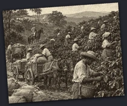

| | |
|---|---|
| Group and tool | picture, `hoi4.image_picture` |
| Canvas and frames | 210x176, 1 frame; DDS |
| Also accepted | 209x176 |
| Names the game looks up | the script names the sprite in full, so the name is free. The example installs `GFX_report_event_winter_border`. |
| Script | event: picture = GFX_report_event_winter_border |
| Installed files (example) | `gfx/event_pictures/gallery/report_event_winter_border.dds` |
| Processing | recipe `report_card` v2: flatten, then the report card: sepia, grain, tilt and a soft shadow fitted to vanilla, with transparent corners. Ran: `flatten_on` (background [0, 0, 0]) → `report_card` (seed 2171901083) |
| Checks | `size`, `checker`, `card_corners`, `style`, `dds` |
| Made | 2026-11-02 on `gpt-6-luna` (high reasoning effort), image tool `gpt-image-2-codex`, quality low, source 1369x1149 |
| Image SHA-256 | `ac56596dd99e1cb31b8a8648046adb77b60b33cfc883e1a435dba4d2d46e1f28` |

```sh
hoi4-imagegen call hoi4.image_picture '{"family": "report_event", "feature_slug": "gallery", "asset": "winter_border", "brief": "Two soldiers in greatcoats at a snowy border checkpoint with a striped barrier, an old photograph", "approve": true, "idempotency_key": "gallery-report_event-1"}'
```

<details><summary>Vanilla evidence for the name</summary>

events/*.txt: 830 of 833 picture values are full GFX_ names (interface/eventpictures.gfx:14 GFX_news_event_polish_army)

</details>

### technology

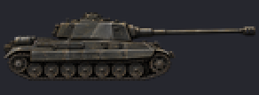

**Tree box (since 0.3.5).** The install writes the picture sprite only. The technology also needs a box in a tree, or the game logs "Found no grid box for tech <key>" and never draws it: a `path` from an existing vanilla technology (with a mod copy of that technology file), or the mod's own gridbox in a copy of `interface/countrytechtreeview.gui` (vanilla names its gridboxes like `tech_support_tree`). The install output, the handoff note and the receipt carry this note.

**Picture size (since 0.3.5).** The game picks the tree item from the technology, not from the picture. Pass `canvas` `[146, 54]` (default) for a technology that enables equipment or sub-units in the land and air folders (183x84 item), `[64, 64]` for any other technology (the small 72x72 item) and `[285, 56]` for naval, artillery and electronics equipment (204x72 item). The sizes are vanilla's most common for each kind, measured on 1.19.4.1 (see the reference). The install note names the item the art is sized for.

| | |
|---|---|
| Group and tool | picture, `hoi4.image_picture` |
| Canvas and frames | 146x54, 1 frame; DDS |
| Also accepted | 131x52 |
| Names the game looks up | the game builds the sprite name from the key of the object it belongs to. The example installs `GFX_heavy_tank_medium`. |
| Script | name the technology heavy_tank (its picture is GFX_<technology key>_medium). The picture alone does not put the technology in the tech tree: it needs a box in a tree, either a path from an existing vanilla technology (which needs a mod copy of that vanilla technology file under common/technologies) or the mod's own gridbox in a copy of interface/countrytechtreeview.gui (vanilla names its gridboxes like tech_support_tree). Without one the game logs "Found no grid box for tech <technology key>" and never draws the technology, whatever its x and y are. This tool writes neither |
| Installed files (example) | `gfx/interface/technologies/gallery/heavy_tank.dds` |
| Processing | recipe `icon` v1: trim, fit to the canvas with the profile margin, grayscale where the family needs it. Ran: `defringe` (erosion 1) → `trim_to_subject` → `fit_subject` (height 54, margin 2, width 146) |
| Checks | `size`, `alpha`, `opaque_canvas`, `fringe`, `margin`, `fill`, `checker`, `style`, `dds` |
| Made | 2026-11-02 on `gpt-6-luna` (high reasoning effort), image tool `gpt-image-2-codex`, quality medium, source 2062x763 |
| Image SHA-256 | `b26d66320ab1d7ce19452e8f7092f133cfba7ec18f280bae99b7c46518236e81` |

```sh
hoi4-imagegen call hoi4.image_picture '{"family": "technology", "feature_slug": "gallery", "asset": "heavy_tank", "brief": "A heavy tank seen from the side, long gun, wide tracks, painted in the dark, muted Hearts of Iron IV style", "approve": true, "idempotency_key": "gallery-technology-1"}'
```

<details><summary>Vanilla evidence for the name</summary>

interface/Technologies.gfx:183 GFX_infantry_weapons_medium for technology infantry_weapons; 429 of 552 technologies have GFX_<key>_medium; hoi4.exe pairs tech_icon with _medium

</details>

## Portraits

Planned with `hoi4.image_portrait`.

### advisor_card

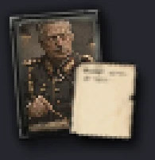

| | |
|---|---|
| Group and tool | portrait, `hoi4.image_portrait` |
| Canvas and frames | 65x67, 1 frame; DDS |
| Names the game looks up | the script names the sprite in full, so the name is free. The example installs `GFX_idea_minister`. |
| Script | character portraits: small = GFX_idea_minister (in the civilian or army block of the advisor) |
| Installed files (example) | `gfx/interface/ideas/gallery/advisors/idea_minister.dds` |
| Processing | recipe `advisor_card` v1: flatten, then the portrait composited into the mod's advisor template, with an alpha-coverage audit that fails closed. Ran: `flatten_on` (background [0, 0, 0]), then finishing `advisor_card` |
| Checks | `size`, `alpha`, `checker`, `card_corners`, `style`, `dds` |
| Made | 2026-11-02 on `gpt-6-luna` (high reasoning effort), image tool `gpt-image-2-codex`, quality low, source 1024x1536 |
| Image SHA-256 | `63ab4b0eb0979f3e52ba5d5936668985c24f41ba5c74807fe8d36448cd3cfe2e` |

```sh
hoi4-imagegen call hoi4.image_portrait '{"family": "advisor_card", "feature_slug": "gallery", "asset": "minister", "brief": "A fictional government minister in a grey uniform jacket, neutral expression, 1930s portrait", "approve": true, "idempotency_key": "gallery-advisor_card-1"}'
```

<details><summary>Vanilla evidence for the name</summary>

common/characters/*.txt: all 2,887 small values are full GFX_ names (interface/ideas.gfx:6562 GFX_portrait_ETH_amha_selassie_small)

</details>

### commander_portrait

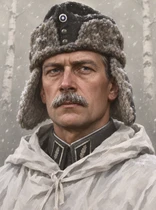

**Vanilla backdrop (since 0.3.4).** Leaders and commanders share one vanilla backdrop: a plain pale cream-grey studio background (about RGB 229, 226, 209 at the top, L*a*b* 89.8, -1.9, 8.5 in the top corners), darker toward the bottom (about 190, 186, 170 at the sides by the shoulders). 424 of the 447 decodable portraits outside the scientists folder use it. The rest are special portraits. The rule asks for this backdrop, and the `backdrop` check warns (`GFX-PORTRAIT-BACKDROP`) when the top corners are more than 15 away from it. The vanilla-match check compares the corners' lightness and yellow-blue tone with this family's own files.

| | |
|---|---|
| Group and tool | portrait, `hoi4.image_portrait` |
| Canvas and frames | 156x210, 1 frame; DDS |
| Names the game looks up | the script names the sprite in full, so the name is free. The example installs `GFX_portrait_general`. |
| Script | character portraits: large = GFX_portrait_general |
| Installed files (example) | `gfx/leaders/gallery/commanders/portrait_general.dds` |
| Processing | recipe `portrait` v1: flatten, then a head-and-shoulders crop found with YuNet face detection. Ran: `flatten_on` (background [0, 0, 0]), then finishing `extract_portrait` |
| Checks | `size`, `checker`, `opaque`, `style`, `dds` |
| Made | 2026-11-02 on `gpt-6-luna` (high reasoning effort), image tool `gpt-image-2-codex`, quality low, source 1081x1455 |
| Image SHA-256 | `66ee237772221ecb0ae01815f930038f59bbafdc71fec6c3970d989590a0aeea` |

```sh
hoi4-imagegen call hoi4.image_portrait '{"family": "commander_portrait", "feature_slug": "gallery", "asset": "general", "brief": "A fictional general in a peaked cap and a dark greatcoat, stern expression, 1940s painted portrait", "approve": true, "idempotency_key": "gallery-commander_portrait-1"}'
```

<details><summary>Vanilla evidence for the name</summary>

common/characters/*.txt: 2,045 of 2,047 large values are full GFX_ names (interface/_scientists_portraits.gfx:7 GFX_portrait_AST_lawrence_wackett)

</details>

### leader_portrait

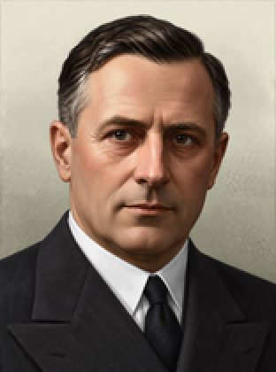

**Vanilla backdrop (since 0.3.4).** Leaders and commanders share one vanilla backdrop: a plain pale cream-grey studio background (about RGB 229, 226, 209 at the top, L*a*b* 89.8, -1.9, 8.5 in the top corners), darker toward the bottom (about 190, 186, 170 at the sides by the shoulders). 424 of the 447 decodable portraits outside the scientists folder use it. The rest are special portraits. The rule asks for this backdrop, and the `backdrop` check warns (`GFX-PORTRAIT-BACKDROP`) when the top corners are more than 15 away from it. The vanilla-match check compares the corners' lightness and yellow-blue tone with this family's own files.

| | |
|---|---|
| Group and tool | portrait, `hoi4.image_portrait` |
| Canvas and frames | 156x210, 1 frame; DDS |
| Names the game looks up | the script names the sprite in full, so the name is free. The example installs `GFX_portrait_statesman`. |
| Script | character portraits: large = GFX_portrait_statesman |
| Installed files (example) | `gfx/leaders/gallery/portrait_statesman.dds` |
| Processing | recipe `portrait` v1: flatten, then a head-and-shoulders crop found with YuNet face detection. Ran: `flatten_on` (background [0, 0, 0]), then finishing `extract_portrait` |
| Checks | `size`, `checker`, `opaque`, `style`, `dds` |
| Made | 2026-11-02 on `gpt-6-luna` (high reasoning effort), image tool `gpt-image-2-codex`, quality low, source 1081x1455 |
| Image SHA-256 | `48bb1b8e3cefb95a54ecf2e534543aff8be2e6556ccc4a67f62988ad9cf3afa1` |

```sh
hoi4-imagegen call hoi4.image_portrait '{"family": "leader_portrait", "feature_slug": "gallery", "asset": "statesman", "brief": "A fictional statesman in his fifties, dark double-breasted suit, serious expression, 1930s painted portrait", "approve": true, "idempotency_key": "gallery-leader_portrait-1"}'
```

<details><summary>Vanilla evidence for the name</summary>

common/characters/*.txt: 2,045 of 2,047 large values are full GFX_ names (interface/_scientists_portraits.gfx:7 GFX_portrait_AST_lawrence_wackett)

</details>

### operative_portrait

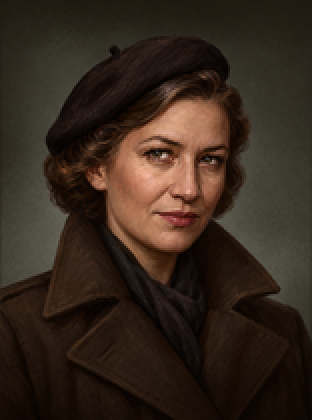

**Vanilla backdrop (since 0.3.4).** Vanilla's operative portraits are La Resistance's 163 `portrait_*_operative_*` files at 156x210 (`dlc/dlc028_la_resistance/gfx/leaders/<region>/`). All of them share one backdrop: a dark warm charcoal studio background (about RGB 34, 31, 24 in the top corners, L*a*b* 11.9, -0.1, 5.3) with a soft lighter spotlight behind the figure. The glow is centred behind the head and shoulders and is lightest beside the shoulders (about RGB 95, 92, 85 at two thirds of the height, 17.1 to 29.2 lighter in L* than the corners). The family's vanilla references and its vanilla-match check use these files and a mod's own operatives folder. The base game's grey `operative_unknown` silhouette is a placeholder and is not used. The rule asks for this backdrop. The `backdrop` check warns when the top corners are more than 15 away from it, or when the side band is less than 15 lighter than the corners, as on the gallery's two operatives (0.2 and 11.4): dark but evenly lit.

| | |
|---|---|
| Group and tool | portrait, `hoi4.image_portrait` |
| Canvas and frames | 156x210, 1 frame; DDS |
| Names the game looks up | the script names the sprite in full, so the name is free. The example installs `GFX_portrait_agent`. |
| Script | character portraits: large = GFX_portrait_agent |
| Installed files (example) | `gfx/leaders/gallery/operatives/portrait_agent.dds` |
| Processing | recipe `portrait` v1: flatten, then a head-and-shoulders crop found with YuNet face detection. Ran: `flatten_on` (background [0, 0, 0]), then finishing `extract_portrait` |
| Checks | `size`, `checker`, `opaque`, `style`, `dds` |
| Made | 2026-11-02 on `gpt-6-luna` (high reasoning effort), image tool `gpt-image-2-codex`, quality medium, source 1081x1455 |
| Image SHA-256 | `8dd94ed960638e22888d233cce17ded5bcb3794ad1eba157b51fce40f89990b6` |

```sh
hoi4-imagegen call hoi4.image_portrait '{"family": "operative_portrait", "feature_slug": "gallery", "asset": "agent", "brief": "A fictional woman agent in a beret and a brown trench coat, calm expression, 1940s painted portrait", "approve": true, "idempotency_key": "gallery-operative_portrait-1"}'
```

<details><summary>Vanilla evidence for the name</summary>

common/characters/*.txt: 2,045 of 2,047 large values are full GFX_ names (interface/_scientists_portraits.gfx:7 GFX_portrait_AST_lawrence_wackett)

</details>

### scientist_portrait


**Vanilla backdrop (since 0.3.4).** All 217 vanilla scientist portraits (`gfx/leaders/scientists`) share one backdrop: a plain pale blue-grey studio background lit from the upper left (about RGB 135, 171, 193 at the top left, L*a*b* 66.0, -7.2, -14.4 in the top corners) and darker toward the lower right (about 93, 129, 151). It is not the leaders' cream. The family's vanilla references and its vanilla-match check now use only this folder, the rule names the backdrop, and the `backdrop` check warns when the top corners are more than 15 away from it.

| | |
|---|---|
| Group and tool | portrait, `hoi4.image_portrait` |
| Canvas and frames | 156x210, 1 frame; DDS |
| Names the game looks up | the script names the sprite in full, so the name is free. The example installs `GFX_portrait_physicist`. |
| Script | character portraits: large = GFX_portrait_physicist |
| Installed files (example) | `gfx/leaders/gallery/scientists/portrait_physicist.dds` |
| Processing | recipe `portrait` v1: flatten, then a head-and-shoulders crop found with YuNet face detection. Ran: `flatten_on` (background [0, 0, 0]), then finishing `extract_portrait` |
| Checks | `size`, `checker`, `opaque`, `style`, `dds` |
| Made | 2026-11-02 on `gpt-6-luna` (high reasoning effort), image tool `gpt-image-2-codex`, quality medium, source 1080x1456 |
| Image SHA-256 | `bc45e7d8ad4ab3c2e9023eb997e687df87a2bfb67da927b10ad666913965ebb1` |

```sh
hoi4-imagegen call hoi4.image_portrait '{"family": "scientist_portrait", "feature_slug": "gallery", "asset": "physicist", "brief": "A fictional physicist in a white lab coat and tie, grey hair, thoughtful expression, 1940s painted portrait", "approve": true, "idempotency_key": "gallery-scientist_portrait-1"}'
```

<details><summary>Vanilla evidence for the name</summary>

common/characters/*.txt: 2,045 of 2,047 large values are full GFX_ names (interface/_scientists_portraits.gfx:7 GFX_portrait_AST_lawrence_wackett)

</details>

## Flags

Planned with `hoi4.image_flag`.

### flag

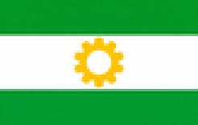

| | |
|---|---|
| Group and tool | flag, `hoi4.image_flag` |
| Canvas and frames | 82x52, 1 frame; TGA |
| Names the game looks up | the game loads the file by name, no sprite. |
| Script | no script: the game loads gfx/flags/<TAG>[_ideology].tga and the medium and small copies by file name |
| Installed files (example) | `gfx/flags/IRP_fascism.tga`<br>`gfx/flags/medium/IRP_fascism.tga`<br>`gfx/flags/small/IRP_fascism.tga` |
| Processing | recipe `flag` v1: flatten, then the 82x52, 41x26 and 10x7 ladder (three bottom-left TGA). Ran: `flatten_on` (background [0, 0, 0]), then finishing `flag_ladder` |
| Checks | `size`, `opaque`, `style`, `tga` |
| Made | 2026-11-02 on `gpt-6-luna` (high reasoning effort), image tool `gpt-image-2-codex`, quality low, source 1536x1024 |
| Image SHA-256 | `1e19bb6d9cbeaba443d6aa7a1ea8c36c0f4e353977be428499218e1bc1b1201e` |

```sh
hoi4-imagegen call hoi4.image_flag '{"family": "flag", "feature_slug": "gallery", "asset": "IRP_fascism", "brief": "A flag with three horizontal bands, green, white and green, and a golden gear in the centre", "approve": true, "idempotency_key": "gallery-flag-1"}'
```

<details><summary>Vanilla evidence for the name</summary>

gfx/flags, gfx/flags/medium, gfx/flags/small (82x52, 41x26, 10x7)

</details>

## Units, logos and buildings

Planned with `hoi4.image_unit`.

### agency_logo

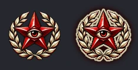

| | |
|---|---|
| Group and tool | unit, `hoi4.image_unit` |
| Canvas and frames | 117x119 per frame, 2 frames side by side in a 234x119 strip; DDS |
| Names the game looks up | the script names the sprite in full, so the name is free. The example installs `GFX_intelligence_agency_logo_state_security`. |
| Script | intelligence agency: picture = GFX_intelligence_agency_logo_state_security |
| Installed files (example) | `gfx/interface/operatives/agencies/gallery/agency_logo_state_security.dds` |
| Processing | recipe `selected_strip` v1: fit with a margin, then frame 2 as the selected state. Ran: `defringe` (erosion 1) → `trim_to_subject` → `fit_subject` (height 119, margin 14, width 117) → `selected_frame` (frames 2) |
| Checks | `size`, `alpha`, `frames`, `style`, `dds` |
| Made | 2026-11-02 on `gpt-6-luna` (high reasoning effort), image tool `gpt-image-2-codex`, quality medium, source 1254x1254 |
| Image SHA-256 | `a626d96d3bb1474d850fd4bb1e495faeedcae3a3fafbf40b9d77c17bca897afd` |

```sh
hoi4-imagegen call hoi4.image_unit '{"family": "agency_logo", "feature_slug": "gallery", "asset": "state_security", "brief": "A round emblem with a five-pointed star containing a watching eye inside a laurel wreath, red and white, painted in the dark, muted Hearts of Iron IV style", "approve": true, "idempotency_key": "gallery-agency_logo-1"}'
```

<details><summary>Vanilla evidence for the name</summary>

common/intelligence_agencies/00_intelligence_agencies.txt:719 picture = GFX_intelligence_agency_logo_AFG_communism (noOfFrames = 2)

</details>

### building

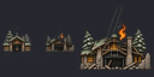

**Entity (since 0.3.5).** The install writes the icons and sprites only. A landmark building with no `gfx/entities` entry named `building_<building key>` cannot be placed: error.log says "Building <key> doesn't have an entity". The install output, the handoff note and the receipt carry this note. The tool does not generate entities.

**Vanilla form (since 0.3.2).** Measured on the 27 vanilla 128x64 landmark strips (`eiffel_tower_icon`, `big_ben_icon`, `colosseum_icon`): frame 1 is a real-world landmark (a monument, a government building, a tower, a statue, a dam or an industrial site) as a small, detailed painted miniature in muted stone colours with a dark outline, seen from the front at a slightly raised angle. It stands on nothing: no ground, rock or hill under it, only water for a dam or a canal. Frame 2 is the same building as ruins with one small orange flame above it. There is no landscape, backdrop or diorama base, and no fantasy castle. References come from these 128x64 strips only, because vanilla's 64x32 small strips are flat orange pictograms, a different form. Since 0.3.4 the rule also keeps the building compact and centred, at most about four times as wide as tall: frame 1 of vanilla's landmarks runs from 0.34 (Big Ben) to 4.0 (the small Cataract dam), median 1.41, and its box is always centred. A long dam, wall or palace is shown foreshortened, from an angle or as its central part. The citadel above predates these rules and stands on a hill.

| | |
|---|---|
| Group and tool | unit, `hoi4.image_unit` |
| Canvas and frames | 64x64 per frame, 2 frames side by side in a 128x64 strip; DDS |
| Also accepted | 32x32 |
| Names the game looks up | the script names the sprite in full, so the name is free. The example installs `GFX_citadel_icon`, `GFX_citadel_icon_small`. |
| Script | landmark building: special_icon = GFX_citadel_icon_small (the raid window shows the large GFX_citadel_icon). The building also needs an entity: add an entry named building_<building key> under gfx/entities (the key is the building's name in common/buildings), or the game logs "Building <building key> doesn't have an entity" and the landmark cannot be placed. Vanilla names the entity building_landmark_eiffel_tower for the building landmark_eiffel_tower (gfx/entities/landmarks.asset, with its mesh in landmarks.gfx), and also defines building_landmark_eiffel_tower_destroyed. This tool does not write entities |
| Installed files (example) | `gfx/interface/buildings/gallery/building_citadel.dds`<br>`gfx/interface/buildings/gallery/building_citadel_small.dds` |
| Processing | recipe `landmark_strip` v1: fit, then frame 2 as the ruined landmark from a second candidate. Ran: `defringe` (erosion 1) → `trim_to_subject` → `fit_subject` (height 64, margin 2, width 64), then finishing `second_frame`, `derived_companions` |
| Checks | `size`, `alpha`, `frames`, `style`, `dds` |
| Made | 2026-11-02 on `gpt-6-luna` (high reasoning effort), image tool `gpt-image-2-codex`, quality medium, source 1254x1254 |
| Image SHA-256 | `0b9ecf6eadef8a403a3851a6681cb54ab9de0d905aaf93fa43d4610afa06f872` |

```sh
hoi4-imagegen call hoi4.image_unit '{"family": "building", "feature_slug": "gallery", "asset": "citadel", "brief": "A walled citadel with towers on a hilltop, painted in the dark, muted Hearts of Iron IV style", "approve": true, "idempotency_key": "gallery-building-1"}'
```

<details><summary>Vanilla evidence for the name</summary>

common/buildings/01_landmark_buildings.txt:134 special_icon = GFX_eiffel_tower_icon_small -> interface/buildings/landmarks.gfx:144; the large GFX_eiffel_tower_icon is at :7 under '# Big Icons in Raid Window #' and no file names it; gfx/entities/landmarks.asset:134 name = "building_landmark_eiffel_tower" is the entity of the building landmark_eiffel_tower

</details>

### counter_large


| | |
|---|---|
| Group and tool | unit, `hoi4.image_unit` |
| Canvas and frames | 76x42 per frame, 2 frames side by side in a 152x42 strip; DDS |
| Names the game looks up | the game builds the sprite name from the key of the object it belongs to. The example installs `GFX_unit_combat_engineers_icon_medium`. |
| Script | name the sub-unit combat_engineers in common/units (the battalion icon is GFX_unit_<sub-unit key>_icon_medium) |
| Installed files (example) | `gfx/interface/counters/divisions_large/gallery/unit_combat_engineers.dds` |
| Processing | recipe `imported_art` v1: import only: the exact strip, or one file per frame. Ran: `conform` (height 42, width 152) |
| Checks | `size`, `alpha`, `frames`, `style`, `dds` |
| Made | 2026-11-02. The tool does not generate this family, so the source art was made on the same ChatGPT login with the `gptimage` MCP (1536x1024, 1536x1024), cut to the exact frames and imported with `hoi4.image_process` |
| Image SHA-256 | `9d769fa81f6e5ba23babbc127de85024ef23aba1021c416bbe9d7be4b603cdbc` |

```sh
hoi4-imagegen call hoi4.image_process '{"import": {"frames": ["incoming/cl_f1.png", "incoming/cl_f2.png"], "family": "counter_large", "feature_slug": "gallery", "asset": "combat_engineers"}}'
```

Source prompts:

> A Hearts of Iron IV style military map counter icon for a combat engineer battalion: bold pure white line-art silhouette of a pickaxe crossed with a rifle, flat, no shading, thick simple strokes, wide composition filling the frame horizontally, genuine transparent background, no text, no frame.

> A Hearts of Iron IV style military map counter icon, selected state, for a combat engineer battalion: the same bold line-art silhouette of a pickaxe crossed with a rifle, but drawn in bright warm yellow-white with a soft glowing outline, flat, thick simple strokes, wide composition filling the frame horizontally, genuine transparent background, no text, no frame.

<details><summary>Vanilla evidence for the name</summary>

interface/subuniticons.gfx:81 GFX_unit_engineer_icon_medium for sub-unit engineer, whose sprite is infantry (common/units/engineer.txt:4): the key, not sprite, names the icon; 100 sub-units whose sprite differs from the key all have GFX_unit_<key>_icon_medium; hoi4.exe has GFX_unit_ and _icon_medium

</details>

### counter_small

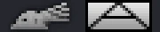

**Text icon (since 0.3.5).** The install writes the tooltip text icon `GFX_unit_<sub-unit key>_icon_small` with `legacy_lazy_load = no`, as all 201 vanilla text icons have it. Without the line the icon is blank in the division tooltip. The on-map sprite and every other family's sprites do not get the line, because vanilla uses it on under 1% of them (see the install section of the reference).

| | |
|---|---|
| Group and tool | unit, `hoi4.image_unit` |
| Canvas and frames | 30x12 per frame, 2 frames side by side in a 60x12 strip; DDS |
| Names the game looks up | the game builds the sprite name from the key of the object it belongs to. The example installs `GFX_unit_infantry_rifle_icon_medium_white`, `GFX_unit_infantry_rifle_icon_small`. |
| Script | name the sub-unit infantry_rifle in common/units (the on-map counter is GFX_unit_<sub-unit key>_icon_medium_white, the tooltip text icon GFX_unit_<sub-unit key>_icon_small) |
| Installed files (example) | `gfx/interface/counters/divisions_small/gallery/onmap_unit_infantry_rifle.dds`<br>`gfx/texticons/gallery/unit_infantry_rifle_icon_small.dds` |
| Processing | recipe `imported_art` v1: import only: the exact strip, or one file per frame. Ran: `conform` (height 12, width 60), then finishing `derived_companions` |
| Checks | `size`, `alpha`, `frames`, `style`, `dds` |
| Made | 2026-11-02. The tool does not generate this family, so the source art was made on the same ChatGPT login with the `gptimage` MCP (1983x793, 1983x793), cut to the exact frames and imported with `hoi4.image_process` |
| Image SHA-256 | `b8efc614c037e80cf433585c906ab4711e7943c29bc81f1dc86f91068a677777` |

```sh
hoi4-imagegen call hoi4.image_process '{"import": {"frames": ["incoming/cs_f1.png", "incoming/cs_f2.png"], "family": "counter_small", "feature_slug": "gallery", "asset": "infantry_rifle"}}'
```

Source prompts:

> A tiny Hearts of Iron IV style on-map unit counter icon for an infantry battalion: a bold pure white silhouette of a WWII bolt-action rifle seen from the side, pointing right, very simple, thick shape readable at 30x12 pixels, very wide composition, flat, genuine transparent background, no text, no frame.

> A tiny Hearts of Iron IV style on-map unit counter icon, selected state, for an infantry battalion: the same bold rifle silhouette in bright warm yellow with a soft glow, very simple, thick shape readable at 30x12 pixels, very wide composition, flat, genuine transparent background, no text, no frame.

<details><summary>Vanilla evidence for the name</summary>

interface/subuniticons.gfx:201 GFX_unit_infantry_icon_medium_white (noOfFrames = 2); interface/texticons.gfx:953 GFX_unit_infantry_icon_small (noOfFrames = 2); hoi4.exe has _icon_medium_white and builds unit_<key>_icon_small| text icons for sub-unit tooltips

</details>

### division_emblem

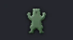

**Vanilla form (since 0.3.2).** Measured on the 101 vanilla symbols (`custom_template_000` to `custom_template_121`): one plain heraldic or unit symbol, such as an animal head, a skull, a helmet, a star or wings, shown as an embossed grey-green metal sign that covers about 21 percent of the canvas. The model draws it as one black silhouette and the `division_symbol` recipe renders vanilla's material. The red symbol above was imported before the recipe existed and is not the vanilla form.

| | |
|---|---|
| Group and tool | unit, `hoi4.image_unit` |
| Canvas and frames | 76x42, 1 frame; DDS |
| Names the game looks up | the game picks the sprite by number. The example installs `GFX_div_templ_122_large`, `GFX_div_templ_122_small`. |
| Script | no script: the player picks symbol 122 in the division designer (GFX_div_templ_122_large and GFX_div_templ_122_small) |
| Installed files (example) | `gfx/interface/counters/division_templates_large/gallery/custom_lightning_shield.dds`<br>`gfx/interface/counters/division_templates_small/gallery/custom_lightning_shield.dds` |
| Processing | recipe `imported_art` v1: import only: the exact strip, or one file per frame. Ran: `conform` (height 42, width 76), then finishing `derived_companions` |
| Checks | `size`, `alpha`, `frames`, `style`, `dds` |
| Made | 2026-11-02. The tool does not generate this family, so the source art was made on the same ChatGPT login with the `gptimage` MCP (1536x1024), cut to the exact frames and imported with `hoi4.image_process` |
| Image SHA-256 | `00400feecb29383bb3e5088a56775c3b0f439be6b6b28454f006934627524afb` |

```sh
hoi4-imagegen call hoi4.image_process '{"import": {"path": "incoming/de.png", "family": "division_emblem", "feature_slug": "gallery", "asset": "lightning_shield"}}'
```

Source prompts:

> A Hearts of Iron IV division designer emblem symbol: a bold stylised lightning bolt cutting through a round shield outline, two flat colours (white and signal red), clean thick shapes, wide composition, genuine transparent background, no text, no frame.

<details><summary>Vanilla evidence for the name</summary>

interface/subuniticons.gfx:318 GFX_div_templ_0_large to :418 GFX_div_templ_121_large and :425 GFX_div_templ_0_small; numbers 0-43 and 65-121 (a gap at 44-64); hoi4.exe has GFX_div_templ_ and _large

</details>

### faction_logo

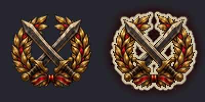

| | |
|---|---|
| Group and tool | unit, `hoi4.image_unit` |
| Canvas and frames | 100x100 per frame, 2 frames side by side in a 200x100 strip; DDS |
| Names the game looks up | the script names the sprite in full, so the name is free. The example installs `GFX_faction_logo_iron_pact`, `GFX_faction_logo_iron_pact_miniature`. |
| Script | faction: icon = GFX_faction_logo_iron_pact (the game also loads GFX_faction_logo_iron_pact_miniature) |
| Installed files (example) | `gfx/interface/factions/faction_logos/gallery/faction_logo_iron_pact.dds`<br>`gfx/interface/factions/faction_logos/gallery/faction_logo_iron_pact_miniature.dds` |
| Processing | recipe `selected_strip` v1: fit with a margin, then frame 2 as the selected state. Ran: `defringe` (erosion 1) → `trim_to_subject` → `fit_subject` (height 100, margin 10, width 100) → `selected_frame` (frames 2), then finishing `derived_companions` |
| Checks | `size`, `alpha`, `frames`, `style`, `dds` |
| Made | 2026-11-02 on `gpt-6-luna` (high reasoning effort), image tool `gpt-image-2-codex`, quality medium, source 1254x1254 |
| Image SHA-256 | `0e3f931d1d6374ac6ced405f669ecf3e04c5c323b3bd16439dcc87b75dda89c6` |

```sh
hoi4-imagegen call hoi4.image_unit '{"family": "faction_logo", "feature_slug": "gallery", "asset": "iron_pact", "brief": "A round emblem with two crossed swords inside a laurel wreath, red and gold, painted in the dark, muted Hearts of Iron IV style", "approve": true, "idempotency_key": "gallery-faction_logo-1"}'
```

<details><summary>Vanilla evidence for the name</summary>

common/factions/templates/allies.txt:30 icon = GFX_faction_icon_allies; interface/factions/factions.gfx:20 GFX_faction_logo_axis and :175 GFX_faction_logo_axis_miniature: all 31 logos have a 32x32 _miniature and hoi4.exe has the string _miniature

</details>

## Interface

Planned with `hoi4.image_interface`.

### gui_texture

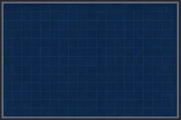

**Vanilla form and references (since 0.3.2).** Vanilla GUI textures are flat interface material seen straight on: dark charcoal, gunmetal, olive green or worn leather with thin bevelled edges. Pass `texture_kind` (`button`, `frame`, `panel` or `background`) to add that kind's form to the prompt and to take vanilla references of that kind: buttons from `gfx/interface/button_*` and `gfx/interface/buttons/` (34 files), frames from `gfx/interface/*_frame*` without the multi-frame strips (empty-middle borders), panels from `gfx/interface/tiles/tiled_*` (48 stretchable plates) and backgrounds from the `gfx/interface/*_bg` files of at least 256 px a side (71 window backgrounds). Without a kind there is no automatic reference.

| | |
|---|---|
| Group and tool | interface, `hoi4.image_interface` |
| Canvas and frames | set by the mod (no vanilla texture to measure), 1 frame; DDS |
| Names the game looks up | the script names the sprite in full, so the name is free. The example installs `GFX_gui_panel_leather`. |
| Script | a .gui element: spriteType = "GFX_gui_panel_leather" |
| Installed files (example) | `gfx/interface/gallery/gui_panel_leather.dds` |
| Processing | recipe `icon` v1: trim, fit to the canvas with the profile margin, grayscale where the family needs it. Ran: `trim_to_subject` → `fit_subject` (height 200, margin 1, width 300) |
| Checks | `size`, `alpha`, `style`, `dds` |
| Made | 2026-11-02 on `gpt-6-luna` (high reasoning effort), image tool `gpt-image-2-codex`, quality medium, source 1536x1024 |
| Image SHA-256 | `9a6f50e0af8383ae10b83ec5ee773ebcb2ce7be1117cd684319739079b5cb6be` |

```sh
hoi4-imagegen call hoi4.image_interface '{"family": "gui_texture", "feature_slug": "gallery", "asset": "panel_leather", "brief": "A dark brown leather panel with brass corner studs and a thin gold border line, flat front view, no scene, painted in the dark, muted Hearts of Iron IV style", "approve": true, "idempotency_key": "gallery-gui_texture-1", "canvas": [300, 200]}'
```

<details><summary>Vanilla evidence for the name</summary>

interface/*.gui name sprites in full

</details>

### modifier_stat_icon

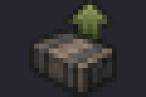

| | |
|---|---|
| Group and tool | interface, `hoi4.image_interface` |
| Canvas and frames | 30x20, 1 frame; DDS |
| Names the game looks up | the script names the sprite in full, so the name is free. The example installs `GFX_MODIFIER_SUPPLY_BONUS`. |
| Script | a .gui element: spriteType = "GFX_MODIFIER_SUPPLY_BONUS" |
| Installed files (example) | `gfx/interface/modifiers/gallery/modifier_supply_bonus.dds` |
| Processing | recipe `icon` v1: trim, fit to the canvas with the profile margin, grayscale where the family needs it. Ran: `trim_to_subject` → `fit_subject` (height 20, margin 0, width 30) |
| Checks | `size`, `alpha`, `style`, `dds` |
| Made | 2026-11-02 on `gpt-6-luna` (high reasoning effort), image tool `gpt-image-2-codex`, quality medium, source 1536x1024 |
| Image SHA-256 | `288ecc4ac784c4990e39c5e275e9ce645d6facf69f9590d30fcb8914d9c9d54e` |

```sh
hoi4-imagegen call hoi4.image_interface '{"family": "modifier_stat_icon", "feature_slug": "gallery", "asset": "supply_bonus", "brief": "A small crate with a green upward arrow, painted in the dark, muted Hearts of Iron IV style", "approve": true, "idempotency_key": "gallery-modifier_stat_icon-1"}'
```

<details><summary>Vanilla evidence for the name</summary>

interface/unitleaderwindow.gui:468 spriteType = "GFX_MODIFIER_SUPPLY_CONSUMPTION_FACTOR" -> interface/countryarmyview.gfx:173; hoi4.exe builds no GFX_MODIFIER_ name, and all 159 vanilla ones are upper case

</details>

### super_event

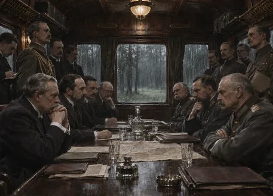

| | |
|---|---|
| Group and tool | interface, `hoi4.image_interface` |
| Canvas and frames | set by the mod (no vanilla texture to measure), 1 frame; DDS |
| Names the game looks up | the script names the sprite in full, so the name is free. The example installs `GFX_super_event_armistice`. |
| Script | the mod's super event window: spriteType = "GFX_super_event_armistice" |
| Installed files (example) | `gfx/super_events/gallery/super_event_armistice.dds` |
| Processing | recipe `picture` v1: flatten on black, cover-resize, grayscale for news. Ran: `flatten_on` (background [0, 0, 0]) → `cover_resize` (height 328, width 457) |
| Checks | `size`, `checker`, `opaque`, `style`, `dds` |
| Made | 2026-11-02 on `gpt-6-luna` (high reasoning effort), image tool `gpt-image-2-codex`, quality medium, source 1480x1062 |
| Image SHA-256 | `c0a192a2853eaad3a69a2db6ca29cb37a6ed1afcb7708cf12628d59dd005584d` |

```sh
hoi4-imagegen call hoi4.image_interface '{"family": "super_event", "feature_slug": "gallery", "asset": "armistice", "brief": "An armistice signed at a polished table inside a railway carriage, officers in dress uniform, evening light through the windows, a painted illustration", "approve": true, "idempotency_key": "gallery-super_event-1", "canvas": [457, 328]}'
```

<details><summary>Vanilla evidence for the name</summary>

no vanilla super events; a mod's .gui names the sprite in full

</details>

## Animated sprites

Planned with `hoi4.image_animation`. These four families make `frameAnimatedSpriteType` strips, measured from the 160 that vanilla 1.19.4.1 registers (`scripts/measure_animated.py`). Only one base frame is generated. The other frames are derived from it, so shape, palette and position cannot drift between frames. The examples below are the tool's own preview GIFs, made by `hoi4.image_preview`. They are installed files, not in-game captures, and the strips have not been checked in game.

The examples were made on 2026-11-02 on the ChatGPT login (plan quota, no money): 4 generations and 2 edits, one at a time, with `scripts/make_animations.py`. A blend strip's GIF shows the engine's cross-fade as linear blends at 20 pictures a second, an approximation because the shader was not traced.

### anim_blend_glow

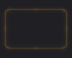

| | |
|---|---|
| Group and tool | animation, `hoi4.image_animation` |
| Frames | 2, `animation_rate_fps = 1`, `effectFile = "gfx/FX/buttonstate_blendframes.lua"`, `alwaystransparent = yes`, like 70 vanilla glows. The default frame is 37x49, and a plan passes `canvas` for the element the glow sits on (vanilla has 47 sizes over 66 textures). The example is 141x115 |
| Processing | recipe `anim_glow` v1: the model draws the bright glow on black. `flatten_on` → `black_to_alpha` (alpha is the brightest channel) → `fit_subject` → `glow_frames` (frame 1 is the glow at 0.17 of its alpha, the vanilla median) |
| Installed (example) | `GFX_glow_focus_ready`, `gfx/interface/animated/animated/glows/glow_focus_ready.dds` (282x115) |

### anim_blend_keyframes

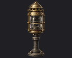

| | |
|---|---|
| Group and tool | animation, `hoi4.image_animation` |
| Frames | 3 key frames at 1 fps with the blend effect, like the ongoing-focus and spirit glows. 141x115 per frame |
| Processing | recipe `anim_keyframes` v1: frame 1 is generated. Frames 2 and 3 are `hoi4.image_edit` candidates of it ("the same lantern from the same angle, framing, size and style, its lens now glowing"), passed to `hoi4.image_process` as `frame_candidates`. `key_frames` fits all three with one shared crop and scale, so an edit that kept the framing lands where the base does |
| Installed (example) | `GFX_anim_signal_beacon`, `gfx/interface/animated/animated/keyframes/anim_signal_beacon.dds` (423x115) |

### anim_scroll

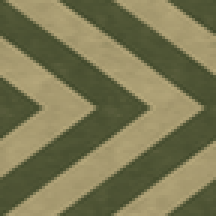

| | |
|---|---|
| Group and tool | animation, `hoi4.image_animation` |
| Frames | 9 at 15 fps with `loadType = "INGAME"` and `transparencecheck = yes`, the currently-researching highlight of 38 vanilla sprites. 72x72 per frame |
| Processing | recipe `anim_scroll` v1: `flatten_on` → `cover_resize` → `scroll_frames`. A repeating pattern is fitted to a whole number of its periods and its edges are blended with an in-phase copy, so the picture is seamless. Each frame moves it right by a ninth of the width |
| Installed (example) | `GFX_scroll_research_progress`, `gfx/interface/animated/animated/scroll/scroll_research_progress.dds` (648x72) |

### anim_spin

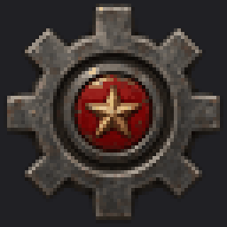

| | |
|---|---|
| Group and tool | animation, `hoi4.image_animation` |
| Frames | 20 at 7 fps with `loadType = "INGAME"` and `transparencecheck = yes`, like the turning cogs of the leader-group and navy views. The default frame is 26x26. The example is 64x64 |
| Processing | recipe `anim_spin` v1: `defringe` → `trim_to_subject` → `spin_frames`. The subject is fitted by its radius, so it stays inside the frame at every angle, and turned clockwise a full circle per loop. Each frame is turned at the source resolution and only then reduced |
| Installed (example) | `GFX_spin_industry_cog`, `gfx/interface/animated/animated/spin/spin_industry_cog.dds` (1280x64) |

### The animation check

| Code | What it means |
|---|---|
| `GFX-ANIM-STATIC` | an error: the frames are the same picture, so nothing moves |
| `GFX-ANIM-ALIGN` | a frame's centroid drifts from frame 1's by more than the motion allows (an error at twice the limit) |
| `GFX-ANIM-SILHOUETTE` | a frame's silhouette overlaps frame 1's less than the motion allows |
| `GFX-ANIM-PALETTE` | a frame's mean colour moves away from frame 1's |
| `GFX-ANIM-SEAM` | the step from the last frame back to the first is much larger than the others, so the loop visibly restarts |
| `GFX-ANIM-JUMP` | a warning: one step inside the loop is much larger than the others |

The limits come from the vanilla strips of each kind, and a test checks that those strips pass. All four examples pass. The warnings they carry are the motion itself: the lantern's colour changes as it lights up (`GFX-ANIM-PALETTE`), and the eight cog teeth overlap less half-way between two teeth (`GFX-ANIM-SILHOUETTE`). The audit adds `GFX-ANIM-FRAMES` for a mod `frameAnimatedSpriteType` that does not divide into its frames or lacks its family's frame count and effect file.

## Usage

The gallery used ChatGPT plan quota and no money (decision W5-1). It was made on 2026-11-02 with a ChatGPT Plus plan.

* **37 images generated by the tool**, one per family, plus **1 edit** (the ruined second frame of `building`): 38 responses on `gpt-6-luna` at high reasoning effort, all checked by the tool.
* **6 images made with the `gptimage` MCP** on the same login for the three import-only families (two frames for each counter, one for the division emblem, and one regenerated rifle that did not match its other frame).
* **1 discarded test generation** (a focus icon made while checking the setup, replaced by the one shown).
* In total 45 image responses. The backend does not report tokens or a price per image, so the plan's own usage meter is the only record.
* The backend chose the quality, as the [ChatGPT login notes](chatgpt-login.md#what-the-backend-controls) explain: 31 of 37 came back at medium and 6 at low (`advisor_card`, `commander_portrait`, `flag`, `leader_portrait`, `operation_picture`, `report_event`). Every one passed validation and the visual review at native size.

## The checks

| Check | What it looks at |
|---|---|
| `size` | canvas size is the family's size or an accepted alternative (`GFX-CANVAS-SIZE`) |
| `alpha` | real transparency from pixels, and a subject in it (`GFX-NO-ALPHA`, `GFX-EMPTY-SUBJECT`) |
| `opaque_canvas` | the subject is not an opaque rectangle (`GFX-OPAQUE-CANVAS`) |
| `fringe` | no magenta or green key-colour fringe on the edge (`GFX-CHROMA-FRINGE`) |
| `margin` | the subject keeps the family's margin (`GFX-MARGIN`) |
| `fill` | the subject is not undersized in its frame (`GFX-UNDERSIZED-SUBJECT`) |
| `checker` | no drawn checkerboard (`GFX-FAKE-CHECKERBOARD`) |
| `ghost` | the subject is not semi-transparent (`GFX-GHOSTED`) |
| `opaque` | no translucent pixel in an opaque picture (`GFX-ALPHA-IN-OPAQUE`) |
| `near_opaque` | the picture is opaque to within the template's own alpha (`GFX-ALPHA-IN-OPAQUE`) |
| `card_corners` | transparent card corners (`GFX-CARD-CORNERS`) |
| `frames` | the width divides into the frames (`GFX-FRAME-WIDTH`) |
| `animation` | an animated strip moves, and only as intended (`GFX-ANIM-STATIC`, `GFX-ANIM-ALIGN`, `GFX-ANIM-SILHOUETTE`, `GFX-ANIM-PALETTE`, `GFX-ANIM-SEAM`, `GFX-ANIM-JUMP`) |
| `style` | distance from the family's style references, a warning only (`GFX-STYLE-DRIFT`, `GFX-STYLE-MATCH`) |
| `dds` | DDS header and layout (`GFX-DDS-HEADER`, `GFX-TRUNCATED`, `GFX-LFS-POINTER`) |
| `tga` | TGA format and bottom-left origin (`GFX-TGA-FORMAT`, `GFX-FLAG-ORIGIN`) |

