# Gallery

Every generated image here was made by `hoi4-imagegen` on the ChatGPT login, then processed, validated and passed by the tool's own check against the game's art. Nothing is retouched. Only images processed on version 0.3.4 or later that pass both checks are shown: an image generated on an older build was processed again from its raw candidate. The gallery grows as more runs finish. Hover over an image for its prompt, or open the prompts under each family. Click an image to open it enlarged. The images labelled as references are the game's and the mods' own art, shown for comparison and credited to their makers.

## Family index

<table>
  <tr><td valign="top"><b><a href="#vanilla-style">Vanilla style</a></b></td><td><a href="#vanilla-focus">focus</a> &middot; <a href="#vanilla-idea-spirit">idea_spirit</a> &middot; <a href="#vanilla-idea-concern">idea_concern</a> &middot; <a href="#vanilla-officer-corps-spirit">officer_corps_spirit</a> &middot; <a href="#vanilla-decision">decision</a> &middot; <a href="#vanilla-decision-category-icon">decision_category_icon</a> &middot; <a href="#vanilla-state-modifier">state_modifier</a> &middot; <a href="#vanilla-special-project-icon">special_project_icon</a> &middot; <a href="#vanilla-raid">raid</a> &middot; <a href="#vanilla-mio-department">mio_department</a> &middot; <a href="#vanilla-mio-trait">mio_trait</a> &middot; <a href="#vanilla-mio-policy">mio_policy</a> &middot; <a href="#vanilla-bop-side">bop_side</a> &middot; <a href="#vanilla-medal">medal</a> &middot; <a href="#vanilla-agency-upgrade">agency_upgrade</a> &middot; <a href="#vanilla-operation-icon">operation_icon</a> &middot; <a href="#vanilla-commander-trait">commander_trait</a> &middot; <a href="#vanilla-personal-trait">personal_trait</a> &middot; <a href="#vanilla-doctrine">doctrine</a> &middot; <a href="#vanilla-report-event">report_event</a> &middot; <a href="#vanilla-news-event">news_event</a> &middot; <a href="#vanilla-operation-picture">operation_picture</a> &middot; <a href="#vanilla-technology">technology</a> &middot; <a href="#vanilla-achievement">achievement</a> &middot; <a href="#vanilla-super-event">super_event</a> &middot; <a href="#vanilla-leader-portrait">leader_portrait</a> &middot; <a href="#vanilla-commander-portrait">commander_portrait</a> &middot; <a href="#vanilla-operative-portrait">operative_portrait</a> &middot; <a href="#vanilla-scientist-portrait">scientist_portrait</a> &middot; <a href="#vanilla-advisor-card">advisor_card</a> &middot; <a href="#vanilla-flag">flag</a> &middot; <a href="#vanilla-building">building</a> &middot; <a href="#vanilla-faction-logo">faction_logo</a> &middot; <a href="#vanilla-agency-logo">agency_logo</a> &middot; <a href="#vanilla-counter-large">counter_large</a> &middot; <a href="#vanilla-counter-small">counter_small</a> &middot; <a href="#vanilla-division-emblem">division_emblem</a> &middot; <a href="#vanilla-modifier-stat-icon">modifier_stat_icon</a> &middot; <a href="#vanilla-gui-texture">gui_texture</a></td></tr>
  <tr><td valign="top"><b><a href="#tno-style">TNO style</a></b></td><td><a href="#tno-focus">focus</a> &middot; <a href="#tno-idea-spirit">idea_spirit</a> &middot; <a href="#tno-decision">decision</a> &middot; <a href="#tno-commander-trait">commander_trait</a> &middot; <a href="#tno-report-event">report_event</a> &middot; <a href="#tno-operation-picture">operation_picture</a> &middot; <a href="#tno-technology">technology</a> &middot; <a href="#tno-achievement">achievement</a> &middot; <a href="#tno-super-event">super_event</a> &middot; <a href="#tno-leader-portrait">leader_portrait</a> &middot; <a href="#tno-counter-large">counter_large</a> &middot; <a href="#tno-gui-texture">gui_texture</a></td></tr>
  <tr><td valign="top"><b><a href="#tfr-style">TFR style</a></b></td><td><a href="#tfr-focus">focus</a> &middot; <a href="#tfr-idea-spirit">idea_spirit</a> &middot; <a href="#tfr-decision">decision</a> &middot; <a href="#tfr-report-event">report_event</a> &middot; <a href="#tfr-decision-category-picture">decision_category_picture</a> &middot; <a href="#tfr-operation-picture">operation_picture</a> &middot; <a href="#tfr-technology">technology</a> &middot; <a href="#tfr-super-event">super_event</a> &middot; <a href="#tfr-leader-portrait">leader_portrait</a> &middot; <a href="#tfr-gui-texture">gui_texture</a></td></tr>
</table>

## Vanilla style

Each family in the game's own style, beside a few vanilla references from *Hearts of Iron IV* by Paradox Interactive.

### focus

100 x 88 px in the game, shown at 200 x 176 on a wide screen. 36 generated examples. Click an image to enlarge it.

<b>Vanilla reference</b> &middot; Hearts of Iron IV, Paradox Interactive

<table align="center">
  <tr><td align="center" valign="middle"></td><td align="center" valign="middle">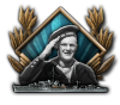</td><td align="center" valign="middle">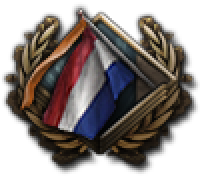</td></tr>
</table>

<b>Generated</b>

<table align="center">
  <tr><td align="center" valign="middle"><a href="vanilla/focus/armoured_column_parade@2x.webp">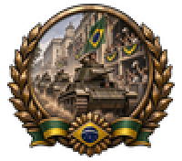</a></td><td align="center" valign="middle"></td><td align="center" valign="middle"><a href="vanilla/focus/assembly_line_trucks_v033@2x.webp">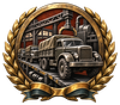</a></td></tr>
  <tr><td align="center" valign="middle"><a href="vanilla/focus/atlantic_convoy@2x.webp">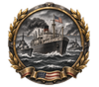</a></td><td align="center" valign="middle"><a href="vanilla/focus/battleship_broadside_v033@2x.webp">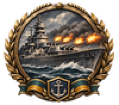</a></td><td align="center" valign="middle"><a href="vanilla/focus/blast_furnace_dawn@2x.webp">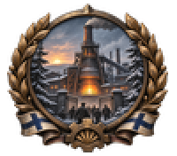</a></td></tr>
  <tr><td align="center" valign="middle"><a href="vanilla/focus/bomber_formation_v033@2x.webp">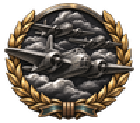</a></td><td align="center" valign="middle"><a href="vanilla/focus/coastal_radar_mast@2x.webp">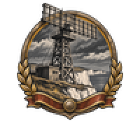</a></td><td align="center" valign="middle"><a href="vanilla/focus/cruiser_launch_slipway@2x.webp">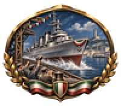</a></td></tr>
  <tr><td align="center" valign="middle"></td><td align="center" valign="middle"><a href="vanilla/focus/embassy_flags_handshake_v033@2x.webp">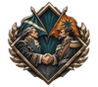</a></td><td align="center" valign="middle"><a href="vanilla/focus/fighter_dawn_scramble@2x.webp">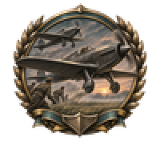</a></td></tr>
  <tr><td align="center" valign="middle"><a href="vanilla/focus/fortified_border_line_v033@2x.webp">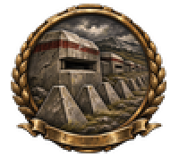</a></td><td align="center" valign="middle"><a href="vanilla/focus/frontier_fortress_turret@2x.webp">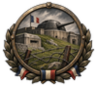</a></td><td align="center" valign="middle"><a href="vanilla/focus/highland_road_builders@2x.webp">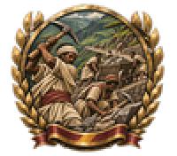</a></td></tr>
  <tr><td align="center" valign="middle"><a href="vanilla/focus/howitzer_hillside@2x.webp">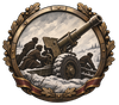</a></td><td align="center" valign="middle"><a href="vanilla/focus/infantry_bayonet_charge_v033@2x.webp">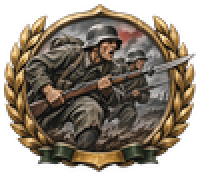</a></td><td align="center" valign="middle"><a href="vanilla/focus/irrigation_canal_gates@2x.webp">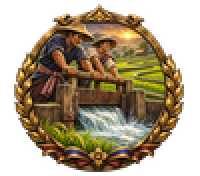</a></td></tr>
  <tr><td align="center" valign="middle"><a href="vanilla/focus/laboratory_microscope_v033@2x.webp">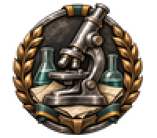</a></td><td align="center" valign="middle"><a href="vanilla/focus/land_reform_plough@2x.webp">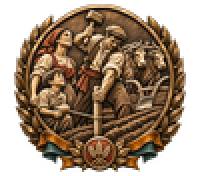</a></td><td align="center" valign="middle"><a href="vanilla/focus/oil_gusher_celebration@2x.webp">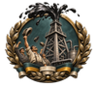</a></td></tr>
  <tr><td align="center" valign="middle"><a href="vanilla/focus/opera_mask_scroll@2x.webp">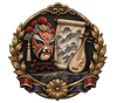</a></td><td align="center" valign="middle"><a href="vanilla/focus/orange_quay_trade@2x.webp">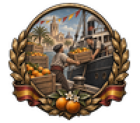</a></td><td align="center" valign="middle"><a href="vanilla/focus/paratrooper_drop@2x.webp">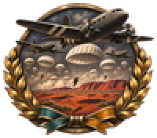</a></td></tr>
  <tr><td align="center" valign="middle"></td><td align="center" valign="middle"><a href="vanilla/focus/railway_viaduct_opening@2x.webp">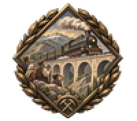</a></td><td align="center" valign="middle"><a href="vanilla/focus/rally_crowd_banners_v033@2x.webp">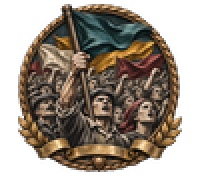</a></td></tr>
  <tr><td align="center" valign="middle"><a href="vanilla/focus/signed_treaty_quill_v033@2x.webp">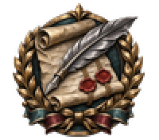</a></td><td align="center" valign="middle"><a href="vanilla/focus/steam_locomotive_power@2x.webp">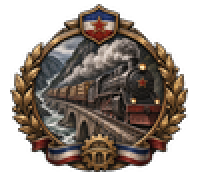</a></td><td align="center" valign="middle"><a href="vanilla/focus/steelworks_blast_furnace_v033@2x.webp">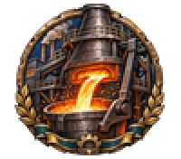</a></td></tr>
  <tr><td align="center" valign="middle"><a href="vanilla/focus/submarine_leaving_pen@2x.webp">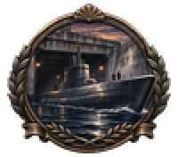</a></td><td align="center" valign="middle"><a href="vanilla/focus/submarine_periscope_v033@2x.webp">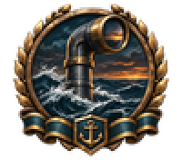</a></td><td align="center" valign="middle"><a href="vanilla/focus/torch_over_square@2x.webp">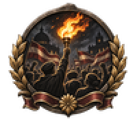</a></td></tr>
  <tr><td align="center" valign="middle"><a href="vanilla/focus/treaty_handshake@2x.webp">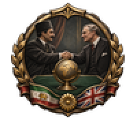</a></td><td align="center" valign="middle"></td><td align="center" valign="middle"><a href="vanilla/focus/wheat_and_gold_vault@2x.webp">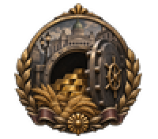</a></td></tr>
</table>

Prompts (36)

| Image | Build | Prompt |
|---|---|---|
| armoured column parade | build 0.3.4 | A column of Brazilian light tanks rolling through a dusty avenue in the 1940s, hatches open, crowds waving from balconies, triumphant mood. |
| assembly ballot vote | build 0.3.4 | A Swedish voter in a wool coat dropping a folded ballot into a wooden box before a columned assembly hall, calm and quiet civic mood. |
| assembly line trucks v033 | build 0.3.3, processed on 0.3.6 | Industry: army trucks rolling off a long assembly line. |
| atlantic convoy | build 0.3.4 | An American merchant convoy crossing a grey Atlantic with escort destroyers on the flanks and smoke on the horizon, grim resolve. |
| battleship broadside v033 | build 0.3.3, processed on 0.3.6 | Naval: a battleship firing a broadside at sea. |
| blast furnace dawn | build 0.3.4 | A Finnish steelworks blast furnace glowing orange at dawn above snowy pines, small silhouettes of workers at the gate, hopeful mood of rebuilding after a hard winter. |
| bomber formation v033 | build 0.3.3, processed on 0.3.6 | Air: a formation of twin-engine bombers over clouds. |
| coastal radar mast | build 0.3.4 | A British coastal radar mast on white chalk cliffs scanning above a calm grey sea in 1940, tense watchful mood. Bold two-colour carved print. |
| cruiser launch slipway | build 0.3.4 | A new Italian light cruiser sliding down the slipway into a Genoa harbour, bunting overhead and dockworkers cheering, festive and proud. |
| cyclotron laboratory | build 0.3.4 | A young researcher beside a brass-coiled cyclotron magnet in a university laboratory, dials and glass tubes glowing, hopeful 1940s scientific mood. |
| embassy flags handshake v033 | build 0.3.3, processed on 0.3.6 | Diplomacy: two envoys shaking hands under two invented national flags. |
| fighter dawn scramble | build 0.3.4 | Polish single-seat fighters taking off from a grass airfield at first light, ground crew running clear, tense and determined mood. |
| fortified border line v033 | build 0.3.3, processed on 0.3.6 | Military: a line of concrete bunkers and dragon's teeth along a border. |
| frontier fortress turret | build 0.3.4 | A French frontier fortress with an armoured gun turret rising from a green hillside, barbed wire in front, grim and steady mood. |
| highland road builders | build 0.3.4 | Ethiopian highland workers breaking rock with picks and hauling carts to build a mountain road, steep green valley behind them, 1930s hopeful effort. |
| howitzer hillside | build 0.3.4 | A heavy Soviet howitzer on a snowy hillside with its crew in dark silhouette, barrel raised against a pale sky, grim determination. |
| infantry bayonet charge v033 | build 0.3.3, processed on 0.3.6 | Military: infantrymen charging with fixed bayonets across a muddy field. |
| irrigation canal gates | build 0.3.4 | Thai farmers opening wooden irrigation sluice gates so water flows into green rice terraces, hopeful early-morning mood. |
| laboratory microscope v033 | build 0.3.3, processed on 0.3.6 | Research: a laboratory microscope beside glass flasks and notes. |
| land reform plough | build 0.3.4 | A southern Italian peasant family marking out their own field with boundary stakes beside a plough and oxen, hopeful early 1950s mood. Bold two-colour carved print. |
| oil gusher celebration | build 0.3.4 | A Mexican oil derrick erupting in a black gusher while oilfield workers throw their hats in the air, a festive mood of national pride in the late 1930s. |
| opera mask scroll | build 0.3.4 | A Chinese opera mask on a lacquered stand beside an unrolled scroll of mountain scenery and a lute, calm 1930s cultural mood. |
| orange quay trade | build 0.3.4 | Crates of Valencia oranges stacked on a quay beside a steamship, dockers loading by hand, festive early 1950s trade mood. |
| paratrooper drop | build 0.3.4 | A wing of transport aircraft over red Australian desert releasing a cloud of white parachutes, long shadows on the sand, tense 1940s mood. |
| parliament dome ballots v033 | build 0.3.3, processed on 0.3.6 | Politics: a parliament dome with ballot papers falling before it. |
| railway viaduct opening | build 0.3.4 | A Turkish steam locomotive crossing a new stone viaduct high in the Anatolian mountains, villagers watching from the ridge, triumphant mood. Soft flat gouache look. |
| rally crowd banners v033 | build 0.3.3, processed on 0.3.6 | Politics: a rally crowd raising banners in invented colours. |
| signed treaty quill v033 | build 0.3.3, processed on 0.3.6 | Diplomacy: a signed treaty with two wax seals and a quill pen. |
| steam locomotive power | build 0.3.4 | A Yugoslav steam locomotive thundering along a river gorge with timber wagons behind it, smoke streaming, confident mood of national infrastructure. |
| steelworks blast furnace v033 | build 0.3.3, processed on 0.3.6 | Industry: a blast furnace pouring molten steel into a ladle, sparks flying. |
| submarine leaving pen | build 0.3.4 | A sleek Japanese submarine gliding out of a concrete pen at dusk with its crew on deck, water dark and still, tense and quiet. |
| submarine periscope v033 | build 0.3.3, processed on 0.3.6 | Naval: a submarine periscope breaking the waves at dusk. |
| torch over square | build 0.3.4 | A burning torch raised high over a crowd of silhouetted citizens in a night city square under fictional striped banners, tense yet defiant. |
| treaty handshake | build 0.3.4 | A Persian envoy and a British diplomat in 1930s suits shake hands across a green felt table with a brass globe between them, quiet and hopeful mood. |
| village radio tower | build 0.3.4 | A tall radio mast above a Chinese village square where families gather around a loudspeaker, radio waves rippling outward, 1940s. Grainy ink and sepia sketch look. |
| wheat and gold vault | build 0.3.4 | An open bank vault in Buenos Aires with stacked gold bars beside heaped wheat sheaves, a promise of economic recovery in the 1930s. |

### idea_spirit

60 x 68 px in the game, shown at 180 x 204 on a wide screen. 24 generated examples. Click an image to enlarge it.

<b>Vanilla reference</b> &middot; Hearts of Iron IV, Paradox Interactive

<table align="center">
  <tr><td align="center" valign="middle">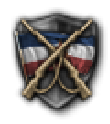</td><td align="center" valign="middle">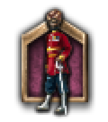</td><td align="center" valign="middle">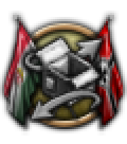</td><td align="center" valign="middle"></td></tr>
</table>

<b>Generated</b>

<table align="center">
  <tr><td align="center" valign="middle"><a href="vanilla/idea_spirit/alpine_village_guard@3x.webp">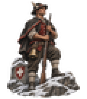</a></td><td align="center" valign="middle"><a href="vanilla/idea_spirit/barricade_curfew@3x.webp">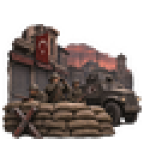</a></td><td align="center" valign="middle"><a href="vanilla/idea_spirit/blackout_street@3x.webp">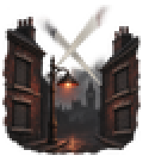</a></td><td align="center" valign="middle"><a href="vanilla/idea_spirit/emergency_cabinet_room@3x.webp">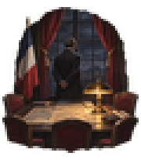</a></td></tr>
  <tr><td align="center" valign="middle"><a href="vanilla/idea_spirit/factory_belt_hall@3x.webp">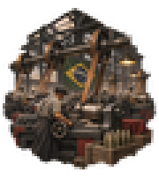</a></td><td align="center" valign="middle"><a href="vanilla/idea_spirit/faiths_united_gate@3x.webp">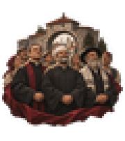</a></td><td align="center" valign="middle"><a href="vanilla/idea_spirit/harvest_festival_garlands@3x.webp">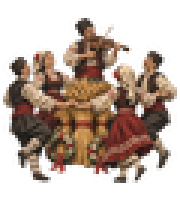</a></td><td align="center" valign="middle"><a href="vanilla/idea_spirit/highland_militia_dawn@3x.webp">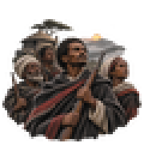</a></td></tr>
  <tr><td align="center" valign="middle"><a href="vanilla/idea_spirit/lantern_farmhouse_table@3x.webp">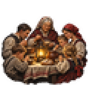</a></td><td align="center" valign="middle"><a href="vanilla/idea_spirit/market_piggy_bank@3x.webp">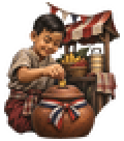</a></td><td align="center" valign="middle"><a href="vanilla/idea_spirit/newsroom_press_run@3x.webp">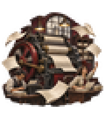</a></td><td align="center" valign="middle"><a href="vanilla/idea_spirit/ration_book_table@3x.webp">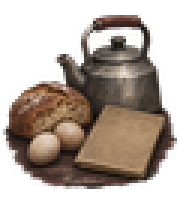</a></td></tr>
  <tr><td align="center" valign="middle"><a href="vanilla/idea_spirit/rebuilding_housing_blocks@3x.webp">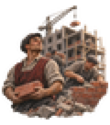</a></td><td align="center" valign="middle"></td><td align="center" valign="middle"></td><td align="center" valign="middle"></td></tr>
  <tr><td align="center" valign="middle"></td><td align="center" valign="middle"></td><td align="center" valign="middle"></td><td align="center" valign="middle"></td></tr>
  <tr><td align="center" valign="middle"></td><td align="center" valign="middle"></td><td align="center" valign="middle"></td><td align="center" valign="middle"></td></tr>
</table>

Prompts (24)

| Image | Build | Prompt |
|---|---|---|
| alpine village guard | build 0.3.1, processed on 0.3.6 | Swiss mountain villagers with rifles and a cowbell standing watch above a snowy pass, calm and watchful readiness. |
| barricade curfew | build 0.3.1, processed on 0.3.6 | Soldiers behind a sandbag barricade and an armoured car in an empty Turkish city square at dusk, shuttered shops, grim mood of martial law. |
| blackout street | build 0.3.1, processed on 0.3.6 | A darkened London street with shuttered windows, a single shaded lamp and searchlights crossing the night sky, tense watchful mood. |
| emergency cabinet room | build 0.3.1, processed on 0.3.6 | A French cabinet room at night, lamplit map table and a few empty chairs, a lone minister standing at a tall window, tense mood. |
| factory belt hall | build 0.3.1, processed on 0.3.6 | A vast Brazilian factory hall full of lathes driven by overhead leather belts, workers at every machine, busy mobilisation mood. |
| faiths united gate | build 0.3.1, processed on 0.3.6 | A priest, an imam and a rabbi in plain robes standing together before a Yugoslav town gate with villagers behind them, hopeful unity. |
| harvest festival garlands | build 0.3.1, processed on 0.3.6 | Bulgarian villagers dancing around wheat sheaves and garlands while a fiddler plays, a festive harvest mood. Soft flat gouache look. |
| highland militia dawn | build 0.3.1, processed on 0.3.6 | Ethiopian farmers with old rifles and cloaks gathering in a highland village at dawn, mist in the valley, resolute volunteer spirit. |
| lantern farmhouse table | build 0.3.1, processed on 0.3.6 | A large Polish farm family eating together around a lantern-lit table, grandmother at the head, quiet mood of tradition and home. |
| market piggy bank | build 0.3.1, processed on 0.3.6 | A Thai child dropping a coin into a clay savings pot beside a bustling market stall, festive mood of thrift and community. |
| newsroom press run | build 0.3.1, processed on 0.3.6 | An Argentine newsroom with a rotary press spinning and blank newspaper sheets flying through the air, journalists at desks, hopeful and busy. |
| ration book table | build 0.3.1, processed on 0.3.6 | A modest British kitchen table with a small loaf, two eggs, a tin kettle and a blank ration book, quiet make-do mood. |
| rebuilding housing blocks | build 0.3.1, processed on 0.3.6 | Hungarian bricklayers raising new apartment blocks among cleared rubble, scaffolding and cranes against a pale morning sky, early 1950s hopeful mood. |
| rooftop wardens | build 0.3.1, processed on 0.3.6 | Dutch air-raid wardens with helmets and wooden rattles on a gabled rooftop scanning the night sky over canals, tense and vigilant. |
| scorched earth field | build 0.3.1, processed on 0.3.6 | Peasants setting fire to their own wheat field beside a retreating road, black smoke towering over the steppe, grim defiance. Bold two-colour carved print. |
| scrap metal drive | build 0.3.1, processed on 0.3.6 | Japanese village children dragging a hand cart of old pots, pans and scrap iron down a lane lined with cherry trees, determined 1940s mood. |
| shadow at the door | build 0.3.1, processed on 0.3.6 | The long shadow of a man in a trench coat and fedora falling across a quiet apartment door at night, grim mood of watchfulness. Bold two-colour carved print. |
| station refugee welcome | build 0.3.1, processed on 0.3.6 | Swedish villagers handing bread and blankets to weary refugee families stepping off a train at a snowy station, compassionate quiet mood. |
| village loom wheel | build 0.3.1, processed on 0.3.6 | A Spanish village room with a hand loom and spinning wheel, homespun cloth and clay jugs, quiet mood of self-reliance. |
| village schoolhouse | build 0.3.1, processed on 0.3.6 | Children in a Mexican village schoolhouse learning with slates while a young teacher points at a globe, sunbeams through the window, hopeful 1930s mood. |
| war bond rally | build 0.3.1, processed on 0.3.6 | Housewives and factory workers queueing at a bond booth in an American small town, a tall gauge with stars rising beside them, hopeful wartime mood. |
| weary veterans trench | build 0.3.1, processed on 0.3.6 | Weary veterans resting against the mud wall of a rain-soaked trench with helmets low, a distant glow on the horizon, grim exhaustion. Grainy ink and sepia sketch look. |
| women welders | build 0.3.1, processed on 0.3.6 | Soviet women in headscarves welding at a bench in an aircraft factory, bright sparks flying, proud and tireless mood. |
| youth spade march | build 0.3.1, processed on 0.3.6 | Rows of Italian teenage boys in plain uniforms marching down a country road with spades over their shoulders, 1930s, disciplined mood. |

### idea_concern

64 x 64 px in the game, shown at 192 x 192 on a wide screen. 24 generated examples. Click an image to enlarge it.

<b>Vanilla reference</b> &middot; Hearts of Iron IV, Paradox Interactive

<table align="center">
  <tr><td align="center" valign="middle"></td><td align="center" valign="middle"></td><td align="center" valign="middle"></td></tr>
</table>

<b>Generated</b>

<table align="center">
  <tr><td align="center" valign="middle"></td><td align="center" valign="middle"></td><td align="center" valign="middle"></td></tr>
  <tr><td align="center" valign="middle"></td><td align="center" valign="middle"></td><td align="center" valign="middle"></td></tr>
  <tr><td align="center" valign="middle"></td><td align="center" valign="middle"></td><td align="center" valign="middle"></td></tr>
  <tr><td align="center" valign="middle"></td><td align="center" valign="middle"></td><td align="center" valign="middle"></td></tr>
  <tr><td align="center" valign="middle"></td><td align="center" valign="middle"></td><td align="center" valign="middle"></td></tr>
  <tr><td align="center" valign="middle"></td><td align="center" valign="middle"></td><td align="center" valign="middle"></td></tr>
  <tr><td align="center" valign="middle"></td><td align="center" valign="middle"></td><td align="center" valign="middle"></td></tr>
  <tr><td align="center" valign="middle"></td><td align="center" valign="middle"></td><td align="center" valign="middle"></td></tr>
</table>

Prompts (24)

| Image | Build | Prompt |
|---|---|---|
| aircraft plant fuselages | build 0.3.4 | An American aircraft plant with silver fuselages hanging in a long line from the ceiling, wings stacked below and morning light through high windows. |
| armour plate rolling | build 0.3.1, processed on 0.3.6 | A rolling mill where a glowing slab of armour plate is pulled between huge rollers, sparks scattering, steelworkers in the glare, Czech mood of power. |
| armoured car yard | build 0.3.1, processed on 0.3.6 | A yard full of freshly built armoured cars with open hatches parked in neat rows beside a brick factory with tall chimneys, French works. |
| bored barrel aa gun | build 0.3.4 | A Swedish ordnance works where a long anti-aircraft gun barrel is bored on a huge lathe, curls of bright steel on the floor, snowy yard outside. |
| brass cartridge mill | build 0.3.4 | A brass rolling mill with coils of golden metal, stamping presses and trays of shining cartridge cases, American small town works. |
| cable drum yard | build 0.3.4 | A cable works yard stacked with huge wooden drums of telegraph cable and coils of copper wire beside a railway siding, Spanish setting. |
| chemical works retorts | build 0.3.1, processed on 0.3.6 | A Norwegian explosives and chemical works beside a fjord, glass retorts, steel vats and pipe tangles under a pale sky, steam rising. |
| diesel engine hall | build 0.3.4 | A Swiss diesel engine works with a massive marine engine block under assembly, polished pistons and gauges, quiet precise craft. Soft flat gouache look. |
| flying boat hangar | build 0.3.4 | A giant hangar with a four-engined flying boat on a slipway, ground crew on its wing, bay water glittering outside, Australian works. |
| gun foundry pour | build 0.3.4 | A gun foundry where a glowing ladle pours molten steel into a mould for a long barrel, workers in leather aprons shielding their faces. Bold two-colour carved print. |
| locomotive erecting shop | build 0.3.4 | A Hungarian locomotive works erecting shop with a steam engine boiler lifted by a crane above its wheels, steam drifting through iron rafters. |
| motorcycle sidecar row | build 0.3.4 | A Polish factory floor with motorcycles and sidecar combinations lined up in a row, headlamps shining, workers wiping tanks with rags. |
| optics workshop lenses | build 0.3.4 | A Japanese optics workshop bench with binoculars, a rangefinder, polished lenses and brass tools under a single lamp, careful quiet craft. Grainy ink and sepia sketch look. |
| pontoon bridge sections | build 0.3.4 | Stacks of steel pontoon bridge sections and girders in an Austrian engineering yard, a crane lifting one over a flowing river. |
| radial engine test stand | build 0.3.4 | A British engine works with a radial aircraft engine on a test stand, propeller blurred, fitters in overalls watching gauges. |
| radio valve works | build 0.3.4 | A Dutch radio works bench covered with glowing valves, copper coils, dials and field radio sets in leather cases. |
| rifle armoury racks | build 0.3.4 | A Belgian arms factory proof room with rows of bolt-action rifles in racks and a bench of gleaming machined parts and gauges. |
| searchlight signal works | build 0.3.4 | A signals works with big searchlight drums, signal lamps and field telephones lined along a workbench, a Turkish factory in warm evening light. |
| shell filling hall | build 0.3.1, processed on 0.3.6 | Women in headscarves lining up rows of artillery shells on long tables inside a bright Soviet munitions hall, orderly and busy. |
| shipyard gantry hulls | build 0.3.4 | A Scottish shipyard with a great gantry crane over two half-built hulls on slipways, riveters' scaffolding and grey river beyond. |
| tank assembly hall | build 0.3.4 | A Czech tank works interior with armoured hulls on rails beneath overhead cranes, welders' sparks and turrets waiting in rows. |
| torpedo shop cradles | build 0.3.4 | A naval torpedo workshop with gleaming torpedoes resting in wooden cradles beside a chain hoist, German shipyard interior, damp and bluish light. |
| tractor tank works | build 0.3.4 | A Ukrainian tractor works where crawler tractors and early tanks sit side by side on the same assembly line, vast hall and misty light. |
| truck assembly line | build 0.3.4 | A line of half-built army lorries on an assembly floor, cabs waiting for engines, tyres stacked against the wall, Italian factory. |

### officer_corps_spirit

45 x 45 px in the game, shown at 135 x 135 on a wide screen. 12 generated examples. Click an image to enlarge it.

<b>Vanilla reference</b> &middot; Hearts of Iron IV, Paradox Interactive

<table align="center">
  <tr><td align="center" valign="middle"></td><td align="center" valign="middle"></td><td align="center" valign="middle"></td><td></td></tr>
</table>

<b>Generated</b>

<table align="center">
  <tr><td align="center" valign="middle"></td><td align="center" valign="middle"></td><td align="center" valign="middle"></td><td align="center" valign="middle"></td></tr>
  <tr><td align="center" valign="middle"></td><td align="center" valign="middle"></td><td align="center" valign="middle"></td><td align="center" valign="middle"></td></tr>
  <tr><td align="center" valign="middle"></td><td align="center" valign="middle"></td><td align="center" valign="middle"></td><td align="center" valign="middle"></td></tr>
</table>

Prompts (12)

| Image | Build | Prompt |
|---|---|---|
| alpine ice axe | build 0.3.1, processed on 0.3.6 | An Italian mountain officer with ice axe and rope on a high glacier, a line of troops behind him against bright peaks. Bold two-colour carved print. |
| braided hussar | build 0.3.1, processed on 0.3.6 | A Hungarian hussar officer in a braided jacket and plumed shako on a prancing horse, festive and proud cavalry pageantry. |
| campfire rice bowl | build 0.3.1, processed on 0.3.6 | A young Chinese officer sharing a bowl of rice with his soldiers around a night campfire, warm comradeship and humble mood. |
| desert patrol truck | build 0.3.1, processed on 0.3.6 | An Australian officer on the running board of a sand-coloured truck in tall dunes, scanning the horizon with binoculars, daring long-range raid. |
| lancer charge | build 0.3.1, processed on 0.3.6 | Polish cavalry officers at full gallop with lances lowered across a meadow, pennants streaming, bold and spirited mood of attack. |
| lantern trench map | build 0.3.1, processed on 0.3.6 | A calm French officer studying a trench map by lantern light in a deep dugout, sandbags around him, careful defensive caution. |
| naval sword telescope | build 0.3.1, processed on 0.3.6 | A naval officer's dress sword, brass telescope and bicorne hat resting on a sea chest, soft window light, gentlemanly tradition. |
| palace guard gate | build 0.3.1, processed on 0.3.6 | A ceremonial Swedish palace guard officer in a plumed helmet and white gloves standing at a gilded gate, calm formal dignity. |
| ski scout forest | build 0.3.1, processed on 0.3.6 | A Finnish officer in white snow camouflage on skis gliding silently between frosted pines, rifle slung, still and watchful. Grainy ink and sepia sketch look. |
| staff college desk | build 0.3.1, processed on 0.3.6 | A staff officer's tidy desk with a large map, dividers, ruler, pencils and binoculars under a green lamp, quiet professionalism. |
| sword and blossom | build 0.3.1, processed on 0.3.6 | A sheathed Japanese officer's sword with a tasselled hilt resting beside a flowering cherry branch, quiet mood of honour. |
| veranda pith helmet | build 0.3.1, processed on 0.3.6 | A British colonial officer in a pith helmet seated on a shaded veranda with a map and tea, tropical garden and distant hills. |

### decision

33 x 32 px in the game, shown at 132 x 128 on a wide screen. 24 generated examples. Click an image to enlarge it.

<b>Vanilla reference</b> &middot; Hearts of Iron IV, Paradox Interactive

<table align="center">
  <tr><td align="center" valign="middle"></td><td align="center" valign="middle"></td><td align="center" valign="middle"></td><td align="center" valign="middle"></td></tr>
</table>

<b>Generated</b>

<table align="center">
  <tr><td align="center" valign="middle"></td><td align="center" valign="middle"></td><td align="center" valign="middle"></td><td align="center" valign="middle"></td></tr>
  <tr><td align="center" valign="middle"></td><td align="center" valign="middle"></td><td align="center" valign="middle"></td><td align="center" valign="middle"></td></tr>
  <tr><td align="center" valign="middle"></td><td align="center" valign="middle"></td><td align="center" valign="middle"></td><td align="center" valign="middle"></td></tr>
  <tr><td align="center" valign="middle"></td><td align="center" valign="middle"></td><td align="center" valign="middle"></td><td align="center" valign="middle"></td></tr>
  <tr><td align="center" valign="middle"></td><td align="center" valign="middle"></td><td align="center" valign="middle"></td><td align="center" valign="middle"></td></tr>
  <tr><td align="center" valign="middle"></td><td align="center" valign="middle"></td><td align="center" valign="middle"></td><td align="center" valign="middle"></td></tr>
</table>

Prompts (24)

| Image | Build | Prompt |
|---|---|---|
| anvil and hammer | build 0.3.1, processed on 0.3.6 | A blacksmith's anvil with a heavy hammer resting across it, a few glowing sparks, one bold object. Bold two-colour carved print. |
| ballot box | build 0.3.1, processed on 0.3.6 | A wooden ballot box with a slot in the lid and a folded slip half dropped in, one bold object. Bold two-colour carved print. |
| brass spyglass | build 0.3.1, processed on 0.3.6 | An extended brass spyglass of a ship's officer, single bold object. Grainy ink and sepia sketch look. |
| church bell | build 0.3.1, processed on 0.3.6 | A large cast bronze church bell hanging from a thick wooden beam with a rope dangling, one bold object. |
| dynamite bundle | build 0.3.1, processed on 0.3.6 | A bundle of dynamite sticks tied with twine and a short fuse trailing off, tense bold object. |
| field telephone | build 0.3.1, processed on 0.3.6 | A military field telephone in a leather case with a hand crank and handset, one bold object. |
| gloved handshake | build 0.3.1, processed on 0.3.6 | Two gloved hands clasped in a firm handshake, one in a grey glove and one in a brown glove, bold simple symbol. |
| grain sack scoop | build 0.3.1, processed on 0.3.6 | A plump burlap grain sack tied at the neck with a tin scoop resting in the spilled wheat, one bold object. |
| iron plough | build 0.3.1, processed on 0.3.6 | A single iron plough with wooden handles standing in a furrow, one bold simple object. |
| oil barrel | build 0.3.1, processed on 0.3.6 | A dark steel oil drum with rolled rims and a bright drip on its side, one bold object. |
| padlock and chain | build 0.3.1, processed on 0.3.6 | A heavy iron padlock hanging from a thick looped chain, closed tight, bold symbol of sealed borders. |
| pickaxe shovel cross | build 0.3.1, processed on 0.3.6 | A pickaxe and a shovel crossed over each other, worn wooden handles, bold symbol of labour. |
| pocket compass | build 0.3.1, processed on 0.3.6 | An open brass pocket compass with a clear red needle and a hinged lid, one bold simple object. |
| ration coupon booklet | build 0.3.1, processed on 0.3.6 | A small booklet of perforated coupons with one corner torn off, marked only with plain oval stamps, simple sturdy object. |
| rolled blueprint | build 0.3.1, processed on 0.3.6 | A rolled blueprint tied with a ribbon beside a drawing compass, one bold simple object. |
| rope bound crate | build 0.3.1, processed on 0.3.6 | A sturdy wooden supply crate bound with rope and stencilled only with a plain black circle, one bold object. |
| rubber stamp pad | build 0.3.1, processed on 0.3.6 | A wooden rubber stamp beside an open ink pad with a clean red smudge, bureaucratic bold object. |
| sand hourglass | build 0.3.1, processed on 0.3.6 | A wooden-framed hourglass with the sand half run through, one bold simple object of waiting and time. |
| sandbag wall | build 0.3.1, processed on 0.3.6 | A short stack of three tied sandbags in a stepped pile, bold simple defensive object. |
| semaphore signal | build 0.3.1, processed on 0.3.6 | A railway semaphore signal post with its arm raised, one bold simple silhouette against the sky. |
| storm lantern | build 0.3.1, processed on 0.3.6 | A single glowing storm lantern with a wire cage and a curved handle, warm light, simple bold object. Soft flat gouache look. |
| street megaphone | build 0.3.1, processed on 0.3.6 | A large conical tin megaphone pointing outward with curved sound lines radiating from it, one bold propaganda object. |
| studio microphone | build 0.3.1, processed on 0.3.6 | A vintage round radio studio microphone on a short chrome stand, polished and gleaming, one bold simple object. |
| telegraph key | build 0.3.1, processed on 0.3.6 | A single brass telegraph key on a worn wooden base, urgent 1930s mood, one bold object. |

### decision_category_icon

52 x 40 px in the game, shown at 156 x 120 on a wide screen. 12 generated examples. Click an image to enlarge it.

<b>Vanilla reference</b> &middot; Hearts of Iron IV, Paradox Interactive

<table align="center">
  <tr><td align="center" valign="middle"></td><td align="center" valign="middle"></td><td align="center" valign="middle"></td><td align="center" valign="middle"></td></tr>
</table>

<b>Generated</b>

<table align="center">
  <tr><td align="center" valign="middle"></td><td align="center" valign="middle"></td><td align="center" valign="middle"></td><td align="center" valign="middle"></td></tr>
  <tr><td align="center" valign="middle"></td><td align="center" valign="middle"></td><td align="center" valign="middle"></td><td align="center" valign="middle"></td></tr>
  <tr><td align="center" valign="middle"></td><td align="center" valign="middle"></td><td align="center" valign="middle"></td><td align="center" valign="middle"></td></tr>
</table>

Prompts (12)

| Image | Build | Prompt |
|---|---|---|
| anchor ship wheel | build 0.3.4 | A heavy ship's anchor crossed with a wooden helm wheel, emblem of the naval programme. |
| border post barrier | build 0.3.4 | A striped border post and a lowered barrier gate with coils of barbed wire, grim emblem of border conflicts. Bold two-colour carved print. |
| colonial steamship palm | build 0.3.4 | A steamship at a tropical jetty with a palm tree and a rolled map, emblem of colonial affairs. |
| espionage window figure | build 0.3.4 | A silhouette of a trench-coated figure behind a lamp-lit frosted window, a blank cipher disc in the foreground, emblem of espionage. |
| industrial gear chimney | build 0.3.4 | A large cogwheel in front of a tall smoking factory chimney and a girder frame, emblem of an industrial programme. |
| military reform manual | build 0.3.1, processed on 0.3.6 | A crossed rifle and sabre laid over an open field manual with a sharpened pencil, emblem of army reform. |
| propaganda poster wall | build 0.3.1, processed on 0.3.6 | A brick wall pasted with blank posters beside a roller brush and a paste bucket, emblem of propaganda campaigns. |
| propeller wings | build 0.3.4 | A two-bladed aircraft propeller flanked by a pair of simple spread wings, emblem of the air programme. |
| reconstruction crane | build 0.3.4 | A tower crane lifting a girder above a half-rebuilt street, rubble at its base, emblem of reconstruction. |
| relief bread soup | build 0.3.4 | A large soup kettle with a ladle beside loaves of bread and a stack of tin bowls, emblem of relief efforts. Soft flat gouache look. |
| science flask rocket | build 0.3.4 | A glass laboratory flask with bubbling liquid, an orbiting atom and a small finned rocket, emblem of scientific research. |
| trade scales crates | build 0.3.4 | A pair of market scales balanced over crates and sacks with a coin on one pan, emblem of trade agreements. |

### state_modifier

32 x 32 px in the game, shown at 128 x 128 on a wide screen. 10 generated examples. Click an image to enlarge it.

<b>Vanilla reference</b> &middot; Hearts of Iron IV, Paradox Interactive

<table align="center">
  <tr><td align="center" valign="middle"></td><td align="center" valign="middle"></td><td align="center" valign="middle"></td><td align="center" valign="middle"></td><td></td></tr>
</table>

<b>Generated</b>

<table align="center">
  <tr><td align="center" valign="middle"></td><td align="center" valign="middle"></td><td align="center" valign="middle"></td><td align="center" valign="middle"></td><td align="center" valign="middle"></td></tr>
  <tr><td align="center" valign="middle"></td><td align="center" valign="middle"></td><td align="center" valign="middle"></td><td align="center" valign="middle"></td><td align="center" valign="middle"></td></tr>
</table>

Prompts (10)

| Image | Build | Prompt |
|---|---|---|
| coal mine headframe | build 0.3.3, processed on 0.3.6 | A coal mine headframe with a spinning winding wheel and a line of coal tubs on a rail, black slag heap behind. |
| harbour cranes | build 0.3.3, processed on 0.3.6 | A busy harbour with two dockside cranes, a moored cargo steamer and stacked crates under a gull-filled sky. Bold two-colour carved print. |
| marshland reeds | build 0.3.3, processed on 0.3.6 | A wet marsh with tall reeds, a flat-bottomed boat and standing pools reflecting a low sky, difficult terrain. |
| mountain pass road | build 0.3.3, processed on 0.3.6 | A narrow winding road climbing through a steep mountain pass between two snowy peaks, a lone signpost at the top. Grainy ink and sepia sketch look. |
| partisan hideout | build 0.3.3, processed on 0.3.6 | A hidden camp of branch lean-tos and a thin campfire smoke trail deep in a dark forest, secretive mood. |
| refugee camp tents | build 0.3.3, processed on 0.3.6 | Rows of canvas tents and bundles of belongings beside a muddy track, a small family walking in under rain. |
| rich oil field | build 0.3.3, processed on 0.3.6 | Several oil derricks and a storage tank standing in desert scrub, a dark pool at the base, abundant resources. |
| ruined city skyline | build 0.3.1, processed on 0.3.6 | A skyline of broken walls and roofless buildings with a crooked church tower standing against smoke, grim mood. |
| scorched farmland | build 0.3.3, processed on 0.3.6 | Burnt wheat fields with blackened stalks, a broken plough and a thin line of smoke curling over a farm, grim mood. |
| terraced vineyards | build 0.3.3, processed on 0.3.6 | Green terraced vineyard slopes above a small village and a river bend, ripe grapes on the vines, peaceful abundance. |

### special_project_icon

161 x 98 px in the game, shown at 161 x 98 on a wide screen. 12 generated examples. Click an image to enlarge it.

<b>Vanilla reference</b> &middot; Hearts of Iron IV, Paradox Interactive

<table align="center">
  <tr><td align="center" valign="middle"></td><td align="center" valign="middle"></td><td align="center" valign="middle"></td><td></td></tr>
</table>

<b>Generated</b>

<table align="center">
  <tr><td align="center" valign="middle"></td><td align="center" valign="middle"></td><td align="center" valign="middle"></td><td align="center" valign="middle"></td></tr>
  <tr><td align="center" valign="middle"></td><td align="center" valign="middle"></td><td align="center" valign="middle"></td><td align="center" valign="middle"></td></tr>
  <tr><td align="center" valign="middle"></td><td align="center" valign="middle"></td><td align="center" valign="middle"></td><td align="center" valign="middle"></td></tr>
</table>

Prompts (12)

| Image | Build | Prompt |
|---|---|---|
| carrier on slipway | build 0.3.2, processed on 0.3.6 | A half-built aircraft carrier on a Japanese shipyard slipway wrapped in scaffolding and cranes, flat deck stretching into morning mist, tiny workers below, proud mood. |
| codebreaking drums | build 0.3.2, processed on 0.3.6 | A room-sized electromechanical code-breaking machine of rotating drums and tangled wiring in a Polish villa cellar, young women operators tending it, tense hushed mood. |
| cyclotron basement | build 0.3.2, processed on 0.3.6 | A huge circular magnet cyclotron in a university basement, scientists in white coats gathered around it, eerie blue glow, tense secretive mood in the early forties. |
| field hospital convoy | build 0.3.2, processed on 0.3.6 | A convoy of canvas-tented mobile field hospital trucks in a Chinese mountain valley, nurses carrying stretchers, hopeful mood, plain white tents without any emblems. |
| jet engine test cell | build 0.3.2, processed on 0.3.6 | A turbojet engine on a test stand in a hangar |
| landing craft beach | build 0.3.2, processed on 0.3.6 | A prototype flat-bottomed landing craft with its bow ramp lowered on an Australian beach, trucks driving out through surf spray, bright triumphant mood. |
| long range bomber ocean | build 0.3.2, processed on 0.3.6 | A four-engined long-range bomber flying alone over a vast empty ocean at sunset, polished silver wings catching the last light, determined and solitary mood. |
| radar masts chalk cliffs | build 0.3.2, processed on 0.3.6 | A chain of tall lattice radar masts along white chalk cliffs of southern England with the sea beyond, bold carved two-colour linocut shapes, quiet vigilant mood. |
| rocket gantry steppe | build 0.3.2, processed on 0.3.6 | A slender liquid-fuel rocket standing on a steel launch gantry in a pale Kazakh steppe at dawn, tiny engineers at its base, hopeful and quietly ambitious mood. |
| standard rifle drafting | build 0.3.3, processed on 0.3.6 | A new semi-automatic rifle lying on a Finnish drafting table beside blueprints and calipers, snowy window behind, grainy sepia ink sketch with careful cross-hatching. |
| super heavy tank hall | build 0.3.2, processed on 0.3.6 | An enormous prototype super-heavy tank with twin turrets rolling out of a Czech factory hall, workers dwarfed beside its tracks, grim and awestruck mood. |
| synthetic fuel refinery | build 0.3.2, processed on 0.3.6 | A sprawling synthetic fuel refinery of tall pipes and cracking towers in a Romanian valley at dusk, orange flames flaring from stacks, heavy industrial mood. |

### raid

32 x 32 px in the game, shown at 128 x 128 on a wide screen. 10 generated examples. Click an image to enlarge it.

<b>Vanilla reference</b> &middot; Hearts of Iron IV, Paradox Interactive

<table align="center">
  <tr><td align="center" valign="middle"></td><td align="center" valign="middle"></td><td align="center" valign="middle"></td><td></td><td></td></tr>
</table>

<b>Generated</b>

<table align="center">
  <tr><td align="center" valign="middle"></td><td align="center" valign="middle"></td><td align="center" valign="middle"></td><td align="center" valign="middle"></td><td align="center" valign="middle"></td></tr>
  <tr><td align="center" valign="middle"></td><td align="center" valign="middle"></td><td align="center" valign="middle"></td><td align="center" valign="middle"></td><td align="center" valign="middle"></td></tr>
</table>

Prompts (10)

| Image | Build | Prompt |
|---|---|---|
| ammunition shells stack | build 0.3.2, processed on 0.3.6 | A neat pyramid of artillery shells stacked behind sandbags with a thin trail of smoke curling from the top, grainy sepia ink sketch of an Italian depot. |
| burning biplane | build 0.3.3, processed on 0.3.6 | A single parked biplane fighter on a grass airstrip with flames licking its wings, raid on a Philippine airfield at night. |
| burning supply crates | build 0.3.2, processed on 0.3.6 | A stack of wooden supply crates and fuel drums engulfed in towering flames, a supply dump hit in the Burmese jungle at night. |
| coastal gun blown | build 0.3.2, processed on 0.3.6 | A coastal artillery gun in its concrete emplacement blasted apart, barrel bent skyward amid smoke and flying debris, raid on a Dutch dune battery. |
| cut telegraph wires | build 0.3.2, processed on 0.3.6 | A wooden telegraph pole with severed wires hanging and swaying, snapped insulators, lonely road in the Ethiopian highlands. |
| dynamite bundle | build 0.3.2, processed on 0.3.6 | A bundle of dynamite sticks tied with rope and a short lit fuse sparking, set against a dark Greek hillside rail cutting. |
| paratrooper canopy | build 0.3.2, processed on 0.3.6 | A single parachute canopy drifting down through a dark Cretan sky carrying a small supply container, calm before the raid. |
| radar dish hilltop | build 0.3.2, processed on 0.3.6 | A rotating radar dish on a lattice tower atop a windswept Scottish hilltop, tilted and sparking after an attack. |
| toppled harbour crane | build 0.3.2, processed on 0.3.6 | A tall harbour crane toppling sideways over a burning ship hull at a quayside, port raid in a French fishing town. |
| twisted rails | build 0.3.2, processed on 0.3.6 | A section of railway track bent and twisted upward like ribbons, splintered sleepers scattered around, a cut line across the Russian steppe. |

### mio_department

48 x 48 px in the game, shown at 144 x 144 on a wide screen. 8 generated examples. Click an image to enlarge it.

<b>Vanilla reference</b> &middot; Hearts of Iron IV, Paradox Interactive

<table align="center">
  <tr><td align="center" valign="middle"></td><td align="center" valign="middle"></td><td align="center" valign="middle"></td><td align="center" valign="middle"></td></tr>
</table>

<b>Generated</b>

<table align="center">
  <tr><td align="center" valign="middle"></td><td align="center" valign="middle"></td><td align="center" valign="middle"></td><td align="center" valign="middle"></td></tr>
  <tr><td align="center" valign="middle"></td><td align="center" valign="middle"></td><td align="center" valign="middle"></td><td align="center" valign="middle"></td></tr>
</table>

Prompts (8)

| Image | Build | Prompt |
|---|---|---|
| armour plate mill | build 0.3.3, processed on 0.3.6 | A thick glowing steel armour plate emerging from heavy rolling mill rollers, sparks flying, Yugoslav steelworks in grim industrial mood. |
| depot trucks crates | build 0.3.3, processed on 0.3.6 | A boxy cargo truck parked beside stacked wooden crates and fuel drums in a Brazilian logistics depot yard, afternoon sun. |
| howitzer barrel casting | build 0.3.3, processed on 0.3.6 | A long howitzer barrel being lifted from a glowing mould in a foundry, molten sparks and heavy chains, bold two-colour linocut carved look. |
| radial engine stand | build 0.3.1, processed on 0.3.6 | A nine-cylinder radial aircraft engine mounted on a workshop stand with polished cylinder fins, a Japanese engine works in warm light. |
| rangefinder lens bench | build 0.3.3, processed on 0.3.6 | A large binocular rangefinder and loose glass lenses on a velvet-lined optics bench, careful quiet mood, German-style precision workshop but fictional. |
| rifle in vise | build 0.3.3, processed on 0.3.6 | A rifle receiver clamped in a workbench vise with files and a half-finished wooden stock beside it, a small Belgian arms workshop. |
| steel sample crucible | build 0.3.3, processed on 0.3.6 | A crucible pouring bright molten steel into a mould beside rows of cut test bars, a metallurgy laboratory in a British northern town. |
| tank drafting table | build 0.3.1, processed on 0.3.6 | A drafting table holding a tank side-view blueprint, a set square and a brass compass, lit by a green desk lamp in a Czech design bureau. |

### mio_trait

48 x 48 px in the game, shown at 144 x 144 on a wide screen. 12 generated examples. Click an image to enlarge it.

<b>Vanilla reference</b> &middot; Hearts of Iron IV, Paradox Interactive

<table align="center">
  <tr><td align="center" valign="middle"></td><td align="center" valign="middle"></td><td align="center" valign="middle"></td><td align="center" valign="middle"></td></tr>
</table>

<b>Generated</b>

<table align="center">
  <tr><td align="center" valign="middle"></td><td align="center" valign="middle"></td><td align="center" valign="middle"></td><td align="center" valign="middle"></td></tr>
  <tr><td align="center" valign="middle"></td><td align="center" valign="middle"></td><td align="center" valign="middle"></td><td align="center" valign="middle"></td></tr>
  <tr><td align="center" valign="middle"></td><td align="center" valign="middle"></td><td align="center" valign="middle"></td><td align="center" valign="middle"></td></tr>
</table>

Prompts (12)

| Image | Build | Prompt |
|---|---|---|
| field radio pack | build 0.3.4 | A portable field radio set with dials and a coiled cable and whip antenna, resting on a map case in a Chinese army camp. |
| gear cluster | build 0.3.4 | A cluster of interlocking steel gears of different sizes with a drip of fresh oil, a reliable transmission built in a Polish workshop. |
| gunsight reticle | build 0.3.4 | A brass telescopic gunsight with a fine crosshair lens glinting, sitting on a green cloth, calm mood. |
| half built prototype | build 0.3.4 | A half-assembled prototype vehicle on a workshop bench, tools scattered around it, skeleton frame without panels. |
| micrometer on shaft | build 0.3.4 | A brass micrometer gripping a polished steel shaft, fine shavings curled beside it, precision machining. |
| pilot helmet goggles | build 0.3.4 | A worn leather flying helmet with big goggles resting on a wooden crate beside a propeller blade, warm morning light at a test airfield. |
| sealed export crate | build 0.3.4 | A wooden crate tied with ribbon and a red wax seal ready to be loaded on a ship, an export order leaving a Swiss harbour. |
| smoke flow wing | build 0.3.4 | A wing section in a wind tunnel with ribbons of smoke flowing smoothly along it, hopeful scientific mood at a French research institute. |
| stamped parts line | build 0.3.4 | Rows of identical stamped metal parts moving along a factory conveyor belt, cheap quick manufacture in a busy American plant. |
| thick sloped plate | build 0.3.4 | A thick sloped armour plate with neat rows of rivets, a bright dent from a test shell in its surface, solid and reassuring mood. |
| turbocharged engine | build 0.3.4 | A compact engine block with shining pistons and a snail-shaped turbocharger glowing hot, set on a bench in a Swedish workshop. |
| welding torch sparks | build 0.3.4 | A welder's torch throwing a fountain of bright sparks along a hull seam, protective mask hanging nearby, shipyard in Finland. |

### mio_policy

60 x 60 px in the game, shown at 180 x 180 on a wide screen. 9 generated examples. Click an image to enlarge it.

<b>Vanilla reference</b> &middot; Hearts of Iron IV, Paradox Interactive

<table align="center">
  <tr><td align="center" valign="middle"></td><td align="center" valign="middle"></td><td align="center" valign="middle"></td></tr>
</table>

<b>Generated</b>

<table align="center">
  <tr><td align="center" valign="middle"></td><td align="center" valign="middle"></td><td align="center" valign="middle"></td></tr>
  <tr><td align="center" valign="middle"></td><td align="center" valign="middle"></td><td align="center" valign="middle"></td></tr>
  <tr><td align="center" valign="middle"></td><td align="center" valign="middle"></td><td align="center" valign="middle"></td></tr>
</table>

Prompts (9)

| Image | Build | Prompt |
|---|---|---|
| blueprints exchanged | build 0.3.3, processed on 0.3.6 | Two pairs of hands passing rolled blueprints to each other across a table in front of two different factory windows, patent sharing, friendly mood. |
| factory night shift | build 0.3.3, processed on 0.3.6 | A large factory with every window glowing yellow against a dark blue night sky and smoke rising from stacks, night shift at work in the USSR. |
| gauge inspector | build 0.3.3, processed on 0.3.6 | A factory inspector reading a brass pressure gauge on a production line |
| interchangeable parts rows | build 0.3.3, processed on 0.3.6 | Rows of identical bolts, nuts and gears laid out evenly in a grid beside a master gauge, tidy standardisation, soft flat gouache look. |
| licence stamp press | build 0.3.3, processed on 0.3.6 | A heavy brass seal press stamping a blank licence document, bold carved two-colour linocut look, foreign production rights agreed in a quiet office. |
| master and apprentice hands | build 0.3.3, processed on 0.3.6 | Weathered hands of a master machinist guiding the hands of a young apprentice on a lathe handle, Finnish factory, warm hopeful mood. |
| nationalised works gate | build 0.3.3, processed on 0.3.6 | A grand iron factory gate opening on a busy yard, a plain banner above it, state-owned works in Mexico, proud mood. |
| scrap metal drive | build 0.3.3, processed on 0.3.6 | Villagers pushing a hand cart piled high with scrap iron, old pots and railings toward a collection yard, determined wartime mood in Britain. |
| worker housing blocks | build 0.3.3, processed on 0.3.6 | Rows of modest apartment blocks beside a factory with washing hung on balconies and children playing, a workers welfare estate in Czechoslovakia. |

### bop_side

72 x 88 px in the game, shown at 144 x 176 on a wide screen. 24 generated examples. Click an image to enlarge it.

<b>Vanilla reference</b> &middot; Hearts of Iron IV, Paradox Interactive

<table align="center">
  <tr><td align="center" valign="middle"></td><td align="center" valign="middle"></td><td align="center" valign="middle"></td><td align="center" valign="middle"></td></tr>
  <tr><td align="center" valign="middle"></td><td align="center" valign="middle"></td><td align="center" valign="middle"></td><td align="center" valign="middle"></td></tr>
</table>

<b>Generated</b>

<table align="center">
  <tr><td align="center" valign="middle"></td><td align="center" valign="middle"></td><td align="center" valign="middle"></td><td align="center" valign="middle"></td></tr>
  <tr><td align="center" valign="middle"></td><td align="center" valign="middle"></td><td align="center" valign="middle"></td><td align="center" valign="middle"></td></tr>
  <tr><td align="center" valign="middle"></td><td align="center" valign="middle"></td><td align="center" valign="middle"></td><td align="center" valign="middle"></td></tr>
  <tr><td align="center" valign="middle"></td><td align="center" valign="middle"></td><td align="center" valign="middle"></td><td align="center" valign="middle"></td></tr>
  <tr><td align="center" valign="middle"></td><td align="center" valign="middle"></td><td align="center" valign="middle"></td><td align="center" valign="middle"></td></tr>
  <tr><td align="center" valign="middle"></td><td align="center" valign="middle"></td><td align="center" valign="middle"></td><td align="center" valign="middle"></td></tr>
</table>

Prompts (24)

| Image | Build | Prompt |
|---|---|---|
| anchor and rope standard | build 0.3.8 | A tall standard bearing a large anchor wrapped in thick rope, the navy side in a rivalry between navy and army for budget. (standard stage) |
| anchor and rope standard improved | build 0.3.8 | A tall standard bearing a large anchor wrapped in thick rope, the navy side in a rivalry between navy and army for budget. (improved stage) |
| anchor and rope standard bad | build 0.3.8 | A tall standard bearing a large anchor wrapped in thick rope, the navy side in a rivalry between navy and army for budget. (bad stage) |
| anchor and rope standard bad improved | build 0.3.8 | A tall standard bearing a large anchor wrapped in thick rope, the navy side in a rivalry between navy and army for budget. (bad improved stage) |
| crown on cushion banner | build 0.3.8 | A jewelled crown on a tall embroidered banner pole with draped velvet, the monarchist side in a struggle between monarchists and republicans, Balkan kingdom feel. (standard stage) |
| crown on cushion banner improved | build 0.3.8 | A jewelled crown on a tall embroidered banner pole with draped velvet, the monarchist side in a struggle between monarchists and republicans, Balkan kingdom feel. (improved stage) |
| crown on cushion banner bad | build 0.3.8 | A jewelled crown on a tall embroidered banner pole with draped velvet, the monarchist side in a struggle between monarchists and republicans, Balkan kingdom feel. (bad stage) |
| crown on cushion banner bad improved | build 0.3.8 | A jewelled crown on a tall embroidered banner pole with draped velvet, the monarchist side in a struggle between monarchists and republicans, Balkan kingdom feel. (bad improved stage) |
| open book torch | build 0.3.8 | A large open book with blank pages and a flaming torch rising from its spine, the liberal intellectuals side in a struggle against censorship. (standard stage) |
| open book torch improved | build 0.3.8 | A large open book with blank pages and a flaming torch rising from its spine, the liberal intellectuals side in a struggle against censorship. (improved stage) |
| open book torch bad | build 0.3.8 | A large open book with blank pages and a flaming torch rising from its spine, the liberal intellectuals side in a struggle against censorship. (bad stage) |
| open book torch bad improved | build 0.3.8 | A large open book with blank pages and a flaming torch rising from its spine, the liberal intellectuals side in a struggle against censorship. (bad improved stage) |
| parliament columns scales | build 0.3.8 | A slim facade of white columns with a pair of balanced scales above, the parliament side in a struggle against military rule. (standard stage) |
| parliament columns scales improved | build 0.3.8 | A slim facade of white columns with a pair of balanced scales above, the parliament side in a struggle against military rule. (improved stage) |
| parliament columns scales bad | build 0.3.8 | A slim facade of white columns with a pair of balanced scales above, the parliament side in a struggle against military rule. (bad stage) |
| parliament columns scales bad improved | build 0.3.8 | A slim facade of white columns with a pair of balanced scales above, the parliament side in a struggle against military rule. (bad improved stage) |
| raised hammer torch | build 0.3.8 | A raised sledgehammer entwined with a burning torch, the labour side in a struggle between workers and factory owners. (standard stage) |
| raised hammer torch improved | build 0.3.8 | A raised sledgehammer entwined with a burning torch, the labour side in a struggle between workers and factory owners. (improved stage) |
| raised hammer torch bad | build 0.3.8 | A raised sledgehammer entwined with a burning torch, the labour side in a struggle between workers and factory owners. (bad stage) |
| raised hammer torch bad improved | build 0.3.8 | A raised sledgehammer entwined with a burning torch, the labour side in a struggle between workers and factory owners. (bad improved stage) |
| wheat sheaf scythe | build 0.3.8 | A tied sheaf of golden wheat with a crossed scythe standing upright, the farmers side in a struggle between farmers and industry, Bulgarian countryside. (standard stage) |
| wheat sheaf scythe improved | build 0.3.8 | A tied sheaf of golden wheat with a crossed scythe standing upright, the farmers side in a struggle between farmers and industry, Bulgarian countryside. (improved stage) |
| wheat sheaf scythe bad | build 0.3.8 | A tied sheaf of golden wheat with a crossed scythe standing upright, the farmers side in a struggle between farmers and industry, Bulgarian countryside. (bad stage) |
| wheat sheaf scythe bad improved | build 0.3.8 | A tied sheaf of golden wheat with a crossed scythe standing upright, the farmers side in a struggle between farmers and industry, Bulgarian countryside. (bad improved stage) |

### medal

56 x 84 px in the game, shown at 112 x 168 on a wide screen. 7 generated examples. Click an image to enlarge it.

<b>Vanilla reference</b> &middot; Hearts of Iron IV, Paradox Interactive

<table align="center">
  <tr><td align="center" valign="middle"></td><td></td><td></td><td></td></tr>
</table>

<b>Generated</b>

<table align="center">
  <tr><td align="center" valign="middle"></td><td align="center" valign="middle"></td><td align="center" valign="middle"></td><td align="center" valign="middle"></td></tr>
  <tr><td align="center" valign="middle"></td><td align="center" valign="middle"></td><td align="center" valign="middle"></td><td></td></tr>
</table>

Prompts (7)

| Image | Build | Prompt |
|---|---|---|
| anchor wreath navy | build 0.3.1, processed on 0.3.6 | A silver anchor inside an oak wreath medal, hanging from a navy blue ribbon with white stripes, British naval honour. |
| bronze eagle black | build 0.3.1, processed on 0.3.6 | A bronze eagle with spread wings medal, hanging from a black ribbon with narrow orange stripes, Polish feel. |
| crescent star red | build 0.3.1, processed on 0.3.6 | A silver crescent moon medal holding a small star, hanging from a bright red ribbon with white borders, Turkish feel. |
| edelweiss green | build 0.3.1, processed on 0.3.6 | A silver edelweiss flower medal with a gold centre, hanging from a dark green ribbon with white edge lines, Yugoslav mountain troops honour. |
| eight point star blue | build 0.3.1, processed on 0.3.6 | A silver eight-pointed star medal with a small centre disc, hanging from a pale blue ribbon with white edge stripes, Finnish winter feel. |
| maltese cross swords | build 0.3.1, processed on 0.3.6 | A white-enamelled cross with crossed swords behind it, hanging from an orange ribbon with dark blue edges, bold carved two-colour linocut look. |
| white elephant crimson | build 0.3.1, processed on 0.3.6 | A white-enamelled elephant medal framed by gold rays, hanging from a crimson ribbon with a blue central stripe, Thai feel, soft flat gouache look. |

### agency_upgrade

68 x 68 px in the game, shown at 204 x 204 on a wide screen. 8 generated examples. Click an image to enlarge it.

<b>Vanilla reference</b> &middot; Hearts of Iron IV, Paradox Interactive

<table align="center">
  <tr><td align="center" valign="middle"></td><td align="center" valign="middle"></td></tr>
  <tr><td align="center" valign="middle"></td><td align="center" valign="middle"></td></tr>
</table>

<b>Generated</b>

<table align="center">
  <tr><td align="center" valign="middle"></td><td align="center" valign="middle"></td></tr>
  <tr><td align="center" valign="middle"></td><td align="center" valign="middle"></td></tr>
  <tr><td align="center" valign="middle"></td><td align="center" valign="middle"></td></tr>
  <tr><td align="center" valign="middle"></td><td align="center" valign="middle"></td></tr>
</table>

Prompts (8)

| Image | Build | Prompt |
|---|---|---|
| chemistry bench flasks | build 0.3.8 | A lab bench with glass flasks, a dropper and a vial of colourless liquid beside a sheet being warmed, secret writing chemistry. Slate and steel-blue tones. |
| intercept operator antennas | build 0.3.8 | A radio operator with headphones at a bank of receivers, a wire antenna array outside the window in a Swedish forest, listening intently. Slate and steel-blue tones. |
| microfilm light table | build 0.3.8 | A tiny roll of microfilm and a magnifying glass over a glowing light table, careful tense mood in a spy lab. Slate and steel-blue tones. |
| parachute training tower | build 0.3.8 | A tall wooden parachute training tower with a billowing canopy descending, recruits watching below in a Polish training field. Slate and steel-blue tones. |
| pocket watch camera | build 0.3.8 | A miniature camera hidden inside an open pocket watch case on a polished table, clever small gadget, warm mood. Slate and steel-blue tones. |
| rooftop pigeon loft | build 0.3.8 | A rooftop pigeon loft with carrier pigeons perched at open doors over British chimneys at sunrise. Slate and steel-blue tones. |
| steel filing vault | build 0.3.8 | A heavy steel filing cabinet with a large combination lock and thick folders spilling from the top drawer, counterintelligence records room. Slate and steel-blue tones. |
| telescope behind curtain | build 0.3.8 | A brass telescope on a tripod peeking from behind a heavy curtain, overlooking a busy foreign embassy street, watchful mood. Slate and steel-blue tones. |

### operation_icon

85 x 85 px in the game, shown at 170 x 170 on a wide screen. 9 generated examples. Click an image to enlarge it.

<b>Vanilla reference</b> &middot; Hearts of Iron IV, Paradox Interactive

<table align="center">
  <tr><td align="center" valign="middle"></td><td align="center" valign="middle"></td><td align="center" valign="middle"></td></tr>
</table>

<b>Generated</b>

<table align="center">
  <tr><td align="center" valign="middle"></td><td align="center" valign="middle"></td><td align="center" valign="middle"></td></tr>
  <tr><td align="center" valign="middle"></td><td align="center" valign="middle"></td><td align="center" valign="middle"></td></tr>
  <tr><td align="center" valign="middle"></td><td align="center" valign="middle"></td><td align="center" valign="middle"></td></tr>
</table>

Prompts (9)

| Image | Build | Prompt |
|---|---|---|
| blueprint unrolled | build 0.3.8 | Hands unrolling a large pale blueprint on a table, a pencil resting on it. |
| bolt cutters cable | build 0.3.8 | Close-up of gloved hands cutting a thick cable with long bolt cutters, light workshop wall behind. |
| briefcase of folders | build 0.3.8 | Fingers lifting the lid of a leather briefcase full of pale folders on a bright table. |
| envelope handover | build 0.3.8 | Close-up of two hands exchanging a thick envelope across a bright table, dark coat cuffs visible, soft daylight. |
| handshake over papers | build 0.3.8 | Two officers shaking hands over a desk of bright papers, only the clasped hands and cuffs visible. |
| magnifier over map | build 0.3.8 | A hand holding a magnifying glass over a bright map covered with pins. |
| receiver with bug | build 0.3.8 | A hand placing a telephone receiver into its cradle beside a small hidden microphone, bright desk. |
| stamp on travel pass | build 0.3.8 | A hand pressing a rubber stamp onto a pale travel pass, an ink pad beside it, bright desk. |
| suitcase radio dials | build 0.3.8 | A hand adjusting the dials of a compact suitcase radio, pale linen lining, soft window light. |

### commander_trait

23 x 33 px in the game, shown at 92 x 132 on a wide screen. 11 generated examples. Click an image to enlarge it.

<b>Vanilla reference</b> &middot; Hearts of Iron IV, Paradox Interactive

<table align="center">
  <tr><td align="center" valign="middle"></td><td align="center" valign="middle"></td><td align="center" valign="middle"></td><td align="center" valign="middle"></td><td></td><td></td></tr>
</table>

<b>Generated</b>

<table align="center">
  <tr><td align="center" valign="middle"></td><td align="center" valign="middle"></td><td align="center" valign="middle"></td><td align="center" valign="middle"></td><td align="center" valign="middle"></td><td align="center" valign="middle"></td></tr>
  <tr><td align="center" valign="middle"></td><td align="center" valign="middle"></td><td align="center" valign="middle"></td><td align="center" valign="middle"></td><td align="center" valign="middle"></td><td></td></tr>
</table>

Prompts (11)

| Image | Build | Prompt |
|---|---|---|
| crossed skis poles | build 0.3.3, processed on 0.3.6 | A pair of wooden skis crossed with two poles, a winter warfare specialist, bold simple shape. |
| fox head big ears | build 0.3.3, processed on 0.3.6 | The head of a desert fox with very large ears and a narrow muzzle, cunning mobile commander of sand campaigns. |
| ice axe | build 0.3.1, processed on 0.3.6 | A single sturdy ice axe with a wooden shaft and steel pick, a mountaineering expert, strong simple outline. |
| machete leaf | build 0.3.3, processed on 0.3.6 | A single broad-bladed machete lying across one large palm leaf, a jungle fighter at home in dense tropical country, bold simple outline. |
| parachute canopy cords | build 0.3.3, processed on 0.3.6 | A single open parachute canopy with hanging cords seen from the front, airborne assault leader, bold simple shape. |
| periscope waves | build 0.3.3, processed on 0.3.6 | A single submarine periscope rising from rippling waves with a small wake, silent undersea hunter, bold simple shape. |
| pickaxe and shovel | build 0.3.3, processed on 0.3.6 | A pickaxe and a shovel crossed in an X, an army engineer commander who fortifies the front, simple strong shape. |
| rearing horse | build 0.3.3, processed on 0.3.6 | A rearing cavalry horse head and forelegs with flowing mane, charging cavalry spirit, bold simple outline. |
| single tank side | build 0.3.3, processed on 0.3.6 | A single medium tank seen from the side with a long gun and wide tracks, bold simple shape, armoured warfare expert. |
| stone bastion tower | build 0.3.3, processed on 0.3.6 | A single squat stone fortress tower with battlements, solid and unmovable defensive commander, strong simple shape. |
| turret gun barrels | build 0.3.3, processed on 0.3.6 | A single naval gun turret with three long barrels raised, a naval gunnery specialist, strong simple shape. |

### personal_trait

23 x 33 px in the game, shown at 92 x 132 on a wide screen. 10 generated examples. Click an image to enlarge it.

<b>Vanilla reference</b> &middot; Hearts of Iron IV, Paradox Interactive

<table align="center">
  <tr><td align="center" valign="middle"></td><td align="center" valign="middle"></td><td align="center" valign="middle"></td><td align="center" valign="middle"></td><td></td></tr>
</table>

<b>Generated</b>

<table align="center">
  <tr><td align="center" valign="middle"></td><td align="center" valign="middle"></td><td align="center" valign="middle"></td><td align="center" valign="middle"></td><td align="center" valign="middle"></td></tr>
  <tr><td align="center" valign="middle"></td><td align="center" valign="middle"></td><td align="center" valign="middle"></td><td align="center" valign="middle"></td><td align="center" valign="middle"></td></tr>
</table>

Prompts (10)

| Image | Build | Prompt |
|---|---|---|
| bulging coin purse | build 0.3.3, processed on 0.3.6 | A single fat coin purse tied at the neck with a few coins spilling out, a corrupt leader, soft flat gouache look. |
| burning torch | build 0.3.3, processed on 0.3.6 | A single burning torch with a bright flame held upright, an inspirational leader, bold simple shape. |
| chess knight | build 0.3.3, processed on 0.3.6 | A single chess knight piece with a carved horse head, brilliant strategist, bold simple shape, grainy sepia ink sketch. |
| clenched gauntlet | build 0.3.1, processed on 0.3.6 | A single clenched armoured gauntlet fist raised upright, steel plates catching the light, an unbreakable iron will, bold simple shape. |
| dented helmet | build 0.3.3, processed on 0.3.6 | A single steel helmet with a deep dent and scuffed paint on one side, a war hero who survived the trenches. |
| hound head | build 0.3.3, processed on 0.3.6 | The head of a loyal hound with floppy ears looking upward, devoted follower, bold simple shape. |
| plain dagger | build 0.3.3, processed on 0.3.6 | A single narrow dagger with a plain black grip pointed downward, a ruthless leader, bold simple shape. |
| silver microphone | build 0.3.1, processed on 0.3.6 | A single gleaming silver vintage microphone on a short stand, silver-tongued orator, bold simple shape. |
| tortoise shell | build 0.3.3, processed on 0.3.6 | A single tortoise seen from the side with a domed patterned shell, a cautious leader, simple shape. |
| wide open eye | build 0.3.3, processed on 0.3.6 | A single wide staring eye with small sharp pupil, a paranoid leader who trusts nobody, bold simple shape. |

### doctrine

64 x 64 px in the game, shown at 192 x 192 on a wide screen. 7 generated examples. Click an image to enlarge it.

<b>Vanilla reference</b> &middot; Hearts of Iron IV, Paradox Interactive

<table align="center">
  <tr><td align="center" valign="middle"></td><td align="center" valign="middle"></td></tr>
</table>

<b>Generated</b>

<table align="center">
  <tr><td align="center" valign="middle"></td><td align="center" valign="middle"></td></tr>
  <tr><td align="center" valign="middle"></td><td align="center" valign="middle"></td></tr>
  <tr><td align="center" valign="middle"></td><td align="center" valign="middle"></td></tr>
  <tr><td align="center" valign="middle"></td><td></td></tr>
</table>

Prompts (7)

| Image | Build | Prompt |
|---|---|---|
| battleship chevrons | build 0.3.8 | A large battleship in side view with two thick orange chevrons rising above it. |
| bomber target ring | build 0.3.8 | A big bomber aircraft in side view dropping one bomb toward a target ring marked in orange. |
| carrier and planes | build 0.3.8 | A large aircraft carrier in side view with two small aircraft above it and an orange arrow. |
| destroyers cycle | build 0.3.8 | Two destroyers in side view inside an orange circular arrow. |
| paratrooper arrow | build 0.3.8 | A paratrooper descending under a canopy beside a bold orange arrow. |
| soldiers behind arrow | build 0.3.8 | Three soldiers in side view advancing behind a large orange arrow. |
| transport aircraft arc | build 0.3.8 | A single large transport aircraft in side view over an orange arrow curving upward. |

### report_event

210 x 176 px in the game, shown at 210 x 176 on a wide screen. 24 generated examples. Click an image to enlarge it.

<b>Vanilla reference</b> &middot; Hearts of Iron IV, Paradox Interactive

<table align="center">
  <tr><td align="center" valign="middle"></td><td align="center" valign="middle"></td><td align="center" valign="middle"></td></tr>
</table>

<b>Generated</b>

<table align="center">
  <tr><td align="center" valign="middle"></td><td align="center" valign="middle"></td><td align="center" valign="middle"></td></tr>
  <tr><td align="center" valign="middle"></td><td align="center" valign="middle"></td><td align="center" valign="middle"></td></tr>
  <tr><td align="center" valign="middle"></td><td align="center" valign="middle"></td><td align="center" valign="middle"></td></tr>
  <tr><td align="center" valign="middle"></td><td align="center" valign="middle"></td><td align="center" valign="middle"></td></tr>
  <tr><td align="center" valign="middle"></td><td align="center" valign="middle"></td><td align="center" valign="middle"></td></tr>
  <tr><td align="center" valign="middle"></td><td align="center" valign="middle"></td><td align="center" valign="middle"></td></tr>
  <tr><td align="center" valign="middle"></td><td align="center" valign="middle"></td><td align="center" valign="middle"></td></tr>
  <tr><td align="center" valign="middle"></td><td align="center" valign="middle"></td><td align="center" valign="middle"></td></tr>
</table>

Prompts (24)

| Image | Build | Prompt |
|---|---|---|
| brazil coffee harvest | build 0.3.1, processed on 0.3.6 | Pickers in straw hats strip coffee cherries on a steep Brazilian hillside plantation, sacks piled beside mule carts, an overseer on horseback watching, warm hazy afternoon. |
| british shelter digging | build 0.3.3, processed on 0.3.6 | Neighbours of a terraced British street dig a corrugated shelter into a back garden while a warden in a tin helmet watches, determined, cloudy 1939; soft flat matte paint look. |
| canadian log haul | build 0.3.3, processed on 0.3.6 | Canadian lumberjacks in plaid jackets guide a horse team hauling huge logs along a snowy track to a frozen river, breath steaming, camp cabins behind; grainy ink and sepia look. |
| chilean mine rescue wait | build 0.3.3, processed on 0.3.6 | Chilean miners with lamps gather at an Andean mine entrance while rescuers lower ropes, wives in shawls clutching each other, anxious grey afternoon. |
| ethiopian airfield dawn | build 0.3.3, processed on 0.3.6 | Ethiopian ground crew in white cotton shawls push a small biplane across a dusty highland airstrip while officers in pith helmets watch, hopeful early morning light. |
| finnish border patrol | build 0.3.1, processed on 0.3.6 | Finnish border guards in snow-dusted greatcoats pause at a striped barrier gate in a pine forest, one pointing at distant footprints while a young conscript grips his rifle, tense winter morning. |
| french reservists farewell | build 0.3.3, processed on 0.3.6 | French reservists in greatcoats say farewell to families on a small rural station platform, a mother tying a scarf round her son's neck, steam locomotive waiting, bittersweet autumn. |
| greek sponge divers | build 0.3.3, processed on 0.3.6 | Greek sponge divers in bulky canvas suits and brass helmets are helped aboard a caique boat while villagers watch from a sunlit stone harbour wall. |
| italian bridge opening | build 0.3.3, processed on 0.3.6 | Villagers and a mayor wearing a sash cut a ribbon on a new stone arch bridge over an alpine stream, brass band mid-note, children on shoulders, festive 1930s day. |
| japanese fishing return | build 0.3.3, processed on 0.3.6 | Japanese fishermen haul nets and baskets from wooden boats onto a pebbled beach at dawn, wives in kimonos waiting at the waterline, mist over the bay, quiet mood. |
| mexican refinery march | build 0.3.3, processed on 0.3.6 | Mexican oil workers in overalls and wide hats march down a dirt road beside tall wooden derricks carrying plain cloth banners, determined and festive. |
| nile dam labourers | build 0.3.3, processed on 0.3.6 | Hundreds of Egyptian labourers carry baskets of earth up an embankment at a Nile dam site while a foreman blows a whistle and engineers set up a theodolite, bright sun. |
| norwegian ski patrol | build 0.3.3, processed on 0.3.6 | Norwegian ski soldiers in white overgarments glide in single file across a snowy valley, rifles slung, an instructor on skis watching, quiet and cold. |
| outback rail derailment | build 0.3.3, processed on 0.3.6 | Australian railwaymen and passing farmers gather around a steam locomotive tilted off the track in red outback dust, steam still rising, stunned and grim faces. |
| pampas cattle drive | build 0.3.3, processed on 0.3.6 | Argentine gauchos on horseback drive cattle across the pampas toward a railway loading pen, dust cloud rising, grain silos and a wooden station on the horizon, quiet golden light. |
| persian caravan checkpoint | build 0.3.3, processed on 0.3.6 | Persian customs officials in tall lambskin hats inspect a camel caravan at a mud-brick checkpoint in the desert, merchants with bundles waiting patiently in dry heat. |
| polish wreath procession | build 0.3.3, processed on 0.3.6 | Polish villagers in folk costume carry an enormous wreath of wheat sheaves down a dirt road, children trailing behind, a wooden church in the distance, festive late summer; grainy ink and sepia look. |
| soviet first tractor | build 0.3.3, processed on 0.3.6 | Collective farm villagers in headscarves and caps crowd around the first tractor delivered on a flatbed truck, an old farmer touching it warily, children climbing aboard, hopeful. |
| spanish refugee column | build 0.3.3, processed on 0.3.6 | A long column of weary villagers with mule carts and bundles trudges along a dry Spanish mountain road, a small child riding a donkey, dusty grim late afternoon. |
| swedish ship launch | build 0.3.3, processed on 0.3.6 | Shipyard workers in flat caps cheer as a freshly built coastal freighter slides down a greased slipway into a grey Swedish fjord, pennants fluttering, triumphant mood. |
| thai rice barge market | build 0.3.3, processed on 0.3.6 | Thai farmers in narrow wooden boats load rice sacks onto a larger barge along a canal lined with stilt houses, merchants bargaining, bright humid morning. |
| turkish dockers strike | build 0.3.3, processed on 0.3.6 | Turkish dockworkers in caps and waistcoats sit on crates across a quayside gate with folded arms, a line of policemen facing them, idle cranes behind, tense standoff. |
| yangtze flood rescue | build 0.3.3, processed on 0.3.6 | Chinese villagers wade through brown floodwater loading belongings onto flat boats, a mother lifting a child high, thatched roofs half-submerged, grim overcast day. |
| yugoslav village council | build 0.3.3, processed on 0.3.6 | Elders in wool vests and embroidered caps debate beneath a walnut tree in a Balkan village square, a teacher holding a ledger, children peeking from behind a wall; bold two-colour carved print. |

### news_event

397 x 153 px in the game, shown at 370 x 143 on a wide screen. 24 generated examples. Click an image to enlarge it.

<b>Vanilla reference</b> &middot; Hearts of Iron IV, Paradox Interactive

<table align="center">
  <tr><td align="center" valign="middle"></td><td align="center" valign="middle"></td></tr>
  <tr><td align="center" valign="middle"></td><td align="center" valign="middle"></td></tr>
</table>

<b>Generated</b>

<table align="center">
  <tr><td align="center" valign="middle"></td><td align="center" valign="middle"></td></tr>
  <tr><td align="center" valign="middle"></td><td align="center" valign="middle"></td></tr>
  <tr><td align="center" valign="middle"></td><td align="center" valign="middle"></td></tr>
  <tr><td align="center" valign="middle"></td><td align="center" valign="middle"></td></tr>
  <tr><td align="center" valign="middle"></td><td align="center" valign="middle"></td></tr>
  <tr><td align="center" valign="middle"></td><td align="center" valign="middle"></td></tr>
  <tr><td align="center" valign="middle"></td><td align="center" valign="middle"></td></tr>
  <tr><td align="center" valign="middle"></td><td align="center" valign="middle"></td></tr>
  <tr><td align="center" valign="middle"></td><td align="center" valign="middle"></td></tr>
  <tr><td align="center" valign="middle"></td><td align="center" valign="middle"></td></tr>
  <tr><td align="center" valign="middle"></td><td align="center" valign="middle"></td></tr>
  <tr><td align="center" valign="middle"></td><td align="center" valign="middle"></td></tr>
</table>

Prompts (24)

| Image | Build | Prompt |
|---|---|---|
| aircraft factory visit | build 0.3.3, processed on 0.3.6 | Dignitaries in overcoats walk through a vast assembly hall lined with bare-metal aircraft fuselages, workers pausing to watch, proud and orderly. |
| airship at mooring mast | build 0.3.3, processed on 0.3.6 | A huge passenger airship moors at a tall mast above a grass field, ground crew holding ropes, a crowd of onlookers in hats pointing upward. |
| alpine tunnel opening | build 0.3.3, processed on 0.3.6 | A decorated locomotive waits before a ribbon stretched across the mouth of a new alpine tunnel, officials in top hats and miners with lamps gathered, snow peaks behind; soft flat matte paint look. |
| arctic port unloading | build 0.3.3, processed on 0.3.6 | Cranes unload crates from freighters at a snowy Arctic port, lines of dockers in furs hauling sledges, grey ships lined along the ice-rimmed quay. |
| armistice street dancing | build 0.3.3, processed on 0.3.6 | Jubilant crowds dance on a boulevard waving hats and scarves, strangers embracing, confetti drifting, a halted tram covered in cheering people. |
| biplane air show | build 0.3.3, processed on 0.3.6 | Spectators in hats and summer dresses look skyward as a formation of biplane fighters trails smoke over a grass airfield with hangars, festive and bright. |
| bombed street cleanup | build 0.3.3, processed on 0.3.6 | Rescue workers and civilians clear rubble from a collapsed row of terraced houses, a fire engine at the kerb, smoke drifting, a dazed woman in a coat standing aside. |
| bridge border talks | build 0.3.3, processed on 0.3.6 | Two groups of officers in different greatcoats face each other at the middle of a steel river bridge, a car at each end, bare winter trees, tense stillness. |
| coronation coach crowds | build 0.3.3, processed on 0.3.6 | Dense crowds line a decorated boulevard as a gilded coach drawn by white horses passes under a cavalry escort, confetti falling, festive. |
| crowded central station | build 0.3.1, processed on 0.3.6 | A huge crowd of travellers with suitcases fills a station under an iron-and-glass roof, steam clouds drifting, porters pushing trolleys, a soldier embracing his sweetheart, tense bustle. |
| emigrant steamer arrival | build 0.3.3, processed on 0.3.6 | Thousands of emigrants crowd the decks and rails of a steamer arriving at a South American port with palms and warehouses, handkerchiefs waving, hopeful. |
| fleet review anchorage | build 0.3.3, processed on 0.3.6 | A line of grey battleships at anchor is reviewed by a white yacht carrying officials, sailors manning the rails, small spectator boats crowding the bay; bold two-colour carved print. |
| football stadium goal | build 0.3.3, processed on 0.3.6 | Tens of thousands in a concrete bowl stadium throw hats into the air as a goal is scored, players tiny on the pitch, festive wide shot. |
| lancer regiment review | build 0.3.3, processed on 0.3.6 | A regiment of mounted lancers with plumed helmets passes a reviewing stand across a parade ground, long afternoon shadows, officers saluting. |
| liner among tugboats | build 0.3.3, processed on 0.3.6 | A great ocean liner with twin funnels towers over small tugboats at a busy British quay, dock crowds waving hats, gulls overhead; soft flat matte paint look. |
| parliament in session | build 0.3.3, processed on 0.3.6 | A packed debating chamber with tiered benches of men in suits, a speaker on a raised chair, a crowded gallery above, shafts of dusty light, tense argument. |
| pontoon river crossing | build 0.3.3, processed on 0.3.6 | Columns of infantry and horse-drawn guns cross a long pontoon bridge over a wide river in morning mist while engineers wave them on. |
| rally in great square | build 0.3.3, processed on 0.3.6 | Tens of thousands fill a vast city square before a balcony stage, fists raised, plain cloth banners, rooftops and lamp posts crowded with onlookers, wide panorama. |
| refugee ferry crossing | build 0.3.3, processed on 0.3.6 | A crowded passenger ferry crossing a grey harbour at dawn, families with suitcases at the rail, gulls overhead, documentary black and white press photo. |
| relief train arrival | build 0.3.3, processed on 0.3.6 | A long relief train arrives in a ruined rail yard as hungry townspeople surge toward unloaded food crates, soldiers keeping order, grey postwar morning. |
| signing ceremony hall | build 0.3.1, processed on 0.3.6 | Delegates in dark suits and uniforms sit at a long table in a chandeliered hall, pens above documents, secretaries standing behind, flashbulbs flaring, solemn wide view. |
| state funeral boulevard | build 0.3.3, processed on 0.3.6 | A horse-drawn gun carriage bearing a coffin draped in a fictional flag passes silent crowds of mourners in black along a wide leafless boulevard. |
| tank column avenue | build 0.3.3, processed on 0.3.6 | A column of light tanks rolls down a cobbled avenue of a capital while civilians watch silently from windows and balconies, tense wide street view. |
| village radio listeners | build 0.3.3, processed on 0.3.6 | Families and farmers gather around a large radio set on a cafe table in a village square, listening gravely, an old man removing his cap. |

### operation_picture

210 x 176 px in the game, shown at 210 x 176 on a wide screen. 12 generated examples. Click an image to enlarge it.

<b>Vanilla reference</b> &middot; Hearts of Iron IV, Paradox Interactive

<table align="center">
  <tr><td align="center" valign="middle"></td><td align="center" valign="middle"></td><td align="center" valign="middle"></td></tr>
</table>

<b>Generated</b>

<table align="center">
  <tr><td align="center" valign="middle"></td><td align="center" valign="middle"></td><td align="center" valign="middle"></td></tr>
  <tr><td align="center" valign="middle"></td><td align="center" valign="middle"></td><td align="center" valign="middle"></td></tr>
  <tr><td align="center" valign="middle"></td><td align="center" valign="middle"></td><td align="center" valign="middle"></td></tr>
  <tr><td align="center" valign="middle"></td><td align="center" valign="middle"></td><td align="center" valign="middle"></td></tr>
</table>

Prompts (12)

| Image | Build | Prompt |
|---|---|---|
| attic wall microphone | build 0.3.3, processed on 0.3.6 | A technician in an attic drills into plaster to place a hidden microphone wire, tools laid neatly on a cloth, a single bare bulb overhead. |
| candlelit suitcase radio | build 0.3.3, processed on 0.3.6 | A radio operator with headphones hunches over a suitcase transmitter on a kitchen table lit by one candle, shutters closed, paper code sheets scattered. |
| depot fence infiltration | build 0.3.3, processed on 0.3.6 | A figure in dark clothes cuts through a wire fence beside a floodlit depot at night while a guard with a dog patrols far behind. |
| filing room camera | build 0.3.3, processed on 0.3.6 | A spy photographs documents with a tiny camera in a darkened filing room, a single flashlight beam crossing rows of metal cabinets. |
| fog border envelope | build 0.3.3, processed on 0.3.6 | Two men exchange an envelope across a rickety wooden barrier at a lonely border crossing in fog, lantern glow, a guard hut dark behind them. |
| istanbul cafe newspaper | build 0.3.3, processed on 0.3.6 | Two men share a newspaper over small coffee cups at a corner cafe table in Istanbul while a third man watches from behind a pillar. |
| moonlit parachute drop | build 0.3.3, processed on 0.3.6 | A parachutist descends over a moonlit forest clearing while resistance fighters below wave shaded lanterns beside waiting crates. |
| park bench dead drop | build 0.3.3, processed on 0.3.6 | An elderly man on a park bench slips a folded newspaper under the slats at dusk among autumn leaves while a woman with a pram strolls past unaware; grainy ink and sepia look. |
| platform suitcase swap | build 0.3.3, processed on 0.3.6 | A man and a woman swap identical suitcases on a steam-filled platform while the crowd blurs around them and a conductor raises his whistle; soft flat matte paint look. |
| quay hull sabotage | build 0.3.3, processed on 0.3.6 | A dark figure fixes a charge to a cargo ship hull at a night quay while searchlights sweep and crane silhouettes loom overhead. |
| rooftop binocular watch | build 0.3.3, processed on 0.3.6 | An agent lies on a rooftop at dusk with binoculars, watching the courtyard of a ministry across a European city of chimneys and church spires. |
| safe house window | build 0.3.3, processed on 0.3.6 | A lit upstairs window with the curtain slightly parted, a silhouette peering out at an empty rainy street below, wet cobblestones gleaming. |

### technology

146 x 54 px in the game, shown at 146 x 54 on a wide screen. 24 generated examples. Click an image to enlarge it.

<b>Vanilla reference</b> &middot; Hearts of Iron IV, Paradox Interactive

<table align="center">
  <tr><td align="center" valign="middle"></td><td align="center" valign="middle"></td><td align="center" valign="middle"></td><td></td></tr>
</table>

<b>Generated</b>

<table align="center">
  <tr><td align="center" valign="middle"></td><td align="center" valign="middle"></td><td align="center" valign="middle"></td><td align="center" valign="middle"></td></tr>
  <tr><td align="center" valign="middle"></td><td align="center" valign="middle"></td><td align="center" valign="middle"></td><td align="center" valign="middle"></td></tr>
  <tr><td align="center" valign="middle"></td><td align="center" valign="middle"></td><td align="center" valign="middle"></td><td align="center" valign="middle"></td></tr>
  <tr><td align="center" valign="middle"></td><td align="center" valign="middle"></td><td align="center" valign="middle"></td><td align="center" valign="middle"></td></tr>
  <tr><td align="center" valign="middle"></td><td align="center" valign="middle"></td><td align="center" valign="middle"></td><td align="center" valign="middle"></td></tr>
  <tr><td align="center" valign="middle"></td><td align="center" valign="middle"></td><td align="center" valign="middle"></td><td align="center" valign="middle"></td></tr>
</table>

Prompts (24)

| Image | Build | Prompt |
|---|---|---|
| armoured half track | build 0.3.3, processed on 0.3.6 | An American armoured half-track personnel carrier with front wheels, rear tracks and a mounted machine gun, shown in side view. |
| backpack field radio | build 0.3.3, processed on 0.3.6 | A Polish backpack field radio set with a handset on a curly cord, dials, a whip antenna and canvas straps, shown on its own. |
| bubble canopy fighter | build 0.3.3, processed on 0.3.6 | A single-engine American fighter with a bubble canopy and four-blade propeller, shown in three-quarter view with landing gear down. |
| canvas cargo truck | build 0.3.3, processed on 0.3.6 | A three-ton cargo truck with a canvas tilt over the bed and rugged tyres, shown in three-quarter view from the front left. |
| casemate assault gun | build 0.3.3, processed on 0.3.6 | A low boxy German assault gun with a short barrel and no turret, shown from the side with wide tracks and a flat roof. |
| czech bolt rifle | build 0.3.3, processed on 0.3.6 | A bolt-action rifle with a polished wooden stock and a leather sling, laid out in clean side view; grainy ink and sepia look. |
| early jet fighter | build 0.3.3, processed on 0.3.6 | A Swedish early jet fighter of the early 1950s with swept wings and a bubble canopy, shown in three-quarter view with a nose air intake. |
| finnish antitank gun | build 0.3.3, processed on 0.3.6 | A compact Finnish anti-tank gun with a low shield, long barrel and small wheels, finished in winter white, shown from the side. |
| four engine heavy bomber | build 0.3.3, processed on 0.3.6 | An American four-engine heavy bomber with a polished metal skin, gun turrets and tall tail, shown in side view. |
| four wheel armoured car | build 0.3.3, processed on 0.3.6 | A four-wheeled armoured car with a rounded turret, machine gun and sloped hull plates, shown in side view. |
| french field howitzer | build 0.3.3, processed on 0.3.6 | A French field howitzer on a split trail carriage with spoked wheels and a lifted barrel, shown in three-quarter view. |
| italian battleship profile | build 0.3.3, processed on 0.3.6 | A sleek Italian battleship with three triple turrets, a tall bridge tower and a pointed bow, shown in side profile on calm water. |
| italian tankette | build 0.3.3, processed on 0.3.6 | A tiny two-man Italian tankette with a pair of machine guns and a riveted hull, shown from the side; bold two-colour carved print. |
| mobile radar array | build 0.3.3, processed on 0.3.6 | A British mobile radar with a rectangular dipole array on a tall mast mounted on a trailer, shown in three-quarter view. |
| radial carrier fighter | build 0.3.3, processed on 0.3.6 | A slender Japanese carrier fighter with radial engine, light rounded wings and a long canopy, shown in side view in flight attitude. |
| riveted cruiser tank | build 0.3.3, processed on 0.3.6 | An early British cruiser tank with a riveted hull, small turret and large road wheels, shown in three-quarter view. |
| scout floatplane | build 0.3.3, processed on 0.3.6 | A Norwegian scout floatplane on twin pontoons with a high wing and a radial engine, shown in three-quarter view; bold two-colour carved print. |
| sloped armour medium tank | build 0.3.3, processed on 0.3.6 | A Soviet medium tank with sloped armour, wide tracks and a long gun, shown in side view, slightly mud-splashed, without markings. |
| surfaced attack submarine | build 0.3.3, processed on 0.3.6 | A diesel-electric attack submarine running surfaced with a deck gun, conning tower and narrow hull, shown in side view. |
| towed field kitchen | build 0.3.3, processed on 0.3.6 | A Hungarian field kitchen on two wheels with a tall chimney, steaming cauldron lid and wooden tow bar, shown in three-quarter view. |
| twin barrel aa gun | build 0.3.3, processed on 0.3.6 | A Swedish twin-barrel anti-aircraft gun on a four-legged firing platform with a raised muzzle and a gunner seat, shown in three-quarter view. |
| twin engine medium bomber | build 0.3.3, processed on 0.3.6 | A British twin-engine medium bomber with a glazed nose and wide wings, shown in three-quarter view on its landing gear. |
| twin funnel destroyer | build 0.3.3, processed on 0.3.6 | A long slim destroyer with two funnels, single gun mounts and a raked bow, shown in side view as if cutting through a calm sea; soft flat matte paint look. |
| water cooled heavy mg | build 0.3.3, processed on 0.3.6 | A water-cooled heavy machine gun on a wheeled mount with a shield and a fabric ammunition belt, shown in side view. |

### achievement

64 x 64 px in the game, shown at 192 x 192 on a wide screen. 12 generated examples. Click an image to enlarge it.

<b>Vanilla reference</b> &middot; Hearts of Iron IV, Paradox Interactive

<table align="center">
  <tr><td align="center" valign="middle"></td><td align="center" valign="middle"></td><td align="center" valign="middle"></td></tr>
</table>

<b>Generated</b>

<table align="center">
  <tr><td align="center" valign="middle"></td><td align="center" valign="middle"></td><td align="center" valign="middle"></td></tr>
  <tr><td align="center" valign="middle"></td><td align="center" valign="middle"></td><td align="center" valign="middle"></td></tr>
  <tr><td align="center" valign="middle"></td><td align="center" valign="middle"></td><td align="center" valign="middle"></td></tr>
  <tr><td align="center" valign="middle"></td><td align="center" valign="middle"></td><td align="center" valign="middle"></td></tr>
</table>

Prompts (12)

| Image | Build | Prompt |
|---|---|---|
| armoured breakthrough gap | build 0.3.3, processed on 0.3.6 | A column of tanks bursts through a smoky gap in a hill line, infantry cheering and following behind, dust and sunlight. |
| concrete dam spillway | build 0.3.3, processed on 0.3.6 | A giant concrete dam with white water spilling, engineers in hard hats on the crest looking proud; bold two-colour carved print. |
| cruiser night battle | build 0.3.1, processed on 0.3.6 | A lone cruiser fires a broadside at night, flashes lighting rough waves and a distant burning ship on the horizon. |
| finished suspension bridge | build 0.3.3, processed on 0.3.6 | A great suspension bridge newly completed over a wide strait with a steam train crossing it, gulls wheeling in golden light. |
| grain wagon bounty | build 0.3.3, processed on 0.3.6 | A wagon heaped with golden grain is pulled by oxen past smiling farmers and stacked sheaves under a warm evening sky. |
| handshake over globe | build 0.3.3, processed on 0.3.6 | Two statesmen in dark suits shake hands over a table holding a large globe, a white dove perched on the chair back, calm light. |
| lifeboat storm rescue | build 0.3.3, processed on 0.3.6 | A lifeboat crew heaves exhausted survivors out of a stormy sea, oars flashing, a distant wrecked steamer on the rocks. |
| observatory night dome | build 0.3.3, processed on 0.3.6 | An observatory dome opens to a starry night sky while an astronomer in a long coat peers through a large telescope; soft flat matte paint look. |
| polar sled expedition | build 0.3.3, processed on 0.3.6 | Explorers and sled dogs trudge across polar ice with a ship frozen in the background, long blue shadows, tired but determined. |
| record flight pass | build 0.3.3, processed on 0.3.6 | A monoplane flies low through a mountain pass at dawn, valley mist below, its pilot's scarf trailing in the slipstream. |
| summit pennant sunrise | build 0.3.1, processed on 0.3.6 | Mountaineers plant a plain pennant on a snowy summit at sunrise, ropes trailing behind them, a sea of clouds below. |
| triumphal arch cheers | build 0.3.3, processed on 0.3.6 | Soldiers march beneath a stone triumphal arch while crowds throw flowers and wave hats, bright sky, victorious mood. |

### super_event

457 x 328 px in the game, shown at 370 x 266 on a wide screen. 12 generated examples. Click an image to enlarge it.

<b>Generated</b>

<table align="center">
  <tr><td align="center" valign="middle"></td><td align="center" valign="middle"></td></tr>
  <tr><td align="center" valign="middle"></td><td align="center" valign="middle"></td></tr>
  <tr><td align="center" valign="middle"></td><td align="center" valign="middle"></td></tr>
  <tr><td align="center" valign="middle"></td><td align="center" valign="middle"></td></tr>
  <tr><td align="center" valign="middle"></td><td align="center" valign="middle"></td></tr>
  <tr><td align="center" valign="middle"></td><td align="center" valign="middle"></td></tr>
</table>

Prompts (12)

| Image | Build | Prompt |
|---|---|---|
| armistice railway carriage | build 0.3.1, processed on 0.3.6 | Two delegations face each other across a table inside a wood-panelled railway carriage in a forest clearing, rain streaking the windows, grim and formal, no flags. |
| capital under snow | build 0.3.3, processed on 0.3.6 | A domed capital skyline under heavy snowfall at dusk, lit windows glowing, a lone tram crossing an empty avenue, quiet and hushed; soft flat matte paint look. |
| convoy at dawn | build 0.3.3, processed on 0.3.6 | A long line of merchant ships and escort destroyers steams across a grey Atlantic as dawn turns the horizon orange, spray on the bows. |
| coronation cathedral vault | build 0.3.1, processed on 0.3.6 | A young monarch in ermine robes kneels to be crowned beneath a soaring gothic cathedral vault, golden light pouring through stained glass onto kneeling clergy. |
| desert column sunrise | build 0.3.3, processed on 0.3.6 | A long column of trucks and tanks crosses a sea of dunes at sunrise, dust plumes streaming and long shadows stretching across the sand. |
| factory opening ribbon | build 0.3.3, processed on 0.3.6 | A gleaming new factory hall with rows of workers in clean overalls watches a ribbon being cut, smokestacks behind, hopeful sunrise light. |
| fleet anchored fjord night | build 0.3.3, processed on 0.3.6 | A battle fleet lies at anchor in a fjord at night, searchlight beams crossing the still black water, mountains looming, calm but ominous. |
| paratroop drop sunset | build 0.3.3, processed on 0.3.6 | Hundreds of parachutes fill a sunset sky above rolling farmland and a winding river, transport planes dark against the glowing clouds. |
| revolution toppled statue | build 0.3.3, processed on 0.3.6 | A crowd surges through a city square waving plain cloth banners around a toppled equestrian statue, smoke drifting, tense and chaotic. |
| ruined city dawn | build 0.3.3, processed on 0.3.6 | Survivors walk among broken cathedral towers and gutted buildings at dawn, smoke rising in thin columns, a grim but quietly resilient mood. |
| treaty on battleship deck | build 0.3.3, processed on 0.3.6 | Officers sign a document at a table on a battleship deck beneath a huge gun turret, sailors at attention, sea wind lifting papers. |
| victory parade avenue | build 0.3.3, processed on 0.3.6 | Tanks and marching troops move down a vast avenue under a triumphal arch while confetti falls from crowded balconies; grainy ink and sepia look. |

### leader_portrait

156 x 210 px in the game, shown at 156 x 210 on a wide screen. 12 generated examples. Click an image to enlarge it.

<b>Vanilla reference</b> &middot; Hearts of Iron IV, Paradox Interactive

<table align="center">
  <tr><td align="center" valign="middle"></td><td align="center" valign="middle"></td><td align="center" valign="middle"></td><td align="center" valign="middle"></td></tr>
</table>

<b>Generated</b>

<table align="center">
  <tr><td align="center" valign="middle"></td><td align="center" valign="middle"></td><td align="center" valign="middle"></td><td align="center" valign="middle"></td></tr>
  <tr><td align="center" valign="middle"></td><td align="center" valign="middle"></td><td align="center" valign="middle"></td><td align="center" valign="middle"></td></tr>
  <tr><td align="center" valign="middle"></td><td align="center" valign="middle"></td><td align="center" valign="middle"></td><td align="center" valign="middle"></td></tr>
</table>

Prompts (12)

| Image | Build | Prompt |
|---|---|---|
| argentine colonel president | build 0.3.3, processed on 0.3.6 | A charismatic Argentine colonel-president in his forties, open-collared uniform tunic, slicked dark hair, confident grin, a cheering crowd on a plaza blurred behind him. An invented person: the face, the name and the likeness are fictional and must not resemble any real historical figure. |
| brazilian populist president | build 0.3.3, processed on 0.3.6 | A confident populist politician of a South American republic in his fifties, white linen suit, thin moustache, warm broad smile, sunlit balcony with palm fronds behind him, hopeful 1930s mood. An invented person: the face, the name and the likeness are fictional and must not resemble any real historical figure. |
| central european chancellor | build 0.3.3, processed on 0.3.6 | A Central European republican chancellor in his sixties, wing collar and pince-nez, gaunt worried face, tall arched city hall windows behind him, anxious interwar mood. An invented person: the face, the name and the likeness are fictional and must not resemble any real historical figure. |
| chinese revolutionary chair | build 0.3.3, processed on 0.3.6 | A Chinese republican revolutionary leader in a high-collared grey tunic, cropped hair, intense fierce gaze, bare rust-coloured hills and a faded cloth backdrop behind, grim resolve. An invented person: the face, the name and the likeness are fictional and must not resemble any real historical figure. |
| ethiopian highland ras | build 0.3.3, processed on 0.3.6 | A dignified Ethiopian ras with a long beard, gold-embroidered black cape and wide-brimmed hat, calm commanding gaze, highland monastery on a crag behind. Grainy ink and sepia sketch. An invented person: the face, the name and the likeness are fictional and must not resemble any real historical figure. |
| finnish winter president | build 0.3.3, processed on 0.3.6 | A stern Finnish president in his sixties, grey overcoat with a fur collar, steel spectacles, tired but resolute expression, snow-lit window behind him. Bold carved two-colour linocut look. An invented person: the face, the name and the likeness are fictional and must not resemble any real historical figure. |
| irish scholar premier | build 0.3.3, processed on 0.3.6 | A tall bespectacled Irish prime minister in his fifties, long dark coat, austere scholarly expression, a row of grey Georgian doors behind him in drizzle. An invented person: the face, the name and the likeness are fictional and must not resemble any real historical figure. |
| japanese cabinet leader | build 0.3.3, processed on 0.3.6 | A Japanese prime minister in his fifties, round spectacles, formal black morning coat, rigid dignified expression, paper screens and cherry blossom branches behind him. An invented person: the face, the name and the likeness are fictional and must not resemble any real historical figure. |
| mexican reform president | build 0.3.3, processed on 0.3.6 | A Mexican reformist president in his fifties, dark suit, thick moustache, stern warm eyes, oil derricks and an adobe wall behind him. Bold carved two-colour linocut look. An invented person: the face, the name and the likeness are fictional and must not resemble any real historical figure. |
| persian young monarch | build 0.3.3, processed on 0.3.6 | A slim young Persian monarch in a braided military uniform with a sash, dark moustache, wary yet hopeful expression, turquoise-tiled mosque dome rising behind him. An invented person: the face, the name and the likeness are fictional and must not resemble any real historical figure. |
| soviet party chairman | build 0.3.3, processed on 0.3.6 | A heavy-set Soviet party chairman, bald and round-faced, plain buttoned khaki tunic, stern but weary eyes, smoking factory chimneys visible through a window behind him. An invented person: the face, the name and the likeness are fictional and must not resemble any real historical figure. |
| turkish republican statesman | build 0.3.3, processed on 0.3.6 | A statesman of an Anatolian republic in his fifties, dark double-breasted suit, composed and proud, standing before a plain modern parliament wall in clear morning light. An invented person: the face, the name and the likeness are fictional and must not resemble any real historical figure. |

### commander_portrait

156 x 210 px in the game, shown at 156 x 210 on a wide screen. 5 generated examples. Click an image to enlarge it.

<b>Vanilla reference</b> &middot; Hearts of Iron IV, Paradox Interactive

<table align="center">
  <tr><td align="center" valign="middle"></td><td align="center" valign="middle"></td><td align="center" valign="middle"></td></tr>
</table>

<b>Generated</b>

<table align="center">
  <tr><td align="center" valign="middle"></td><td align="center" valign="middle"></td><td align="center" valign="middle"></td></tr>
  <tr><td align="center" valign="middle"></td><td align="center" valign="middle"></td><td></td></tr>
</table>

Prompts (5)

| Image | Build | Prompt |
|---|---|---|
| finnish ski colonel | build 0.3.1, processed on 0.3.6 | A Finnish colonel in a white winter camouflage smock and fur-flapped cap, frosted moustache, alert steady eyes, birch forest and falling snow behind him. |
| french navy vice admiral | build 0.3.3, processed on 0.3.6 | A French vice admiral in a dark naval jacket with gold sleeve rings and a kepi, trimmed white beard, proud thoughtful expression, a stone harbour fort at golden hour behind him. An invented person: the face, the name and the likeness are fictional and must not resemble any real historical figure. |
| polish cavalry colonel | build 0.3.3, processed on 0.3.6 | A Polish cavalry colonel in a four-cornered rogatywka cap and long grey greatcoat, thick moustache, gloved hand on a sabre hilt, misty autumn fields and a horse beside him. An invented person: the face, the name and the likeness are fictional and must not resemble any real historical figure. |
| royal navy admiral | build 0.3.1, processed on 0.3.6 | A British admiral in a double-breasted navy greatcoat with gold-braided peaked cap, binoculars at his chest, weathered calm face, grey sea and a destroyer on the horizon. |
| turkish highland colonel | build 0.3.3, processed on 0.3.6 | A Turkish colonel in a woolly kalpak and olive tunic with a bandolier, hawk-nosed and watchful, rocky Anatolian ridgeline in cold dawn light behind him. Grainy ink and sepia sketch. An invented person: the face, the name and the likeness are fictional and must not resemble any real historical figure. |

### operative_portrait

156 x 210 px in the game, shown at 156 x 210 on a wide screen. 12 generated examples. Click an image to enlarge it.

<b>Vanilla reference</b> &middot; Hearts of Iron IV, Paradox Interactive

<table align="center">
  <tr><td align="center" valign="middle"></td><td align="center" valign="middle"></td><td align="center" valign="middle"></td><td align="center" valign="middle"></td></tr>
</table>

<b>Generated</b>

<table align="center">
  <tr><td align="center" valign="middle"></td><td align="center" valign="middle"></td><td align="center" valign="middle"></td><td align="center" valign="middle"></td></tr>
  <tr><td align="center" valign="middle"></td><td align="center" valign="middle"></td><td align="center" valign="middle"></td><td align="center" valign="middle"></td></tr>
  <tr><td align="center" valign="middle"></td><td align="center" valign="middle"></td><td align="center" valign="middle"></td><td align="center" valign="middle"></td></tr>
</table>

Prompts (12)

| Image | Build | Prompt |
|---|---|---|
| attic radio operator | build 0.3.4 | A young woman radio operator with headphones around her neck, hair pinned back, alert and secretive expression. |
| bicycle courier girl | build 0.3.4 | A teenage French courier girl in a beret and cardigan, sly innocent smile. |
| bowler hat umbrella officer | build 0.3.4 | A British intelligence officer disguised as a city clerk in a bowler hat and dark overcoat, neat moustache, mild expression. |
| factory worker infiltrator | build 0.3.4 | A Soviet infiltrator in a worker's flat cap and oil-stained overalls, blank dutiful face. |
| istanbul cafe informant | build 0.3.4 | A Turkish informant in a fez and rumpled suit, watchful eyes over a thin moustache. |
| lisbon fur collar spy | build 0.3.4 | A glamorous woman spy in a veiled hat and fur-collared coat, appraising stare. |
| priest disguise smuggler | build 0.3.4 | A Polish resistance courier disguised as a country priest in a black cassock and wide-brimmed hat, a sharp glance hiding purpose. |
| shanghai fedora agent | build 0.3.4 | A Japanese agent in a fedora and tailored western suit, a cigarette at his lips, cool level gaze. |
| swiss diplomat attache | build 0.3.4 | A neutral diplomat in a morning coat and wing collar, polished and unreadable expression. |
| tango hall informant | build 0.3.4 | An Argentine informant in a white dinner jacket and slicked-back hair, charming smirk with a watchful eye. |
| thai fisherman scout | build 0.3.4 | A Thai scout disguised as a fisherman in a conical straw hat and plain collarless shirt, quiet watchful smile. |
| trench coat watcher | build 0.3.4 | A lean man in a turned-up trench coat and low fedora, face half in shadow, glancing sideways, tense mood. |

### scientist_portrait

156 x 210 px in the game, shown at 156 x 210 on a wide screen. 12 generated examples. Click an image to enlarge it.

<b>Vanilla reference</b> &middot; Hearts of Iron IV, Paradox Interactive

<table align="center">
  <tr><td align="center" valign="middle"></td><td align="center" valign="middle"></td><td align="center" valign="middle"></td><td align="center" valign="middle"></td></tr>
</table>

<b>Generated</b>

<table align="center">
  <tr><td align="center" valign="middle"></td><td align="center" valign="middle"></td><td align="center" valign="middle"></td><td align="center" valign="middle"></td></tr>
  <tr><td align="center" valign="middle"></td><td align="center" valign="middle"></td><td align="center" valign="middle"></td><td align="center" valign="middle"></td></tr>
  <tr><td align="center" valign="middle"></td><td align="center" valign="middle"></td><td align="center" valign="middle"></td><td align="center" valign="middle"></td></tr>
</table>

Prompts (12)

| Image | Build | Prompt |
|---|---|---|
| aircraft designer drafting | build 0.3.4 | An Italian aircraft designer in his forties in a waistcoat and bow tie, pencil tucked behind his ear, confident look. |
| chemist flask goggles | build 0.3.4 | A British chemist in a white lab coat with safety goggles pushed up on his forehead, curious half smile. |
| codebreaker mathematician | build 0.3.4 | A shy British mathematician in a rumpled sweater and wire glasses, intense distracted gaze. |
| indian astronomer dome | build 0.3.4 | An Indian astronomer in a pressed white shirt and waistcoat, gentle composed expression. |
| japanese radio physicist | build 0.3.4 | A Japanese physicist in round glasses and a dark high-collar jacket, quiet concentration. |
| nuclear physicist blackboard | build 0.3.4 | A pensive Danish physicist in a tweed jacket with tousled hair and a pipe, chalk dust on his lapel. |
| penicillin doctor microscope | build 0.3.4 | An Australian woman medical researcher in a white coat, calm hopeful expression. |
| radar engineer antenna | build 0.3.4 | An American radar engineer in shirt sleeves and horn-rimmed glasses, windblown hair and an eager look. |
| rocket engineer blueprints | build 0.3.4 | A German-speaking rocket engineer in his thirties, rolled sleeves and a loosened tie, pencil behind his ear, intent expression. |
| soviet metallurgist foundry | build 0.3.4 | A broad-shouldered Soviet metallurgist in a leather apron over a work shirt and a cloth cap, stern proud face. |
| swedish geologist tweed | build 0.3.4 | A Swedish geologist in a heavy wool jacket and spectacles, weathered cheeks and a calm gaze. |
| woman physicist chamber | build 0.3.4 | A French woman physicist in a white lab coat with her hair tied back, thoughtful and radiant. |

### advisor_card

65 x 67 px in the game, shown at 195 x 201 on a wide screen. 12 generated examples. Click an image to enlarge it.

<b>Vanilla reference</b> &middot; Hearts of Iron IV, Paradox Interactive

<table align="center">
  <tr><td align="center" valign="middle"></td><td align="center" valign="middle"></td><td align="center" valign="middle"></td></tr>
</table>

<b>Generated</b>

<table align="center">
  <tr><td align="center" valign="middle"></td><td align="center" valign="middle"></td><td align="center" valign="middle"></td></tr>
  <tr><td align="center" valign="middle"></td><td align="center" valign="middle"></td><td align="center" valign="middle"></td></tr>
  <tr><td align="center" valign="middle"></td><td align="center" valign="middle"></td><td align="center" valign="middle"></td></tr>
  <tr><td align="center" valign="middle"></td><td align="center" valign="middle"></td><td align="center" valign="middle"></td></tr>
</table>

Prompts (12)

| Image | Build | Prompt |
|---|---|---|
| bishop in vestments | build 0.3.3, processed on 0.3.6 | An elderly bishop in embroidered vestments and a tall mitre, kindly yet shrewd expression, hands clasped over a staff, candlelit stone cathedral nave behind him. An invented person: the face, the name and the likeness are fictional and must not resemble any real historical figure. |
| chief of staff map | build 0.3.1, processed on 0.3.6 | A grey-haired chief of staff in a decorated general's uniform, standing over a large map table with a pointer, stern focused expression, dim war-room lamps behind him. |
| economist spectacles | build 0.3.3, processed on 0.3.6 | A thin economist in thick spectacles and a rumpled tweed jacket, holding a sheaf of charts, mild distracted look, a cluttered university study with bookshelves behind him. An invented person: the face, the name and the likeness are fictional and must not resemble any real historical figure. |
| finance minister ledger | build 0.3.1, processed on 0.3.6 | A portly finance minister in a three-piece suit and pince-nez, hand resting on a thick ledger, cautious frown, an oak-panelled treasury office behind him. |
| foreign minister gloves | build 0.3.3, processed on 0.3.6 | A suave foreign minister in a tailsuit with white gloves and a silk top hat under one arm, diplomatic smile, ornate embassy salon with a chandelier behind him. An invented person: the face, the name and the likeness are fictional and must not resemble any real historical figure. |
| industrialist top hat | build 0.3.3, processed on 0.3.6 | A wealthy industrialist in a top hat and fur-collared coat, gold watch chain across his waistcoat, satisfied smirk, smoking factory chimneys glowing behind him. An invented person: the face, the name and the likeness are fictional and must not resemble any real historical figure. |
| labour minister woman | build 0.3.3, processed on 0.3.6 | A confident woman labour minister in a plain wool suit and a brooch, sleeves ready for work, warm determined smile, a bustling factory floor of workers behind her. An invented person: the face, the name and the likeness are fictional and must not resemble any real historical figure. |
| naval minister sea cap | build 0.3.3, processed on 0.3.6 | A jovial naval minister in a white-topped officer's cap and dark double-breasted jacket, binoculars around his neck, a model battleship on the desk beside him, sea light through windows. An invented person: the face, the name and the likeness are fictional and must not resemble any real historical figure. |
| police chief trenchcoat | build 0.3.3, processed on 0.3.6 | A hard-faced police chief in a long leather coat and peaked cap, arms folded, cold watchful eyes, a rainy street with a parked black car behind him. An invented person: the face, the name and the likeness are fictional and must not resemble any real historical figure. |
| propaganda chief megaphone | build 0.3.3, processed on 0.3.6 | A slick propaganda chief in a sharp suit, hair swept back, smiling confidently beside a large loudspeaker and rolls of poster paper in a busy print shop. An invented person: the face, the name and the likeness are fictional and must not resemble any real historical figure. |
| spymaster in shadow | build 0.3.3, processed on 0.3.6 | A pale intelligence chief in a dark overcoat and round glasses, fingertips pressed together, half his face in shadow, a wall of locked filing cabinets behind him. An invented person: the face, the name and the likeness are fictional and must not resemble any real historical figure. |
| war minister greatcoat | build 0.3.3, processed on 0.3.6 | A stocky war minister in a greatcoat with broad lapels, bristling grey moustache, gesturing firmly with one fist, a wall of telephones and dispatches behind him. Grainy ink and sepia sketch. An invented person: the face, the name and the likeness are fictional and must not resemble any real historical figure. |

### flag

82 x 52 px in the game, shown at 164 x 104 on a wide screen. 24 generated examples. Click an image to enlarge it.

<b>Vanilla reference</b> &middot; Hearts of Iron IV, Paradox Interactive

<table align="center">
  <tr><td align="center" valign="middle"></td><td align="center" valign="middle"></td><td align="center" valign="middle"></td><td></td></tr>
</table>

<b>Generated</b>

<table align="center">
  <tr><td align="center" valign="middle"></td><td align="center" valign="middle"></td><td align="center" valign="middle"></td><td align="center" valign="middle"></td></tr>
  <tr><td align="center" valign="middle"></td><td align="center" valign="middle"></td><td align="center" valign="middle"></td><td align="center" valign="middle"></td></tr>
  <tr><td align="center" valign="middle"></td><td align="center" valign="middle"></td><td align="center" valign="middle"></td><td align="center" valign="middle"></td></tr>
  <tr><td align="center" valign="middle"></td><td align="center" valign="middle"></td><td align="center" valign="middle"></td><td align="center" valign="middle"></td></tr>
  <tr><td align="center" valign="middle"></td><td align="center" valign="middle"></td><td align="center" valign="middle"></td><td align="center" valign="middle"></td></tr>
  <tr><td align="center" valign="middle"></td><td align="center" valign="middle"></td><td align="center" valign="middle"></td><td align="center" valign="middle"></td></tr>
</table>

Prompts (24)

| Image | Build | Prompt |
|---|---|---|
| BAR republican | build 0.3.3, processed on 0.3.6 | A fictional flag with a red field crossed by a broad white diagonal stripe from the lower hoist to the upper fly, and a blue triangle at the hoist. |
| BRO republican | build 0.3.3, processed on 0.3.6 | A fictional flag with two horizontal bands of green over white, and a yellow circle at the centre enclosing a small red liberty cap. |
| CAS neutral | build 0.3.3, processed on 0.3.6 | A fictional flag split on the diagonal into pale grey in the upper hoist and sea green in the lower fly, with a small white circle at the centre. |
| DAS fascist | build 0.3.3, processed on 0.3.6 | A fictional flag with a black field, a golden rising sun with straight rays on the centre line, and a broad red horizontal band across the lower third. |
| ELD monarchist | build 0.3.3, processed on 0.3.6 | A fictional flag with a royal blue field, a golden crown above two crossed sceptres at the centre, and an ermine-white border with small black tails along the edge. |
| HEL monarchist | build 0.3.3, processed on 0.3.6 | A fictional flag with a yellow field bearing a red rampant lion facing the hoist, and a blue canton at the upper hoist containing three small golden crowns. |
| ISK monarchist | build 0.3.3, processed on 0.3.6 | A fictional flag of horizontal stripes alternating purple and white, with a white canton at the upper hoist holding a golden crowned eagle with spread wings. |
| JOR neutral | build 0.3.3, processed on 0.3.6 | A fictional flag with a plain blue field, a white stylised mountain peak silhouette at the centre, and a thin white border around the edge. |
| KHO theocratic | build 0.3.3, processed on 0.3.6 | A fictional flag with a deep purple field, a white cross with flared arms at the centre rimmed in gold, and a narrow golden border around the edge. |
| KRA communist | build 0.3.1, processed on 0.3.6 | A fictional flag with a plain crimson field, a large golden five-pointed star at the centre encircled by a ring of golden wheat ears, and a thin golden border. |
| MIR theocratic | build 0.3.3, processed on 0.3.6 | A fictional flag with a white field, a large golden domed temple with a slender spire under a rayed halo at the centre, and red bands along the top and bottom edges. Grainy ink and sepia sketch. |
| MOS fascist | build 0.3.3, processed on 0.3.6 | A fictional flag with a black field, a bold upright red sword at the centre with a gold hilt, and a narrow white border running around all four edges. Bold carved two-colour linocut look. |
| NAZ theocratic | build 0.3.3, processed on 0.3.6 | A fictional flag with a deep green field, a golden crescent cradling a large golden eight-pointed star at the centre, and a white border band at top and bottom. |
| NEV democratic | build 0.3.3, processed on 0.3.6 | A fictional flag with a blue field bearing a ring of small white stars around a golden anchor at the centre. Bold carved two-colour linocut look. |
| ORK communist | build 0.3.3, processed on 0.3.6 | A fictional flag with a red field, a large golden cogwheel with a white-outlined hollow centre, and a thick black diagonal stripe running from the upper hoist to the lower fly. Soft flat matte gouache colours. |
| PAV communist | build 0.3.3, processed on 0.3.6 | A fictional flag with a red field, a white vertical stripe at the hoist, and a golden mountain peak topped by a small yellow star near the centre. |
| QUA republican | build 0.3.3, processed on 0.3.6 | A fictional flag with two horizontal bands of ochre over teal, and a red disc at the centre bearing a white five-pointed star. |
| SAV republican | build 0.3.3, processed on 0.3.6 | A fictional flag of diagonal bands of green and gold meeting at a white central disc that holds a small red mountain peak. |
| SIL democratic | build 0.3.3, processed on 0.3.6 | A fictional flag with a forest green field and an off-centre white cross edged in thin red, the vertical arm of the cross set close to the hoist. |
| TAV neutral | build 0.3.3, processed on 0.3.6 | A fictional flag with a plain white field, a single large green olive branch curving across the centre, and a thin horizontal green stripe along the bottom edge. |
| TOL democratic | build 0.3.3, processed on 0.3.6 | A fictional flag with three vertical bands of red, white and navy, and a golden spreading oak tree standing at the centre of the white band. |
| ULM communist | build 0.3.3, processed on 0.3.6 | A fictional flag with a plain red field and a thick blue vertical band at the hoist carrying one large white five-pointed star. |
| VOR democratic | build 0.3.1, processed on 0.3.6 | A fictional flag of three horizontal bands of sky blue, white and navy, with a small golden sun with short straight rays at the centre of the white band. |
| ZEL fascist | build 0.3.3, processed on 0.3.6 | A fictional flag with a black field, a bold red saltire edged in white, and a golden axe head at the centre where the diagonals cross. |

### building

128 x 64 px in the game, shown at 256 x 128 on a wide screen. 5 generated examples. Click an image to enlarge it.

<b>Vanilla reference</b> &middot; Hearts of Iron IV, Paradox Interactive

<table align="center">
  <tr><td align="center" valign="middle"></td><td align="center" valign="middle"></td></tr>
</table>

<b>Generated</b>

<table align="center">
  <tr><td align="center" valign="middle"></td><td align="center" valign="middle"></td></tr>
  <tr><td align="center" valign="middle"></td><td align="center" valign="middle"></td></tr>
  <tr><td align="center" valign="middle"></td><td></td></tr>
</table>

Prompts (5)

| Image | Build | Prompt |
|---|---|---|
| alpine cable car station | build 0.3.3, processed on 0.3.6 | A timber-and-stone cable car station clinging to an Italian Alpine ridge, steel cables rising into clouds, snow-dusted fir trees and a festive mood. |
| japanese five tier pagoda | build 0.3.3, processed on 0.3.6 | A five-tier wooden Japanese pagoda with curved tiled eaves among crimson autumn maples, a gravel courtyard in front of it, quiet and serene mood. |
| silesian radio mast | build 0.3.3, processed on 0.3.6 | A tall lattice radio mast with guy wires and a small brick transmitter hut in a Polish pine forest clearing, grey dawn light, tense and secretive mood. |
| steel arch harbour bridge | build 0.3.3, processed on 0.3.6 | A great steel arch bridge spanning a sunlit Australian harbour inlet, with a train crossing its deck and small ferries passing beneath, triumphant mood. |
| victory obelisk monument | build 0.3.3, processed on 0.3.6 | A tall stone obelisk monument with a stepped base and a bronze wreath relief on a windswept Yugoslav hilltop, a few small trees around it. Grainy ink and sepia sketch. |

### faction_logo

200 x 100 px in the game, shown at 200 x 100 on a wide screen. 12 generated examples. Click an image to enlarge it.

<b>Vanilla reference</b> &middot; Hearts of Iron IV, Paradox Interactive

<table align="center">
  <tr><td align="center" valign="middle"></td><td align="center" valign="middle"></td><td align="center" valign="middle"></td></tr>
</table>

<b>Generated</b>

<table align="center">
  <tr><td align="center" valign="middle"></td><td align="center" valign="middle"></td><td align="center" valign="middle"></td></tr>
  <tr><td align="center" valign="middle"></td><td align="center" valign="middle"></td><td align="center" valign="middle"></td></tr>
  <tr><td align="center" valign="middle"></td><td align="center" valign="middle"></td><td align="center" valign="middle"></td></tr>
  <tr><td align="center" valign="middle"></td><td align="center" valign="middle"></td><td align="center" valign="middle"></td></tr>
</table>

Prompts (12)

| Image | Build | Prompt |
|---|---|---|
| anchor rope naval league | build 0.3.3, processed on 0.3.6 | A round emblem of a large anchor wrapped with rope on a navy blue disc, surrounded by a ring of white waves, calm maritime mood. |
| cogwheel workers front | build 0.3.3, processed on 0.3.6 | A round red emblem with a large golden cogwheel at the centre, crossed by a wheat sheaf and a hammer-free wrench, with a thin black rim. |
| crossed spears star horde | build 0.3.3, processed on 0.3.6 | A round emblem of two crossed spears below a bright yellow star on a deep orange disc, with a thick black border, fierce and proud. |
| crossed swords laurel | build 0.3.1, processed on 0.3.6 | A round emblem of two crossed swords inside a laurel wreath, in steel grey and gold on a deep red disc, formal and martial. |
| eagle shield pact | build 0.3.3, processed on 0.3.6 | A heraldic shield emblem bearing a spread-winged eagle in gold over a black field, with a red border and a small crown above it. Bold carved two-colour linocut look. |
| five star alliance | build 0.3.1, processed on 0.3.6 | A round blue emblem with a ring of white stars circling a large central golden star, with a thin gold rim, democratic and hopeful. |
| lion and crown commonwealth | build 0.3.3, processed on 0.3.6 | A round emblem of a crowned lion standing on its hind legs on a deep purple disc, with a wreath of oak leaves around it. Soft flat matte gouache colours. |
| mountain fist pact | build 0.3.3, processed on 0.3.6 | A shield emblem of a clenched gauntlet in front of snow-capped peaks, silver and white on a slate blue field with a bold red edge. |
| olive branch dove accord | build 0.3.3, processed on 0.3.6 | A round pale blue emblem of a white dove carrying an olive branch above a simple globe, with a thin silver rim, a peaceful neutral mood. |
| rising sun east union | build 0.3.3, processed on 0.3.6 | A round emblem of a half-risen golden sun with long alternating rays over a calm teal sea, ringed by a thin crimson band. |
| torch of liberty | build 0.3.3, processed on 0.3.6 | A round emblem of a raised torch with a bright orange flame and rays of light on a deep green disc, with a gold rim, triumphant and hopeful. |
| winged wheel railway bloc | build 0.3.3, processed on 0.3.6 | A shield emblem of a spoked locomotive wheel with outstretched wings, silver on a dark blue field with a gold border. |

### agency_logo

234 x 119 px in the game, shown at 234 x 119 on a wide screen. 12 generated examples. Click an image to enlarge it.

<b>Vanilla reference</b> &middot; Hearts of Iron IV, Paradox Interactive

<table align="center">
  <tr><td align="center" valign="middle"></td><td align="center" valign="middle"></td><td align="center" valign="middle"></td></tr>
</table>

<b>Generated</b>

<table align="center">
  <tr><td align="center" valign="middle"></td><td align="center" valign="middle"></td><td align="center" valign="middle"></td></tr>
  <tr><td align="center" valign="middle"></td><td align="center" valign="middle"></td><td align="center" valign="middle"></td></tr>
  <tr><td align="center" valign="middle"></td><td align="center" valign="middle"></td><td align="center" valign="middle"></td></tr>
  <tr><td align="center" valign="middle"></td><td align="center" valign="middle"></td><td align="center" valign="middle"></td></tr>
</table>

Prompts (12)

| Image | Build | Prompt |
|---|---|---|
| all seeing eye bureau | build 0.3.1, processed on 0.3.6 | A round emblem of a single open eye with a radiating gold iris inside a pyramid-free triangle, on a black disc with a thin gold rim. |
| compass rose intelligence | build 0.3.3, processed on 0.3.6 | A round emblem of an eight-pointed compass rose in gold and cream on a deep blue disc, with a fine outer ring of tick marks. |
| dagger and rose section | build 0.3.3, processed on 0.3.6 | A round emblem of an upright dagger entwined by a single red rose on a charcoal disc, with a thin silver ring around it. |
| fox head counterintel | build 0.3.3, processed on 0.3.6 | A round emblem of a sly red fox head in profile with pricked ears on a dark forest green disc, with a thin cream border. |
| hourglass and quill archive | build 0.3.3, processed on 0.3.6 | A round emblem of an hourglass crossed with a feather quill on a deep burgundy disc, a thin gold rim around it, scholarly and watchful. |
| keyhole shield service | build 0.3.3, processed on 0.3.6 | A shield emblem with a glowing keyhole in the centre of a dark navy field, framed by a silver border and a faint beam of light. |
| lantern in the dark | build 0.3.3, processed on 0.3.6 | A round emblem of a glowing oil lantern on a hook against a deep indigo night, its warm light forming a halo, mysterious and quiet. |
| lighthouse beam signals | build 0.3.3, processed on 0.3.6 | A round emblem of a small lighthouse sending a broad beam across a night sea, in teal and pale yellow on a navy disc, calm and vigilant. |
| masked face special branch | build 0.3.3, processed on 0.3.6 | A round emblem of a half-face domino mask in white and black on a crimson disc, with a small golden star on the brow. Grainy ink and sepia sketch. |
| owl watch office | build 0.3.3, processed on 0.3.6 | A round emblem of a wide-eyed owl with spread wings perched on a branch, in sepia browns and gold on a dark disc. |
| padlock and chain cipher | build 0.3.3, processed on 0.3.6 | A round emblem of a heavy brass padlock wrapped by a chain, on a steel grey disc with a thin red rim, secretive and stern. |
| skeleton key directorate | build 0.3.1, processed on 0.3.6 | A round emblem of a large old skeleton key set upright on a dark green disc, with a ring of small silver stars around it. |

### counter_large

152 x 42 px in the game, shown at 152 x 42 on a wide screen. 24 generated examples. Click an image to enlarge it.

<b>Vanilla reference</b> &middot; Hearts of Iron IV, Paradox Interactive

<table align="center">
  <tr><td align="center" valign="middle"></td><td align="center" valign="middle"></td><td align="center" valign="middle"></td><td></td></tr>
</table>

<b>Generated</b>

<table align="center">
  <tr><td align="center" valign="middle"></td><td align="center" valign="middle"></td><td align="center" valign="middle"></td><td align="center" valign="middle"></td></tr>
  <tr><td align="center" valign="middle"></td><td align="center" valign="middle"></td><td align="center" valign="middle"></td><td align="center" valign="middle"></td></tr>
  <tr><td align="center" valign="middle"></td><td align="center" valign="middle"></td><td align="center" valign="middle"></td><td align="center" valign="middle"></td></tr>
  <tr><td align="center" valign="middle"></td><td align="center" valign="middle"></td><td align="center" valign="middle"></td><td align="center" valign="middle"></td></tr>
  <tr><td align="center" valign="middle"></td><td align="center" valign="middle"></td><td align="center" valign="middle"></td><td align="center" valign="middle"></td></tr>
  <tr><td align="center" valign="middle"></td><td align="center" valign="middle"></td><td align="center" valign="middle"></td><td align="center" valign="middle"></td></tr>
</table>

Prompts (24)

| Image | Build | Prompt |
|---|---|---|
| anti air gun | build 0.3.3, processed on 0.3.6 | Bold black silhouette of a quad-barrelled anti-aircraft gun pointing steeply skyward on a rotating pedestal with a small gunner seat. |
| anti tank gun | build 0.3.3, processed on 0.3.6 | Bold black silhouette of a towed anti-tank gun with a long slender barrel, angular shield and two spoked wheels with split trails. |
| armoured car | build 0.3.3, processed on 0.3.6 | Bold black side-view silhouette of a four-wheeled armoured car with a small turret, short gun and sloped plated body. |
| bicycle infantry | build 0.3.3, processed on 0.3.6 | Bold black silhouette of a soldier riding a bicycle with a rifle slung on his back, thick wheel rings and simple frame lines. |
| camel corps | build 0.3.3, processed on 0.3.6 | Bold black silhouette of a camel in profile with a single hump, a rider sitting upright on a saddle and a rifle strapped to the side. |
| cavalry horse | build 0.3.3, processed on 0.3.6 | Bold black silhouette of a rearing cavalry horse seen in profile with a rider's sabre raised, thick simple outline, clear against a dark ground. |
| engineers bridge | build 0.3.3, processed on 0.3.6 | Bold black silhouette of a simple girder bridge spanning a gap between two banks, with a crossed shovel and hammer beneath the arch. |
| field artillery | build 0.3.3, processed on 0.3.6 | Bold black silhouette of a field howitzer with the barrel angled upward, recoil cylinder, large wheels and spread trail legs. |
| flamethrower | build 0.3.3, processed on 0.3.6 | Bold black silhouette of a soldier carrying twin fuel tanks on his back and a long nozzle spraying a tongue of flame forward. |
| heavy tank | build 0.3.3, processed on 0.3.6 | Bold black side-view silhouette of a heavy tank with a tall boxy turret, thick gun barrel and wide tracks, massive and squat. |
| infantry rifleman | build 0.3.3, processed on 0.3.6 | Bold black silhouette of a standing rifleman in a rounded helmet, rifle held diagonally across the chest, simple chunky shapes with no interior detail. |
| light tank | build 0.3.3, processed on 0.3.6 | Bold black side-view silhouette of a small light tank with a short-barrelled turret and small road wheels, low and compact, thick unbroken outline. |
| machine gun team | build 0.3.3, processed on 0.3.6 | Bold black silhouette of a heavy machine gun on a tripod with a belt feed, a crouching gunner behind it, compact chunky forms. |
| marines anchor | build 0.3.3, processed on 0.3.6 | Bold black silhouette of a large ship's anchor with a heavy chain loop, a short rifle crossing behind the shank, simple and easily readable. |
| medium tank | build 0.3.3, processed on 0.3.6 | Bold black side-view silhouette of a medium tank with a rounded turret, long gun barrel and a row of road wheels under a sloped hull. |
| military police | build 0.3.3, processed on 0.3.6 | Bold black silhouette of a helmeted sentry standing at attention with a baton and a wide armband, a simple upright shield shape beside him. |
| mortar crew | build 0.3.3, processed on 0.3.6 | Bold black silhouette of a short mortar tube on a baseplate with a bipod, a kneeling soldier dropping a round into the barrel. |
| motorised truck | build 0.3.3, processed on 0.3.6 | Bold black side-view silhouette of a canvas-topped army truck with a boxy cab, rounded cargo hood and two large wheels. |
| mountain ice axe | build 0.3.3, processed on 0.3.6 | Bold black silhouette of a mountain trooper's ice axe crossed over a coil of rope, with a small jagged peak behind, thick chunky shapes. |
| paratrooper canopy | build 0.3.3, processed on 0.3.6 | Bold black silhouette of an open parachute canopy with taut lines descending to a small hanging soldier, broad scalloped dome and simple shapes. |
| recon motorcycle | build 0.3.3, processed on 0.3.6 | Bold black side-view silhouette of a motorcycle with a sidecar and a small mounted machine gun, large spoked wheels and a hunched rider. |
| rocket artillery | build 0.3.3, processed on 0.3.6 | Bold black silhouette of a truck-mounted rocket launcher with a rack of angled rails, several rockets pointing skyward, thick simple shapes. |
| signal pole | build 0.3.3, processed on 0.3.6 | Bold black silhouette of a tall telegraph pole with two crossbars and insulators, a looping wire sagging away from each side. |
| ski troops | build 0.3.3, processed on 0.3.6 | Bold black silhouette of a skier mid-stride with two long poles and skis, a rifle slung across the back, dynamic angular posture. |

### counter_small

60 x 12 px in the game, shown at 180 x 36 on a wide screen. 24 generated examples. Click an image to enlarge it.

<b>Vanilla reference</b> &middot; Hearts of Iron IV, Paradox Interactive

<table align="center">
  <tr><td align="center" valign="middle"></td><td align="center" valign="middle"></td><td align="center" valign="middle"></td><td></td></tr>
</table>

<b>Generated</b>

<table align="center">
  <tr><td align="center" valign="middle"></td><td align="center" valign="middle"></td><td align="center" valign="middle"></td><td align="center" valign="middle"></td></tr>
  <tr><td align="center" valign="middle"></td><td align="center" valign="middle"></td><td align="center" valign="middle"></td><td align="center" valign="middle"></td></tr>
  <tr><td align="center" valign="middle"></td><td align="center" valign="middle"></td><td align="center" valign="middle"></td><td align="center" valign="middle"></td></tr>
  <tr><td align="center" valign="middle"></td><td align="center" valign="middle"></td><td align="center" valign="middle"></td><td align="center" valign="middle"></td></tr>
  <tr><td align="center" valign="middle"></td><td align="center" valign="middle"></td><td align="center" valign="middle"></td><td align="center" valign="middle"></td></tr>
  <tr><td align="center" valign="middle"></td><td align="center" valign="middle"></td><td align="center" valign="middle"></td><td align="center" valign="middle"></td></tr>
</table>

Prompts (24)

| Image | Build | Prompt |
|---|---|---|
| anti air barrels | build 0.3.3, processed on 0.3.6 | Four short black gun barrels fanned upward from a squat round mount, bold wide shapes with flat tops. |
| armoured car side | build 0.3.3, processed on 0.3.6 | Wide black side silhouette of an armoured car with a low sloped body, small turret and two big wheels. |
| bicycle side | build 0.3.3, processed on 0.3.6 | Wide black side silhouette of a bicycle: two thick wheel rings joined by a simple frame and handlebar. |
| bridge span | build 0.3.3, processed on 0.3.6 | A wide black bridge span as a flat deck on two pillars with a simple triangular truss above, very minimal. |
| camel head | build 0.3.3, processed on 0.3.6 | Bold black silhouette of a camel head and long curved neck in profile with a flat muzzle, reduced to one wide shape. |
| crossed skis | build 0.3.3, processed on 0.3.6 | Two long black skis crossed in an X with a pair of short poles, bold wide shapes with rounded tips. |
| field telephone | build 0.3.3, processed on 0.3.6 | A black field telephone box with a handset resting on top and a short coil of cable, chunky blocky shapes. |
| flamethrower nozzle | build 0.3.3, processed on 0.3.6 | A black flamethrower wand pointing right with a single teardrop flame at its tip, thick and extremely simple. |
| half track | build 0.3.3, processed on 0.3.6 | Wide black side silhouette of a half-track: a boxy open body, a front wheel and a short band of tracks at the rear. |
| heavy tank side | build 0.3.3, processed on 0.3.6 | Very simple wide black side silhouette of a heavy tank with a tall boxy turret and a long thick barrel on a broad track block. |
| horse head | build 0.3.3, processed on 0.3.6 | Bold black silhouette of a horse head and arched neck in profile, ears forward, mane reduced to a few chunky notches. |
| howitzer barrel | build 0.3.3, processed on 0.3.6 | Bold black silhouette of a single artillery barrel tilted upward on a squat carriage with one wheel, extremely simple and wide. |
| ice axe | build 0.3.3, processed on 0.3.6 | A single black ice axe lying diagonally, a thick shaft with a curved pick and a flat adze, bold simple shapes. |
| light tank side | build 0.3.3, processed on 0.3.6 | Very simple wide black side silhouette of a light tank, low hull, tiny turret and a short barrel, no interior detail. |
| machine gun | build 0.3.3, processed on 0.3.6 | Wide black silhouette of a machine gun on a short tripod with a perforated barrel jacket and a boxy receiver. |
| mortar tube | build 0.3.3, processed on 0.3.6 | A thick black mortar tube leaning at an angle on a small round baseplate, one bold wide shape. |
| motorcycle side | build 0.3.3, processed on 0.3.6 | Wide black side silhouette of a motorcycle with two chunky wheels and a hunched rider, very few shapes. |
| parachute canopy | build 0.3.3, processed on 0.3.6 | A wide black half-dome parachute canopy with three short lines meeting at a tiny hanging figure, bold and minimal. |
| rifle infantry | build 0.3.3, processed on 0.3.6 | A single bold black rifle seen in profile, long barrel, stock and a hint of a bolt, reduced to one thick wide stroke-like shape. |
| rocket rack | build 0.3.3, processed on 0.3.6 | A black diagonal rack of three rockets with pointed tips on a short wide base, bold and simple. |
| signal pole | build 0.3.3, processed on 0.3.6 | A bold black pole with two short crossbars and a drooping wire on each side, wide and minimal. |
| small anchor | build 0.3.3, processed on 0.3.6 | A chunky black ship's anchor with a wide crossbar, flat curved flukes and a ring at the top, extremely simple. |
| tank destroyer side | build 0.3.3, processed on 0.3.6 | Wide black side silhouette of a low turretless tank destroyer with a sloped casemate and a long gun barrel. |
| truck side | build 0.3.3, processed on 0.3.6 | Wide black side silhouette of a cargo truck: boxy cab, long flat bed and two big wheels, nothing more. |

### division_emblem

76 x 42 px in the game, shown at 152 x 84 on a wide screen. 12 generated examples. Click an image to enlarge it.

<b>Vanilla reference</b> &middot; Hearts of Iron IV, Paradox Interactive

<table align="center">
  <tr><td align="center" valign="middle"></td><td align="center" valign="middle"></td><td align="center" valign="middle"></td><td></td></tr>
</table>

<b>Generated</b>

<table align="center">
  <tr><td align="center" valign="middle"></td><td align="center" valign="middle"></td><td align="center" valign="middle"></td><td align="center" valign="middle"></td></tr>
  <tr><td align="center" valign="middle"></td><td align="center" valign="middle"></td><td align="center" valign="middle"></td><td align="center" valign="middle"></td></tr>
  <tr><td align="center" valign="middle"></td><td align="center" valign="middle"></td><td align="center" valign="middle"></td><td align="center" valign="middle"></td></tr>
</table>

Prompts (12)

| Image | Build | Prompt |
|---|---|---|
| bear standing | build 0.3.3, processed on 0.3.6 | A brown bear rearing on its hind legs with claws raised, set on a pale green wide shield with a dark border. |
| charging bull | build 0.3.3, processed on 0.3.6 | A black bull lowering its curved horns and charging forward in profile, on a wide ochre-yellow shape with a red border. |
| crossed axes | build 0.3.3, processed on 0.3.6 | Two crossed battle axes in silver with dark wooden handles, on a wide forest-green shape with a black border. |
| lightning bolt | build 0.3.3, processed on 0.3.6 | A jagged golden lightning bolt striking down across a deep blue wide shield, with a thin black edge line, bold and simple. |
| lion passant | build 0.3.3, processed on 0.3.6 | A golden lion walking in profile with one paw raised and a tufted tail, on a wide crimson shield with a thin gold rim. |
| radiant sun | build 0.3.3, processed on 0.3.6 | A round yellow sun with a ring of straight and wavy rays on a wide sky-blue shape, edged with orange. |
| snowflake star | build 0.3.3, processed on 0.3.6 | A six-armed black snowflake with branching points on a wide icy-blue shape, with a darker blue border. |
| stone tower | build 0.3.3, processed on 0.3.6 | A tall crenellated stone tower with a small arched door, in grey and black on a wide red banner shape. |
| thistle bloom | build 0.3.3, processed on 0.3.6 | A purple thistle bloom on a spiked green stem with two sharp leaves, set on a wide cream shape with a navy border. |
| trident waves | build 0.3.3, processed on 0.3.6 | A golden three-pronged trident rising from stylised teal waves, set on a wide deep navy shape. |
| winged wheel | build 0.3.3, processed on 0.3.6 | A black spoked wheel with one spread feathered wing on each side, on a wide maroon shape with a gold rim. |
| wolf head | build 0.3.3, processed on 0.3.6 | A grey wolf head in profile with open jaws and pointed ears, on a wide dark-green shape with a pale border. |

### modifier_stat_icon

30 x 20 px in the game, shown at 120 x 80 on a wide screen. 10 generated examples. Click an image to enlarge it.

<b>Vanilla reference</b> &middot; Hearts of Iron IV, Paradox Interactive

<table align="center">
  <tr><td align="center" valign="middle"></td><td align="center" valign="middle"></td><td align="center" valign="middle"></td><td align="center" valign="middle"></td><td></td></tr>
</table>

<b>Generated</b>

<table align="center">
  <tr><td align="center" valign="middle"></td><td align="center" valign="middle"></td><td align="center" valign="middle"></td><td align="center" valign="middle"></td><td align="center" valign="middle"></td></tr>
  <tr><td align="center" valign="middle"></td><td align="center" valign="middle"></td><td align="center" valign="middle"></td><td align="center" valign="middle"></td><td align="center" valign="middle"></td></tr>
</table>

Prompts (10)

| Image | Build | Prompt |
|---|---|---|
| air superiority fighter | build 0.3.3, processed on 0.3.6 | A single-engined fighter plane seen from above with swept wings, and a bold arrow rising above it. |
| defence shield | build 0.3.3, processed on 0.3.6 | A sturdy heater-shaped shield with a bold raised centre ridge and thick rim, nothing else. |
| manpower helmet | build 0.3.3, processed on 0.3.6 | A single round steel helmet seen from the side with a chin strap, drawn with thick simple shapes. |
| naval range ship | build 0.3.3, processed on 0.3.6 | A small warship in side view with a stubby funnel, with a long double-headed arrow running beneath its hull. |
| organisation chain | build 0.3.1, processed on 0.3.6 | Two interlocked chain links in heavy outline, one slightly turned, with a short curved arrow circling them. |
| production cogwheel | build 0.3.3, processed on 0.3.6 | A chunky cogwheel with eight teeth and a round centre hole, with a small curved arrow along its rim. |
| reinforcement helmets | build 0.3.3, processed on 0.3.6 | Two stacked steel helmets with a small bold plus-shaped arrow pointing up toward them. |
| research flask | build 0.3.3, processed on 0.3.6 | A round-bottomed laboratory flask half full of liquid with rising bubbles and a small upward arrow above it. |
| speed winged boot | build 0.3.3, processed on 0.3.6 | A single soldier's boot with one small spread wing at the heel, with a short arrow trailing behind. |
| supply crate | build 0.3.1, processed on 0.3.6 | A single wooden supply crate with crossed slat bands and a rope handle on each side, bold and simple. |

### gui_texture

300 x 200 px in the game, shown at 300 x 200 on a wide screen. 12 generated examples. Click an image to enlarge it.

<b>Vanilla reference</b> &middot; Hearts of Iron IV, Paradox Interactive

<table align="center">
  <tr><td align="center" valign="middle"></td><td align="center" valign="middle"></td></tr>
</table>

<b>Generated</b>

<table align="center">
  <tr><td align="center" valign="middle"></td><td align="center" valign="middle"></td></tr>
  <tr><td align="center" valign="middle"></td><td align="center" valign="middle"></td></tr>
  <tr><td align="center" valign="middle"></td><td align="center" valign="middle"></td></tr>
  <tr><td align="center" valign="middle"></td><td align="center" valign="middle"></td></tr>
  <tr><td align="center" valign="middle"></td><td align="center" valign="middle"></td></tr>
  <tr><td align="center" valign="middle"></td><td align="center" valign="middle"></td></tr>
</table>

Prompts (12)

| Image | Build | Prompt |
|---|---|---|
| aged leather | build 0.3.1, processed on 0.3.6 | Worn brown leather with a fine cracked grain, faint creases and darkened edges, framed by a thin stitched border line. |
| blueprint grid | build 0.3.3, processed on 0.3.6 | Deep blue technical paper with a faint pale grid of fine lines and a thin white double border, no drawings. |
| brushed steel | build 0.3.1, processed on 0.3.6 | Cool grey brushed steel with fine horizontal grain and a soft sheen, bordered by a narrow bevelled edge in a darker tone. |
| green baize | build 0.3.3, processed on 0.3.6 | Deep green felt like a card table with soft napped fibres and a dark piped border strip around the edges, gouache-like matte surface. |
| linen paper | build 0.3.3, processed on 0.3.6 | Off-white linen-textured paper with a faint woven cross-hatch fibre and a slim inked rule border near the edge. |
| oak wood | build 0.3.3, processed on 0.3.6 | Warm oak planks with bold carved grain lines running horizontally and a plain beaded frame at the edge, suited to a two-colour carved print. |
| parchment sheet | build 0.3.3, processed on 0.3.6 | Yellowed parchment with mottled stains, uneven fibres and a thin brown line border, rendered in grainy sepia ink and sketch tones. |
| polished brass | build 0.3.3, processed on 0.3.6 | Warm golden brass sheet with soft brushed highlights, small age tarnish and a thin engraved border line. |
| poured concrete | build 0.3.3, processed on 0.3.6 | Pale grey poured concrete with fine pitting and hairline cracks, bordered by a slightly raised shuttered edge. |
| riveted iron plate | build 0.3.3, processed on 0.3.6 | Dark iron plate with a rough surface, rust bloom at the corners and a row of round rivets along a raised border. |
| rough canvas | build 0.3.3, processed on 0.3.6 | Olive-tan army canvas with a visible coarse weave and a stitched hem line running around the border. |
| white marble | build 0.3.3, processed on 0.3.6 | Polished white marble with delicate grey veins and a slim carved moulding border in a slightly darker stone tone. |

## TNO style

The families with their own look in *The New Order: Last Days of Europe*. Each has the generated examples and, above them, a few reference images from the mod itself, credited to it and its team and shown only so readers can compare. The art belongs to its authors. Families the mod draws in the vanilla style are only in the vanilla section.

### focus (TNO style)

100 x 88 px in the game, shown at 200 x 176 on a wide screen. 12 generated examples. Click an image to enlarge it.

<b>TNO reference</b> &middot; The New Order: Last Days of Europe, by the TNO Team

<table align="center">
  <tr><td align="center" valign="middle"></td><td align="center" valign="middle"></td><td align="center" valign="middle"></td></tr>
</table>

<b>Generated</b>

<table align="center">
  <tr><td align="center" valign="middle"></td><td align="center" valign="middle"></td><td align="center" valign="middle"></td></tr>
  <tr><td align="center" valign="middle"></td><td align="center" valign="middle"></td><td align="center" valign="middle"></td></tr>
  <tr><td align="center" valign="middle"></td><td align="center" valign="middle"></td><td align="center" valign="middle"></td></tr>
  <tr><td align="center" valign="middle"></td><td align="center" valign="middle"></td><td align="center" valign="middle"></td></tr>
</table>

Prompts (12)

| Image | Build | Prompt |
|---|---|---|
| ballot and fist | build 0.3.3, processed on 0.3.6 | A raised fist holding a folded ballot paper. In TNO's style: silver or grey monochrome subject with a hard dark outline, dark laurel wreath or dark metal frame, at most one accent colour, no warm gold plaque and no red or brown cloth. |
| border checkpoint barrier | build 0.3.3, processed on 0.3.6 | A striped border barrier arm with a watchtower behind it. In TNO's style: silver or grey monochrome subject with a hard dark outline, dark laurel wreath or dark metal frame, at most one accent colour, no warm gold plaque and no red or brown cloth. |
| broken chain wrists | build 0.3.3, processed on 0.3.6 | Two wrists breaking a heavy chain. In TNO's style: silver or grey monochrome subject with a hard dark outline, dark laurel wreath or dark metal frame, at most one accent colour, no warm gold plaque and no red or brown cloth. |
| crossed rifles ration tin | build 0.3.3, processed on 0.3.6 | Two crossed assault rifles over a dented ration tin. In TNO's style: silver or grey monochrome subject with a hard dark outline, dark laurel wreath or dark metal frame, at most one accent colour, no warm gold plaque and no red or brown cloth. |
| dam spillway | build 0.3.3, processed on 0.3.6 | A hydroelectric dam with water pouring down the spillway. In TNO's style: silver or grey monochrome subject with a hard dark outline, dark laurel wreath or dark metal frame, at most one accent colour, no warm gold plaque and no red or brown cloth. |
| helicopter over jungle | build 0.3.3, processed on 0.3.6 | A transport helicopter flying low over jungle canopy. In TNO's style: silver or grey monochrome subject with a hard dark outline, dark laurel wreath or dark metal frame, at most one accent colour, no warm gold plaque and no red or brown cloth. |
| missile on transporter | build 0.3.3, processed on 0.3.6 | A ballistic missile lying on its wheeled transporter. In TNO's style: silver or grey monochrome subject with a hard dark outline, dark laurel wreath or dark metal frame, at most one accent colour, no warm gold plaque and no red or brown cloth. |
| oil derrick flare | build 0.3.3, processed on 0.3.6 | An oil derrick with a gas flare burning at its top. In TNO's style: silver or grey monochrome subject with a hard dark outline, dark laurel wreath or dark metal frame, at most one accent colour, no warm gold plaque and no red or brown cloth. |
| radio mast static | build 0.3.3, processed on 0.3.6 | A lattice radio mast with crackling static rings. In TNO's style: silver or grey monochrome subject with a hard dark outline, dark laurel wreath or dark metal frame, at most one accent colour, no warm gold plaque and no red or brown cloth. |
| reactor cooling tower | build 0.3.3, processed on 0.3.6 | A concrete reactor cooling tower venting steam. In TNO's style: silver or grey monochrome subject with a hard dark outline, dark laurel wreath or dark metal frame, at most one accent colour, no warm gold plaque and no red or brown cloth. |
| satellite dish array | build 0.3.3, processed on 0.3.6 | A large satellite dish pointed at the sky. In TNO's style: silver or grey monochrome subject with a hard dark outline, dark laurel wreath or dark metal frame, at most one accent colour, no warm gold plaque and no red or brown cloth. |
| tank in ruined street | build 0.3.3, processed on 0.3.6 | A main battle tank advancing through a ruined city street. In TNO's style: silver or grey monochrome subject with a hard dark outline, dark laurel wreath or dark metal frame, at most one accent colour, no warm gold plaque and no red or brown cloth. |

### idea_spirit (TNO style)

60 x 68 px in the game, shown at 180 x 204 on a wide screen. 12 generated examples. Click an image to enlarge it.

<b>TNO reference</b> &middot; The New Order: Last Days of Europe, by the TNO Team

<table align="center">
  <tr><td align="center" valign="middle"></td><td align="center" valign="middle"></td><td align="center" valign="middle"></td><td align="center" valign="middle"></td></tr>
</table>

<b>Generated</b>

<table align="center">
  <tr><td align="center" valign="middle"></td><td align="center" valign="middle"></td><td align="center" valign="middle"></td><td align="center" valign="middle"></td></tr>
  <tr><td align="center" valign="middle"></td><td align="center" valign="middle"></td><td align="center" valign="middle"></td><td align="center" valign="middle"></td></tr>
  <tr><td align="center" valign="middle"></td><td align="center" valign="middle"></td><td align="center" valign="middle"></td><td align="center" valign="middle"></td></tr>
</table>

Prompts (12)

| Image | Build | Prompt |
|---|---|---|
| barbed wire fence line | build 0.3.3, processed on 0.3.6 | A barbed wire fence line with a lone searchlight. In TNO's style: unframed greyscale object or scene with a soft dark shadow, at most one warm accent such as fire or embers. |
| burning oil drums | build 0.3.3, processed on 0.3.6 | Oil drums burning in a frozen yard. In TNO's style: unframed greyscale object or scene with a soft dark shadow, at most one warm accent such as fire or embers. |
| empty ration queue | build 0.3.3, processed on 0.3.6 | A long queue of people outside a shuttered ration shop. In TNO's style: unframed greyscale object or scene with a soft dark shadow, at most one warm accent such as fire or embers. |
| gas mask on hook | build 0.3.3, processed on 0.3.6 | A gas mask hanging on a hook beside a door. In TNO's style: unframed greyscale object or scene with a soft dark shadow, at most one warm accent such as fire or embers. |
| gold bars vault | build 0.3.3, processed on 0.3.6 | Gold bars stacked in a dim vault. In TNO's style: unframed greyscale object or scene with a soft dark shadow, at most one warm accent such as fire or embers. |
| partisan rifle cache | build 0.3.3, processed on 0.3.6 | Rifles hidden under floorboards. In TNO's style: unframed greyscale object or scene with a soft dark shadow, at most one warm accent such as fire or embers. |
| printing press leaflets | build 0.3.3, processed on 0.3.6 | A printing press throwing out underground leaflets. In TNO's style: unframed greyscale object or scene with a soft dark shadow, at most one warm accent such as fire or embers. |
| propaganda loudspeaker pole | build 0.3.3, processed on 0.3.6 | A pole of loudspeakers above a grey town square. In TNO's style: unframed greyscale object or scene with a soft dark shadow, at most one warm accent such as fire or embers. |
| rubble cleared street | build 0.3.3, processed on 0.3.6 | Workers clearing rubble from a bombed street. In TNO's style: unframed greyscale object or scene with a soft dark shadow, at most one warm accent such as fire or embers. |
| smoking factory chimneys | build 0.3.3, processed on 0.3.6 | Factory chimneys pouring black smoke. In TNO's style: unframed greyscale object or scene with a soft dark shadow, at most one warm accent such as fire or embers. |
| stacked ammo crates | build 0.3.3, processed on 0.3.6 | Stacked ammunition crates under a tarpaulin. In TNO's style: unframed greyscale object or scene with a soft dark shadow, at most one warm accent such as fire or embers. |
| wheat field embers | build 0.3.3, processed on 0.3.6 | A wheat field with glowing embers drifting over it. In TNO's style: unframed greyscale object or scene with a soft dark shadow, at most one warm accent such as fire or embers. |

### decision (TNO style)

33 x 32 px in the game, shown at 132 x 128 on a wide screen. 5 generated examples. Click an image to enlarge it.

<b>TNO reference</b> &middot; The New Order: Last Days of Europe, by the TNO Team

<table align="center">
  <tr><td align="center" valign="middle"></td><td align="center" valign="middle"></td><td align="center" valign="middle"></td><td align="center" valign="middle"></td><td></td></tr>
</table>

<b>Generated</b>

<table align="center">
  <tr><td align="center" valign="middle"></td><td align="center" valign="middle"></td><td align="center" valign="middle"></td><td align="center" valign="middle"></td><td align="center" valign="middle"></td></tr>
</table>

Prompts (5)

| Image | Build | Prompt |
|---|---|---|
| factory gear | build 0.3.3, processed on 0.3.6 | A factory with a gear. In TNO's style: flat teal pictogram on transparent, crisp pixel edges, white and salmon red accents only, no frame and no shading. |
| handshake simple | build 0.3.3, processed on 0.3.6 | Two hands shaking. In TNO's style: flat teal pictogram on transparent, crisp pixel edges, white and salmon red accents only, no frame and no shading. |
| jet plane top | build 0.3.3, processed on 0.3.6 | A jet plane seen from above. In TNO's style: flat teal pictogram on transparent, crisp pixel edges, white and salmon red accents only, no frame and no shading. |
| rifle upright | build 0.3.3, processed on 0.3.6 | An upright rifle. In TNO's style: flat teal pictogram on transparent, crisp pixel edges, white and salmon red accents only, no frame and no shading. |
| warning triangle | build 0.3.3, processed on 0.3.6 | A warning triangle with an exclamation mark. In TNO's style: flat teal pictogram on transparent, crisp pixel edges, white and salmon red accents only, no frame and no shading. |

### commander_trait (TNO style)

23 x 33 px in the game, shown at 92 x 132 on a wide screen. 5 generated examples. Click an image to enlarge it.

<b>TNO reference</b> &middot; The New Order: Last Days of Europe, by the TNO Team

<table align="center">
  <tr><td align="center" valign="middle"></td><td align="center" valign="middle"></td><td align="center" valign="middle"></td><td align="center" valign="middle"></td><td></td></tr>
</table>

<b>Generated</b>

<table align="center">
  <tr><td align="center" valign="middle"></td><td align="center" valign="middle"></td><td align="center" valign="middle"></td><td align="center" valign="middle"></td><td align="center" valign="middle"></td></tr>
</table>

Prompts (5)

| Image | Build | Prompt |
|---|---|---|
| artillery trait | build 0.3.3, processed on 0.3.6 | An artillery shell. In TNO's style: pixel-art medal with a salmon or teal ribbon and a small teal pictogram. |
| guerrilla trait | build 0.3.3, processed on 0.3.6 | A rifle in grass. In TNO's style: pixel-art medal with a salmon or teal ribbon and a small teal pictogram. |
| logistics trait | build 0.3.3, processed on 0.3.6 | A supply truck. In TNO's style: pixel-art medal with a salmon or teal ribbon and a small teal pictogram. |
| mountaineer trait | build 0.3.3, processed on 0.3.6 | A mountain peak. In TNO's style: pixel-art medal with a salmon or teal ribbon and a small teal pictogram. |
| paratrooper trait | build 0.3.3, processed on 0.3.6 | A parachute. In TNO's style: pixel-art medal with a salmon or teal ribbon and a small teal pictogram. |

### report_event (TNO style)

210 x 176 px in the game, shown at 210 x 176 on a wide screen. 12 generated examples. Click an image to enlarge it.

<b>TNO reference</b> &middot; The New Order: Last Days of Europe, by the TNO Team

<table align="center">
  <tr><td align="center" valign="middle"></td><td align="center" valign="middle"></td><td align="center" valign="middle"></td></tr>
</table>

<b>Generated</b>

<table align="center">
  <tr><td align="center" valign="middle"></td><td align="center" valign="middle"></td><td align="center" valign="middle"></td></tr>
  <tr><td align="center" valign="middle"></td><td align="center" valign="middle"></td><td align="center" valign="middle"></td></tr>
  <tr><td align="center" valign="middle"></td><td align="center" valign="middle"></td><td align="center" valign="middle"></td></tr>
  <tr><td align="center" valign="middle"></td><td align="center" valign="middle"></td><td align="center" valign="middle"></td></tr>
</table>

Prompts (12)

| Image | Build | Prompt |
|---|---|---|
| airfield jets | build 0.3.3, processed on 0.3.6 | A row of jet fighters on a desert airfield. In TNO's style: black and white photograph printed on a slightly tilted white paper print with a soft shadow, upright frame. |
| collapsed bridge | build 0.3.3, processed on 0.3.6 | A collapsed road bridge over a wide river. In TNO's style: black and white photograph printed on a slightly tilted white paper print with a soft shadow, upright frame. |
| convoy mountain pass | build 0.3.3, processed on 0.3.6 | A military truck convoy on a mountain pass, 1962. In TNO's style: black and white photograph printed on a slightly tilted white paper print with a soft shadow, upright frame. |
| dockworkers strike | build 0.3.3, processed on 0.3.6 | Dockworkers on strike at the harbour gates. In TNO's style: black and white photograph printed on a slightly tilted white paper print with a soft shadow, upright frame. |
| factory floor lathes | build 0.3.3, processed on 0.3.6 | Workers at lathes on a long factory floor. In TNO's style: black and white photograph printed on a slightly tilted white paper print with a soft shadow, upright frame. |
| flooded village | build 0.3.3, processed on 0.3.6 | A flooded village with people on rooftops. In TNO's style: black and white photograph printed on a slightly tilted white paper print with a soft shadow, upright frame. |
| jungle patrol | build 0.3.3, processed on 0.3.6 | A patrol wading through a jungle river. In TNO's style: black and white photograph printed on a slightly tilted white paper print with a soft shadow, upright frame. |
| missile silo hatch | build 0.3.3, processed on 0.3.6 | Engineers standing on an open missile silo hatch. In TNO's style: black and white photograph printed on a slightly tilted white paper print with a soft shadow, upright frame. |
| parliament steps crowd | build 0.3.3, processed on 0.3.6 | A crowd on the steps of a parliament building. In TNO's style: black and white photograph printed on a slightly tilted white paper print with a soft shadow, upright frame. |
| refugee train | build 0.3.3, processed on 0.3.6 | A crowded refugee train leaving a station. In TNO's style: black and white photograph printed on a slightly tilted white paper print with a soft shadow, upright frame. |
| snowbound outpost | build 0.3.3, processed on 0.3.6 | A snowbound radar outpost in the tundra. In TNO's style: black and white photograph printed on a slightly tilted white paper print with a soft shadow, upright frame. |
| street barricade | build 0.3.3, processed on 0.3.6 | A barricade of overturned cars on a city street at dawn. In TNO's style: black and white photograph printed on a slightly tilted white paper print with a soft shadow, upright frame. |

### operation_picture (TNO style)

210 x 176 px in the game, shown at 210 x 176 on a wide screen. 6 generated examples. Click an image to enlarge it.

<b>TNO reference</b> &middot; The New Order: Last Days of Europe, by the TNO Team

<table align="center">
  <tr><td align="center" valign="middle"></td><td align="center" valign="middle"></td><td align="center" valign="middle"></td></tr>
</table>

<b>Generated</b>

<table align="center">
  <tr><td align="center" valign="middle"></td><td align="center" valign="middle"></td><td align="center" valign="middle"></td></tr>
  <tr><td align="center" valign="middle"></td><td align="center" valign="middle"></td><td align="center" valign="middle"></td></tr>
</table>

Prompts (6)

| Image | Build | Prompt |
|---|---|---|
| dead drop park bench | build 0.3.3, processed on 0.3.6 | A park bench with a newspaper left on it. In TNO's style: archival photograph toned teal, grime at the corners, thin teal border. |
| forged papers desk | build 0.3.3, processed on 0.3.6 | Forged passports on a desk under a lamp. In TNO's style: archival photograph toned teal, grime at the corners, thin teal border. |
| mountain airdrop | build 0.3.3, processed on 0.3.6 | Supply parachutes over a mountain valley. In TNO's style: archival photograph toned teal, grime at the corners, thin teal border. |
| night harbour infiltration | build 0.3.3, processed on 0.3.6 | Frogmen slipping into a night harbour. In TNO's style: archival photograph toned teal, grime at the corners, thin teal border. |
| radio listening post | build 0.3.3, processed on 0.3.6 | Operators at a radio listening post. In TNO's style: archival photograph toned teal, grime at the corners, thin teal border. |
| rooftop surveillance | build 0.3.3, processed on 0.3.6 | A man watching a street from a rooftop with binoculars. In TNO's style: archival photograph toned teal, grime at the corners, thin teal border. |

### technology (TNO style)

146 x 54 px in the game, shown at 146 x 54 on a wide screen. 5 generated examples. Click an image to enlarge it.

<b>TNO reference</b> &middot; The New Order: Last Days of Europe, by the TNO Team

<table align="center">
  <tr><td align="center" valign="middle"></td><td align="center" valign="middle"></td><td align="center" valign="middle"></td><td align="center" valign="middle"></td><td></td></tr>
</table>

<b>Generated</b>

<table align="center">
  <tr><td align="center" valign="middle"></td><td align="center" valign="middle"></td><td align="center" valign="middle"></td><td align="center" valign="middle"></td><td align="center" valign="middle"></td></tr>
</table>

Prompts (5)

| Image | Build | Prompt |
|---|---|---|
| jet interceptor | build 0.3.3, processed on 0.3.6 | A swept-wing jet interceptor, label INTERCEPTOR 2. In TNO's style: teal line-art blueprint side view on a dark navy panel, name label top left in teal capitals, thin teal guide lines. |
| main battle tank | build 0.3.3, processed on 0.3.6 | A main battle tank, label MBT 3. In TNO's style: teal line-art blueprint side view on a dark navy panel, name label top left in teal capitals, thin teal guide lines. |
| sam launcher | build 0.3.3, processed on 0.3.6 | A surface-to-air missile launcher on a truck, label SAM 2. In TNO's style: teal line-art blueprint side view on a dark navy panel, name label top left in teal capitals, thin teal guide lines. |
| strategic bomber | build 0.3.3, processed on 0.3.6 | A delta-wing strategic bomber, label STRATEGIC BOMBER 4. In TNO's style: teal line-art blueprint side view on a dark navy panel, name label top left in teal capitals, thin teal guide lines. |
| wheeled apc | build 0.3.3, processed on 0.3.6 | An eight-wheeled armoured personnel carrier, label APC 4. In TNO's style: teal line-art blueprint side view on a dark navy panel, name label top left in teal capitals, thin teal guide lines. |

### achievement (TNO style)

64 x 64 px in the game, shown at 192 x 192 on a wide screen. 6 generated examples. Click an image to enlarge it.

<b>TNO reference</b> &middot; The New Order: Last Days of Europe, by the TNO Team

<table align="center">
  <tr><td align="center" valign="middle"></td><td align="center" valign="middle"></td><td align="center" valign="middle"></td></tr>
</table>

<b>Generated</b>

<table align="center">
  <tr><td align="center" valign="middle"></td><td align="center" valign="middle"></td><td align="center" valign="middle"></td></tr>
  <tr><td align="center" valign="middle"></td><td align="center" valign="middle"></td><td align="center" valign="middle"></td></tr>
</table>

Prompts (6)

| Image | Build | Prompt |
|---|---|---|
| broken rifle plate | build 0.3.3, processed on 0.3.6 | A broken rifle. In TNO's style: embossed greyscale relief of the subject on a riveted brushed steel plate. |
| crown plate | build 0.3.3, processed on 0.3.6 | A crown. In TNO's style: embossed greyscale relief of the subject on a riveted brushed steel plate. |
| globe plate | build 0.3.3, processed on 0.3.6 | A globe. In TNO's style: embossed greyscale relief of the subject on a riveted brushed steel plate. |
| handshake plate | build 0.3.3, processed on 0.3.6 | Two hands shaking. In TNO's style: embossed greyscale relief of the subject on a riveted brushed steel plate. |
| nuclear symbol plate | build 0.3.3, processed on 0.3.6 | An atom symbol. In TNO's style: embossed greyscale relief of the subject on a riveted brushed steel plate. |
| rocket plate | build 0.3.3, processed on 0.3.6 | A rocket. In TNO's style: embossed greyscale relief of the subject on a riveted brushed steel plate. |

### super_event (TNO style)

457 x 328 px in the game, shown at 370 x 266 on a wide screen. 8 generated examples. Click an image to enlarge it.

<b>TNO reference</b> &middot; The New Order: Last Days of Europe, by the TNO Team

<table align="center">
  <tr><td align="center" valign="middle"></td><td align="center" valign="middle"></td></tr>
</table>

<b>Generated</b>

<table align="center">
  <tr><td align="center" valign="middle"></td><td align="center" valign="middle"></td></tr>
  <tr><td align="center" valign="middle"></td><td align="center" valign="middle"></td></tr>
  <tr><td align="center" valign="middle"></td><td align="center" valign="middle"></td></tr>
  <tr><td align="center" valign="middle"></td><td align="center" valign="middle"></td></tr>
</table>

Prompts (8)

| Image | Build | Prompt |
|---|---|---|
| abandoned capital | build 0.3.3, processed on 0.3.6 | An abandoned capital with empty avenues. In TNO's style: wide archival photograph toned teal and cyan, faint scanlines, muted. |
| fleet at sea | build 0.3.3, processed on 0.3.6 | A battle fleet steaming in line at sea. In TNO's style: wide archival photograph toned teal and cyan, faint scanlines, muted. |
| frozen city ruins | build 0.3.3, processed on 0.3.6 | Frozen ruins of a city under snow. In TNO's style: wide archival photograph toned teal and cyan, faint scanlines, muted. |
| moon rocket gantry | build 0.3.3, processed on 0.3.6 | A moon rocket on its gantry at night. In TNO's style: wide archival photograph toned teal and cyan, faint scanlines, muted. |
| mushroom cloud desert | build 0.3.3, processed on 0.3.6 | A distant mushroom cloud over a desert test range. In TNO's style: wide archival photograph toned teal and cyan, faint scanlines, muted. |
| peace conference hall | build 0.3.3, processed on 0.3.6 | A peace conference hall full of delegates. In TNO's style: wide archival photograph toned teal and cyan, faint scanlines, muted. |
| uprising crowds | build 0.3.3, processed on 0.3.6 | Crowds storming a government building. In TNO's style: wide archival photograph toned teal and cyan, faint scanlines, muted. |
| victory parade square | build 0.3.3, processed on 0.3.6 | A victory parade filling a huge square. In TNO's style: wide archival photograph toned teal and cyan, faint scanlines, muted. |

### leader_portrait (TNO style)

156 x 210 px in the game, shown at 156 x 210 on a wide screen. 8 generated examples. Click an image to enlarge it.

<b>TNO reference</b> &middot; The New Order: Last Days of Europe, by the TNO Team

<table align="center">
  <tr><td align="center" valign="middle"></td><td align="center" valign="middle"></td><td align="center" valign="middle"></td><td align="center" valign="middle"></td></tr>
</table>

<b>Generated</b>

<table align="center">
  <tr><td align="center" valign="middle"></td><td align="center" valign="middle"></td><td align="center" valign="middle"></td><td align="center" valign="middle"></td></tr>
  <tr><td align="center" valign="middle"></td><td align="center" valign="middle"></td><td align="center" valign="middle"></td><td align="center" valign="middle"></td></tr>
</table>

Prompts (8)

| Image | Build | Prompt |
|---|---|---|
| admiral white cap | build 0.3.3, processed on 0.3.6 | An admiral in a white cap. In TNO's style: softly colourised photograph of an invented person, close head-and-shoulders crop, pale cream-grey vignette background. An invented person: the face, the name and the likeness are fictional and must not resemble any real historical figure. |
| bearded warlord | build 0.3.3, processed on 0.3.6 | A bearded regional warlord in a fur hat. In TNO's style: softly colourised photograph of an invented person, close head-and-shoulders crop, pale cream-grey vignette background. An invented person: the face, the name and the likeness are fictional and must not resemble any real historical figure. |
| bespectacled technocrat | build 0.3.3, processed on 0.3.6 | A bespectacled technocrat with slicked hair. In TNO's style: softly colourised photograph of an invented person, close head-and-shoulders crop, pale cream-grey vignette background. An invented person: the face, the name and the likeness are fictional and must not resemble any real historical figure. |
| general peaked cap | build 0.3.3, processed on 0.3.6 | A stern general in a peaked cap. In TNO's style: softly colourised photograph of an invented person, close head-and-shoulders crop, pale cream-grey vignette background. An invented person: the face, the name and the likeness are fictional and must not resemble any real historical figure. |
| grey haired premier | build 0.3.3, processed on 0.3.6 | A grey-haired premier in a dark suit, 1960s. In TNO's style: softly colourised photograph of an invented person, close head-and-shoulders crop, pale cream-grey vignette background. An invented person: the face, the name and the likeness are fictional and must not resemble any real historical figure. |
| union leader cap | build 0.3.3, processed on 0.3.6 | A trade union leader in a flat cap. In TNO's style: softly colourised photograph of an invented person, close head-and-shoulders crop, pale cream-grey vignette background. An invented person: the face, the name and the likeness are fictional and must not resemble any real historical figure. |
| woman minister | build 0.3.3, processed on 0.3.6 | A woman minister with pinned-up hair and pearl earrings. In TNO's style: softly colourised photograph of an invented person, close head-and-shoulders crop, pale cream-grey vignette background. An invented person: the face, the name and the likeness are fictional and must not resemble any real historical figure. |
| young revolutionary | build 0.3.3, processed on 0.3.6 | A young revolutionary in an open-collar shirt. In TNO's style: softly colourised photograph of an invented person, close head-and-shoulders crop, pale cream-grey vignette background. An invented person: the face, the name and the likeness are fictional and must not resemble any real historical figure. |

### counter_large (TNO style)

152 x 42 px in the game, shown at 152 x 42 on a wide screen. 8 generated examples. Click an image to enlarge it.

<b>TNO reference</b> &middot; The New Order: Last Days of Europe, by the TNO Team

<table align="center">
  <tr><td align="center" valign="middle"></td><td align="center" valign="middle"></td><td align="center" valign="middle"></td><td align="center" valign="middle"></td></tr>
</table>

<b>Generated</b>

<table align="center">
  <tr><td align="center" valign="middle"></td><td align="center" valign="middle"></td><td align="center" valign="middle"></td><td align="center" valign="middle"></td></tr>
  <tr><td align="center" valign="middle"></td><td align="center" valign="middle"></td><td align="center" valign="middle"></td><td align="center" valign="middle"></td></tr>
</table>

Prompts (8)

| Image | Build | Prompt |
|---|---|---|
| air assault helicopter | build 0.3.4, processed on 0.3.6 | A transport helicopter in side view with a long tail boom and a two-blade rotor. |
| anti air halftrack | build 0.3.4, processed on 0.3.6 | A half-track in side view carrying twin anti-aircraft guns pointed upward. |
| assault rifle infantry | build 0.3.6 | A standing infantryman in side view with a helmet and an assault rifle held at the ready. |
| cold war mbt | build 0.3.4, processed on 0.3.6 | A post-war main battle tank in side view, long gun, low turret and six road wheels. |
| mechanised apc | build 0.3.4, processed on 0.3.6 | A tracked armoured personnel carrier in side view, boxy hull and a small roof machine gun. |
| motorised truck | build 0.3.4, processed on 0.3.6 | A six-wheeled military truck in side view with a canvas-covered cargo bed. |
| naval destroyer | build 0.3.4, processed on 0.3.6 | A destroyer warship in side view with two gun turrets, a mast and a single funnel. |
| self propelled artillery | build 0.3.4, processed on 0.3.6 | A self-propelled howitzer in side view, tracked hull and a long barrel raised at an angle. |

### gui_texture (TNO style)

300 x 200 px in the game, shown at 300 x 200 on a wide screen. 8 generated examples. Click an image to enlarge it.

<b>TNO reference</b> &middot; The New Order: Last Days of Europe, by the TNO Team

<table align="center">
  <tr><td align="center" valign="middle"></td><td align="center" valign="middle"></td></tr>
</table>

<b>Generated</b>

<table align="center">
  <tr><td align="center" valign="middle"></td><td align="center" valign="middle"></td></tr>
  <tr><td align="center" valign="middle"></td><td align="center" valign="middle"></td></tr>
  <tr><td align="center" valign="middle"></td><td align="center" valign="middle"></td></tr>
  <tr><td align="center" valign="middle"></td><td align="center" valign="middle"></td></tr>
</table>

Prompts (8)

| Image | Build | Prompt |
|---|---|---|
| terminal button wide | build 0.3.3, processed on 0.3.6 | A wide button. In TNO's style: near-black navy panel with 1 px teal and green lines, terminal look, no ornament. |
| terminal input box | build 0.3.3, processed on 0.3.6 | A text input box with a prompt. In TNO's style: near-black navy panel with 1 px teal and green lines, terminal look, no ornament. |
| terminal main panel | build 0.3.3, processed on 0.3.6 | A main window panel with a header bar. In TNO's style: near-black navy panel with 1 px teal and green lines, terminal look, no ornament. |
| terminal map frame | build 0.3.3, processed on 0.3.6 | A frame for a small map with a grid. In TNO's style: near-black navy panel with 1 px teal and green lines, terminal look, no ornament. |
| terminal progress bar | build 0.3.3, processed on 0.3.6 | A progress bar frame. In TNO's style: near-black navy panel with 1 px teal and green lines, terminal look, no ornament. |
| terminal side panel | build 0.3.3, processed on 0.3.6 | A tall side panel with two inset boxes. In TNO's style: near-black navy panel with 1 px teal and green lines, terminal look, no ornament. |
| terminal table header | build 0.3.3, processed on 0.3.6 | A table panel with column header cells. In TNO's style: near-black navy panel with 1 px teal and green lines, terminal look, no ornament. |
| terminal tooltip | build 0.3.3, processed on 0.3.6 | A tooltip background. In TNO's style: near-black navy panel with 1 px teal and green lines, terminal look, no ornament. |

## TFR style

The families with their own look in *The Fire Rises*. Each has the generated examples and, above them, a few reference images from the mod itself, credited to it and its team and shown only so readers can compare. The art belongs to its authors. Families the mod draws in the vanilla style are only in the vanilla section.

### focus (TFR style)

170 x 150 px in the game, shown at 170 x 150 on a wide screen. 12 generated examples. Click an image to enlarge it.

<b>TFR reference</b> &middot; The Fire Rises, by its mod team

<table align="center">
  <tr><td align="center" valign="middle"></td><td align="center" valign="middle"></td><td align="center" valign="middle"></td><td align="center" valign="middle"></td></tr>
</table>

<b>Generated</b>

<table align="center">
  <tr><td align="center" valign="middle"></td><td align="center" valign="middle"></td><td align="center" valign="middle"></td><td align="center" valign="middle"></td></tr>
  <tr><td align="center" valign="middle"></td><td align="center" valign="middle"></td><td align="center" valign="middle"></td><td align="center" valign="middle"></td></tr>
  <tr><td align="center" valign="middle"></td><td align="center" valign="middle"></td><td align="center" valign="middle"></td><td align="center" valign="middle"></td></tr>
</table>

Prompts (12)

| Image | Build | Prompt |
|---|---|---|
| combat drone desert road | build 0.3.6 | A combat drone over a desert road. In the style of The Fire Rises: cut-out modern news photo collage with flags, saturated red and electric blue glow, no wreath or frame, dark drop shadow, wide 170x150 shape. |
| container ship stacked high | build 0.3.6 | A container ship stacked high beside harbour cranes. In the style of The Fire Rises: cut-out modern news photo collage with flags, saturated red and electric blue glow, no wreath or frame, dark drop shadow, wide 170x150 shape. |
| crowd protesters raising fists | build 0.3.6 | A crowd of protesters raising fists in front of a parliament building. In the style of The Fire Rises: cut-out modern news photo collage with flags, saturated red and electric blue glow, no wreath or frame, dark drop shadow, wide 170x150 shape. |
| fibre optic cable bundle | build 0.3.6 | A fibre-optic cable bundle glowing beside a server rack. In the style of The Fire Rises: cut-out modern news photo collage with flags, saturated red and electric blue glow, no wreath or frame, dark drop shadow, wide 170x150 shape. |
| main battle tank national | build 0.3.6 | A main battle tank under a national flag. In the style of The Fire Rises: cut-out modern news photo collage with flags, saturated red and electric blue glow, no wreath or frame, dark drop shadow, wide 170x150 shape. |
| oil pump jack against | build 0.3.6 | An oil pump jack against a burning sky. In the style of The Fire Rises: cut-out modern news photo collage with flags, saturated red and electric blue glow, no wreath or frame, dark drop shadow, wide 170x150 shape. |
| riot shield wall facing | build 0.3.6 | A riot shield wall facing burning barricades. In the style of The Fire Rises: cut-out modern news photo collage with flags, saturated red and electric blue glow, no wreath or frame, dark drop shadow, wide 170x150 shape. |
| rocket lifting off coastal | build 0.3.6 | A rocket lifting off from a coastal launch pad. In the style of The Fire Rises: cut-out modern news photo collage with flags, saturated red and electric blue glow, no wreath or frame, dark drop shadow, wide 170x150 shape. |
| satellite dish array pointed | build 0.3.6 | A satellite dish array pointed at the night sky. In the style of The Fire Rises: cut-out modern news photo collage with flags, saturated red and electric blue glow, no wreath or frame, dark drop shadow, wide 170x150 shape. |
| stock exchange board falling | build 0.3.6 | A stock exchange board with falling red numbers. In the style of The Fire Rises: cut-out modern news photo collage with flags, saturated red and electric blue glow, no wreath or frame, dark drop shadow, wide 170x150 shape. |
| two hands shaking stack | build 0.3.6 | Two hands shaking over a stack of trade agreements. In the style of The Fire Rises: cut-out modern news photo collage with flags, saturated red and electric blue glow, no wreath or frame, dark drop shadow, wide 170x150 shape. |
| wind farm ridge power | build 0.3.6 | A wind farm on a ridge with a power line in front. In the style of The Fire Rises: cut-out modern news photo collage with flags, saturated red and electric blue glow, no wreath or frame, dark drop shadow, wide 170x150 shape. |

### idea_spirit (TFR style)

60 x 68 px in the game, shown at 180 x 204 on a wide screen. 9 generated examples. Click an image to enlarge it.

<b>TFR reference</b> &middot; The Fire Rises, by its mod team

<table align="center">
  <tr><td align="center" valign="middle"></td><td align="center" valign="middle"></td><td align="center" valign="middle"></td></tr>
</table>

<b>Generated</b>

<table align="center">
  <tr><td align="center" valign="middle"></td><td align="center" valign="middle"></td><td align="center" valign="middle"></td></tr>
  <tr><td align="center" valign="middle"></td><td align="center" valign="middle"></td><td align="center" valign="middle"></td></tr>
  <tr><td align="center" valign="middle"></td><td align="center" valign="middle"></td><td align="center" valign="middle"></td></tr>
</table>

Prompts (9)

| Image | Build | Prompt |
|---|---|---|
| ballot box paper vote | build 0.3.6 | A ballot box with a paper vote going in. In the style of The Fire Rises: small cut-out photo collage of modern objects with a flag or emblem, cool silver tones lit by a teal, blue or magenta glow, no frame. |
| field hospital tent red | build 0.3.6 | A field hospital tent with a red cross. In the style of The Fire Rises: small cut-out photo collage of modern objects with a flag or emblem, cool silver tones lit by a teal, blue or magenta glow, no frame. |
| microchip held tweezers | build 0.3.6 | A microchip held in tweezers. In the style of The Fire Rises: small cut-out photo collage of modern objects with a flag or emblem, cool silver tones lit by a teal, blue or magenta glow, no frame. |
| offshore oil platform | build 0.3.6 | An offshore oil platform. In the style of The Fire Rises: small cut-out photo collage of modern objects with a flag or emblem, cool silver tones lit by a teal, blue or magenta glow, no frame. |
| police car lights flashing | build 0.3.6 | A police car with its lights flashing. In the style of The Fire Rises: small cut-out photo collage of modern objects with a flag or emblem, cool silver tones lit by a teal, blue or magenta glow, no frame. |
| smartphone news feed | build 0.3.6 | A smartphone showing a news feed. In the style of The Fire Rises: small cut-out photo collage of modern objects with a flag or emblem, cool silver tones lit by a teal, blue or magenta glow, no frame. |
| stack banknotes bound paper | build 0.3.6 | A stack of banknotes bound with a paper band. In the style of The Fire Rises: small cut-out photo collage of modern objects with a flag or emblem, cool silver tones lit by a teal, blue or magenta glow, no frame. |
| surveillance camera pole | build 0.3.6 | A surveillance camera on a pole. In the style of The Fire Rises: small cut-out photo collage of modern objects with a flag or emblem, cool silver tones lit by a teal, blue or magenta glow, no frame. |
| tractor ploughing wide field | build 0.3.6 | A tractor ploughing a wide field. In the style of The Fire Rises: small cut-out photo collage of modern objects with a flag or emblem, cool silver tones lit by a teal, blue or magenta glow, no frame. |

### decision (TFR style)

33 x 32 px in the game, shown at 132 x 128 on a wide screen. 8 generated examples. Click an image to enlarge it.

<b>TFR reference</b> &middot; The Fire Rises, by its mod team

<table align="center">
  <tr><td align="center" valign="middle"></td><td align="center" valign="middle"></td><td align="center" valign="middle"></td><td align="center" valign="middle"></td></tr>
</table>

<b>Generated</b>

<table align="center">
  <tr><td align="center" valign="middle"></td><td align="center" valign="middle"></td><td align="center" valign="middle"></td><td align="center" valign="middle"></td></tr>
  <tr><td align="center" valign="middle"></td><td align="center" valign="middle"></td><td align="center" valign="middle"></td><td align="center" valign="middle"></td></tr>
</table>

Prompts (8)

| Image | Build | Prompt |
|---|---|---|
| first aid kit | build 0.3.6 | A first aid kit. In the style of The Fire Rises: tiny photo cut-out of a modern subject with a flag or a blue electric glow, no frame. |
| gas pipeline valve | build 0.3.6 | A gas pipeline valve. In the style of The Fire Rises: tiny photo cut-out of a modern subject with a flag or a blue electric glow, no frame. |
| loudspeaker | build 0.3.6 | A loudspeaker. In the style of The Fire Rises: tiny photo cut-out of a modern subject with a flag or a blue electric glow, no frame. |
| missile launcher | build 0.3.6 | A missile on a launcher. In the style of The Fire Rises: tiny photo cut-out of a modern subject with a flag or a blue electric glow, no frame. |
| padlocked server | build 0.3.6 | A padlocked server. In the style of The Fire Rises: tiny photo cut-out of a modern subject with a flag or a blue electric glow, no frame. |
| radio tower | build 0.3.6 | A radio tower. In the style of The Fire Rises: tiny photo cut-out of a modern subject with a flag or a blue electric glow, no frame. |
| shipping container | build 0.3.6 | A shipping container. In the style of The Fire Rises: tiny photo cut-out of a modern subject with a flag or a blue electric glow, no frame. |
| signed treaty pen | build 0.3.6 | A signed treaty with a pen. In the style of The Fire Rises: tiny photo cut-out of a modern subject with a flag or a blue electric glow, no frame. |

### report_event (TFR style)

500 x 250 px in the game, shown at 370 x 185 on a wide screen. 11 generated examples. Click an image to enlarge it.

<b>TFR reference</b> &middot; The Fire Rises, by its mod team

<table align="center">
  <tr><td align="center" valign="middle"></td><td align="center" valign="middle"></td></tr>
</table>

<b>Generated</b>

<table align="center">
  <tr><td align="center" valign="middle"></td><td align="center" valign="middle"></td></tr>
  <tr><td align="center" valign="middle"></td><td align="center" valign="middle"></td></tr>
  <tr><td align="center" valign="middle"></td><td align="center" valign="middle"></td></tr>
  <tr><td align="center" valign="middle"></td><td align="center" valign="middle"></td></tr>
  <tr><td align="center" valign="middle"></td><td align="center" valign="middle"></td></tr>
  <tr><td align="center" valign="middle"></td><td></td></tr>
</table>

Prompts (11)

| Image | Build | Prompt |
|---|---|---|
| cargo plane unloading pallets | build 0.3.6 | A cargo plane unloading pallets at night |
| city square full protesters | build 0.3.6 | A city square full of protesters with flags and smoke |
| convoy military trucks highway | build 0.3.6 | A convoy of military trucks on a highway |
| delegates seated summit table | build 0.3.6 | Delegates seated around a summit table under bright lights |
| emergency workers searching collapsed | build 0.3.6 | Emergency workers searching a collapsed apartment block |
| firefighters fighting refinery fire | build 0.3.6 | Firefighters fighting a refinery fire |
| flooded town street rescue | build 0.3.6 | A flooded town street with rescue boats |
| journalists crowding press podium | build 0.3.6 | Journalists crowding a press podium |
| naval task force sailing | build 0.3.6 | A naval task force sailing in formation |
| soldiers checking cars border | build 0.3.6 | Soldiers checking cars at a border crossing |
| workers car factory assembly | build 0.3.6 | Workers at a car factory assembly line |

### decision_category_picture (TFR style)

102 x 101 px in the game, shown at 204 x 202 on a wide screen. 6 generated examples. Click an image to enlarge it.

<b>TFR reference</b> &middot; The Fire Rises, by its mod team

<table align="center">
  <tr><td align="center" valign="middle"></td><td align="center" valign="middle"></td><td align="center" valign="middle"></td></tr>
</table>

<b>Generated</b>

<table align="center">
  <tr><td align="center" valign="middle"></td><td align="center" valign="middle"></td><td align="center" valign="middle"></td></tr>
  <tr><td align="center" valign="middle"></td><td align="center" valign="middle"></td><td align="center" valign="middle"></td></tr>
</table>

Prompts (6)

| Image | Build | Prompt |
|---|---|---|
| armoured vehicles parked muddy | build 0.3.6 | Armoured vehicles parked in a muddy field |
| container port dusk | build 0.3.6 | A container port at dusk |
| crowd waving flags rally | build 0.3.6 | A crowd waving flags at a rally |
| gas power plant smoking | build 0.3.6 | A gas power plant with smoking chimneys |
| riot police lined city | build 0.3.6 | Riot police lined up on a city street at night |
| soldiers loading supplies transport | build 0.3.6 | Soldiers loading supplies into a transport plane |

### operation_picture (TFR style)

210 x 176 px in the game, shown at 210 x 176 on a wide screen. 6 generated examples. Click an image to enlarge it.

<b>TFR reference</b> &middot; The Fire Rises, by its mod team

<table align="center">
  <tr><td align="center" valign="middle"></td><td align="center" valign="middle"></td><td align="center" valign="middle"></td></tr>
</table>

<b>Generated</b>

<table align="center">
  <tr><td align="center" valign="middle"></td><td align="center" valign="middle"></td><td align="center" valign="middle"></td></tr>
  <tr><td align="center" valign="middle"></td><td align="center" valign="middle"></td><td align="center" valign="middle"></td></tr>
</table>

Prompts (6)

| Image | Build | Prompt |
|---|---|---|
| briefcase handed parking garage | build 0.3.6 | A briefcase handed over in a parking garage. In the style of The Fire Rises: desaturated cool blue-grey surveillance photograph with a red and cyan colour split and faint scanlines. |
| drone hovering prison wall | build 0.3.6 | A drone hovering above a prison wall. In the style of The Fire Rises: desaturated cool blue-grey surveillance photograph with a red and cyan colour split and faint scanlines. |
| laptop lines code dark | build 0.3.6 | A laptop showing lines of code in a dark room. In the style of The Fire Rises: desaturated cool blue-grey surveillance photograph with a red and cyan colour split and faint scanlines. |
| man hooded jacket photographing | build 0.3.6 | A man in a hooded jacket photographing a building. In the style of The Fire Rises: desaturated cool blue-grey surveillance photograph with a red and cyan colour split and faint scanlines. |
| night vision view soldiers | build 0.3.6 | Night vision view of soldiers at a fence. In the style of The Fire Rises: desaturated cool blue-grey surveillance photograph with a red and cyan colour split and faint scanlines. |
| radar dome cold hillside | build 0.3.6 | A radar dome on a cold hillside. In the style of The Fire Rises: desaturated cool blue-grey surveillance photograph with a red and cyan colour split and faint scanlines. |

### technology (TFR style)

146 x 54 px in the game, shown at 146 x 54 on a wide screen. 7 generated examples. Click an image to enlarge it.

<b>TFR reference</b> &middot; The Fire Rises, by its mod team

<table align="center">
  <tr><td align="center" valign="middle"></td><td align="center" valign="middle"></td><td align="center" valign="middle"></td><td align="center" valign="middle"></td></tr>
</table>

<b>Generated</b>

<table align="center">
  <tr><td align="center" valign="middle"></td><td align="center" valign="middle"></td><td align="center" valign="middle"></td><td align="center" valign="middle"></td></tr>
  <tr><td align="center" valign="middle"></td><td align="center" valign="middle"></td><td align="center" valign="middle"></td><td></td></tr>
</table>

Prompts (7)

| Image | Build | Prompt |
|---|---|---|
| attack submarine surface | build 0.3.6 | An attack submarine at the surface. In the style of The Fire Rises: unframed full-colour photograph of modern military equipment in side view, plain daylight setting. |
| guided missile frigate | build 0.3.6 | A guided-missile frigate. In the style of The Fire Rises: unframed full-colour photograph of modern military equipment in side view, plain daylight setting. |
| modern main battle tank | build 0.3.6 | A modern main battle tank. In the style of The Fire Rises: unframed full-colour photograph of modern military equipment in side view, plain daylight setting. |
| self propelled howitzer | build 0.3.6 | A self-propelled howitzer. In the style of The Fire Rises: unframed full-colour photograph of modern military equipment in side view, plain daylight setting. |
| surveillance drone | build 0.3.6 | A surveillance drone. In the style of The Fire Rises: unframed full-colour photograph of modern military equipment in side view, plain daylight setting. |
| transport helicopter | build 0.3.6 | A transport helicopter. In the style of The Fire Rises: unframed full-colour photograph of modern military equipment in side view, plain daylight setting. |
| wheeled infantry fighting vehicle | build 0.3.6 | A wheeled infantry fighting vehicle. In the style of The Fire Rises: unframed full-colour photograph of modern military equipment in side view, plain daylight setting. |

### super_event (TFR style)

982 x 594 px in the game, shown at 370 x 224 on a wide screen. 6 generated examples. Click an image to enlarge it.

<b>TFR reference</b> &middot; The Fire Rises, by its mod team

<table align="center">
  <tr><td align="center" valign="middle"></td><td align="center" valign="middle"></td></tr>
</table>

<b>Generated</b>

<table align="center">
  <tr><td align="center" valign="middle"></td><td align="center" valign="middle"></td></tr>
  <tr><td align="center" valign="middle"></td><td align="center" valign="middle"></td></tr>
  <tr><td align="center" valign="middle"></td><td align="center" valign="middle"></td></tr>
</table>

Prompts (6)

| Image | Build | Prompt |
|---|---|---|
| burning parliament building crowds | build 0.3.6 | A burning parliament building with crowds below. In the style of The Fire Rises: wide full-colour news photograph of a dramatic modern scene, crowds, fire or a skyline, muted grade. |
| capital city skyline night | build 0.3.6 | A capital city skyline at night with fires and smoke. In the style of The Fire Rises: wide full-colour news photograph of a dramatic modern scene, crowds, fire or a skyline, muted grade. |
| crowd tearing down border | build 0.3.6 | A crowd tearing down a border wall. In the style of The Fire Rises: wide full-colour news photograph of a dramatic modern scene, crowds, fire or a skyline, muted grade. |
| fleet warships dawn | build 0.3.6 | A fleet of warships at dawn. In the style of The Fire Rises: wide full-colour news photograph of a dramatic modern scene, crowds, fire or a skyline, muted grade. |
| huge military parade tanks | build 0.3.6 | A huge military parade with tanks and flags. In the style of The Fire Rises: wide full-colour news photograph of a dramatic modern scene, crowds, fire or a skyline, muted grade. |
| mushroom cloud distant desert | build 0.3.6 | A mushroom cloud over a distant desert. In the style of The Fire Rises: wide full-colour news photograph of a dramatic modern scene, crowds, fire or a skyline, muted grade. |

### leader_portrait (TFR style)

156 x 210 px in the game, shown at 156 x 210 on a wide screen. 7 generated examples. Click an image to enlarge it.

<b>TFR reference</b> &middot; The Fire Rises, by its mod team

<table align="center">
  <tr><td align="center" valign="middle"></td><td align="center" valign="middle"></td><td align="center" valign="middle"></td><td align="center" valign="middle"></td></tr>
</table>

<b>Generated</b>

<table align="center">
  <tr><td align="center" valign="middle"></td><td align="center" valign="middle"></td><td align="center" valign="middle"></td><td align="center" valign="middle"></td></tr>
  <tr><td align="center" valign="middle"></td><td align="center" valign="middle"></td><td align="center" valign="middle"></td><td></td></tr>
</table>

Prompts (7)

| Image | Build | Prompt |
|---|---|---|
| bearded rebel commander black | build 0.3.6 | A bearded rebel commander in a black beret |
| general modern olive dress | build 0.3.6 | A general in a modern olive dress uniform with ribbons |
| grey haired head state | build 0.3.6 | A grey-haired head of state in a dark suit and tie |
| naval admiral white uniform | build 0.3.6 | A naval admiral in a white uniform |
| populist leader broad smile | build 0.3.6 | A populist leader with a broad smile and loosened tie |
| stern woman minister short | build 0.3.6 | A stern woman minister with short hair and a dark blazer |
| young reformist politician open | build 0.3.6 | A young reformist politician with an open collar |

### gui_texture (TFR style)

300 x 200 px in the game, shown at 300 x 200 on a wide screen. 6 generated examples. Click an image to enlarge it.

<b>TFR reference</b> &middot; The Fire Rises, by its mod team

<table align="center">
  <tr><td align="center" valign="middle"></td><td align="center" valign="middle"></td></tr>
</table>

<b>Generated</b>

<table align="center">
  <tr><td align="center" valign="middle"></td><td align="center" valign="middle"></td></tr>
  <tr><td align="center" valign="middle"></td><td align="center" valign="middle"></td></tr>
  <tr><td align="center" valign="middle"></td><td align="center" valign="middle"></td></tr>
</table>

Prompts (6)

| Image | Build | Prompt |
|---|---|---|
| city skyline dusk | build 0.3.6 | A city skyline at dusk. In the style of The Fire Rises: dim photographic backdrop, a city skyline or warship, graded in one colour and fading into near-black at the edges. |
| fighter jet formation | build 0.3.6 | A fighter jet formation. In the style of The Fire Rises: dim photographic backdrop, a city skyline or warship, graded in one colour and fading into near-black at the edges. |
| harbour cranes | build 0.3.6 | A harbour with container cranes, the picture fading into a transparent background at every edge. In the style of The Fire Rises: dim photographic backdrop, a city skyline or warship, graded in one colour and fading into near-black at the edges. |
| mountain border post snow | build 0.3.6 | A mountain border post in snow, the picture fading into a transparent background at every edge. In the style of The Fire Rises: dim photographic backdrop, a city skyline or warship, graded in one colour and fading into near-black at the edges. |
| row server racks | build 0.3.6 | A row of server racks. In the style of The Fire Rises: dim photographic backdrop, a city skyline or warship, graded in one colour and fading into near-black at the edges. |
| warship sea | build 0.3.6 | A warship at sea. In the style of The Fire Rises: dim photographic backdrop, a city skyline or warship, graded in one colour and fading into near-black at the edges. |

Families still waiting for a later build are not shown yet. [`manifest.json`](manifest.json) lists every image with its brief, build and check result.
