# Gallery

Every image here was made by `hoi4-imagegen` on the ChatGPT login, then processed, validated and passed by the tool's own check against the game's art. Nothing is retouched. Only images from version 0.3 or later that pass both checks are shown, and the gallery grows as more runs finish. Click an image to open it enlarged.

## Contents

* [Vanilla style](#vanilla-style): [focus](#vanilla-focus), [idea_spirit](#vanilla-idea-spirit), [idea_concern](#vanilla-idea-concern), [officer_corps_spirit](#vanilla-officer-corps-spirit), [decision](#vanilla-decision), [decision_category_icon](#vanilla-decision-category-icon), [state_modifier](#vanilla-state-modifier), [special_project_icon](#vanilla-special-project-icon), [raid](#vanilla-raid), [mio_department](#vanilla-mio-department), [mio_policy](#vanilla-mio-policy), [bop_side](#vanilla-bop-side), [operation_icon](#vanilla-operation-icon), [commander_trait](#vanilla-commander-trait), [personal_trait](#vanilla-personal-trait), [doctrine](#vanilla-doctrine), [report_event](#vanilla-report-event), [news_event](#vanilla-news-event), [operation_picture](#vanilla-operation-picture), [technology](#vanilla-technology), [achievement](#vanilla-achievement), [super_event](#vanilla-super-event), [leader_portrait](#vanilla-leader-portrait), [commander_portrait](#vanilla-commander-portrait), [advisor_card](#vanilla-advisor-card), [flag](#vanilla-flag), [building](#vanilla-building), [faction_logo](#vanilla-faction-logo), [agency_logo](#vanilla-agency-logo), [counter_large](#vanilla-counter-large), [counter_small](#vanilla-counter-small), [division_emblem](#vanilla-division-emblem), [modifier_stat_icon](#vanilla-modifier-stat-icon), [gui_texture](#vanilla-gui-texture)
* [TNO style](#tno-style): [focus](#tno-focus), [idea_spirit](#tno-idea-spirit), [decision](#tno-decision), [operation_icon](#tno-operation-icon), [commander_trait](#tno-commander-trait), [report_event](#tno-report-event), [operation_picture](#tno-operation-picture), [technology](#tno-technology), [achievement](#tno-achievement), [super_event](#tno-super-event), [leader_portrait](#tno-leader-portrait), [gui_texture](#tno-gui-texture)

## Vanilla style

Each family in the game's own style, beside a few vanilla references from *Hearts of Iron IV* by Paradox Interactive.

### focus

Vanilla: 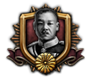   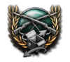

Generated: <a href="vanilla/focus/armoured_column_parade@2x.webp">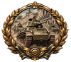</a>  <a href="vanilla/focus/assembly_line_trucks_v033@2x.webp">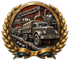</a> <a href="vanilla/focus/atlantic_convoy@2x.webp">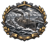</a> <a href="vanilla/focus/battleship_broadside_v033@2x.webp">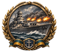</a> <a href="vanilla/focus/blast_furnace_dawn@2x.webp">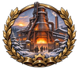</a> <a href="vanilla/focus/bomber_formation_v033@2x.webp">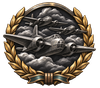</a> <a href="vanilla/focus/coastal_radar_mast@2x.webp">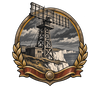</a> <a href="vanilla/focus/cruiser_launch_slipway@2x.webp">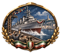</a>   <a href="vanilla/focus/fighter_dawn_scramble@2x.webp">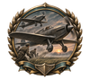</a> <a href="vanilla/focus/fortified_border_line_v033@2x.webp">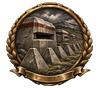</a> <a href="vanilla/focus/frontier_fortress_turret@2x.webp">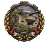</a> <a href="vanilla/focus/highland_road_builders@2x.webp">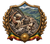</a> <a href="vanilla/focus/howitzer_hillside@2x.webp">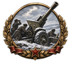</a> <a href="vanilla/focus/infantry_bayonet_charge_v033@2x.webp">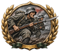</a> <a href="vanilla/focus/irrigation_canal_gates@2x.webp">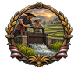</a>   <a href="vanilla/focus/oil_gusher_celebration@2x.webp">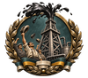</a> <a href="vanilla/focus/opera_mask_scroll@2x.webp">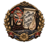</a>  <a href="vanilla/focus/paratrooper_drop@2x.webp">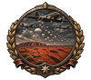</a>  <a href="vanilla/focus/railway_viaduct_opening@2x.webp">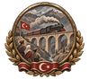</a> <a href="vanilla/focus/rally_crowd_banners_v033@2x.webp">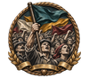</a> <a href="vanilla/focus/signed_treaty_quill_v033@2x.webp">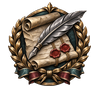</a> <a href="vanilla/focus/steam_locomotive_power@2x.webp">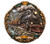</a>  <a href="vanilla/focus/submarine_leaving_pen@2x.webp">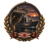</a>  <a href="vanilla/focus/torch_over_square@2x.webp">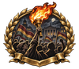</a>  <a href="vanilla/focus/village_radio_tower@2x.webp">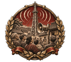</a> 

### idea_spirit

Vanilla:    

Generated:  <a href="vanilla/idea_spirit/barricade_curfew@3x.webp">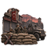</a> <a href="vanilla/idea_spirit/blackout_street@3x.webp">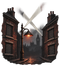</a>    <a href="vanilla/idea_spirit/harvest_festival_garlands@3x.webp">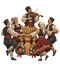</a>    <a href="vanilla/idea_spirit/newsroom_press_run@3x.webp">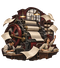</a> <a href="vanilla/idea_spirit/ration_book_table@3x.webp">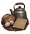</a> <a href="vanilla/idea_spirit/rebuilding_housing_blocks@3x.webp">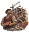</a>  <a href="vanilla/idea_spirit/scorched_earth_field@3x.webp">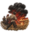</a>   <a href="vanilla/idea_spirit/station_refugee_welcome@3x.webp">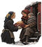</a> <a href="vanilla/idea_spirit/village_loom_wheel@3x.webp">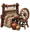</a> <a href="vanilla/idea_spirit/village_schoolhouse@3x.webp">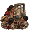</a> <a href="vanilla/idea_spirit/war_bond_rally@3x.webp">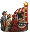</a> <a href="vanilla/idea_spirit/weary_veterans_trench@3x.webp">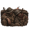</a> <a href="vanilla/idea_spirit/women_welders@3x.webp">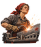</a> <a href="vanilla/idea_spirit/youth_spade_march@3x.webp">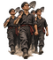</a>

### idea_concern

Vanilla:  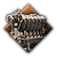  

Generated:  <a href="vanilla/idea_concern/armour_plate_rolling@3x.webp">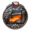</a> <a href="vanilla/idea_concern/armoured_car_yard@3x.webp">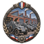</a> <a href="vanilla/idea_concern/bored_barrel_aa_gun@3x.webp">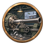</a> <a href="vanilla/idea_concern/brass_cartridge_mill@3x.webp">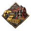</a> <a href="vanilla/idea_concern/cable_drum_yard@3x.webp">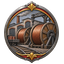</a> <a href="vanilla/idea_concern/chemical_works_retorts@3x.webp">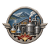</a> <a href="vanilla/idea_concern/diesel_engine_hall@3x.webp">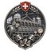</a> <a href="vanilla/idea_concern/flying_boat_hangar@3x.webp">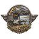</a>               

### officer_corps_spirit

Vanilla:   

Generated:            

### decision

Vanilla:    

Generated:                        

### decision_category_icon

Vanilla:    

Generated:          

### state_modifier

Vanilla:    

Generated:          

### special_project_icon

Vanilla:   

Generated:            

### raid

Vanilla:   

Generated:          

### mio_department

Vanilla:    

Generated:        

### mio_policy

Vanilla:   

Generated:         

### bop_side

Vanilla:    

Generated:      

### operation_icon

Vanilla:   

Generated:            

### commander_trait

Vanilla:    

Generated:           

### personal_trait

Vanilla:    

Generated:          

### doctrine

Vanilla:   

Generated:          

### report_event

Vanilla:    

Generated:                        

### news_event

Vanilla:    

Generated:                        

### operation_picture

Vanilla:   

Generated:            

### technology

Vanilla:   

Generated:                        

### achievement

Vanilla:    

Generated:            

### super_event

Generated:            

### leader_portrait

Vanilla:    

Generated:                        

### commander_portrait

Vanilla:    

Generated:            

### advisor_card

Vanilla:    

Generated:            

### flag

Vanilla:   

Generated:                        

### building

Vanilla:   

Generated:     

### faction_logo

Vanilla:    

Generated:            

### agency_logo

Vanilla:    

Generated:            

### counter_large

Vanilla:   

Generated:                        

### counter_small

Vanilla:   

Generated:                        

### division_emblem

Vanilla:   

Generated:            

### modifier_stat_icon

Vanilla:    

Generated:          

### gui_texture

Vanilla:   

Generated:            

## TNO style

The families with their own look in *The New Order: Last Days of Europe*, made from references of that mod's art, which is not reproduced here. Families TNO draws in the vanilla style are only in the vanilla section.

### focus (TNO style)

Generated:            

### idea_spirit (TNO style)

Generated:            

### decision (TNO style)

Generated:     

### operation_icon (TNO style)

Generated:      

### commander_trait (TNO style)

Generated:     

### report_event (TNO style)

Generated:            

### operation_picture (TNO style)

Generated:      

### technology (TNO style)

Generated:  

### achievement (TNO style)

Generated:      

### super_event (TNO style)

Generated:        

### leader_portrait (TNO style)

Generated:        

### gui_texture (TNO style)

Generated:        

Families still waiting for a later build are not shown yet. [`manifest.json`](manifest.json) lists every image with its brief, build and check result.
