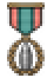
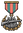
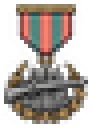
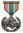
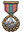
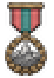
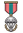
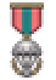

# commander_trait (TNO style)

Every image here was made by `hoi4-imagegen` on the ChatGPT login, processed, validated and checked against the game's own art by the tool's vanilla-match check. Nothing is retouched. Only images from version 0.3 or later that pass both checks are shown. The gallery grows as more runs finish.

Made with references from *The New Order: Last Days of Europe*'s own art for this family. That art is not reproduced here.

## Generated

| Image | Enlarged | Brief |
|---|---|---|
|  |  | An artillery shell. In TNO's style: pixel-art medal with a salmon or teal ribbon and a small teal pictogram. Build 0.3.3, 23x33. |
|  |  | A rifle in grass. In TNO's style: pixel-art medal with a salmon or teal ribbon and a small teal pictogram. Build 0.3.3, 23x33. |
|  |  | A supply truck. In TNO's style: pixel-art medal with a salmon or teal ribbon and a small teal pictogram. Build 0.3.3, 23x33. |
|  |  | A mountain peak. In TNO's style: pixel-art medal with a salmon or teal ribbon and a small teal pictogram. Build 0.3.3, 23x33. |
|  |  | A parachute. In TNO's style: pixel-art medal with a salmon or teal ribbon and a small teal pictogram. Build 0.3.3, 23x33. |
