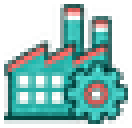
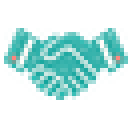
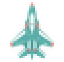
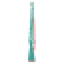
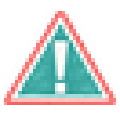

# decision (TNO style)

Every image here was made by `hoi4-imagegen` on the ChatGPT login, processed, validated and checked against the game's own art by the tool's vanilla-match check. Nothing is retouched. Only images from version 0.3 or later that pass both checks are shown. The gallery grows as more runs finish.

Made with references from *The New Order: Last Days of Europe*'s own art for this family. That art is not reproduced here.

## Generated

| Image | Enlarged | Brief |
|---|---|---|
|  |  | A factory with a gear. In TNO's style: flat teal pictogram on transparent, crisp pixel edges, white and salmon red accents only, no frame and no shading. Build 0.3.3, 33x32. |
|  |  | Two hands shaking. In TNO's style: flat teal pictogram on transparent, crisp pixel edges, white and salmon red accents only, no frame and no shading. Build 0.3.3, 33x32. |
|  |  | A jet plane seen from above. In TNO's style: flat teal pictogram on transparent, crisp pixel edges, white and salmon red accents only, no frame and no shading. Build 0.3.3, 33x32. |
|  |  | An upright rifle. In TNO's style: flat teal pictogram on transparent, crisp pixel edges, white and salmon red accents only, no frame and no shading. Build 0.3.3, 33x32. |
|  |  | A warning triangle with an exclamation mark. In TNO's style: flat teal pictogram on transparent, crisp pixel edges, white and salmon red accents only, no frame and no shading. Build 0.3.3, 33x32. |
