# focus (TNO style)

Every image here was made by `hoi4-imagegen` on the ChatGPT login, processed, validated and checked against the game's own art by the tool's vanilla-match check. Nothing is retouched. Only images from version 0.3 or later that pass both checks are shown. The gallery grows as more runs finish.

Made with references from *The New Order: Last Days of Europe*'s own art for this family. That art is not reproduced here.

## Generated

| Image | Enlarged | Brief |
|---|---|---|
| 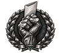 | 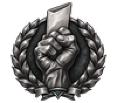 | A raised fist holding a folded ballot paper. In TNO's style: silver or grey monochrome subject with a hard dark outline, dark laurel wreath or dark metal frame, at most one accent colour, no warm gold plaque and no red or brown cloth. Build 0.3.3, 100x88. |
| 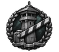 |  | A striped border barrier arm with a watchtower behind it. In TNO's style: silver or grey monochrome subject with a hard dark outline, dark laurel wreath or dark metal frame, at most one accent colour, no warm gold plaque and no red or brown cloth. Build 0.3.3, 100x88. |
| 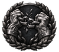 | 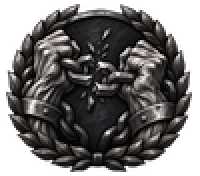 | Two wrists breaking a heavy chain. In TNO's style: silver or grey monochrome subject with a hard dark outline, dark laurel wreath or dark metal frame, at most one accent colour, no warm gold plaque and no red or brown cloth. Build 0.3.3, 100x88. |
| 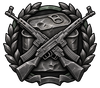 | 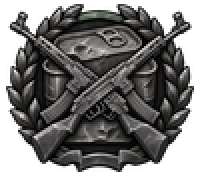 | Two crossed assault rifles over a dented ration tin. In TNO's style: silver or grey monochrome subject with a hard dark outline, dark laurel wreath or dark metal frame, at most one accent colour, no warm gold plaque and no red or brown cloth. Build 0.3.3, 100x88. |
| 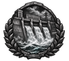 | 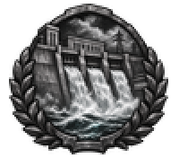 | A hydroelectric dam with water pouring down the spillway. In TNO's style: silver or grey monochrome subject with a hard dark outline, dark laurel wreath or dark metal frame, at most one accent colour, no warm gold plaque and no red or brown cloth. Build 0.3.3, 100x88. |
| 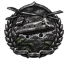 | 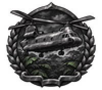 | A transport helicopter flying low over jungle canopy. In TNO's style: silver or grey monochrome subject with a hard dark outline, dark laurel wreath or dark metal frame, at most one accent colour, no warm gold plaque and no red or brown cloth. Build 0.3.3, 100x88. |
|  | 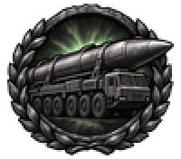 | A ballistic missile lying on its wheeled transporter. In TNO's style: silver or grey monochrome subject with a hard dark outline, dark laurel wreath or dark metal frame, at most one accent colour, no warm gold plaque and no red or brown cloth. Build 0.3.3, 100x88. |
|  | 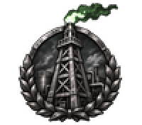 | An oil derrick with a gas flare burning at its top. In TNO's style: silver or grey monochrome subject with a hard dark outline, dark laurel wreath or dark metal frame, at most one accent colour, no warm gold plaque and no red or brown cloth. Build 0.3.3, 100x88. |
| 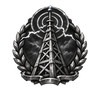 |  | A lattice radio mast with crackling static rings. In TNO's style: silver or grey monochrome subject with a hard dark outline, dark laurel wreath or dark metal frame, at most one accent colour, no warm gold plaque and no red or brown cloth. Build 0.3.3, 100x88. |
| 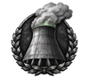 | 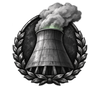 | A concrete reactor cooling tower venting steam. In TNO's style: silver or grey monochrome subject with a hard dark outline, dark laurel wreath or dark metal frame, at most one accent colour, no warm gold plaque and no red or brown cloth. Build 0.3.3, 100x88. |
| 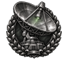 | 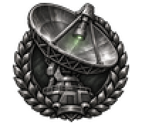 | A large satellite dish pointed at the sky. In TNO's style: silver or grey monochrome subject with a hard dark outline, dark laurel wreath or dark metal frame, at most one accent colour, no warm gold plaque and no red or brown cloth. Build 0.3.3, 100x88. |
|  | 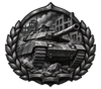 | A main battle tank advancing through a ruined city street. In TNO's style: silver or grey monochrome subject with a hard dark outline, dark laurel wreath or dark metal frame, at most one accent colour, no warm gold plaque and no red or brown cloth. Build 0.3.3, 100x88. |
