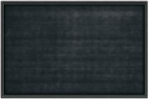
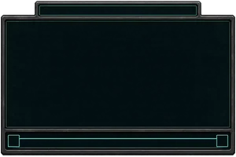
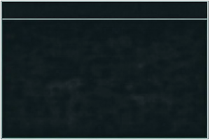
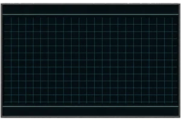
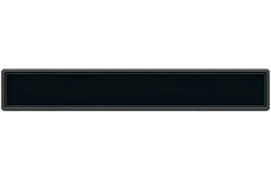
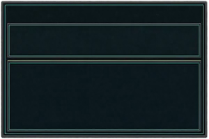
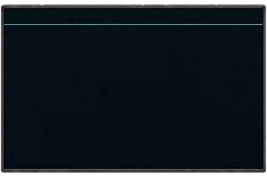
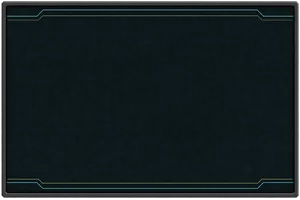

# gui_texture (TNO style)

Every image here was made by `hoi4-imagegen` on the ChatGPT login, processed, validated and checked against the game's own art by the tool's vanilla-match check. Nothing is retouched. Only images from version 0.3 or later that pass both checks are shown. The gallery grows as more runs finish.

Made with references from *The New Order: Last Days of Europe*'s own art for this family. That art is not reproduced here.

## Generated

| Image | Enlarged | Brief |
|---|---|---|
|  |  | A wide button. In TNO's style: near-black navy panel with 1 px teal and green lines, terminal look, no ornament. Build 0.3.3, 300x200. The vanilla-match check does not measure this family. |
|  |  | A text input box with a prompt. In TNO's style: near-black navy panel with 1 px teal and green lines, terminal look, no ornament. Build 0.3.3, 300x200. The vanilla-match check does not measure this family. |
|  |  | A main window panel with a header bar. In TNO's style: near-black navy panel with 1 px teal and green lines, terminal look, no ornament. Build 0.3.3, 300x200. The vanilla-match check does not measure this family. |
|  |  | A frame for a small map with a grid. In TNO's style: near-black navy panel with 1 px teal and green lines, terminal look, no ornament. Build 0.3.3, 300x200. The vanilla-match check does not measure this family. |
|  |  | A progress bar frame. In TNO's style: near-black navy panel with 1 px teal and green lines, terminal look, no ornament. Build 0.3.3, 300x200. The vanilla-match check does not measure this family. |
|  |  | A tall side panel with two inset boxes. In TNO's style: near-black navy panel with 1 px teal and green lines, terminal look, no ornament. Build 0.3.3, 300x200. The vanilla-match check does not measure this family. |
|  |  | A table panel with column header cells. In TNO's style: near-black navy panel with 1 px teal and green lines, terminal look, no ornament. Build 0.3.3, 300x200. The vanilla-match check does not measure this family. |
|  |  | A tooltip background. In TNO's style: near-black navy panel with 1 px teal and green lines, terminal look, no ornament. Build 0.3.3, 300x200. The vanilla-match check does not measure this family. |
