# idea_spirit (TNO style)

Every image here was made by `hoi4-imagegen` on the ChatGPT login, processed, validated and checked against the game's own art by the tool's vanilla-match check. Nothing is retouched. Only images from version 0.3 or later that pass both checks are shown. The gallery grows as more runs finish.

Made with references from *The New Order: Last Days of Europe*'s own art for this family. That art is not reproduced here.

## Generated

| Image | Enlarged | Brief |
|---|---|---|
| 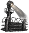 | 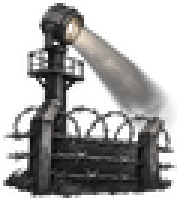 | A barbed wire fence line with a lone searchlight. In TNO's style: unframed greyscale object or scene with a soft dark shadow, at most one warm accent such as fire or embers. Build 0.3.3, 60x68. |
|  | 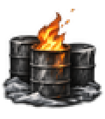 | Oil drums burning in a frozen yard. In TNO's style: unframed greyscale object or scene with a soft dark shadow, at most one warm accent such as fire or embers. Build 0.3.3, 60x68. |
|  | 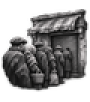 | A long queue of people outside a shuttered ration shop. In TNO's style: unframed greyscale object or scene with a soft dark shadow, at most one warm accent such as fire or embers. Build 0.3.3, 60x68. |
| 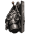 |  | A gas mask hanging on a hook beside a door. In TNO's style: unframed greyscale object or scene with a soft dark shadow, at most one warm accent such as fire or embers. Build 0.3.3, 60x68. |
| 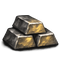 | 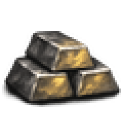 | Gold bars stacked in a dim vault. In TNO's style: unframed greyscale object or scene with a soft dark shadow, at most one warm accent such as fire or embers. Build 0.3.3, 60x68. |
| 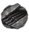 | 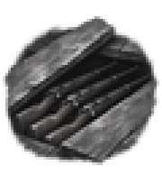 | Rifles hidden under floorboards. In TNO's style: unframed greyscale object or scene with a soft dark shadow, at most one warm accent such as fire or embers. Build 0.3.3, 60x68. |
| 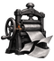 | 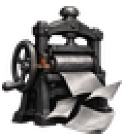 | A printing press throwing out underground leaflets. In TNO's style: unframed greyscale object or scene with a soft dark shadow, at most one warm accent such as fire or embers. Build 0.3.3, 60x68. |
|  |  | A pole of loudspeakers above a grey town square. In TNO's style: unframed greyscale object or scene with a soft dark shadow, at most one warm accent such as fire or embers. Build 0.3.3, 60x68. |
| 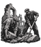 | 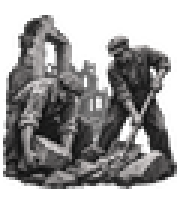 | Workers clearing rubble from a bombed street. In TNO's style: unframed greyscale object or scene with a soft dark shadow, at most one warm accent such as fire or embers. Build 0.3.3, 60x68. |
| 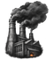 |  | Factory chimneys pouring black smoke. In TNO's style: unframed greyscale object or scene with a soft dark shadow, at most one warm accent such as fire or embers. Build 0.3.3, 60x68. |
| 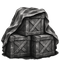 | 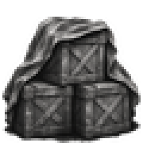 | Stacked ammunition crates under a tarpaulin. In TNO's style: unframed greyscale object or scene with a soft dark shadow, at most one warm accent such as fire or embers. Build 0.3.3, 60x68. |
|  | 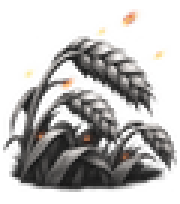 | A wheat field with glowing embers drifting over it. In TNO's style: unframed greyscale object or scene with a soft dark shadow, at most one warm accent such as fire or embers. Build 0.3.3, 60x68. |
