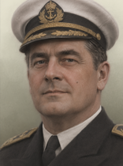
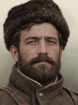
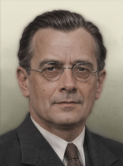
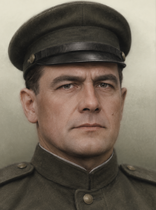
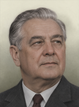
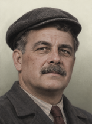
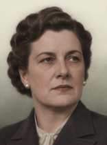
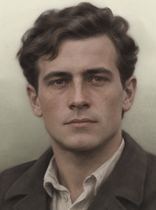

# leader_portrait (TNO style)

Every image here was made by `hoi4-imagegen` on the ChatGPT login, processed, validated and checked against the game's own art by the tool's vanilla-match check. Nothing is retouched. Only images from version 0.3 or later that pass both checks are shown. The gallery grows as more runs finish.

Made with references from *The New Order: Last Days of Europe*'s own art for this family. That art is not reproduced here.

## Generated

| Image | Enlarged | Brief |
|---|---|---|
|  |  | An admiral in a white cap. In TNO's style: softly colourised photograph of an invented person, close head-and-shoulders crop, pale cream-grey vignette background. An invented person: the face, the name and the likeness are fictional and must not resemble any real historical figure. Build 0.3.3, 156x210. |
|  |  | A bearded regional warlord in a fur hat. In TNO's style: softly colourised photograph of an invented person, close head-and-shoulders crop, pale cream-grey vignette background. An invented person: the face, the name and the likeness are fictional and must not resemble any real historical figure. Build 0.3.3, 156x210. |
|  |  | A bespectacled technocrat with slicked hair. In TNO's style: softly colourised photograph of an invented person, close head-and-shoulders crop, pale cream-grey vignette background. An invented person: the face, the name and the likeness are fictional and must not resemble any real historical figure. Build 0.3.3, 156x210. |
|  |  | A stern general in a peaked cap. In TNO's style: softly colourised photograph of an invented person, close head-and-shoulders crop, pale cream-grey vignette background. An invented person: the face, the name and the likeness are fictional and must not resemble any real historical figure. Build 0.3.3, 156x210. |
|  |  | A grey-haired premier in a dark suit, 1960s. In TNO's style: softly colourised photograph of an invented person, close head-and-shoulders crop, pale cream-grey vignette background. An invented person: the face, the name and the likeness are fictional and must not resemble any real historical figure. Build 0.3.3, 156x210. |
|  |  | A trade union leader in a flat cap. In TNO's style: softly colourised photograph of an invented person, close head-and-shoulders crop, pale cream-grey vignette background. An invented person: the face, the name and the likeness are fictional and must not resemble any real historical figure. Build 0.3.3, 156x210. |
|  |  | A woman minister with pinned-up hair and pearl earrings. In TNO's style: softly colourised photograph of an invented person, close head-and-shoulders crop, pale cream-grey vignette background. An invented person: the face, the name and the likeness are fictional and must not resemble any real historical figure. Build 0.3.3, 156x210. |
|  |  | A young revolutionary in an open-collar shirt. In TNO's style: softly colourised photograph of an invented person, close head-and-shoulders crop, pale cream-grey vignette background. An invented person: the face, the name and the likeness are fictional and must not resemble any real historical figure. Build 0.3.3, 156x210. |
