# operation_icon (TNO style)

Every image here was made by `hoi4-imagegen` on the ChatGPT login, processed, validated and checked against the game's own art by the tool's vanilla-match check. Nothing is retouched. Only images from version 0.3 or later that pass both checks are shown. The gallery grows as more runs finish.

Made with references from *The New Order: Last Days of Europe*'s own art for this family. That art is not reproduced here.

## Generated

| Image | Enlarged | Brief |
|---|---|---|
| 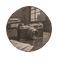 | 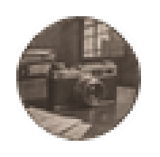 | A spy camera. In TNO's style: small archival photograph toned teal, thin teal border. Build 0.3.3, 59x58. |
|  | 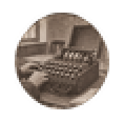 | A cipher machine. In TNO's style: small archival photograph toned teal, thin teal border. Build 0.3.3, 59x58. |
| 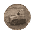 | 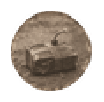 | A demolition charge with a fuse. In TNO's style: small archival photograph toned teal, thin teal border. Build 0.3.3, 59x58. |
| 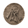 | 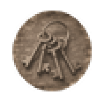 | A ring of keys. In TNO's style: small archival photograph toned teal, thin teal border. Build 0.3.3, 59x58. |
| 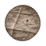 | 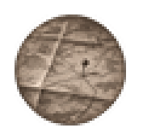 | A map with a pin. In TNO's style: small archival photograph toned teal, thin teal border. Build 0.3.3, 59x58. |
| 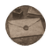 | 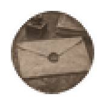 | A sealed envelope. In TNO's style: small archival photograph toned teal, thin teal border. Build 0.3.3, 59x58. |
