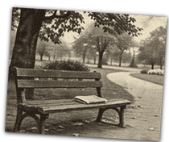
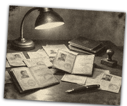
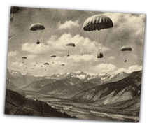
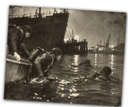
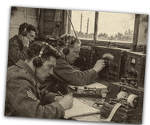
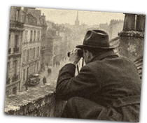

# operation_picture (TNO style)

Every image here was made by `hoi4-imagegen` on the ChatGPT login, processed, validated and checked against the game's own art by the tool's vanilla-match check. Nothing is retouched. Only images from version 0.3 or later that pass both checks are shown. The gallery grows as more runs finish.

Made with references from *The New Order: Last Days of Europe*'s own art for this family. That art is not reproduced here.

## Generated

| Image | Enlarged | Brief |
|---|---|---|
|  |  | A park bench with a newspaper left on it. In TNO's style: archival photograph toned teal, grime at the corners, thin teal border. Build 0.3.3, 210x176. |
|  |  | Forged passports on a desk under a lamp. In TNO's style: archival photograph toned teal, grime at the corners, thin teal border. Build 0.3.3, 210x176. |
|  |  | Supply parachutes over a mountain valley. In TNO's style: archival photograph toned teal, grime at the corners, thin teal border. Build 0.3.3, 210x176. |
|  |  | Frogmen slipping into a night harbour. In TNO's style: archival photograph toned teal, grime at the corners, thin teal border. Build 0.3.3, 210x176. |
|  |  | Operators at a radio listening post. In TNO's style: archival photograph toned teal, grime at the corners, thin teal border. Build 0.3.3, 210x176. |
|  |  | A man watching a street from a rooftop with binoculars. In TNO's style: archival photograph toned teal, grime at the corners, thin teal border. Build 0.3.3, 210x176. |
