# report_event (TNO style)

Every image here was made by `hoi4-imagegen` on the ChatGPT login, processed, validated and checked against the game's own art by the tool's vanilla-match check. Nothing is retouched. Only images from version 0.3 or later that pass both checks are shown. The gallery grows as more runs finish.

Made with references from *The New Order: Last Days of Europe*'s own art for this family. That art is not reproduced here.

## Generated

| Image | Enlarged | Brief |
|---|---|---|
| 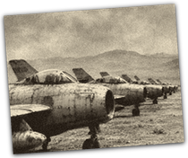 |  | A row of jet fighters on a desert airfield. In TNO's style: black and white photograph printed on a slightly tilted white paper print with a soft shadow, upright frame. Build 0.3.3, 210x176. |
| 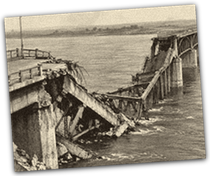 |  | A collapsed road bridge over a wide river. In TNO's style: black and white photograph printed on a slightly tilted white paper print with a soft shadow, upright frame. Build 0.3.3, 210x176. |
| 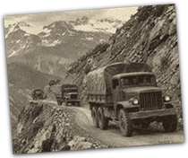 |  | A military truck convoy on a mountain pass, 1962. In TNO's style: black and white photograph printed on a slightly tilted white paper print with a soft shadow, upright frame. Build 0.3.3, 210x176. |
| 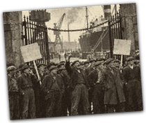 |  | Dockworkers on strike at the harbour gates. In TNO's style: black and white photograph printed on a slightly tilted white paper print with a soft shadow, upright frame. Build 0.3.3, 210x176. |
| 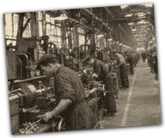 |  | Workers at lathes on a long factory floor. In TNO's style: black and white photograph printed on a slightly tilted white paper print with a soft shadow, upright frame. Build 0.3.3, 210x176. |
| 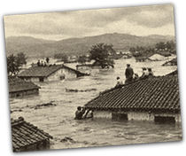 |  | A flooded village with people on rooftops. In TNO's style: black and white photograph printed on a slightly tilted white paper print with a soft shadow, upright frame. Build 0.3.3, 210x176. |
| 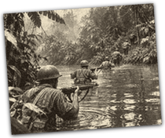 |  | A patrol wading through a jungle river. In TNO's style: black and white photograph printed on a slightly tilted white paper print with a soft shadow, upright frame. Build 0.3.3, 210x176. |
| 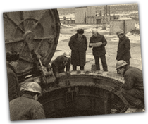 |  | Engineers standing on an open missile silo hatch. In TNO's style: black and white photograph printed on a slightly tilted white paper print with a soft shadow, upright frame. Build 0.3.3, 210x176. |
| 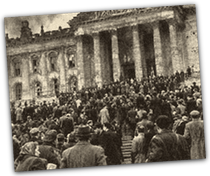 |  | A crowd on the steps of a parliament building. In TNO's style: black and white photograph printed on a slightly tilted white paper print with a soft shadow, upright frame. Build 0.3.3, 210x176. |
| 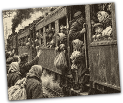 |  | A crowded refugee train leaving a station. In TNO's style: black and white photograph printed on a slightly tilted white paper print with a soft shadow, upright frame. Build 0.3.3, 210x176. |
| 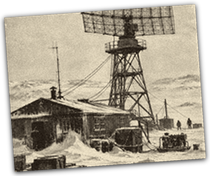 |  | A snowbound radar outpost in the tundra. In TNO's style: black and white photograph printed on a slightly tilted white paper print with a soft shadow, upright frame. Build 0.3.3, 210x176. |
| 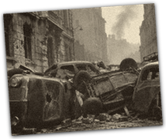 |  | A barricade of overturned cars on a city street at dawn. In TNO's style: black and white photograph printed on a slightly tilted white paper print with a soft shadow, upright frame. Build 0.3.3, 210x176. |
