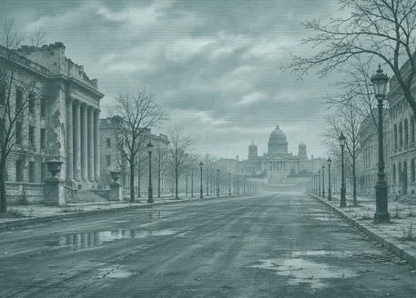
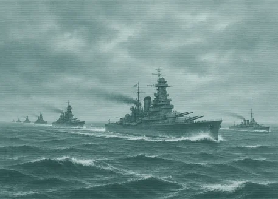
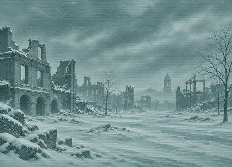
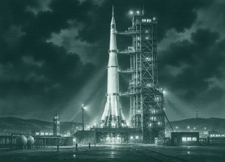
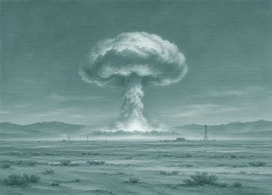
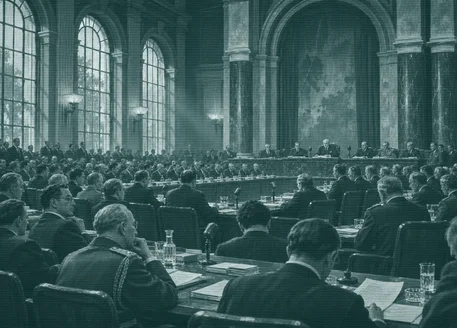
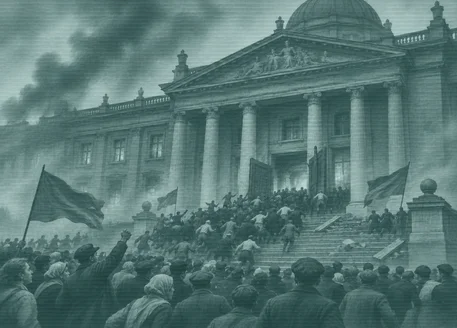
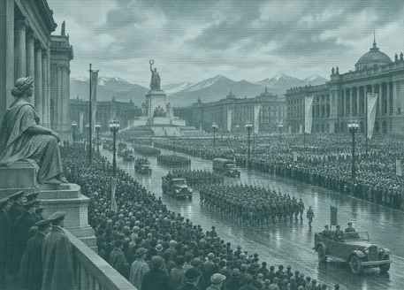

# super_event (TNO style)

Every image here was made by `hoi4-imagegen` on the ChatGPT login, processed, validated and checked against the game's own art by the tool's vanilla-match check. Nothing is retouched. Only images from version 0.3 or later that pass both checks are shown. The gallery grows as more runs finish.

Made with references from *The New Order: Last Days of Europe*'s own art for this family. That art is not reproduced here.

## Generated

| Image | Enlarged | Brief |
|---|---|---|
|  |  | An abandoned capital with empty avenues. In TNO's style: wide archival photograph toned teal and cyan, faint scanlines, muted. Build 0.3.3, 457x328. The vanilla-match check does not measure this family. |
|  |  | A battle fleet steaming in line at sea. In TNO's style: wide archival photograph toned teal and cyan, faint scanlines, muted. Build 0.3.3, 457x328. The vanilla-match check does not measure this family. |
|  |  | Frozen ruins of a city under snow. In TNO's style: wide archival photograph toned teal and cyan, faint scanlines, muted. Build 0.3.3, 457x328. The vanilla-match check does not measure this family. |
|  |  | A moon rocket on its gantry at night. In TNO's style: wide archival photograph toned teal and cyan, faint scanlines, muted. Build 0.3.3, 457x328. The vanilla-match check does not measure this family. |
|  |  | A distant mushroom cloud over a desert test range. In TNO's style: wide archival photograph toned teal and cyan, faint scanlines, muted. Build 0.3.3, 457x328. The vanilla-match check does not measure this family. |
|  |  | A peace conference hall full of delegates. In TNO's style: wide archival photograph toned teal and cyan, faint scanlines, muted. Build 0.3.3, 457x328. The vanilla-match check does not measure this family. |
|  |  | Crowds storming a government building. In TNO's style: wide archival photograph toned teal and cyan, faint scanlines, muted. Build 0.3.3, 457x328. The vanilla-match check does not measure this family. |
|  |  | A victory parade filling a huge square. In TNO's style: wide archival photograph toned teal and cyan, faint scanlines, muted. Build 0.3.3, 457x328. The vanilla-match check does not measure this family. |
