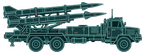

# technology (TNO style)

Every image here was made by `hoi4-imagegen` on the ChatGPT login, processed, validated and checked against the game's own art by the tool's vanilla-match check. Nothing is retouched. Only images from version 0.3 or later that pass both checks are shown. The gallery grows as more runs finish.

Made with references from *The New Order: Last Days of Europe*'s own art for this family. That art is not reproduced here.

## Generated

| Image | Enlarged | Brief |
|---|---|---|
|  |  | A swept-wing jet interceptor, label INTERCEPTOR 2. In TNO's style: teal line-art blueprint side view on a dark navy panel, name label top left in teal capitals, thin teal guide lines. Build 0.3.3, 146x54. |
|  |  | A surface-to-air missile launcher on a truck, label SAM 2. In TNO's style: teal line-art blueprint side view on a dark navy panel, name label top left in teal capitals, thin teal guide lines. Build 0.3.3, 146x54. |
