# achievement

Every image here was made by `hoi4-imagegen` on the ChatGPT login, processed, validated and checked against the game's own art by the tool's vanilla-match check. Nothing is retouched. Only images from version 0.3 or later that pass both checks are shown. The gallery grows as more runs finish.

## Vanilla references

From *Hearts of Iron IV* by Paradox Interactive, shown at native size for comparison.

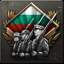 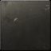  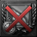

## Generated

| Image | Enlarged | Brief |
|---|---|---|
| 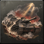 |  | A column of tanks bursts through a smoky gap in a hill line, infantry cheering and following behind, dust and sunlight. Sub-family: war. Build 0.3.3, 64x64. |
| 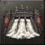 | 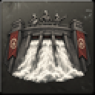 | A giant concrete dam with white water spilling, engineers in hard hats on the crest looking proud; bold two-colour carved print. Build 0.3.3, 64x64. |
| 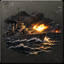 |  | A lone cruiser fires a broadside at night, flashes lighting rough waves and a distant burning ship on the horizon. Build 0.3.1, 64x64. |
|  | 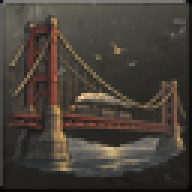 | A great suspension bridge newly completed over a wide strait with a steam train crossing it, gulls wheeling in golden light. Build 0.3.3, 64x64. |
|  | 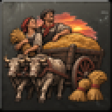 | A wagon heaped with golden grain is pulled by oxen past smiling farmers and stacked sheaves under a warm evening sky. Sub-family: economy. Build 0.3.3, 64x64. |
|  | 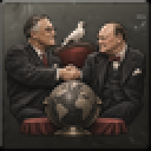 | Two statesmen in dark suits shake hands over a table holding a large globe, a white dove perched on the chair back, calm light. Build 0.3.3, 64x64. |
| 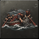 |  | A lifeboat crew heaves exhausted survivors out of a stormy sea, oars flashing, a distant wrecked steamer on the rocks. Build 0.3.3, 64x64. |
| 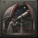 | 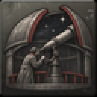 | An observatory dome opens to a starry night sky while an astronomer in a long coat peers through a large telescope; soft flat matte paint look. Build 0.3.3, 64x64. |
| 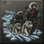 |  | Explorers and sled dogs trudge across polar ice with a ship frozen in the background, long blue shadows, tired but determined. Sub-family: naval. Build 0.3.3, 64x64. |
| 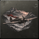 |  | A monoplane flies low through a mountain pass at dawn, valley mist below, its pilot's scarf trailing in the slipstream. Sub-family: air. Build 0.3.3, 64x64. |
|  | 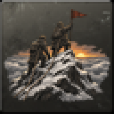 | Mountaineers plant a plain pennant on a snowy summit at sunrise, ropes trailing behind them, a sea of clouds below. Build 0.3.1, 64x64. |
| 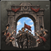 | 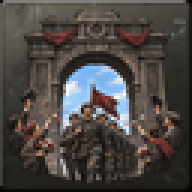 | Soldiers march beneath a stone triumphal arch while crowds throw flowers and wave hats, bright sky, victorious mood. Sub-family: war. Build 0.3.3, 64x64. |
