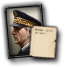
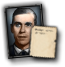
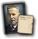
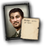
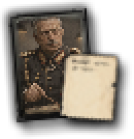
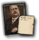

# advisor_card

Every image here was made by `hoi4-imagegen` on the ChatGPT login, processed, validated and checked against the game's own art by the tool's vanilla-match check. Nothing is retouched. Only images from version 0.3 or later that pass both checks are shown. The gallery grows as more runs finish.

## Vanilla references

From *Hearts of Iron IV* by Paradox Interactive, shown at native size for comparison.

   

## Generated

| Image | Enlarged | Brief |
|---|---|---|
|  |  | A grey-haired chief of staff in a decorated general's uniform, standing over a large map table with a pointer, stern focused expression, dim war-room lamps behind him. Build 0.3.1, 65x67. |
|  |  | A portly finance minister in a three-piece suit and pince-nez, hand resting on a thick ledger, cautious frown, an oak-panelled treasury office behind him. Build 0.3.1, 65x67. |
