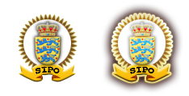
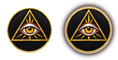
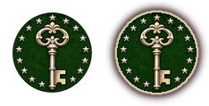

# agency_logo

Every image here was made by `hoi4-imagegen` on the ChatGPT login, processed, validated and checked against the game's own art by the tool's vanilla-match check. Nothing is retouched. Only images from version 0.3 or later that pass both checks are shown. The gallery grows as more runs finish.

## Vanilla references

From *Hearts of Iron IV* by Paradox Interactive, shown at native size for comparison.

   

## Generated

| Image | Enlarged | Brief |
|---|---|---|
|  |  | A round emblem of a single open eye with a radiating gold iris inside a pyramid-free triangle, on a black disc with a thin gold rim. Build 0.3.1, 234x119. |
|  |  | A round emblem of a large old skeleton key set upright on a dark green disc, with a ring of small silver stars around it. Build 0.3.1, 234x119. |
