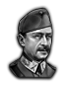
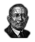
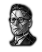
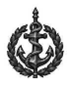
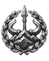
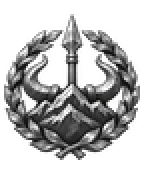
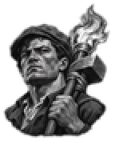
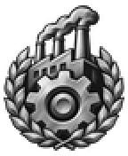
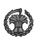
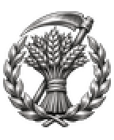

# bop_side

Every image here was made by `hoi4-imagegen` on the ChatGPT login, processed, validated and checked against the game's own art by the tool's vanilla-match check. Nothing is retouched. Only images from version 0.3 or later that pass both checks are shown. The gallery grows as more runs finish.

## Vanilla references

From *Hearts of Iron IV* by Paradox Interactive, shown at native size for comparison.

   

## Generated

| Image | Enlarged | Brief |
|---|---|---|
|  |  | A tall standard bearing a large anchor wrapped in thick rope, the navy side in a rivalry between navy and army for budget. Build 0.3.3, 72x88. |
|  |  | A hill-clan standard with stylised mountain peaks, ox horns and a spear tip, the regional autonomists side in a struggle against the central state in Persia. Build 0.3.3, 72x88. |
|  |  | A slim facade of white columns with a pair of balanced scales above, the parliament side in a struggle against military rule. Sub-family: war. Build 0.3.3, 72x88. |
|  |  | A raised sledgehammer entwined with a burning torch, the labour side in a struggle between workers and factory owners. Build 0.3.3, 72x88. |
|  |  | A towering cogwheel with factory smokestacks rising behind it, the industrial side in a struggle between industry and farmers, bold carved two-colour linocut look. Build 0.3.3, 72x88. |
|  |  | A tied sheaf of golden wheat with a crossed scythe standing upright, the farmers side in a struggle between farmers and industry, Bulgarian countryside. Build 0.3.3, 72x88. |
