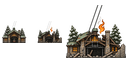
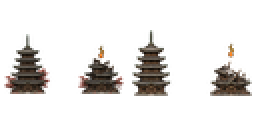
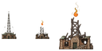
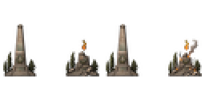

# building

Every image here was made by `hoi4-imagegen` on the ChatGPT login, processed, validated and checked against the game's own art by the tool's vanilla-match check. Nothing is retouched. Only images from version 0.3 or later that pass both checks are shown. The gallery grows as more runs finish.

## Vanilla references

From *Hearts of Iron IV* by Paradox Interactive, shown at native size for comparison.

  

## Generated

| Image | Enlarged | Brief |
|---|---|---|
|  |  | A timber-and-stone cable car station clinging to an Italian Alpine ridge, steel cables rising into clouds, snow-dusted fir trees and a festive mood. Build 0.3.3, 128x64. |
|  |  | A five-tier wooden Japanese pagoda with curved tiled eaves among crimson autumn maples, a gravel courtyard in front of it, quiet and serene mood. Build 0.3.3, 128x64. |
|  |  | A tall lattice radio mast with guy wires and a small brick transmitter hut in a Polish pine forest clearing, grey dawn light, tense and secretive mood. Build 0.3.3, 128x64. |
|  |  | A great steel arch bridge spanning a sunlit Australian harbour inlet, with a train crossing its deck and small ferries passing beneath, triumphant mood. Build 0.3.3, 128x64. |
|  |  | A tall stone obelisk monument with a stepped base and a bronze wreath relief on a windswept Yugoslav hilltop, a few small trees around it. Grainy ink and sepia sketch. Build 0.3.3, 128x64. |
