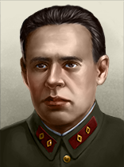
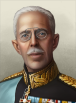
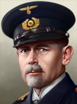
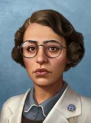
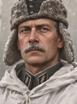
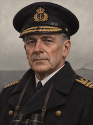

# commander_portrait

Every image here was made by `hoi4-imagegen` on the ChatGPT login, processed, validated and checked against the game's own art by the tool's vanilla-match check. Nothing is retouched. Only images from version 0.3 or later that pass both checks are shown. The gallery grows as more runs finish.

## Vanilla references

From *Hearts of Iron IV* by Paradox Interactive, shown at native size for comparison.

   

## Generated

| Image | Enlarged | Brief |
|---|---|---|
|  |  | A Finnish colonel in a white winter camouflage smock and fur-flapped cap, frosted moustache, alert steady eyes, birch forest and falling snow behind him. Build 0.3.1, 156x210. |
|  |  | A British admiral in a double-breasted navy greatcoat with gold-braided peaked cap, binoculars at his chest, weathered calm face, grey sea and a destroyer on the horizon. Build 0.3.1, 156x210. |
