# commander_trait

Every image here was made by `hoi4-imagegen` on the ChatGPT login, processed, validated and checked against the game's own art by the tool's vanilla-match check. Nothing is retouched. Only images from version 0.3 or later that pass both checks are shown. The gallery grows as more runs finish.

## Vanilla references

From *Hearts of Iron IV* by Paradox Interactive, shown at native size for comparison.

   

## Generated

| Image | Enlarged | Brief |
|---|---|---|
|  | 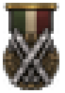 | A pair of wooden skis crossed with two poles, a winter warfare specialist, bold simple shape. Build 0.3.1, 23x33. |
|  | 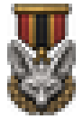 | The head of a desert fox with very large ears and a narrow muzzle, cunning mobile commander of sand campaigns. Build 0.3.1, 23x33. |
|  | 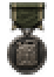 | A single dented metal fuel jerrycan with a cross-pressed side and spout, a logistics master keeping armies moving. Build 0.3.1, 23x33. |
|  | 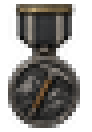 | A single sturdy ice axe with a wooden shaft and steel pick, a mountaineering expert, strong simple outline. Build 0.3.1, 23x33. |
|  | 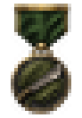 | A single broad-bladed machete lying across one large palm leaf, a jungle fighter at home in dense tropical country, bold simple outline. Build 0.3.1, 23x33. |
|  | 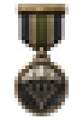 | A single open parachute canopy with hanging cords seen from the front, airborne assault leader, bold simple shape. Build 0.3.1, 23x33. |
|  | 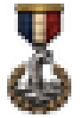 | A single submarine periscope rising from rippling waves with a small wake, silent undersea hunter, bold simple shape. Build 0.3.1, 23x33. |
|  | 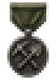 | A pickaxe and a shovel crossed in an X, an army engineer commander who fortifies the front, simple strong shape. Build 0.3.1, 23x33. |
|  | 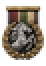 | A rearing cavalry horse head and forelegs with flowing mane, charging cavalry spirit, bold simple outline. Build 0.3.1, 23x33. |
|  | 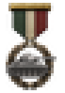 | A single medium tank seen from the side with a long gun and wide tracks, bold simple shape, armoured warfare expert. Build 0.3.3, 23x33. |
|  | 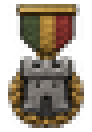 | A single squat stone fortress tower with battlements, solid and unmovable defensive commander, strong simple shape. Build 0.3.1, 23x33. |
|  | 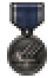 | A single naval gun turret with three long barrels raised, a naval gunnery specialist, strong simple shape. Build 0.3.1, 23x33. |
