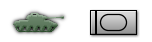
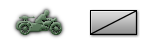
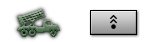

# counter_large

Every image here was made by `hoi4-imagegen` on the ChatGPT login, processed, validated and checked against the game's own art by the tool's vanilla-match check. Nothing is retouched. Only images from version 0.3 or later that pass both checks are shown. The gallery grows as more runs finish.

## Vanilla references

From *Hearts of Iron IV* by Paradox Interactive, shown at native size for comparison.

  

## Generated

| Image | Enlarged | Brief |
|---|---|---|
|  |  | Bold black silhouette of a quad-barrelled anti-aircraft gun pointing steeply skyward on a rotating pedestal with a small gunner seat. Build 0.3.3, 152x42. |
|  |  | Bold black silhouette of a towed anti-tank gun with a long slender barrel, angular shield and two spoked wheels with split trails. Build 0.3.3, 152x42. |
|  |  | Bold black side-view silhouette of a four-wheeled armoured car with a small turret, short gun and sloped plated body. Build 0.3.3, 152x42. |
|  |  | Bold black silhouette of a soldier riding a bicycle with a rifle slung on his back, thick wheel rings and simple frame lines. Build 0.3.3, 152x42. |
|  |  | Bold black silhouette of a camel in profile with a single hump, a rider sitting upright on a saddle and a rifle strapped to the side. Build 0.3.3, 152x42. |
|  |  | Bold black silhouette of a rearing cavalry horse seen in profile with a rider's sabre raised, thick simple outline, clear against a dark ground. Build 0.3.3, 152x42. |
|  |  | Bold black silhouette of a simple girder bridge spanning a gap between two banks, with a crossed shovel and hammer beneath the arch. Build 0.3.3, 152x42. |
|  |  | Bold black silhouette of a field howitzer with the barrel angled upward, recoil cylinder, large wheels and spread trail legs. Build 0.3.3, 152x42. |
|  |  | Bold black silhouette of a soldier carrying twin fuel tanks on his back and a long nozzle spraying a tongue of flame forward. Build 0.3.3, 152x42. |
|  |  | Bold black side-view silhouette of a heavy tank with a tall boxy turret, thick gun barrel and wide tracks, massive and squat. Build 0.3.3, 152x42. |
|  |  | Bold black silhouette of a standing rifleman in a rounded helmet, rifle held diagonally across the chest, simple chunky shapes with no interior detail. Build 0.3.3, 152x42. |
|  |  | Bold black side-view silhouette of a small light tank with a short-barrelled turret and small road wheels, low and compact, thick unbroken outline. Build 0.3.3, 152x42. |
|  |  | Bold black silhouette of a heavy machine gun on a tripod with a belt feed, a crouching gunner behind it, compact chunky forms. Build 0.3.3, 152x42. |
|  |  | Bold black silhouette of a large ship's anchor with a heavy chain loop, a short rifle crossing behind the shank, simple and easily readable. Build 0.3.3, 152x42. |
|  |  | Bold black side-view silhouette of a medium tank with a rounded turret, long gun barrel and a row of road wheels under a sloped hull. Build 0.3.3, 152x42. |
|  |  | Bold black silhouette of a helmeted sentry standing at attention with a baton and a wide armband, a simple upright shield shape beside him. Build 0.3.3, 152x42. |
|  |  | Bold black silhouette of a short mortar tube on a baseplate with a bipod, a kneeling soldier dropping a round into the barrel. Build 0.3.3, 152x42. |
|  |  | Bold black side-view silhouette of a canvas-topped army truck with a boxy cab, rounded cargo hood and two large wheels. Build 0.3.3, 152x42. |
|  |  | Bold black silhouette of a mountain trooper's ice axe crossed over a coil of rope, with a small jagged peak behind, thick chunky shapes. Build 0.3.3, 152x42. |
|  |  | Bold black silhouette of an open parachute canopy with taut lines descending to a small hanging soldier, broad scalloped dome and simple shapes. Build 0.3.3, 152x42. |
|  |  | Bold black side-view silhouette of a motorcycle with a sidecar and a small mounted machine gun, large spoked wheels and a hunched rider. Build 0.3.3, 152x42. |
|  |  | Bold black silhouette of a truck-mounted rocket launcher with a rack of angled rails, several rockets pointing skyward, thick simple shapes. Build 0.3.3, 152x42. |
|  |  | Bold black silhouette of a tall telegraph pole with two crossbars and insulators, a looping wire sagging away from each side. Build 0.3.3, 152x42. |
|  |  | Bold black silhouette of a skier mid-stride with two long poles and skis, a rifle slung across the back, dynamic angular posture. Build 0.3.3, 152x42. |
