# decision

Every image here was made by `hoi4-imagegen` on the ChatGPT login, processed, validated and checked against the game's own art by the tool's vanilla-match check. Nothing is retouched. Only images from version 0.3 or later that pass both checks are shown. The gallery grows as more runs finish.

## Vanilla references

From *Hearts of Iron IV* by Paradox Interactive, shown at native size for comparison.

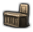   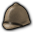

## Generated

| Image | Enlarged | Brief |
|---|---|---|
|  |  | A blacksmith's anvil with a heavy hammer resting across it, a few glowing sparks, one bold object. Bold two-colour carved print. Build 0.3.1, 33x32. |
|  | 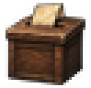 | A wooden ballot box with a slot in the lid and a folded slip half dropped in, one bold object. Bold two-colour carved print. Build 0.3.1, 33x32. |
|  | 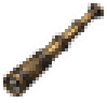 | An extended brass spyglass of a ship's officer, single bold object. Grainy ink and sepia sketch look. Build 0.3.1, 33x32. |
|  | 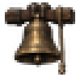 | A large cast bronze church bell hanging from a thick wooden beam with a rope dangling, one bold object. Build 0.3.1, 33x32. |
| 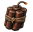 |  | A bundle of dynamite sticks tied with twine and a short fuse trailing off, tense bold object. Build 0.3.1, 33x32. |
| 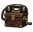 |  | A military field telephone in a leather case with a hand crank and handset, one bold object. Build 0.3.1, 33x32. |
|  | 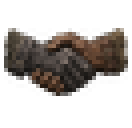 | Two gloved hands clasped in a firm handshake, one in a grey glove and one in a brown glove, bold simple symbol. Build 0.3.1, 33x32. |
|  | 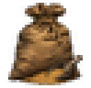 | A plump burlap grain sack tied at the neck with a tin scoop resting in the spilled wheat, one bold object. Build 0.3.1, 33x32. |
|  | 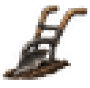 | A single iron plough with wooden handles standing in a furrow, one bold simple object. Build 0.3.1, 33x32. |
| 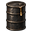 | 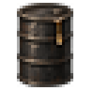 | A dark steel oil drum with rolled rims and a bright drip on its side, one bold object. Build 0.3.1, 33x32. |
|  | 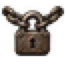 | A heavy iron padlock hanging from a thick looped chain, closed tight, bold symbol of sealed borders. Build 0.3.1, 33x32. |
|  | 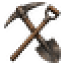 | A pickaxe and a shovel crossed over each other, worn wooden handles, bold symbol of labour. Build 0.3.1, 33x32. |
|  | 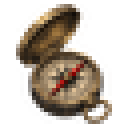 | An open brass pocket compass with a clear red needle and a hinged lid, one bold simple object. Build 0.3.1, 33x32. |
| 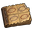 | 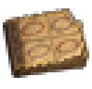 | A small booklet of perforated coupons with one corner torn off, marked only with plain oval stamps, simple sturdy object. Build 0.3.1, 33x32. |
|  |  | A rolled blueprint tied with a ribbon beside a drawing compass, one bold simple object. Build 0.3.1, 33x32. |
|  | 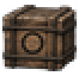 | A sturdy wooden supply crate bound with rope and stencilled only with a plain black circle, one bold object. Build 0.3.1, 33x32. |
|  | 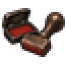 | A wooden rubber stamp beside an open ink pad with a clean red smudge, bureaucratic bold object. Build 0.3.1, 33x32. |
|  | 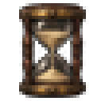 | A wooden-framed hourglass with the sand half run through, one bold simple object of waiting and time. Build 0.3.1, 33x32. |
| 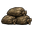 | 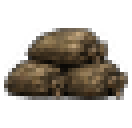 | A short stack of three tied sandbags in a stepped pile, bold simple defensive object. Build 0.3.1, 33x32. |
|  | 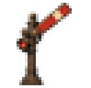 | A railway semaphore signal post with its arm raised, one bold simple silhouette against the sky. Build 0.3.1, 33x32. |
|  | 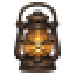 | A single glowing storm lantern with a wire cage and a curved handle, warm light, simple bold object. Soft flat gouache look. Build 0.3.1, 33x32. |
|  | 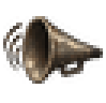 | A large conical tin megaphone pointing outward with curved sound lines radiating from it, one bold propaganda object. Build 0.3.1, 33x32. |
|  |  | A vintage round radio studio microphone on a short chrome stand, polished and gleaming, one bold simple object. Build 0.3.1, 33x32. |
|  | 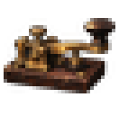 | A single brass telegraph key on a worn wooden base, urgent 1930s mood, one bold object. Build 0.3.1, 33x32. |
