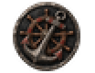
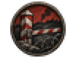
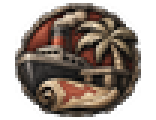
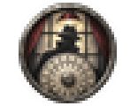
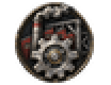
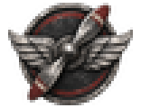
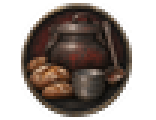
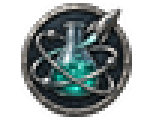
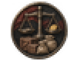

# decision_category_icon

Every image here was made by `hoi4-imagegen` on the ChatGPT login, processed, validated and checked against the game's own art by the tool's vanilla-match check. Nothing is retouched. Only images from version 0.3 or later that pass both checks are shown. The gallery grows as more runs finish.

## Vanilla references

From *Hearts of Iron IV* by Paradox Interactive, shown at native size for comparison.

   

## Generated

| Image | Enlarged | Brief |
|---|---|---|
|  |  | A heavy ship's anchor crossed with a wooden helm wheel, emblem of the naval programme. Build 0.3.1, 52x40. |
|  |  | A striped border post and a lowered barrier gate with coils of barbed wire, grim emblem of border conflicts. Bold two-colour carved print. Build 0.3.1, 52x40. |
|  |  | A steamship at a tropical jetty with a palm tree and a rolled map, emblem of colonial affairs. Build 0.3.1, 52x40. |
|  |  | A silhouette of a trench-coated figure behind a lamp-lit frosted window, a blank cipher disc in the foreground, emblem of espionage. Build 0.3.1, 52x40. |
|  |  | A large cogwheel in front of a tall smoking factory chimney and a girder frame, emblem of an industrial programme. Build 0.3.1, 52x40. |
|  |  | A two-bladed aircraft propeller flanked by a pair of simple spread wings, emblem of the air programme. Build 0.3.1, 52x40. |
|  |  | A large soup kettle with a ladle beside loaves of bread and a stack of tin bowls, emblem of relief efforts. Soft flat gouache look. Build 0.3.1, 52x40. |
|  |  | A glass laboratory flask with bubbling liquid, an orbiting atom and a small finned rocket, emblem of scientific research. Build 0.3.1, 52x40. |
|  |  | A pair of market scales balanced over crates and sacks with a coin on one pan, emblem of trade agreements. Build 0.3.1, 52x40. |
