# division_emblem

Every image here was made by `hoi4-imagegen` on the ChatGPT login, processed, validated and checked against the game's own art by the tool's vanilla-match check. Nothing is retouched. Only images from version 0.3 or later that pass both checks are shown. The gallery grows as more runs finish.

## Vanilla references

From *Hearts of Iron IV* by Paradox Interactive, shown at native size for comparison.

  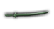

## Generated

| Image | Enlarged | Brief |
|---|---|---|
| 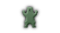 | 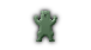 | A brown bear rearing on its hind legs with claws raised, set on a pale green wide shield with a dark border. Build 0.3.3, 76x42. |
|  | 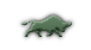 | A black bull lowering its curved horns and charging forward in profile, on a wide ochre-yellow shape with a red border. Build 0.3.3, 76x42. |
| 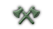 | 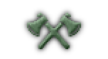 | Two crossed battle axes in silver with dark wooden handles, on a wide forest-green shape with a black border. Build 0.3.3, 76x42. |
|  | 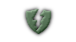 | A jagged golden lightning bolt striking down across a deep blue wide shield, with a thin black edge line, bold and simple. Build 0.3.3, 76x42. |
| 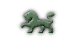 |  | A golden lion walking in profile with one paw raised and a tufted tail, on a wide crimson shield with a thin gold rim. Build 0.3.3, 76x42. |
| 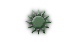 |  | A round yellow sun with a ring of straight and wavy rays on a wide sky-blue shape, edged with orange. Build 0.3.3, 76x42. |
|  | 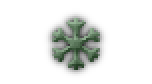 | A six-armed black snowflake with branching points on a wide icy-blue shape, with a darker blue border. Build 0.3.3, 76x42. |
|  | 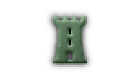 | A tall crenellated stone tower with a small arched door, in grey and black on a wide red banner shape. Build 0.3.3, 76x42. |
| 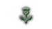 | 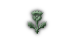 | A purple thistle bloom on a spiked green stem with two sharp leaves, set on a wide cream shape with a navy border. Build 0.3.3, 76x42. |
|  | 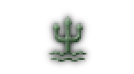 | A golden three-pronged trident rising from stylised teal waves, set on a wide deep navy shape. Build 0.3.3, 76x42. |
|  | 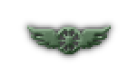 | A black spoked wheel with one spread feathered wing on each side, on a wide maroon shape with a gold rim. Build 0.3.3, 76x42. |
| 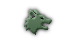 | 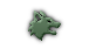 | A grey wolf head in profile with open jaws and pointed ears, on a wide dark-green shape with a pale border. Build 0.3.3, 76x42. |
