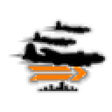
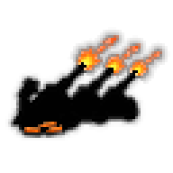

# doctrine

Every image here was made by `hoi4-imagegen` on the ChatGPT login, processed, validated and checked against the game's own art by the tool's vanilla-match check. Nothing is retouched. Only images from version 0.3 or later that pass both checks are shown. The gallery grows as more runs finish.

## Vanilla references

From *Hearts of Iron IV* by Paradox Interactive, shown at native size for comparison.

  

## Generated

| Image | Enlarged | Brief |
|---|---|---|
|  |  | A line of alpine troops roped together climbing a snowy ridge with packs and ice axes under a huge sky, Italian mountain doctrine. Build 0.3.2, 64x64. |
|  |  | A tight formation of heavy bombers flying high above a distant city skyline at dusk, vapour trails stretching behind, strategic bombing. Build 0.3.2, 64x64. |
|  |  | Concrete bunkers and rows of anti-tank obstacles in a Finnish pine forest line, bold carved two-colour linocut look, stubborn defence. Build 0.3.2, 64x64. |
|  |  | An aircraft carrier launching a squadron of strike aircraft into an orange dawn over a flat sea, Japanese carrier strike doctrine. Build 0.3.2, 64x64. |
|  |  | A destroyer escort steaming beside a line of merchant ships on a grey Atlantic sea with heavy swells, Canadian convoy duty. Build 0.3.2, 64x64. |
|  |  | A row of massed howitzers firing together at night with bright muzzle flashes lighting crews and shell casings, superior firepower. Build 0.3.2, 64x64. |
|  |  | A dense wave of infantry silhouettes with fixed bayonets surging across a muddy field under a heavy sky, mass assault, grim mood. Build 0.3.2, 64x64. |
|  |  | Officers' hands moving pins and arrows over a large map table lit by a hanging lamp, a French interwar methodical battle plan, grainy sepia ink sketch. Build 0.3.2, 64x64. |
|  |  | A sky full of parachutes descending over patchwork farmland and a river at dawn, airborne assault doctrine, tense hopeful mood. Build 0.3.2, 64x64. |
|  |  | Armed partisans in a Yugoslav mountain forest, one lookout watching from a rock ridge with rifle and scarf, quiet determined mood. Build 0.3.2, 64x64. |
