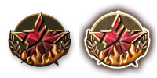
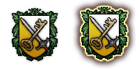
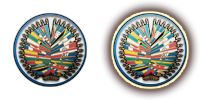
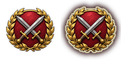

# faction_logo

Every image here was made by `hoi4-imagegen` on the ChatGPT login, processed, validated and checked against the game's own art by the tool's vanilla-match check. Nothing is retouched. Only images from version 0.3 or later that pass both checks are shown. The gallery grows as more runs finish.

## Vanilla references

From *Hearts of Iron IV* by Paradox Interactive, shown at native size for comparison.

   

## Generated

| Image | Enlarged | Brief |
|---|---|---|
|  |  | A round emblem of two crossed swords inside a laurel wreath, in steel grey and gold on a deep red disc, formal and martial. Build 0.3.1, 200x100. |
|  |  | A round blue emblem with a ring of white stars circling a large central golden star, with a thin gold rim, democratic and hopeful. Build 0.3.1, 200x100. |
