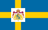
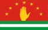
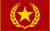
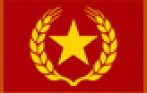
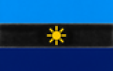

# flag

Every image here was made by `hoi4-imagegen` on the ChatGPT login, processed, validated and checked against the game's own art by the tool's vanilla-match check. Nothing is retouched. Only images from version 0.3 or later that pass both checks are shown. The gallery grows as more runs finish.

## Vanilla references

From *Hearts of Iron IV* by Paradox Interactive, shown at native size for comparison.

  

## Generated

| Image | Enlarged | Brief |
|---|---|---|
|  |  | A fictional flag with a plain crimson field, a large golden five-pointed star at the centre encircled by a ring of golden wheat ears, and a thin golden border. Build 0.3.1, 82x52. |
|  |  | A fictional flag of three horizontal bands of sky blue, white and navy, with a small golden sun with short straight rays at the centre of the white band. Build 0.3.1, 82x52. |
