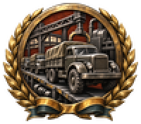
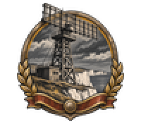
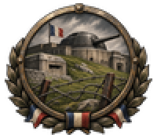
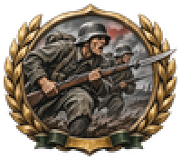
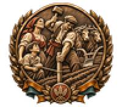
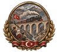
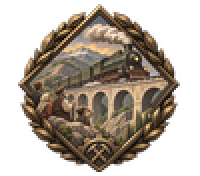
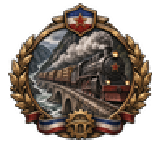
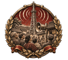

# focus

Every image here was made by `hoi4-imagegen` on the ChatGPT login, processed, validated and checked against the game's own art by the tool's vanilla-match check. Nothing is retouched. Only images from version 0.3 or later that pass both checks are shown. The gallery grows as more runs finish.

## Vanilla references

From *Hearts of Iron IV* by Paradox Interactive, shown at native size for comparison.

   

## Generated

| Image | Enlarged | Brief |
|---|---|---|
|  |  | A column of Brazilian light tanks rolling through a dusty avenue in the 1940s, hatches open, crowds waving from balconies, triumphant mood. Build 0.3.1, 100x88. |
|  |  | A Swedish voter in a wool coat dropping a folded ballot into a wooden box before a columned assembly hall, calm and quiet civic mood. Build 0.3.3, 100x88. |
|  |  | Industry: army trucks rolling off a long assembly line. Build 0.3.3, 100x88. |
|  |  | An American merchant convoy crossing a grey Atlantic with escort destroyers on the flanks and smoke on the horizon, grim resolve. Build 0.3.1, 100x88. |
|  |  | Naval: a battleship firing a broadside at sea. Build 0.3.3, 100x88. |
|  |  | A Finnish steelworks blast furnace glowing orange at dawn above snowy pines, small silhouettes of workers at the gate, hopeful mood of rebuilding after a hard winter. Build 0.3.1, 100x88. |
|  |  | Air: a formation of twin-engine bombers over clouds. Build 0.3.3, 100x88. |
|  |  | A British coastal radar mast on white chalk cliffs scanning above a calm grey sea in 1940, tense watchful mood. Bold two-colour carved print. Build 0.3.1, 100x88. |
|  |  | A new Italian light cruiser sliding down the slipway into a Genoa harbour, bunting overhead and dockworkers cheering, festive and proud. Build 0.3.1, 100x88. |
|  |  | A young researcher beside a brass-coiled cyclotron magnet in a university laboratory, dials and glass tubes glowing, hopeful 1940s scientific mood. Build 0.3.1, 100x88. |
|  |  | Diplomacy: two envoys shaking hands under two invented national flags. Build 0.3.3, 100x88. |
|  |  | Polish single-seat fighters taking off from a grass airfield at first light, ground crew running clear, tense and determined mood. Build 0.3.1, 100x88. |
|  |  | Military: a line of concrete bunkers and dragon's teeth along a border. Build 0.3.3, 100x88. |
|  |  | A French frontier fortress with an armoured gun turret rising from a green hillside, barbed wire in front, grim and steady mood. Build 0.3.1, 100x88. |
|  |  | Ethiopian highland workers breaking rock with picks and hauling carts to build a mountain road, steep green valley behind them, 1930s hopeful effort. Build 0.3.1, 100x88. |
|  |  | A heavy Soviet howitzer on a snowy hillside with its crew in dark silhouette, barrel raised against a pale sky, grim determination. Build 0.3.1, 100x88. |
|  |  | Military: infantrymen charging with fixed bayonets across a muddy field. Build 0.3.3, 100x88. |
|  |  | Thai farmers opening wooden irrigation sluice gates so water flows into green rice terraces, hopeful early-morning mood. Build 0.3.1, 100x88. |
|  |  | Research: a laboratory microscope beside glass flasks and notes. Build 0.3.3, 100x88. |
|  |  | A southern Italian peasant family marking out their own field with boundary stakes beside a plough and oxen, hopeful early 1950s mood. Bold two-colour carved print. Build 0.3.1, 100x88. |
|  |  | A Mexican oil derrick erupting in a black gusher while oilfield workers throw their hats in the air, a festive mood of national pride in the late 1930s. Build 0.3.1, 100x88. |
|  |  | A Chinese opera mask on a lacquered stand beside an unrolled scroll of mountain scenery and a lute, calm 1930s cultural mood. Build 0.3.1, 100x88. |
|  |  | Crates of Valencia oranges stacked on a quay beside a steamship, dockers loading by hand, festive early 1950s trade mood. Build 0.3.1, 100x88. |
|  |  | A wing of transport aircraft over red Australian desert releasing a cloud of white parachutes, long shadows on the sand, tense 1940s mood. Build 0.3.1, 100x88. |
|  |  | Politics: a parliament dome with ballot papers falling before it. Build 0.3.3, 100x88. |
|  |  | A Turkish steam locomotive crossing a new stone viaduct high in the Anatolian mountains, villagers watching from the ridge, triumphant mood. Soft flat gouache look. Build 0.3.1, 100x88. |
|  |  | Politics: a rally crowd raising banners in invented colours. Build 0.3.3, 100x88. |
|  |  | Diplomacy: a signed treaty with two wax seals and a quill pen. Build 0.3.3, 100x88. |
|  |  | A Yugoslav steam locomotive thundering along a river gorge with timber wagons behind it, smoke streaming, confident mood of national infrastructure. Build 0.3.1, 100x88. |
|  |  | Industry: a blast furnace pouring molten steel into a ladle, sparks flying. Build 0.3.3, 100x88. |
|  |  | A sleek Japanese submarine gliding out of a concrete pen at dusk with its crew on deck, water dark and still, tense and quiet. Build 0.3.1, 100x88. |
|  |  | Naval: a submarine periscope breaking the waves at dusk. Build 0.3.3, 100x88. |
|  |  | A burning torch raised high over a crowd of silhouetted citizens in a night city square under fictional striped banners, tense yet defiant. Build 0.3.1, 100x88. |
|  |  | A Persian envoy and a British diplomat in 1930s suits shake hands across a green felt table with a brass globe between them, quiet and hopeful mood. Build 0.3.1, 100x88. |
|  |  | A tall radio mast above a Chinese village square where families gather around a loudspeaker, radio waves rippling outward, 1940s. Grainy ink and sepia sketch look. Build 0.3.1, 100x88. |
|  |  | An open bank vault in Buenos Aires with stacked gold bars beside heaped wheat sheaves, a promise of economic recovery in the 1930s. Build 0.3.1, 100x88. |
