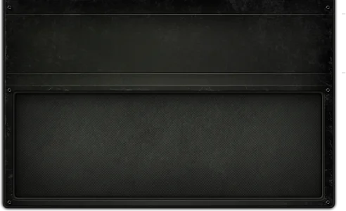
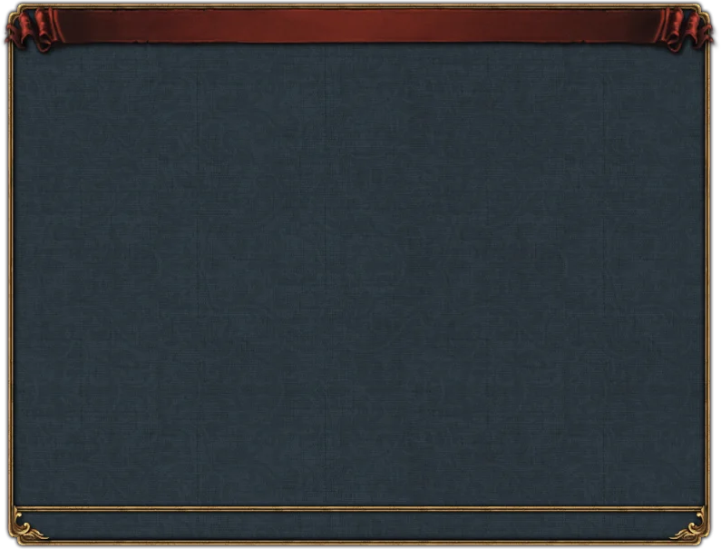
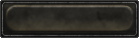
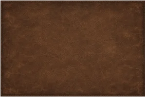
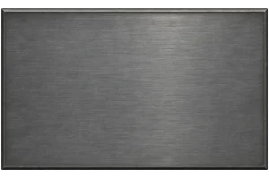

# gui_texture

Every image here was made by `hoi4-imagegen` on the ChatGPT login, processed, validated and checked against the game's own art by the tool's vanilla-match check. Nothing is retouched. Only images from version 0.3 or later that pass both checks are shown. The gallery grows as more runs finish.

## Vanilla references

From *Hearts of Iron IV* by Paradox Interactive, shown at native size for comparison.

  

## Generated

| Image | Enlarged | Brief |
|---|---|---|
|  |  | Worn brown leather with a fine cracked grain, faint creases and darkened edges, framed by a thin stitched border line. Build 0.3.1, 300x200. The vanilla-match check does not measure this family. |
|  |  | Cool grey brushed steel with fine horizontal grain and a soft sheen, bordered by a narrow bevelled edge in a darker tone. Build 0.3.1, 300x200. The vanilla-match check does not measure this family. |
