# idea_concern

Every image here was made by `hoi4-imagegen` on the ChatGPT login, processed, validated and checked against the game's own art by the tool's vanilla-match check. Nothing is retouched. Only images from version 0.3 or later that pass both checks are shown. The gallery grows as more runs finish.

## Vanilla references

From *Hearts of Iron IV* by Paradox Interactive, shown at native size for comparison.

   

## Generated

| Image | Enlarged | Brief |
|---|---|---|
|  | 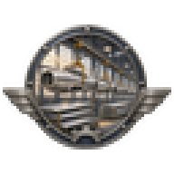 | An American aircraft plant with silver fuselages hanging in a long line from the ceiling, wings stacked below and morning light through high windows. Build 0.3.1, 64x64. |
|  | 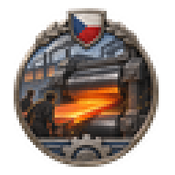 | A rolling mill where a glowing slab of armour plate is pulled between huge rollers, sparks scattering, steelworkers in the glare, Czech mood of power. Build 0.3.1, 64x64. |
| 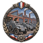 | 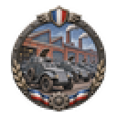 | A yard full of freshly built armoured cars with open hatches parked in neat rows beside a brick factory with tall chimneys, French works. Build 0.3.1, 64x64. |
| 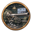 | 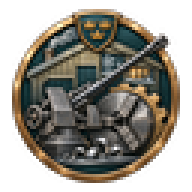 | A Swedish ordnance works where a long anti-aircraft gun barrel is bored on a huge lathe, curls of bright steel on the floor, snowy yard outside. Build 0.3.1, 64x64. |
| 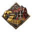 | 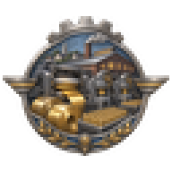 | A brass rolling mill with coils of golden metal, stamping presses and trays of shining cartridge cases, American small town works. Build 0.3.1, 64x64. |
|  | 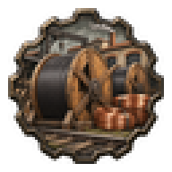 | A cable works yard stacked with huge wooden drums of telegraph cable and coils of copper wire beside a railway siding, Spanish setting. Build 0.3.1, 64x64. |
|  | 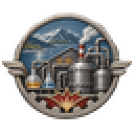 | A Norwegian explosives and chemical works beside a fjord, glass retorts, steel vats and pipe tangles under a pale sky, steam rising. Build 0.3.1, 64x64. |
|  | 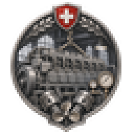 | A Swiss diesel engine works with a massive marine engine block under assembly, polished pistons and gauges, quiet precise craft. Soft flat gouache look. Build 0.3.1, 64x64. |
|  | 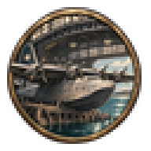 | A giant hangar with a four-engined flying boat on a slipway, ground crew on its wing, bay water glittering outside, Australian works. Build 0.3.1, 64x64. |
|  |  | A gun foundry where a glowing ladle pours molten steel into a mould for a long barrel, workers in leather aprons shielding their faces. Bold two-colour carved print. Build 0.3.1, 64x64. |
| 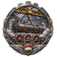 |  | A Hungarian locomotive works erecting shop with a steam engine boiler lifted by a crane above its wheels, steam drifting through iron rafters. Build 0.3.1, 64x64. |
|  | 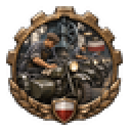 | A Polish factory floor with motorcycles and sidecar combinations lined up in a row, headlamps shining, workers wiping tanks with rags. Build 0.3.1, 64x64. |
|  | 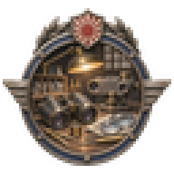 | A Japanese optics workshop bench with binoculars, a rangefinder, polished lenses and brass tools under a single lamp, careful quiet craft. Grainy ink and sepia sketch look. Build 0.3.1, 64x64. |
| 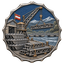 | 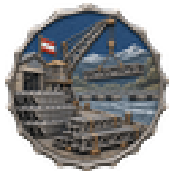 | Stacks of steel pontoon bridge sections and girders in an Austrian engineering yard, a crane lifting one over a flowing river. Build 0.3.1, 64x64. |
|  | 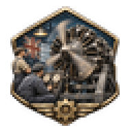 | A British engine works with a radial aircraft engine on a test stand, propeller blurred, fitters in overalls watching gauges. Build 0.3.1, 64x64. |
|  | 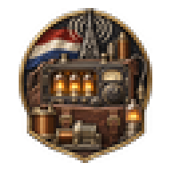 | A Dutch radio works bench covered with glowing valves, copper coils, dials and field radio sets in leather cases. Build 0.3.1, 64x64. |
|  |  | A Belgian arms factory proof room with rows of bolt-action rifles in racks and a bench of gleaming machined parts and gauges. Build 0.3.1, 64x64. |
|  |  | A signals works with big searchlight drums, signal lamps and field telephones lined along a workbench, a Turkish factory in warm evening light. Build 0.3.1, 64x64. |
|  | 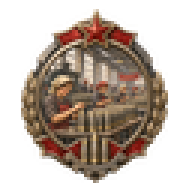 | Women in headscarves lining up rows of artillery shells on long tables inside a bright Soviet munitions hall, orderly and busy. Build 0.3.1, 64x64. |
|  | 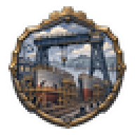 | A Scottish shipyard with a great gantry crane over two half-built hulls on slipways, riveters' scaffolding and grey river beyond. Build 0.3.1, 64x64. |
| 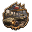 | 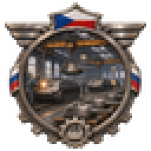 | A Czech tank works interior with armoured hulls on rails beneath overhead cranes, welders' sparks and turrets waiting in rows. Build 0.3.1, 64x64. |
| 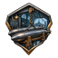 | 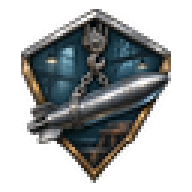 | A naval torpedo workshop with gleaming torpedoes resting in wooden cradles beside a chain hoist, German shipyard interior, damp and bluish light. Build 0.3.1, 64x64. |
| 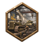 | 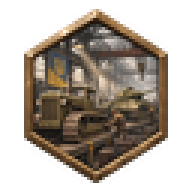 | A Ukrainian tractor works where crawler tractors and early tanks sit side by side on the same assembly line, vast hall and misty light. Build 0.3.1, 64x64. |
| 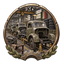 | 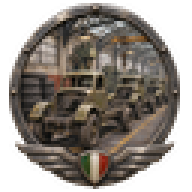 | A line of half-built army lorries on an assembly floor, cabs waiting for engines, tyres stacked against the wall, Italian factory. Build 0.3.1, 64x64. |
