# idea_spirit

Every image here was made by `hoi4-imagegen` on the ChatGPT login, processed, validated and checked against the game's own art by the tool's vanilla-match check. Nothing is retouched. Only images from version 0.3 or later that pass both checks are shown. The gallery grows as more runs finish.

## Vanilla references

From *Hearts of Iron IV* by Paradox Interactive, shown at native size for comparison.

   

## Generated

| Image | Enlarged | Brief |
|---|---|---|
|  | 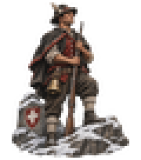 | Swiss mountain villagers with rifles and a cowbell standing watch above a snowy pass, calm and watchful readiness. Build 0.3.1, 60x68. |
|  | 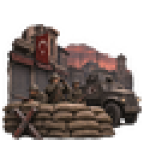 | Soldiers behind a sandbag barricade and an armoured car in an empty Turkish city square at dusk, shuttered shops, grim mood of martial law. Build 0.3.1, 60x68. |
|  | 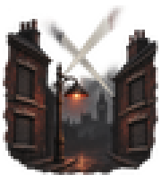 | A darkened London street with shuttered windows, a single shaded lamp and searchlights crossing the night sky, tense watchful mood. Build 0.3.1, 60x68. |
|  | 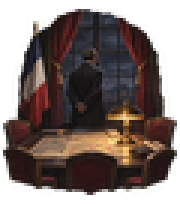 | A French cabinet room at night, lamplit map table and a few empty chairs, a lone minister standing at a tall window, tense mood. Build 0.3.1, 60x68. |
| 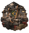 |  | A vast Brazilian factory hall full of lathes driven by overhead leather belts, workers at every machine, busy mobilisation mood. Build 0.3.1, 60x68. |
|  |  | A priest, an imam and a rabbi in plain robes standing together before a Yugoslav town gate with villagers behind them, hopeful unity. Build 0.3.1, 60x68. |
|  | 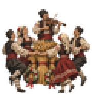 | Bulgarian villagers dancing around wheat sheaves and garlands while a fiddler plays, a festive harvest mood. Soft flat gouache look. Build 0.3.1, 60x68. |
|  | 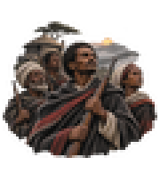 | Ethiopian farmers with old rifles and cloaks gathering in a highland village at dawn, mist in the valley, resolute volunteer spirit. Build 0.3.1, 60x68. |
|  | 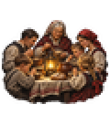 | A large Polish farm family eating together around a lantern-lit table, grandmother at the head, quiet mood of tradition and home. Build 0.3.1, 60x68. |
|  | 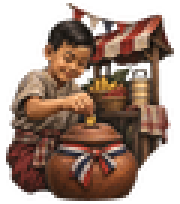 | A Thai child dropping a coin into a clay savings pot beside a bustling market stall, festive mood of thrift and community. Build 0.3.1, 60x68. |
|  | 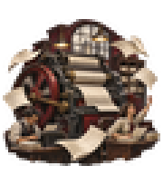 | An Argentine newsroom with a rotary press spinning and blank newspaper sheets flying through the air, journalists at desks, hopeful and busy. Build 0.3.1, 60x68. |
|  | 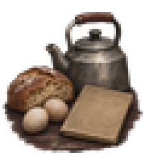 | A modest British kitchen table with a small loaf, two eggs, a tin kettle and a blank ration book, quiet make-do mood. Build 0.3.1, 60x68. |
| 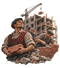 | 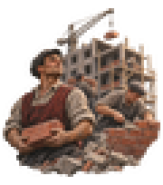 | Hungarian bricklayers raising new apartment blocks among cleared rubble, scaffolding and cranes against a pale morning sky, early 1950s hopeful mood. Build 0.3.1, 60x68. |
|  | 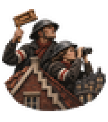 | Dutch air-raid wardens with helmets and wooden rattles on a gabled rooftop scanning the night sky over canals, tense and vigilant. Build 0.3.1, 60x68. |
|  | 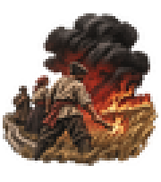 | Peasants setting fire to their own wheat field beside a retreating road, black smoke towering over the steppe, grim defiance. Bold two-colour carved print. Build 0.3.1, 60x68. |
|  | 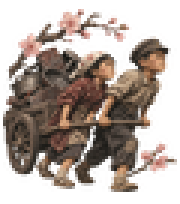 | Japanese village children dragging a hand cart of old pots, pans and scrap iron down a lane lined with cherry trees, determined 1940s mood. Build 0.3.1, 60x68. |
|  | 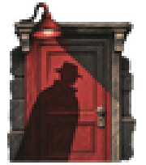 | The long shadow of a man in a trench coat and fedora falling across a quiet apartment door at night, grim mood of watchfulness. Bold two-colour carved print. Build 0.3.1, 60x68. |
| 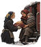 | 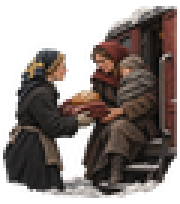 | Swedish villagers handing bread and blankets to weary refugee families stepping off a train at a snowy station, compassionate quiet mood. Build 0.3.1, 60x68. |
|  | 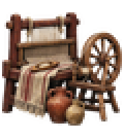 | A Spanish village room with a hand loom and spinning wheel, homespun cloth and clay jugs, quiet mood of self-reliance. Build 0.3.1, 60x68. |
|  | 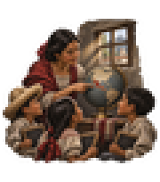 | Children in a Mexican village schoolhouse learning with slates while a young teacher points at a globe, sunbeams through the window, hopeful 1930s mood. Build 0.3.1, 60x68. |
|  | 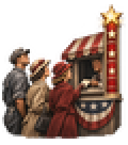 | Housewives and factory workers queueing at a bond booth in an American small town, a tall gauge with stars rising beside them, hopeful wartime mood. Build 0.3.1, 60x68. |
|  | 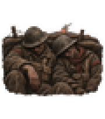 | Weary veterans resting against the mud wall of a rain-soaked trench with helmets low, a distant glow on the horizon, grim exhaustion. Grainy ink and sepia sketch look. Build 0.3.1, 60x68. |
|  | 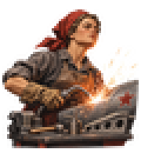 | Soviet women in headscarves welding at a bench in an aircraft factory, bright sparks flying, proud and tireless mood. Build 0.3.1, 60x68. |
|  | 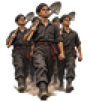 | Rows of Italian teenage boys in plain uniforms marching down a country road with spades over their shoulders, 1930s, disciplined mood. Build 0.3.1, 60x68. |
