# leader_portrait

Every image here was made by `hoi4-imagegen` on the ChatGPT login, processed, validated and checked against the game's own art by the tool's vanilla-match check. Nothing is retouched. Only images from version 0.3 or later that pass both checks are shown. The gallery grows as more runs finish.

## Vanilla references

From *Hearts of Iron IV* by Paradox Interactive, shown at native size for comparison.

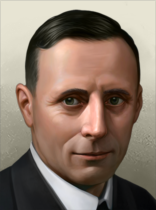 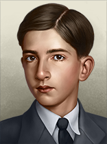 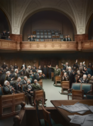 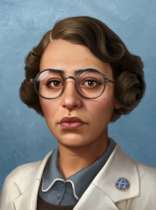

## Generated

| Image | Enlarged | Brief |
|---|---|---|
| 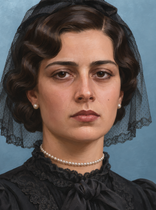 |  | A young Yugoslav queen regent in her twenties, black mourning dress, pearl choker and short veil, solemn composed expression, candlelit palace hall glowing behind her. An invented person: the face, the name and the likeness are fictional and must not resemble any real historical figure. Build 0.3.3, 156x210. |
| 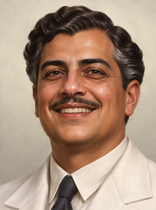 |  | A confident populist politician of a South American republic in his fifties, white linen suit, thin moustache, warm broad smile, sunlit balcony with palm fronds behind him, hopeful 1930s mood. An invented person: the face, the name and the likeness are fictional and must not resemble any real historical figure. Build 0.3.3, 156x210. |
| 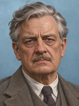 |  | A weary British prime minister in his sixties, rumpled tweed three-piece suit, furrowed brow, grim determination, sandbagged street and barrage balloons hazy behind him. An invented person: the face, the name and the likeness are fictional and must not resemble any real historical figure. Build 0.3.3, 156x210. |
| 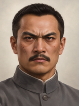 |  | A Chinese republican revolutionary leader in a high-collared grey tunic, cropped hair, intense fierce gaze, bare rust-coloured hills and a faded cloth backdrop behind, grim resolve. An invented person: the face, the name and the likeness are fictional and must not resemble any real historical figure. Build 0.3.3, 156x210. |
| 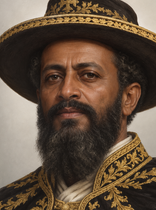 |  | A dignified Ethiopian ras with a long beard, gold-embroidered black cape and wide-brimmed hat, calm commanding gaze, highland monastery on a crag behind. Grainy ink and sepia sketch. An invented person: the face, the name and the likeness are fictional and must not resemble any real historical figure. Build 0.3.3, 156x210. |
| 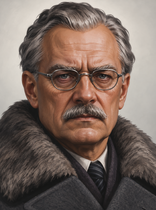 |  | A stern Finnish president in his sixties, grey overcoat with a fur collar, steel spectacles, tired but resolute expression, snow-lit window behind him. Bold carved two-colour linocut look. An invented person: the face, the name and the likeness are fictional and must not resemble any real historical figure. Build 0.3.3, 156x210. |
| 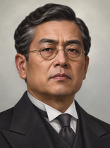 |  | A Japanese prime minister in his fifties, round spectacles, formal black morning coat, rigid dignified expression, paper screens and cherry blossom branches behind him. An invented person: the face, the name and the likeness are fictional and must not resemble any real historical figure. Build 0.3.3, 156x210. |
| 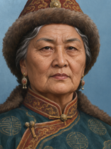 |  | An elderly Mongolian regent in an embroidered silk deel and fur-trimmed hat, wise lined face, calm gaze, windswept steppe and felt yurts behind, soft flat gouache colours. An invented person: the face, the name and the likeness are fictional and must not resemble any real historical figure. Build 0.3.3, 156x210. |
| 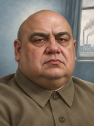 |  | A heavy-set Soviet party chairman, bald and round-faced, plain buttoned khaki tunic, stern but weary eyes, smoking factory chimneys visible through a window behind him. An invented person: the face, the name and the likeness are fictional and must not resemble any real historical figure. Build 0.3.3, 156x210. |
| 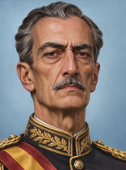 |  | A tall thin Spanish nationalist general-dictator, grey moustache, gold-braided tunic with a sash, severe expression, dark cathedral arches casting heavy shadows behind him. An invented person: the face, the name and the likeness are fictional and must not resemble any real historical figure. Build 0.3.3, 156x210. |
| 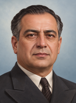 |  | A statesman of an Anatolian republic in his fifties, dark double-breasted suit, composed and proud, standing before a plain modern parliament wall in clear morning light. An invented person: the face, the name and the likeness are fictional and must not resemble any real historical figure. Build 0.3.3, 156x210. |
