# mio_department

Every image here was made by `hoi4-imagegen` on the ChatGPT login, processed, validated and checked against the game's own art by the tool's vanilla-match check. Nothing is retouched. Only images from version 0.3 or later that pass both checks are shown. The gallery grows as more runs finish.

## Vanilla references

From *Hearts of Iron IV* by Paradox Interactive, shown at native size for comparison.

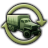  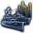 

## Generated

| Image | Enlarged | Brief |
|---|---|---|
| 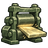 | 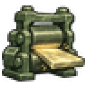 | A thick glowing steel armour plate emerging from heavy rolling mill rollers, sparks flying, Yugoslav steelworks in grim industrial mood. Sub-family: economy. Build 0.3.3, 48x48. |
| 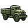 | 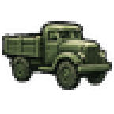 | A boxy cargo truck parked beside stacked wooden crates and fuel drums in a Brazilian logistics depot yard, afternoon sun. Sub-family: economy. Build 0.3.3, 48x48. |
|  | 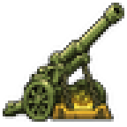 | A long howitzer barrel being lifted from a glowing mould in a foundry, molten sparks and heavy chains, bold two-colour linocut carved look. Sub-family: economy. Build 0.3.3, 48x48. |
|  | 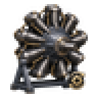 | A nine-cylinder radial aircraft engine mounted on a workshop stand with polished cylinder fins, a Japanese engine works in warm light. Build 0.3.1, 48x48. |
| 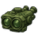 | 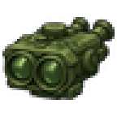 | A large binocular rangefinder and loose glass lenses on a velvet-lined optics bench, careful quiet mood, German-style precision workshop but fictional. Build 0.3.3, 48x48. |
|  | 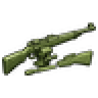 | A rifle receiver clamped in a workbench vise with files and a half-finished wooden stock beside it, a small Belgian arms workshop. Sub-family: war. Build 0.3.3, 48x48. |
| 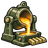 | 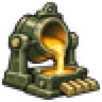 | A crucible pouring bright molten steel into a mould beside rows of cut test bars, a metallurgy laboratory in a British northern town. Sub-family: economy. Build 0.3.3, 48x48. |
| 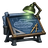 | 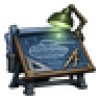 | A drafting table holding a tank side-view blueprint, a set square and a brass compass, lit by a green desk lamp in a Czech design bureau. Build 0.3.1, 48x48. |
