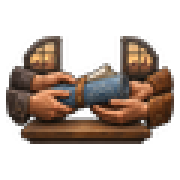
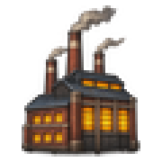
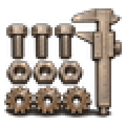
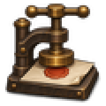
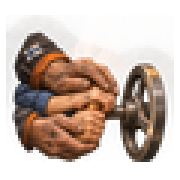
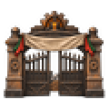
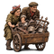
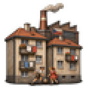

# mio_policy

Every image here was made by `hoi4-imagegen` on the ChatGPT login, processed, validated and checked against the game's own art by the tool's vanilla-match check. Nothing is retouched. Only images from version 0.3 or later that pass both checks are shown. The gallery grows as more runs finish.

## Vanilla references

From *Hearts of Iron IV* by Paradox Interactive, shown at native size for comparison.

  

## Generated

| Image | Enlarged | Brief |
|---|---|---|
|  |  | Two pairs of hands passing rolled blueprints to each other across a table in front of two different factory windows, patent sharing, friendly mood. Build 0.3.3, 60x60. |
|  |  | A large factory with every window glowing yellow against a dark blue night sky and smoke rising from stacks, night shift at work in the USSR. Build 0.3.3, 60x60. |
|  |  | A factory inspector reading a brass pressure gauge on a production line Build 0.3.3, 60x60. |
|  |  | Rows of identical bolts, nuts and gears laid out evenly in a grid beside a master gauge, tidy standardisation, soft flat gouache look. Build 0.3.3, 60x60. |
|  |  | A heavy brass seal press stamping a blank licence document, bold carved two-colour linocut look, foreign production rights agreed in a quiet office. Build 0.3.3, 60x60. |
|  |  | Weathered hands of a master machinist guiding the hands of a young apprentice on a lathe handle, Finnish factory, warm hopeful mood. Build 0.3.3, 60x60. |
|  |  | A grand iron factory gate opening on a busy yard, a plain banner above it, state-owned works in Mexico, proud mood. Build 0.3.3, 60x60. |
|  |  | Villagers pushing a hand cart piled high with scrap iron, old pots and railings toward a collection yard, determined wartime mood in Britain. Build 0.3.3, 60x60. |
|  |  | Rows of modest apartment blocks beside a factory with washing hung on balconies and children playing, a workers welfare estate in Czechoslovakia. Build 0.3.3, 60x60. |
