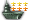
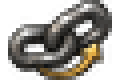
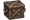

# modifier_stat_icon

Every image here was made by `hoi4-imagegen` on the ChatGPT login, processed, validated and checked against the game's own art by the tool's vanilla-match check. Nothing is retouched. Only images from version 0.3 or later that pass both checks are shown. The gallery grows as more runs finish.

## Vanilla references

From *Hearts of Iron IV* by Paradox Interactive, shown at native size for comparison.

   

## Generated

| Image | Enlarged | Brief |
|---|---|---|
|  |  | Two interlocked chain links in heavy outline, one slightly turned, with a short curved arrow circling them. Build 0.3.1, 30x20. |
|  |  | A single wooden supply crate with crossed slat bands and a rope handle on each side, bold and simple. Build 0.3.1, 30x20. |
