# news_event

Every image here was made by `hoi4-imagegen` on the ChatGPT login, processed, validated and checked against the game's own art by the tool's vanilla-match check. Nothing is retouched. Only images from version 0.3 or later that pass both checks are shown. The gallery grows as more runs finish.

## Vanilla references

From *Hearts of Iron IV* by Paradox Interactive, shown at native size for comparison.

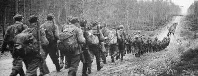 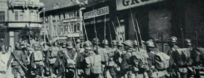 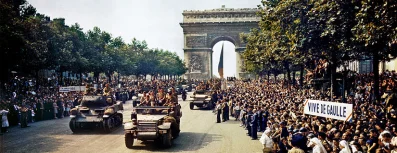 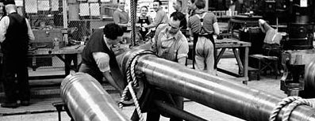

## Generated

| Image | Enlarged | Brief |
|---|---|---|
| 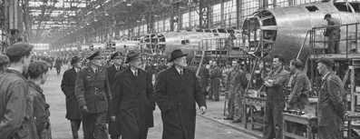 |  | Dignitaries in overcoats walk through a vast assembly hall lined with bare-metal aircraft fuselages, workers pausing to watch, proud and orderly. Build 0.3.3, 397x153. |
| 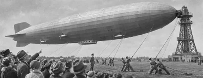 |  | A huge passenger airship moors at a tall mast above a grass field, ground crew holding ropes, a crowd of onlookers in hats pointing upward. Build 0.3.3, 397x153. |
| 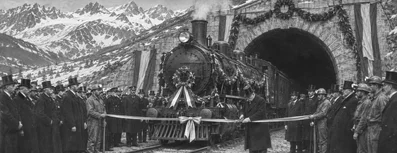 |  | A decorated locomotive waits before a ribbon stretched across the mouth of a new alpine tunnel, officials in top hats and miners with lamps gathered, snow peaks behind; soft flat matte paint look. Build 0.3.3, 397x153. |
| 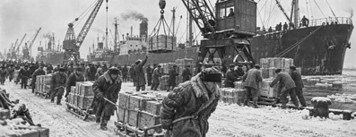 |  | Cranes unload crates from freighters at a snowy Arctic port, lines of dockers in furs hauling sledges, grey ships lined along the ice-rimmed quay. Build 0.3.3, 397x153. |
| 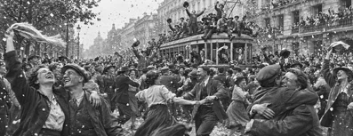 |  | Jubilant crowds dance on a boulevard waving hats and scarves, strangers embracing, confetti drifting, a halted tram covered in cheering people. Build 0.3.3, 397x153. |
| 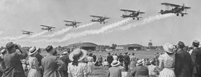 |  | Spectators in hats and summer dresses look skyward as a formation of biplane fighters trails smoke over a grass airfield with hangars, festive and bright. Build 0.3.3, 397x153. |
| 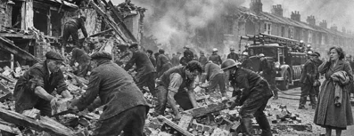 |  | Rescue workers and civilians clear rubble from a collapsed row of terraced houses, a fire engine at the kerb, smoke drifting, a dazed woman in a coat standing aside. Build 0.3.3, 397x153. |
| 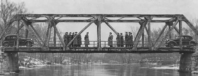 |  | Two groups of officers in different greatcoats face each other at the middle of a steel river bridge, a car at each end, bare winter trees, tense stillness. Sub-family: war. Build 0.3.3, 397x153. |
| 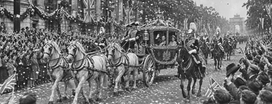 |  | Dense crowds line a decorated boulevard as a gilded coach drawn by white horses passes under a cavalry escort, confetti falling, festive. Build 0.3.3, 397x153. |
| 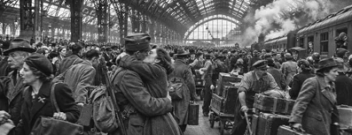 |  | A huge crowd of travellers with suitcases fills a station under an iron-and-glass roof, steam clouds drifting, porters pushing trolleys, a soldier embracing his sweetheart, tense bustle. Build 0.3.1, 397x153. |
| 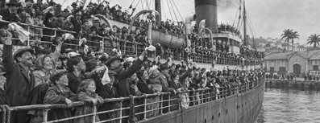 |  | Thousands of emigrants crowd the decks and rails of a steamer arriving at a South American port with palms and warehouses, handkerchiefs waving, hopeful. Build 0.3.3, 397x153. |
| 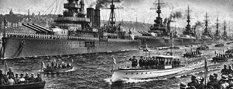 |  | A line of grey battleships at anchor is reviewed by a white yacht carrying officials, sailors manning the rails, small spectator boats crowding the bay; bold two-colour carved print. Build 0.3.3, 397x153. |
| 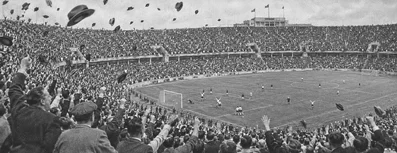 |  | Tens of thousands in a concrete bowl stadium throw hats into the air as a goal is scored, players tiny on the pitch, festive wide shot. Build 0.3.3, 397x153. |
| 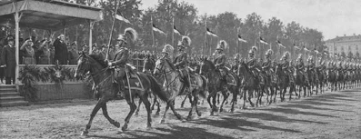 |  | A regiment of mounted lancers with plumed helmets passes a reviewing stand across a parade ground, long afternoon shadows, officers saluting. Build 0.3.3, 397x153. |
| 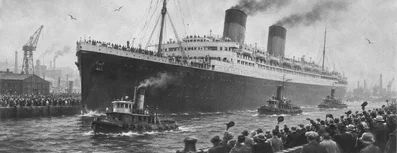 |  | A great ocean liner with twin funnels towers over small tugboats at a busy British quay, dock crowds waving hats, gulls overhead; soft flat matte paint look. Build 0.3.3, 397x153. |
| 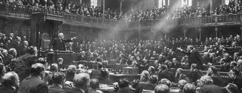 |  | A packed debating chamber with tiered benches of men in suits, a speaker on a raised chair, a crowded gallery above, shafts of dusty light, tense argument. Sub-family: politics. Build 0.3.3, 397x153. |
| 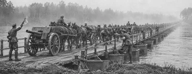 |  | Columns of infantry and horse-drawn guns cross a long pontoon bridge over a wide river in morning mist while engineers wave them on. Build 0.3.3, 397x153. |
| 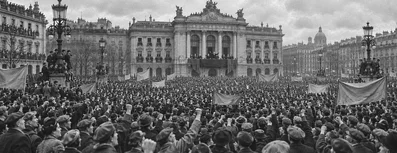 |  | Tens of thousands fill a vast city square before a balcony stage, fists raised, plain cloth banners, rooftops and lamp posts crowded with onlookers, wide panorama. Sub-family: politics. Build 0.3.3, 397x153. |
| 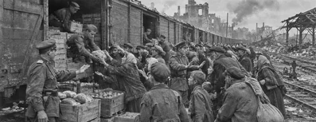 |  | A long relief train arrives in a ruined rail yard as hungry townspeople surge toward unloaded food crates, soldiers keeping order, grey postwar morning. Build 0.3.3, 397x153. |
| 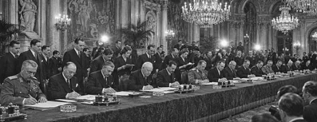 |  | Delegates in dark suits and uniforms sit at a long table in a chandeliered hall, pens above documents, secretaries standing behind, flashbulbs flaring, solemn wide view. Build 0.3.1, 397x153. |
| 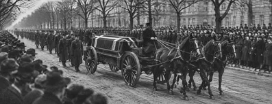 |  | A horse-drawn gun carriage bearing a coffin draped in a fictional flag passes silent crowds of mourners in black along a wide leafless boulevard. Build 0.3.3, 397x153. |
| 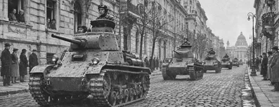 |  | A column of light tanks rolls down a cobbled avenue of a capital while civilians watch silently from windows and balconies, tense wide street view. Build 0.3.3, 397x153. |
| 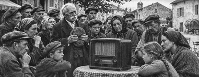 |  | Families and farmers gather around a large radio set on a cafe table in a village square, listening gravely, an old man removing his cap. Build 0.3.3, 397x153. |
