# officer_corps_spirit

Every image here was made by `hoi4-imagegen` on the ChatGPT login, processed, validated and checked against the game's own art by the tool's vanilla-match check. Nothing is retouched. Only images from version 0.3 or later that pass both checks are shown. The gallery grows as more runs finish.

## Vanilla references

From *Hearts of Iron IV* by Paradox Interactive, shown at native size for comparison.

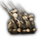  

## Generated

| Image | Enlarged | Brief |
|---|---|---|
| 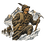 | 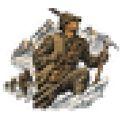 | An Italian mountain officer with ice axe and rope on a high glacier, a line of troops behind him against bright peaks. Bold two-colour carved print. Build 0.3.1, 45x45. |
| 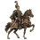 |  | A Hungarian hussar officer in a braided jacket and plumed shako on a prancing horse, festive and proud cavalry pageantry. Build 0.3.1, 45x45. |
|  | 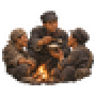 | A young Chinese officer sharing a bowl of rice with his soldiers around a night campfire, warm comradeship and humble mood. Build 0.3.1, 45x45. |
| 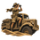 | 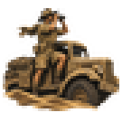 | An Australian officer on the running board of a sand-coloured truck in tall dunes, scanning the horizon with binoculars, daring long-range raid. Build 0.3.1, 45x45. |
|  | 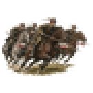 | Polish cavalry officers at full gallop with lances lowered across a meadow, pennants streaming, bold and spirited mood of attack. Build 0.3.1, 45x45. |
|  | 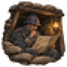 | A calm French officer studying a trench map by lantern light in a deep dugout, sandbags around him, careful defensive caution. Build 0.3.1, 45x45. |
|  | 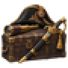 | A naval officer's dress sword, brass telescope and bicorne hat resting on a sea chest, soft window light, gentlemanly tradition. Build 0.3.1, 45x45. |
| 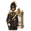 | 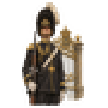 | A ceremonial Swedish palace guard officer in a plumed helmet and white gloves standing at a gilded gate, calm formal dignity. Build 0.3.1, 45x45. |
| 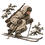 | 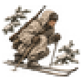 | A Finnish officer in white snow camouflage on skis gliding silently between frosted pines, rifle slung, still and watchful. Grainy ink and sepia sketch look. Build 0.3.1, 45x45. |
| 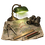 | 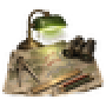 | A staff officer's tidy desk with a large map, dividers, ruler, pencils and binoculars under a green lamp, quiet professionalism. Build 0.3.1, 45x45. |
| 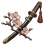 | 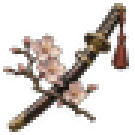 | A sheathed Japanese officer's sword with a tasselled hilt resting beside a flowering cherry branch, quiet mood of honour. Build 0.3.1, 45x45. |
|  | 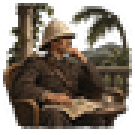 | A British colonial officer in a pith helmet seated on a shaded veranda with a map and tea, tropical garden and distant hills. Build 0.3.1, 45x45. |
