# operation_icon

Every image here was made by `hoi4-imagegen` on the ChatGPT login, processed, validated and checked against the game's own art by the tool's vanilla-match check. Nothing is retouched. Only images from version 0.3 or later that pass both checks are shown. The gallery grows as more runs finish.

## Vanilla references

From *Hearts of Iron IV* by Paradox Interactive, shown at native size for comparison.

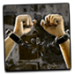 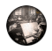 

## Generated

| Image | Enlarged | Brief |
|---|---|---|
| 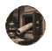 | 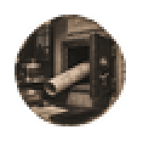 | A rolled blueprint tube half pulled from an open wall safe, bold carved two-colour linocut look, quiet theft at night. Build 0.3.2, 59x58. |
| 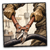 | 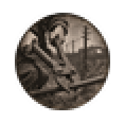 | A pair of long bolt cutters about to snip a thick cable, sabotage tool in strong lighting. Build 0.3.2, 59x58. |
| 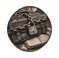 | 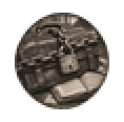 | A leather briefcase locked with a heavy chain and padlock, secret codebook theft, dramatic shadows. Build 0.3.2, 59x58. |
|  | 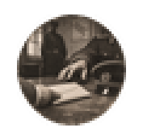 | A thick envelope sliding across a table toward an officer's peaked cap, the bribe of a Balkan officer, tense mood. Build 0.3.2, 59x58. |
|  | 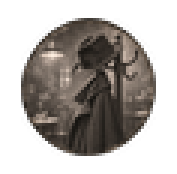 | A lone fedora hat resting on top of a coat with a raised collar hung on a rack, recruiting an informant in a smoky cafe. Build 0.3.2, 59x58. |
| 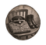 | 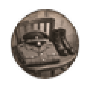 | A neatly folded officer uniform tunic with a cap and polished boots on a wooden chair, disguise prepared for infiltration. Build 0.3.3, 59x58. |
| 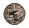 | 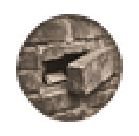 | A loose brick pulled from an old Prague wall revealing a folded paper note behind it, dead drop, grainy sepia ink sketch. Build 0.3.2, 59x58. |
| 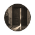 | 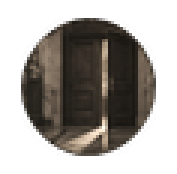 | A heavy oak ministry door standing slightly ajar with warm light spilling through the crack onto a marble floor. Build 0.3.2, 59x58. |
| 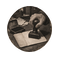 | 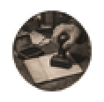 | A rubber stamp pressed onto a blank travel pass, ink pad beside it, forged papers made in a back room. Build 0.3.2, 59x58. |
| 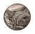 | 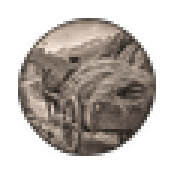 | A farm cart loaded with hay and rifle barrels poking out the side, weapons smuggled across a Spanish mountain border. Build 0.3.2, 59x58. |
| 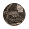 |  | An open suitcase containing a compact clandestine radio transmitter with dials and a short wire antenna, resistance in occupied Norway. Build 0.3.2, 59x58. |
| 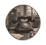 | 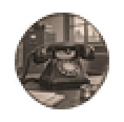 | A black desk telephone with a tiny microphone attached under the handset, with coiled cable, planted bug in a Berlin-style office but fictional. Build 0.3.2, 59x58. |
