# operation_picture

Every image here was made by `hoi4-imagegen` on the ChatGPT login, processed, validated and checked against the game's own art by the tool's vanilla-match check. Nothing is retouched. Only images from version 0.3 or later that pass both checks are shown. The gallery grows as more runs finish.

## Vanilla references

From *Hearts of Iron IV* by Paradox Interactive, shown at native size for comparison.

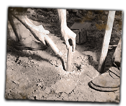 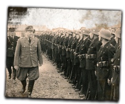 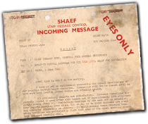

## Generated

| Image | Enlarged | Brief |
|---|---|---|
| 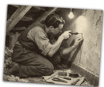 |  | A technician in an attic drills into plaster to place a hidden microphone wire, tools laid neatly on a cloth, a single bare bulb overhead. Build 0.3.3, 210x176. |
| 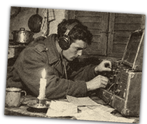 |  | A radio operator with headphones hunches over a suitcase transmitter on a kitchen table lit by one candle, shutters closed, paper code sheets scattered. Build 0.3.3, 210x176. |
| 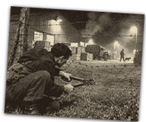 |  | A figure in dark clothes cuts through a wire fence beside a floodlit depot at night while a guard with a dog patrols far behind. Build 0.3.3, 210x176. |
| 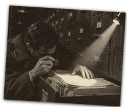 |  | A spy photographs documents with a tiny camera in a darkened filing room, a single flashlight beam crossing rows of metal cabinets. Build 0.3.3, 210x176. |
| 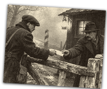 |  | Two men exchange an envelope across a rickety wooden barrier at a lonely border crossing in fog, lantern glow, a guard hut dark behind them. Build 0.3.3, 210x176. |
| 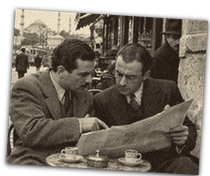 |  | Two men share a newspaper over small coffee cups at a corner cafe table in Istanbul while a third man watches from behind a pillar. Build 0.3.3, 210x176. |
| 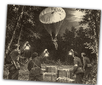 |  | A parachutist descends over a moonlit forest clearing while resistance fighters below wave shaded lanterns beside waiting crates. Build 0.3.3, 210x176. |
| 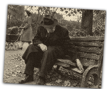 |  | An elderly man on a park bench slips a folded newspaper under the slats at dusk among autumn leaves while a woman with a pram strolls past unaware; grainy ink and sepia look. Build 0.3.3, 210x176. |
| 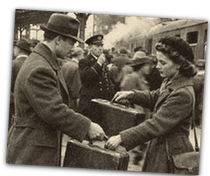 |  | A man and a woman swap identical suitcases on a steam-filled platform while the crowd blurs around them and a conductor raises his whistle; soft flat matte paint look. Build 0.3.3, 210x176. |
| 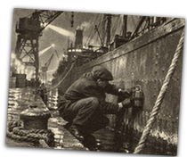 |  | A dark figure fixes a charge to a cargo ship hull at a night quay while searchlights sweep and crane silhouettes loom overhead. Build 0.3.3, 210x176. |
| 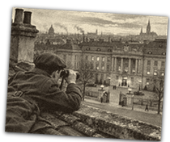 |  | An agent lies on a rooftop at dusk with binoculars, watching the courtyard of a ministry across a European city of chimneys and church spires. Build 0.3.3, 210x176. |
| 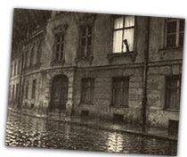 |  | A lit upstairs window with the curtain slightly parted, a silhouette peering out at an empty rainy street below, wet cobblestones gleaming. Build 0.3.3, 210x176. |
