# personal_trait

Every image here was made by `hoi4-imagegen` on the ChatGPT login, processed, validated and checked against the game's own art by the tool's vanilla-match check. Nothing is retouched. Only images from version 0.3 or later that pass both checks are shown. The gallery grows as more runs finish.

## Vanilla references

From *Hearts of Iron IV* by Paradox Interactive, shown at native size for comparison.

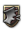   

## Generated

| Image | Enlarged | Brief |
|---|---|---|
| 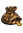 |  | A single fat coin purse tied at the neck with a few coins spilling out, a corrupt leader, soft flat gouache look. Sub-family: politics. Build 0.3.3, 23x33. |
|  | 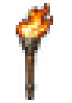 | A single burning torch with a bright flame held upright, an inspirational leader, bold simple shape. Sub-family: politics. Build 0.3.3, 23x33. |
|  | 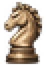 | A single chess knight piece with a carved horse head, brilliant strategist, bold simple shape, grainy sepia ink sketch. Build 0.3.3, 23x33. |
|  | 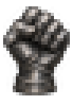 | A single clenched armoured gauntlet fist raised upright, steel plates catching the light, an unbreakable iron will, bold simple shape. Build 0.3.1, 23x33. |
| 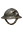 | 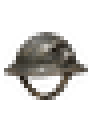 | A single steel helmet with a deep dent and scuffed paint on one side, a war hero who survived the trenches. Sub-family: war. Build 0.3.3, 23x33. |
| 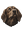 | 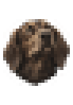 | The head of a loyal hound with floppy ears looking upward, devoted follower, bold simple shape. Build 0.3.3, 23x33. |
| 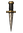 | 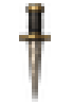 | A single narrow dagger with a plain black grip pointed downward, a ruthless leader, bold simple shape. Sub-family: politics. Build 0.3.3, 23x33. |
|  | 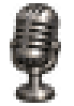 | A single gleaming silver vintage microphone on a short stand, silver-tongued orator, bold simple shape. Build 0.3.1, 23x33. |
| 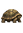 | 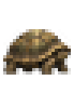 | A single tortoise seen from the side with a domed patterned shell, a cautious leader, simple shape. Sub-family: politics. Build 0.3.3, 23x33. |
| 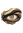 | 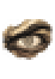 | A single wide staring eye with small sharp pupil, a paranoid leader who trusts nobody, bold simple shape. Sub-family: politics. Build 0.3.3, 23x33. |
