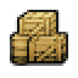
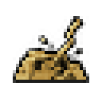
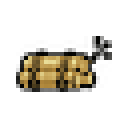
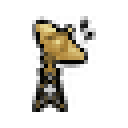
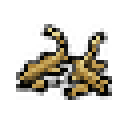

# raid

Every image here was made by `hoi4-imagegen` on the ChatGPT login, processed, validated and checked against the game's own art by the tool's vanilla-match check. Nothing is retouched. Only images from version 0.3 or later that pass both checks are shown. The gallery grows as more runs finish.

## Vanilla references

From *Hearts of Iron IV* by Paradox Interactive, shown at native size for comparison.

  

## Generated

| Image | Enlarged | Brief |
|---|---|---|
|  |  | A neat pyramid of artillery shells stacked behind sandbags with a thin trail of smoke curling from the top, grainy sepia ink sketch of an Italian depot. Build 0.3.2, 32x32. |
|  |  | A single parked biplane fighter on a grass airstrip with flames licking its wings, raid on a Philippine airfield at night. Build 0.3.3, 32x32. |
|  |  | A stack of wooden supply crates and fuel drums engulfed in towering flames, a supply dump hit in the Burmese jungle at night. Build 0.3.2, 32x32. |
|  |  | A coastal artillery gun in its concrete emplacement blasted apart, barrel bent skyward amid smoke and flying debris, raid on a Dutch dune battery. Build 0.3.2, 32x32. |
|  |  | A wooden telegraph pole with severed wires hanging and swaying, snapped insulators, lonely road in the Ethiopian highlands. Build 0.3.2, 32x32. |
|  |  | A bundle of dynamite sticks tied with rope and a short lit fuse sparking, set against a dark Greek hillside rail cutting. Build 0.3.2, 32x32. |
|  |  | A single parachute canopy drifting down through a dark Cretan sky carrying a small supply container, calm before the raid. Build 0.3.2, 32x32. |
|  |  | A rotating radar dish on a lattice tower atop a windswept Scottish hilltop, tilted and sparking after an attack. Build 0.3.2, 32x32. |
|  |  | A tall harbour crane toppling sideways over a burning ship hull at a quayside, port raid in a French fishing town. Build 0.3.2, 32x32. |
|  |  | A section of railway track bent and twisted upward like ribbons, splintered sleepers scattered around, a cut line across the Russian steppe. Build 0.3.2, 32x32. |
