# report_event

Every image here was made by `hoi4-imagegen` on the ChatGPT login, processed, validated and checked against the game's own art by the tool's vanilla-match check. Nothing is retouched. Only images from version 0.3 or later that pass both checks are shown. The gallery grows as more runs finish.

## Vanilla references

From *Hearts of Iron IV* by Paradox Interactive, shown at native size for comparison.

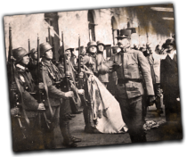 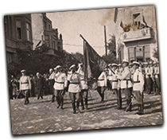 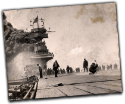 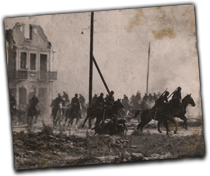

## Generated

| Image | Enlarged | Brief |
|---|---|---|
| 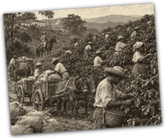 |  | Pickers in straw hats strip coffee cherries on a steep Brazilian hillside plantation, sacks piled beside mule carts, an overseer on horseback watching, warm hazy afternoon. Build 0.3.1, 210x176. |
| 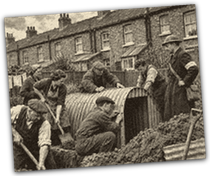 |  | Neighbours of a terraced British street dig a corrugated shelter into a back garden while a warden in a tin helmet watches, determined, cloudy 1939; soft flat matte paint look. Build 0.3.3, 210x176. |
| 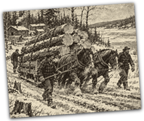 |  | Canadian lumberjacks in plaid jackets guide a horse team hauling huge logs along a snowy track to a frozen river, breath steaming, camp cabins behind; grainy ink and sepia look. Build 0.3.3, 210x176. |
| 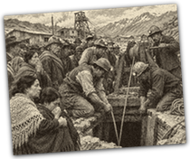 |  | Chilean miners with lamps gather at an Andean mine entrance while rescuers lower ropes, wives in shawls clutching each other, anxious grey afternoon. Build 0.3.3, 210x176. |
| 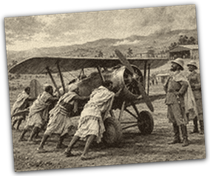 |  | Ethiopian ground crew in white cotton shawls push a small biplane across a dusty highland airstrip while officers in pith helmets watch, hopeful early morning light. Build 0.3.3, 210x176. |
| 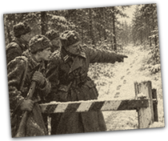 |  | Finnish border guards in snow-dusted greatcoats pause at a striped barrier gate in a pine forest, one pointing at distant footprints while a young conscript grips his rifle, tense winter morning. Build 0.3.1, 210x176. |
| 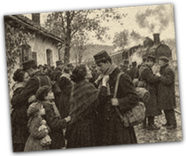 |  | French reservists in greatcoats say farewell to families on a small rural station platform, a mother tying a scarf round her son's neck, steam locomotive waiting, bittersweet autumn. Build 0.3.3, 210x176. |
| 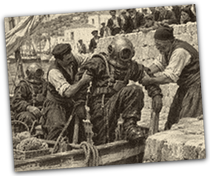 |  | Greek sponge divers in bulky canvas suits and brass helmets are helped aboard a caique boat while villagers watch from a sunlit stone harbour wall. Build 0.3.3, 210x176. |
| 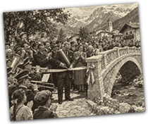 |  | Villagers and a mayor wearing a sash cut a ribbon on a new stone arch bridge over an alpine stream, brass band mid-note, children on shoulders, festive 1930s day. Build 0.3.3, 210x176. |
| 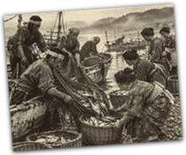 |  | Japanese fishermen haul nets and baskets from wooden boats onto a pebbled beach at dawn, wives in kimonos waiting at the waterline, mist over the bay, quiet mood. Build 0.3.3, 210x176. |
| 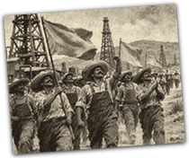 |  | Mexican oil workers in overalls and wide hats march down a dirt road beside tall wooden derricks carrying plain cloth banners, determined and festive. Build 0.3.3, 210x176. |
| 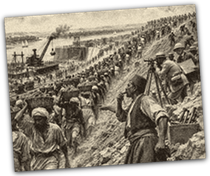 |  | Hundreds of Egyptian labourers carry baskets of earth up an embankment at a Nile dam site while a foreman blows a whistle and engineers set up a theodolite, bright sun. Build 0.3.3, 210x176. |
| 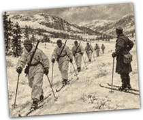 |  | Norwegian ski soldiers in white overgarments glide in single file across a snowy valley, rifles slung, an instructor on skis watching, quiet and cold. Sub-family: war. Build 0.3.3, 210x176. |
| 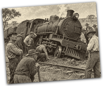 |  | Australian railwaymen and passing farmers gather around a steam locomotive tilted off the track in red outback dust, steam still rising, stunned and grim faces. Build 0.3.3, 210x176. |
| 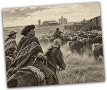 |  | Argentine gauchos on horseback drive cattle across the pampas toward a railway loading pen, dust cloud rising, grain silos and a wooden station on the horizon, quiet golden light. Build 0.3.3, 210x176. |
| 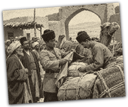 |  | Persian customs officials in tall lambskin hats inspect a camel caravan at a mud-brick checkpoint in the desert, merchants with bundles waiting patiently in dry heat. Build 0.3.3, 210x176. |
| 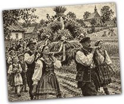 |  | Polish villagers in folk costume carry an enormous wreath of wheat sheaves down a dirt road, children trailing behind, a wooden church in the distance, festive late summer; grainy ink and sepia look. Build 0.3.3, 210x176. |
| 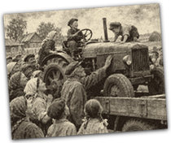 |  | Collective farm villagers in headscarves and caps crowd around the first tractor delivered on a flatbed truck, an old farmer touching it warily, children climbing aboard, hopeful. Build 0.3.3, 210x176. |
| 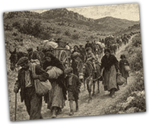 |  | A long column of weary villagers with mule carts and bundles trudges along a dry Spanish mountain road, a small child riding a donkey, dusty grim late afternoon. Build 0.3.3, 210x176. |
| 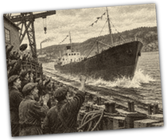 |  | Shipyard workers in flat caps cheer as a freshly built coastal freighter slides down a greased slipway into a grey Swedish fjord, pennants fluttering, triumphant mood. Build 0.3.3, 210x176. |
| 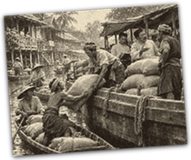 |  | Thai farmers in narrow wooden boats load rice sacks onto a larger barge along a canal lined with stilt houses, merchants bargaining, bright humid morning. Build 0.3.3, 210x176. |
| 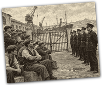 |  | Turkish dockworkers in caps and waistcoats sit on crates across a quayside gate with folded arms, a line of policemen facing them, idle cranes behind, tense standoff. Build 0.3.3, 210x176. |
| 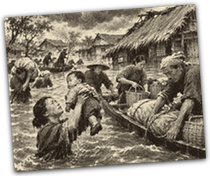 |  | Chinese villagers wade through brown floodwater loading belongings onto flat boats, a mother lifting a child high, thatched roofs half-submerged, grim overcast day. Build 0.3.3, 210x176. |
| 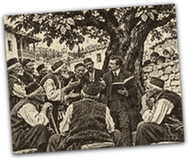 |  | Elders in wool vests and embroidered caps debate beneath a walnut tree in a Balkan village square, a teacher holding a ledger, children peeking from behind a wall; bold two-colour carved print. Sub-family: politics. Build 0.3.3, 210x176. |
