# special_project_icon

Every image here was made by `hoi4-imagegen` on the ChatGPT login, processed, validated and checked against the game's own art by the tool's vanilla-match check. Nothing is retouched. Only images from version 0.3 or later that pass both checks are shown. The gallery grows as more runs finish.

## Vanilla references

From *Hearts of Iron IV* by Paradox Interactive, shown at native size for comparison.

  

## Generated

| Image | Enlarged | Brief |
|---|---|---|
|  |  | A half-built aircraft carrier on a Japanese shipyard slipway wrapped in scaffolding and cranes, flat deck stretching into morning mist, tiny workers below, proud mood. Build 0.3.2, 161x98. |
|  |  | A room-sized electromechanical code-breaking machine of rotating drums and tangled wiring in a Polish villa cellar, young women operators tending it, tense hushed mood. Build 0.3.2, 161x98. |
|  |  | A huge circular magnet cyclotron in a university basement, scientists in white coats gathered around it, eerie blue glow, tense secretive mood in the early forties. Build 0.3.2, 161x98. |
|  |  | A convoy of canvas-tented mobile field hospital trucks in a Chinese mountain valley, nurses carrying stretchers, hopeful mood, plain white tents without any emblems. Build 0.3.2, 161x98. |
|  |  | A turbojet engine on a test stand in a hangar Build 0.3.2, 161x98. |
|  |  | A prototype flat-bottomed landing craft with its bow ramp lowered on an Australian beach, trucks driving out through surf spray, bright triumphant mood. Build 0.3.2, 161x98. |
|  |  | A four-engined long-range bomber flying alone over a vast empty ocean at sunset, polished silver wings catching the last light, determined and solitary mood. Build 0.3.2, 161x98. |
|  |  | A chain of tall lattice radar masts along white chalk cliffs of southern England with the sea beyond, bold carved two-colour linocut shapes, quiet vigilant mood. Build 0.3.2, 161x98. |
|  |  | A slender liquid-fuel rocket standing on a steel launch gantry in a pale Kazakh steppe at dawn, tiny engineers at its base, hopeful and quietly ambitious mood. Build 0.3.2, 161x98. |
|  |  | A new semi-automatic rifle lying on a Finnish drafting table beside blueprints and calipers, snowy window behind, grainy sepia ink sketch with careful cross-hatching. Build 0.3.3, 161x98. |
|  |  | An enormous prototype super-heavy tank with twin turrets rolling out of a Czech factory hall, workers dwarfed beside its tracks, grim and awestruck mood. Build 0.3.2, 161x98. |
|  |  | A sprawling synthetic fuel refinery of tall pipes and cracking towers in a Romanian valley at dusk, orange flames flaring from stacks, heavy industrial mood. Build 0.3.2, 161x98. |
