# state_modifier

Every image here was made by `hoi4-imagegen` on the ChatGPT login, processed, validated and checked against the game's own art by the tool's vanilla-match check. Nothing is retouched. Only images from version 0.3 or later that pass both checks are shown. The gallery grows as more runs finish.

## Vanilla references

From *Hearts of Iron IV* by Paradox Interactive, shown at native size for comparison.

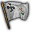   

## Generated

| Image | Enlarged | Brief |
|---|---|---|
|  | 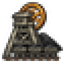 | A coal mine headframe with a spinning winding wheel and a line of coal tubs on a rail, black slag heap behind. Sub-family: economy. Build 0.3.3, 32x32. |
| 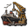 |  | A busy harbour with two dockside cranes, a moored cargo steamer and stacked crates under a gull-filled sky. Bold two-colour carved print. Build 0.3.3, 32x32. |
|  |  | A wet marsh with tall reeds, a flat-bottomed boat and standing pools reflecting a low sky, difficult terrain. Build 0.3.3, 32x32. |
|  | 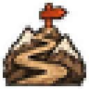 | A narrow winding road climbing through a steep mountain pass between two snowy peaks, a lone signpost at the top. Grainy ink and sepia sketch look. Build 0.3.3, 32x32. |
|  | 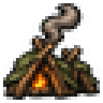 | A hidden camp of branch lean-tos and a thin campfire smoke trail deep in a dark forest, secretive mood. Build 0.3.3, 32x32. |
| 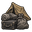 | 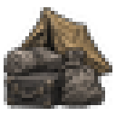 | Rows of canvas tents and bundles of belongings beside a muddy track, a small family walking in under rain. Build 0.3.3, 32x32. |
|  | 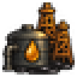 | Several oil derricks and a storage tank standing in desert scrub, a dark pool at the base, abundant resources. Sub-family: economy. Build 0.3.3, 32x32. |
| 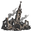 |  | A skyline of broken walls and roofless buildings with a crooked church tower standing against smoke, grim mood. Build 0.3.1, 32x32. |
|  | 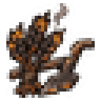 | Burnt wheat fields with blackened stalks, a broken plough and a thin line of smoke curling over a farm, grim mood. Sub-family: economy. Build 0.3.3, 32x32. |
|  | 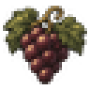 | Green terraced vineyard slopes above a small village and a river bend, ripe grapes on the vines, peaceful abundance. Build 0.3.3, 32x32. |
