# super_event

Every image here was made by `hoi4-imagegen` on the ChatGPT login, processed, validated and checked against the game's own art by the tool's vanilla-match check. Nothing is retouched. Only images from version 0.3 or later that pass both checks are shown. The gallery grows as more runs finish.

## Generated

| Image | Enlarged | Brief |
|---|---|---|
| 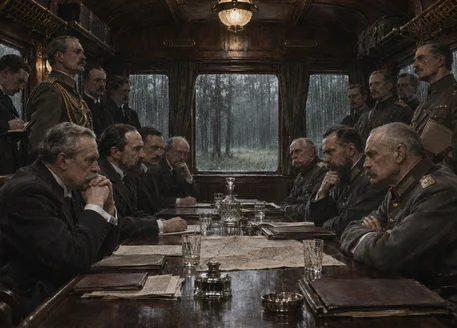 |  | Two delegations face each other across a table inside a wood-panelled railway carriage in a forest clearing, rain streaking the windows, grim and formal, no flags. Build 0.3.1, 457x328. The vanilla-match check does not measure this family. |
| 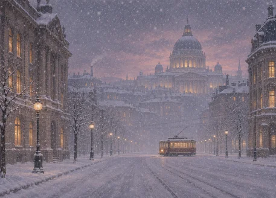 |  | A domed capital skyline under heavy snowfall at dusk, lit windows glowing, a lone tram crossing an empty avenue, quiet and hushed; soft flat matte paint look. Build 0.3.3, 457x328. The vanilla-match check does not measure this family. |
| 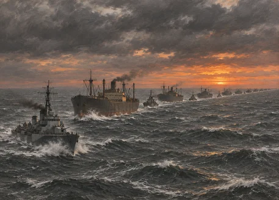 |  | A long line of merchant ships and escort destroyers steams across a grey Atlantic as dawn turns the horizon orange, spray on the bows. Build 0.3.3, 457x328. The vanilla-match check does not measure this family. |
| 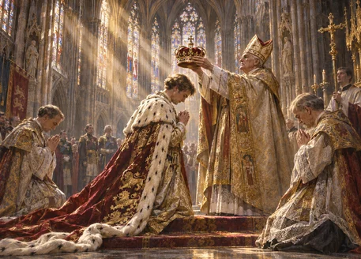 |  | A young monarch in ermine robes kneels to be crowned beneath a soaring gothic cathedral vault, golden light pouring through stained glass onto kneeling clergy. Build 0.3.1, 457x328. The vanilla-match check does not measure this family. |
| 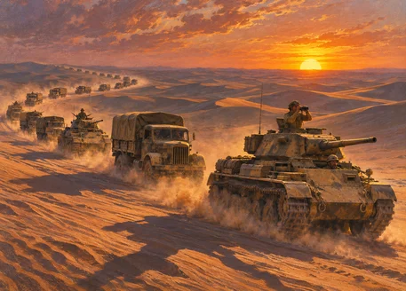 |  | A long column of trucks and tanks crosses a sea of dunes at sunrise, dust plumes streaming and long shadows stretching across the sand. Build 0.3.3, 457x328. The vanilla-match check does not measure this family. |
| 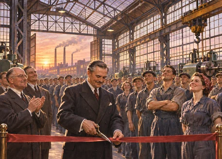 |  | A gleaming new factory hall with rows of workers in clean overalls watches a ribbon being cut, smokestacks behind, hopeful sunrise light. Build 0.3.3, 457x328. The vanilla-match check does not measure this family. |
| 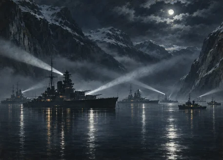 |  | A battle fleet lies at anchor in a fjord at night, searchlight beams crossing the still black water, mountains looming, calm but ominous. Build 0.3.3, 457x328. The vanilla-match check does not measure this family. |
| 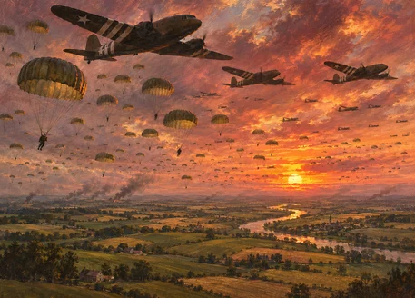 |  | Hundreds of parachutes fill a sunset sky above rolling farmland and a winding river, transport planes dark against the glowing clouds. Build 0.3.3, 457x328. The vanilla-match check does not measure this family. |
| 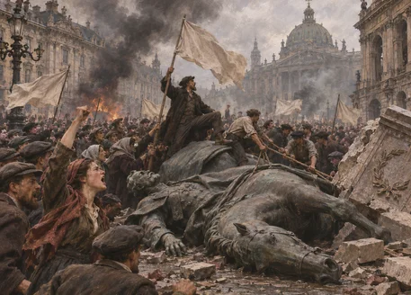 |  | A crowd surges through a city square waving plain cloth banners around a toppled equestrian statue, smoke drifting, tense and chaotic. Build 0.3.3, 457x328. The vanilla-match check does not measure this family. |
| 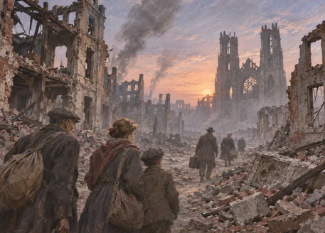 |  | Survivors walk among broken cathedral towers and gutted buildings at dawn, smoke rising in thin columns, a grim but quietly resilient mood. Build 0.3.3, 457x328. The vanilla-match check does not measure this family. |
| 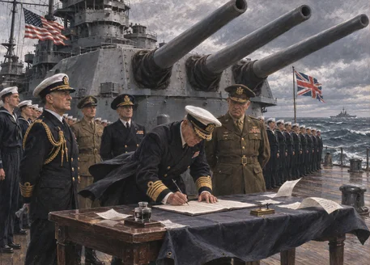 |  | Officers sign a document at a table on a battleship deck beneath a huge gun turret, sailors at attention, sea wind lifting papers. Build 0.3.3, 457x328. The vanilla-match check does not measure this family. |
| 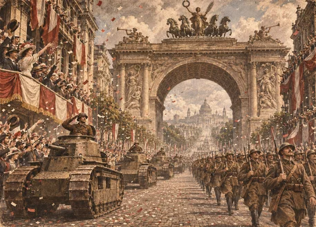 |  | Tanks and marching troops move down a vast avenue under a triumphal arch while confetti falls from crowded balconies; grainy ink and sepia look. Build 0.3.3, 457x328. The vanilla-match check does not measure this family. |
