# technology

Every image here was made by `hoi4-imagegen` on the ChatGPT login, processed, validated and checked against the game's own art by the tool's vanilla-match check. Nothing is retouched. Only images from version 0.3 or later that pass both checks are shown. The gallery grows as more runs finish.

## Vanilla references

From *Hearts of Iron IV* by Paradox Interactive, shown at native size for comparison.

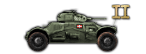 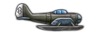 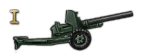

## Generated

| Image | Enlarged | Brief |
|---|---|---|
| 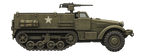 |  | An American armoured half-track personnel carrier with front wheels, rear tracks and a mounted machine gun, shown in side view. Build 0.3.3, 146x54. |
| 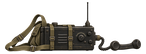 |  | A Polish backpack field radio set with a handset on a curly cord, dials, a whip antenna and canvas straps, shown on its own. Build 0.3.3, 146x54. |
| 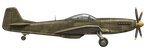 |  | A single-engine American fighter with a bubble canopy and four-blade propeller, shown in three-quarter view with landing gear down. Build 0.3.3, 146x54. |
| 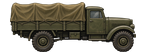 |  | A three-ton cargo truck with a canvas tilt over the bed and rugged tyres, shown in three-quarter view from the front left. Build 0.3.3, 146x54. |
| 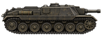 |  | A low boxy German assault gun with a short barrel and no turret, shown from the side with wide tracks and a flat roof. Build 0.3.3, 146x54. |
| 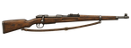 |  | A bolt-action rifle with a polished wooden stock and a leather sling, laid out in clean side view; grainy ink and sepia look. Build 0.3.3, 146x54. |
| 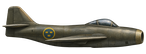 |  | A Swedish early jet fighter of the early 1950s with swept wings and a bubble canopy, shown in three-quarter view with a nose air intake. Build 0.3.3, 146x54. |
| 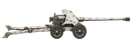 |  | A compact Finnish anti-tank gun with a low shield, long barrel and small wheels, finished in winter white, shown from the side. Build 0.3.3, 146x54. |
| 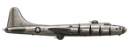 |  | An American four-engine heavy bomber with a polished metal skin, gun turrets and tall tail, shown in side view. Build 0.3.3, 146x54. |
| 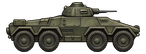 |  | A four-wheeled armoured car with a rounded turret, machine gun and sloped hull plates, shown in side view. Build 0.3.3, 146x54. |
| 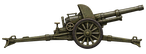 |  | A French field howitzer on a split trail carriage with spoked wheels and a lifted barrel, shown in three-quarter view. Build 0.3.3, 146x54. |
| 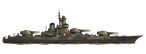 |  | A sleek Italian battleship with three triple turrets, a tall bridge tower and a pointed bow, shown in side profile on calm water. Build 0.3.3, 146x54. |
| 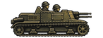 |  | A tiny two-man Italian tankette with a pair of machine guns and a riveted hull, shown from the side; bold two-colour carved print. Build 0.3.3, 146x54. |
| 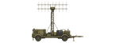 |  | A British mobile radar with a rectangular dipole array on a tall mast mounted on a trailer, shown in three-quarter view. Build 0.3.3, 146x54. |
| 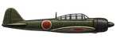 |  | A slender Japanese carrier fighter with radial engine, light rounded wings and a long canopy, shown in side view in flight attitude. Build 0.3.3, 146x54. |
| 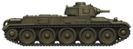 |  | An early British cruiser tank with a riveted hull, small turret and large road wheels, shown in three-quarter view. Build 0.3.3, 146x54. |
| 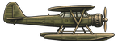 |  | A Norwegian scout floatplane on twin pontoons with a high wing and a radial engine, shown in three-quarter view; bold two-colour carved print. Build 0.3.3, 146x54. |
| 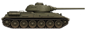 |  | A Soviet medium tank with sloped armour, wide tracks and a long gun, shown in side view, slightly mud-splashed, without markings. Build 0.3.3, 146x54. |
| 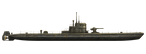 |  | A diesel-electric attack submarine running surfaced with a deck gun, conning tower and narrow hull, shown in side view. Build 0.3.3, 146x54. |
| 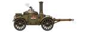 |  | A Hungarian field kitchen on two wheels with a tall chimney, steaming cauldron lid and wooden tow bar, shown in three-quarter view. Build 0.3.3, 146x54. |
| 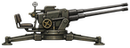 |  | A Swedish twin-barrel anti-aircraft gun on a four-legged firing platform with a raised muzzle and a gunner seat, shown in three-quarter view. Build 0.3.3, 146x54. |
| 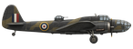 |  | A British twin-engine medium bomber with a glazed nose and wide wings, shown in three-quarter view on its landing gear. Build 0.3.3, 146x54. |
| 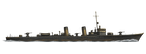 |  | A long slim destroyer with two funnels, single gun mounts and a raked bow, shown in side view as if cutting through a calm sea; soft flat matte paint look. Build 0.3.3, 146x54. |
| 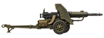 |  | A water-cooled heavy machine gun on a wheeled mount with a shield and a fabric ammunition belt, shown in side view. Build 0.3.3, 146x54. |
